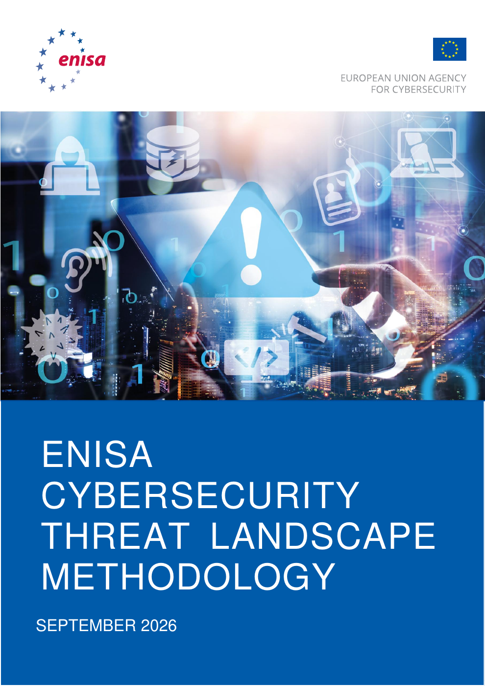
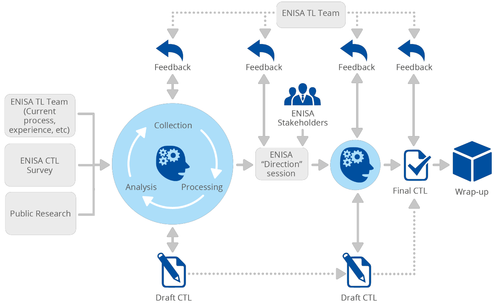
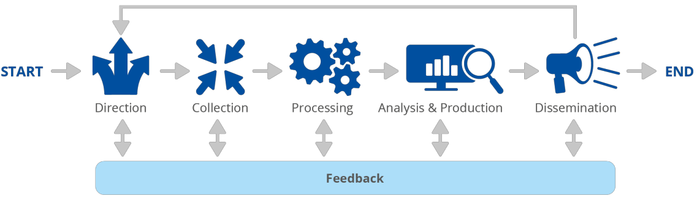
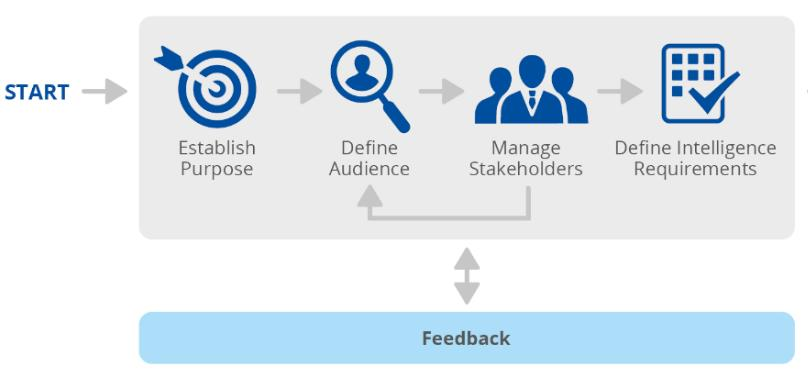
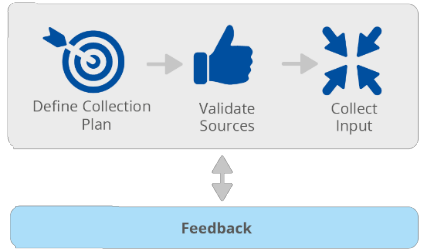
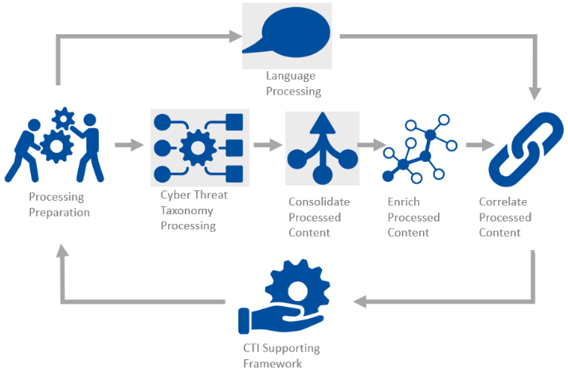
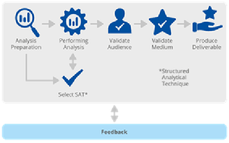
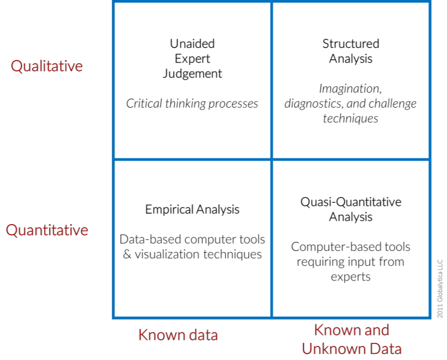
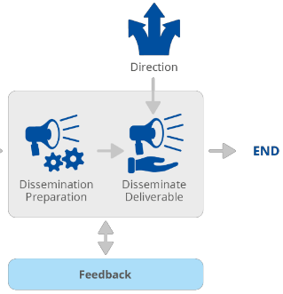
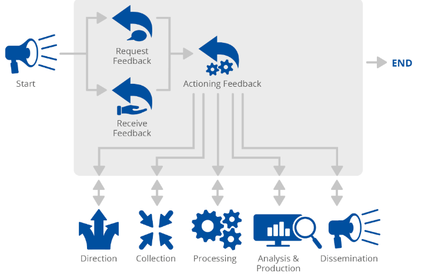

# enisa-cybersecurity-threat-landscape-methodology

ENISA CYBERSECURITY THREAT LANDSCAPE METHODOLOGY

SEPTEMBER 2026

## conversion-notes

Source: European Union Agency for Cybersecurity (ENISA), *ENISA Cybersecurity Threat Landscape Methodology*, September 2026, supplied PDF named “ENISA CTL Methodology_Updated 18 september 2026.pdf”; ISBN 978-92-9204-719-1, DOI [10.2824/1888892](https://doi.org/10.2824/1888892). Source SHA-256: f5a26e3ffe0df502405ee2ab76bca356ff5051c8cd15661dc025683acc060bb9.

Attribution: © European Union Agency for Cybersecurity (ENISA), 2026. Reused under [Creative Commons Attribution 4.0 International (CC BY 4.0)](https://creativecommons.org/licenses/by/4.0/), subject to the source copyright notice below.

Conversion changes: locally extracted text from all 17 PDF pages has been reflowed into Markdown; running headers, repeated September 2026 date headers, page numbers (0–15) and page breaks are omitted. Source heading labels are represented by kebab-case headings for portable links; the complete linked contents below retains the section numbering and adds the source subsection 2.3.2.1 and unnumbered textual/machine-readable format headings omitted from the printed contents. Figure/table navigation lists are added. Both source captions labelled “Figure 4” are deliberately preserved without renumbering. Tables are represented as Markdown tables; numbered notes are collected at the end with links from the text and return links to their containing section. Full-page cover/back-cover renders and individual figures accompany the text in their source positions; the cover and back cover contain decorative graphics. Wording, grammatical errors, inconsistent dates (including references to 2025), punctuation and source reference details are retained, not silently corrected. This is a format conversion, not an ENISA revision, endorsement or new analytical assessment. The back-cover office details, which are not exposed by the PDF text layer, have been transcribed from the visible page. Figure soft masks are composited on white to match the PDF paper and keep labels readable in light and dark repository themes. No external upload was used.

Companion Patchwork authoring resources (not part of the ENISA source): [annual report template](../../Report-Templates/annual-threat-landscape.md), [extracted annual-report schema](enisa-threat-landscape-2026-schema.md), and [methodology alignment decisions](../../ENISA-Alignment.md).

## table-of-contents

- [ABOUT ENISA](#about-enisa)
- [CONTACT](#contact)
- [AUTHORS](#authors)
- [LEGAL NOTICE](#legal-notice)
- [COPYRIGHT NOTICE](#copyright-notice)
- [1. INTRODUCTION](#1-introduction)
  - [1.1 CTL SCOPE AND DRIVING PRINCIPLES](#11-ctl-scope-and-driving-principles)
- [2. CTL METHODOLOGY](#2-ctl-methodology)
  - [2.1 OVERVIEW OF THE METHODOLOGICAL APPROACH](#21-overview-of-the-methodological-approach)
  - [2.2 DIRECTION](#22-direction)
    - [2.2.1 Establish CTL Purpose](#221-establish-ctl-purpose)
    - [2.2.2 Define Audience](#222-define-audience)
    - [2.2.3 Define Intelligence Requirements](#223-define-intelligence-requirements)
  - [2.3 COLLECTION](#23-collection)
    - [2.3.1 Define collection plan](#231-define-collection-plan)
    - [2.3.2 Validate Sources](#232-validate-sources)
      - [2.3.2.1 Source confidence level](#2321-source-confidence-level)
    - [2.3.3 Input data collection](#233-input-data-collection)
  - [2.4 PROCESSING](#24-processing)
    - [2.4.1 Preparation for processing](#241-preparation-for-processing)
    - [2.4.2 Language processing](#242-language-processing)
    - [2.4.3 Cyber threat taxonomy](#243-cyber-threat-taxonomy)
    - [2.4.4 CTI frameworks](#244-cti-frameworks)
    - [2.4.5 Consolidate processed content](#245-consolidate-processed-content)
    - [2.4.6 Correlate and enrich processed content](#246-correlate-and-enrich-processed-content)
    - [2.4.7 Use of AI supported tools](#247-use-of-ai-supported-tools)
  - [2.5 ANALYSIS & PRODUCTION](#25-analysis-and-production)
    - [2.5.1 Analysis preparation](#251-analysis-preparation)
    - [2.5.2 Performing analysis](#252-performing-analysis)
    - [2.5.3 Validate CTL](#253-validate-ctl)
    - [2.5.4 Validate dissemination medium](#254-validate-dissemination-medium)
      - [Textual formats](#textual-formats)
      - [Machine-readable formats](#machine-readable-formats)
    - [2.5.5 Deliverable production](#255-deliverable-production)
  - [2.6 DISSEMINATION](#26-dissemination)
    - [2.6.1 Prepare dissemination](#261-prepare-dissemination)
    - [2.6.2 Disseminate CTL deliverable](#262-disseminate-ctl-deliverable)
    - [2.6.3 Post-publication updates](#263-post-publication-updates)
  - [2.7 FEEDBACK](#27-feedback)
    - [2.7.1 Receiving feedback](#271-receiving-feedback)
    - [2.7.2 Actioning feedback](#272-actioning-feedback)
- [3. FUTURE WORK](#3-future-work)
  - [3.1 MOVING TOWARDS AUTOMATED INFORMATION PROCESSING](#31-moving-towards-automated-information-processing)
- [Back cover](#back-cover)
  - [ABOUT ENISA](#about-enisa-back-cover)
- [Numbered notes](#numbered-notes)

## list-of-figures

- [Figure 1: High level overview of ENISA CTL methodology](#figure-1-high-level-overview-of-enisa-ctl-methodology)
- [Figure 2: Overview of ENISA CTL production process](#figure-2-overview-of-enisa-ctl-production-process)
- [Figure 3: CTL direction definition process](#figure-3-ctl-direction-definition-process)
- [Figure 4: CTL data collection process](#figure-4-ctl-data-collection-process)
- [Figure 4: CTL data processing process](#figure-4-ctl-data-processing-process)
- [Figure 5: CTL data analysis and production process](#figure-5-ctl-data-analysis-and-production-process)
- [Figure 6: Analysis approaches](#figure-6-analysis-approaches)
- [Figure 7: CTL dissemination process](#figure-7-ctl-dissemination-process)
- [Figure 8: CTL feedback collection process](#figure-8-ctl-feedback-collection-process)

## list-of-tables

- [Table 1: Example of defining data collection requirements](#table-1-example-of-defining-data-collection-requirements)
- [Table 2: TAS indicative intelligence collection plan](#table-2-tas-indicative-intelligence-collection-plan)
- [Source confidence table (unnumbered)](#source-confidence-table)

## about-enisa

The European Union Agency for Cybersecurity, ENISA, is the Union’s agency dedicated to achieving a high common level of cybersecurity across Europe. Established in 2004 and strengthened by the EU Cybersecurity Act, the European Union Agency for Cybersecurity contributes to EU cyber policy, enhances the trustworthiness of ICT products, services and processes with cybersecurity certification schemes, cooperates with Member States and EU bodies and helps Europe prepare for the cyber challenges of tomorrow. Through knowledge sharing, capacity building and awareness raising, the Agency works together with its key stakeholders to strengthen trust in the connected economy, to boost the resilience of the Union’s infrastructure and, ultimately, to keep Europe’s society and citizens digitally secure. More information about ENISA and its work can be found at: www.enisa.europa.eu.

## contact

To contact the authors, please use etl@enisa.europa.eu

For media enquiries about this paper, please use press@enisa.europa.eu.

## authors

ENISA

## legal-notice

This publication represents the views and interpretations of ENISA unless stated otherwise. It does not endorse a regulatory obligation of ENISA or of ENISA bodies pursuant to the Regulation (EU) No 2019/881.

ENISA has the right to alter, update or remove the publication or any of its contents. It is intended for information purposes only and it must be accessible free of charge. All references to it or its use as a whole or in part must show ENISA as its source.

Third-party sources are quoted as appropriate. ENISA is not responsible or liable for the content of the external sources including external websites referenced in this publication.

Neither ENISA nor any person acting on its behalf is responsible for the use that might be made of the information contained in this publication.

ENISA maintains its intellectual property rights in relation to this publication.

## copyright-notice

© European Union Agency for Cybersecurity (ENISA), 2026

This publication is licenced under CC-BY 4.0 “Unless otherwise noted, the reuse of this document is authorised under the Creative Commons Attribution 4.0 International (CC BY 4.0) licence https://creativecommons.org/licenses/by/4.0/). This means that reuse is allowed, provided that appropriate credit is given and any changes are indicated”.

For any use or reproduction of photos or other materials that are not under ENISA copyright, permission must be sought directly from the copyright holders.

ISBN 978-92-9204-719-1, DOI 10.2824/1888892

## 1-introduction

Policy makers, risk managers and information security practitioners need up to date and accurate information on the current threat landscape, supported by situational awareness and threat analysis. The EU Agency for Cybersecurity (ENISA) Cyber Threat Landscape (CTL) reports have been published on an annual basis since 2013. These reports use publicly available data and provides an independent view on observed threats agents, trends and attack vectors, with a focus on the EU threat landscape.

ENISA aims at building on its expertise and enhancing this activity for its stakeholders to receive relevant information for policy-creation and decision-making, as well as in increasing knowledge and information for specialised cybersecurity communities or for establishing a solid understanding of the cybersecurity challenges. By providing a snapshot of the constantly shifting cyber threat landscape, ENISA's cyber threat analysis efforts add value. By identifying mid- to long-term trends, these initiatives foster situational awareness and the ability to anticipate future difficulties.

ENISA seeks to provide targeted as well as general reports, recommendations, analyses and other actions on threat landscapes, supported through a clear and publicly available methodology. By establishing the ENISA CTL methodology, the Agency aims at setting a baseline for the transparent and systematic delivery of horizontal, thematic, and sectoral cybersecurity threat landscapes. The overall focus of the methodological framework involves the identification and definition of the process, methods, stakeholders and tools as well as the various elements which, content-wise, constitute a CTL.

Following the revised form of the ENISA Threat Landscape Report 2021 [1](#note-1) and the ENISA Threat Landscape Report methodology 2022 [2](#note-2), ENISA continues to further develop and document this initiative. This updated methodology aims at synthetizing the document to make it more actionable and provide further details as to the different phases of the CTL production process.

### 1.1-ctl-scope-and-driving-principles

This methodology applies to ENISA’s annual (ENISA Threat Landscape, ETL), sectoral (STL), and other thematic (TTL) threat landscapes, as well as all other reports written by ENISA’s Threat Analysis Services (TAS) for situational awareness purposes.

The following considerations and principles are considered critical when drafting a CTL:

- Accuracy: a report’s accuracy depends on the information collected, processed, correlated and analysed. The TAS team reflects on the information input strategy and scores the quality of sources based on their accuracy, relevance and comprehensiveness, the types of presentation format (e.g., report or machine-readable formats) and focus areas (e.g., sector, EU victimology, adversary nexus, threat group, threat type). This is also of particular importance when ENISA publishes sectoral threat landscapes (STL) since their input strategy will need to be refined accordingly. In addition, the accuracy of the report is directly influenced by the quality of analysis and the inferences derived.

- Timeliness: Time influences a report’s actionability, especially when a report also accounts for tactical or operational information. The periodicity of a report is influenced by its scope, criticality and the stakeholder requirements it addresses. Based on those criteria, reports can be published as it happens, monthly, quarterly, biannually or annually.

- Actionability: the CTL should increase stakeholders’ awareness of threats in the cyber domain, support their decision-making processes and improve their proactive, active defence, and retroactive postures against cyber threats. This can be achieved at both strategic and operational levels. ENISA focuses on this aspect of the CTL by providing cybersecurity recommendations for different categories of threats in its reports, at both operational level and at strategic level. The operational aspect is covered by delivering the basis for the development of a mitigation strategy for prevention against and response to a given threat. The strategic high-level aspect is covered in its annual review of the threat landscape. When delivering thematic or sectoral threat landscapes, the countermeasures proposed reflect the specificity of the sector or the thematic topic under analysis.

## 2-ctl-methodology

### 2.1-overview-of-the-methodological-approach

The CTL production methodology aims at addressing the following questions:

- Which type of data is collected?

- Who is the targeted audience?

- How is the data collected and processed?

- How is the data analysed?

- What is the structure (components and contents) of a CTL?

- How are CTLs disseminated?

- What is the process for collecting feedback?

For the purpose of the methodology, ENISA’s approach focusses on cooperation, starting with the collection and processing of inputs, performing analysis, interacting with key stakeholders and providing clear recommendations for the improvement of the CTL.

Figure 1 provides a high-level overview of the CTL production process. ENISA first defines the purpose, scope, audience and intelligence requirements of the CTL. The CTL team then identifies and validates relevant information sources, collects and processes the available data, and performs the analysis. ENISA OSA TAS analysts continuously assess the relevance, quality and limitations of the evidence throughout these stages.

The resulting draft is reviewed and refined through an iterative process involving internal reviewers and, where appropriate, relevant external stakeholders. After stakeholder feedback has been assessed and incorporated, the revised draft is submitted through the applicable internal validation process before it is finalised and disseminated. Feedback received during production and after dissemination informs subsequent analytical decisions and future CTL cycles.

##### figure-1-high-level-overview-of-enisa-ctl-methodology

Figure 1: High level overview of ENISA CTL methodology

A CTL represents information or analysis on past and current events, allowing audiences to have a contextualized understanding of the threats they are likely to face. To understand what content a CTL should contain or what taxonomies should be used, one must first understand how the CTL is drafted. An ‘intelligence-driven’ approach adopts practical and useful lessons from the intelligence community to produce the CTL, for example allowing authors to explicitly translate what audiences and stakeholders would like to understand from their CTL (e.g., intelligence requirements) to the respective answers (e.g., findings of analysis).

The following figure details a high-level structure for such a process within ENISA, based on the intelligence lifecycle [3](#note-3).

##### figure-2-overview-of-enisa-ctl-production-process

Figure 2: Overview of ENISA CTL production process

The upcoming chapters detail the different elements as highlighted in the figure above, and, in each chapter, we explicitly refer to how the methodology is satisfied in the context of the ENISA CTL.

### 2.2-direction

The aim of this first step is to establish the purpose, the scope, and the audience of CTLs. By establishing these requirements and by taking into consideration ENISA’s legal mandate, we can then define what are the intelligence requirements for the report, what type of information is needed, who might be the stakeholders to provide the information, and to whom the report would be addressed.

##### figure-3-ctl-direction-definition-process

Figure 3: CTL direction definition process

#### 2.2.1-establish-ctl-purpose

All CTLs aim at sharing information to contribute to enhanced threat analysis for the following purposes:

- Providing an accurate EU-level cyber threat overview,

- Raising awareness,

- Contributing to risk management,

- Identifying opportunities for training, exercises and capacity building,

- Contributing to strategic decision-making,

- Contributing to policy making.

#### 2.2.2-define-audience

Once the purpose for a CTL is established and the deliverable is commissioned, the audience is considered. The audience for a CTL should be as follows.

- Strategic: information about developments associated with threats that can be used to drive a high-level strategy. Consumed by security strategist or other senior decision-makers, it can even reach board level.

- Tactical: information about most common Tactics, Techniques and Procedures (TTPs) used by Intrusion Sets to conduct malicious cyber activities. This information is typically consumed by architects (network, system, product or process), security control owners and HR related roles, red/blue/purple teams, incident responders, threat hunters and digital forensics.

- Operational: information about precursory and indicatory signals of impending attacks. Usually generated by monitoring the threat environment, contextualized if and when possible, it is usually consumed by incident responders and high-level security staff, such as security managers.

As the content and sharing or marking level of the CTL is dependent on the defined audience and vice versa, it is essential to emphasize the significance of clearly defining the audience. For strategic audiences a summary and references to key research assessments should be provided. Additionally, different sections of a CTL should be addressed at different levels. As an example, there could be a separate annex detailing references to TTPs [4](#note-4) in a graphical way, so detection engineers may explore this more effectively. The document structure can also be used to send a signal to the targeted audience. Therefore, tailoring the structure and analytical depth of the CTL to match audience needs — and explicitly stating those choices — enhances the document’s relevance, actionability, and impact.

#### 2.2.3-define-intelligence-requirements

We define intelligence requirement as any subject, general or specific, upon which there is a need for the collection of information, or the production of intelligence [5](#note-5).

There is a distinction between what is needed to produce an intelligence report (production requirement), and what information needs to be collected to answer the production requirement (intelligence requirement). Production requirements come from stakeholders, posing a more abstract question. This production requirement is translated into multiple intelligence requirements, breaking down the main question into separate pieces, answerable by the production team.

ENISA’s primary production requirement is cyber threats faced by EU Member States (EU MS).

Intelligence requirements notably include cyberattacks [6](#note-6) targeting NIS2 sectors, carried out by State-nexus intrusion sets, cybercrime groups, and hacktivists. For each collected incident or event, the following questions should be addressed:

- Does this incident targets and / or impacts at least one EU Member State?

- Is this a cross-border incident?

- Which sectors are affected?

- Which system(s) and/or asset(s) are affected by the incident?

- What is the impact of the incident?

- How did the associated intrusion set carry out the attack (TTPs)?

- What is the intrusion set’s assessed motivation?

- Is there a specific context related to this incident?

- Which mitigation measure can be applied to counter this threat?

Analysis of collected incidents then allows to draw trends and assessments, which are then included in a synthetized manner in the threat landscape reports.

Period for which the collected data should be considered is defined. Usually, it specifies the time frame for which we collect the data. Of note, while the majority of incidents selected and analysed to draft CTLs occurred during the defined time period, in some cases, it is possible CTLs will include incidents reported during this timeframe that occurred previously.

To assess relevance of a specific event to the EU threat landscape, ENISA analysts rely on a simple scoring system called EU relevance scoring, characterised with the following values:

HIGH: A cybersecurity event that may have significant effect to the resilience of the European Union against cyber threats and to the trustworthiness and reliability of services and digital tools for European citizens and businesses.

MEDIUM: A cybersecurity event that may have moderate effect to the resilience of the European Union against cyber threats and to the trustworthiness and reliability of services and digital tools for European citizens and businesses.

LOW: A cybersecurity event that may have minor or no effect to the resilience of the European Union against cyber threats and to the trustworthiness and reliability of services and digital tools for European citizens and businesses.

### 2.3-collection

The collection process entails the coordination of a number of operations, including the collection plan, as well as the continuous evaluation of identified sources to ensure accurate and actionable intelligence [7](#note-7). Data are collected from multiple sources (publicly available reports, subscription services, information shared by EU Member States and Private Partners with ENISA, etc.). This step of the methodology deals with the data collection plan, and the rating of data sources. It also includes the actual collection of data from the sources before they can be processed and transformed into actionable intelligence in the next phase.

##### figure-4-ctl-data-collection-process

Figure 4: CTL data collection process

#### 2.3.1-define-collection-plan

The next step in the process is to clearly define the data collection requirements, identifying and breaking down the information that needs to be collected to meet the intelligence requirements, and from where this data can be monitored and collected. This can be external collection, such as open-source intelligence, cyber threat intelligence (CTI) providers or knowledge sharing groups, and information shared by EU MS or private partners.

An example how this would work in practice is present in the table below.

##### table-1-example-of-defining-data-collection-requirements

| Intelligence requirement | Collection requirement |
| --- | --- |
| What are the most deployed ransomware strains against EU organisations over the reporting period? | • Consult ransomware groups Data Leak Sites (DLS) • Consult ENISA knowledge base • Consult ENISA stakeholders |

Table 1: Example of defining data collection requirements

The data collection requirements are usually stored in an Intelligence Collection Plan (ICP), listing all intelligence requirements, mapping that to type of sources and allowing TAS analysts to collect data on a daily basis. An indicative intelligence collection plan is presented in Table 2. This listing allows analysts to spot overlaps, gaps or inconsistencies, so that they can act accordingly. Data-driven analysis requires skills and relevant tools and services. Since January 2025, the ENISA CTL has been integrated to the ENISA Threat Analysis Services (TAS) processes and catalogue, with a strong focus on the data collection phase, to ensure accuracy of the EU cyber threat picture at a certain point in time.

ENISA daily data collection is refined based on production and intelligence requirements, as well as timeframe of the CTL. While data-gathering is a repetitive task, it is essential to foresee an adequate level of continuous evaluation and redundancy to ensure that if an information asset fails, it is replaced by a duplicate or complementary asset that can meet the established collection demand [8](#note-8). Most sources are based on open-source intelligence (OSINT), theoretically described as intelligence derived from publicly accessible data that is collected, processed, and distributed to the proper audience in a timely manner to meet intelligence objectives or collection requirements [9](#note-9). To avoid information overload and to maximise the value of this abundance of information for a CTL, a structured and continuous assessment of source accuracy and relevance will help in preparing a good collection plan.

Based on the direction of the CTL, we define what types of sources we will need and use. The different types of data have the following characteristics.

- Operational – tends to include technical details such as Indicators of Compromise (IoCs).

- Tactical – contains information about Tactics, Techniques and Procedures (TTPs) associated to a certain incident, malware, or intrusion set.

- Strategic – assessed motivation, associated threat actor, contextual information, notably based on the PESTEL method [10](#note-10).

##### table-2-tas-indicative-intelligence-collection-plan

| Source | Type of data | Collection time |
| --- | --- | --- |
| Private vendors | Operational, tactical | All year |
| Institutional stakeholders | Operational, strategic | All year |
| Social media | Operational, strategic, tactical | All year |
| Vulnerability disclosure | Operational, tactical | All year |
| Research | Operational, strategic, tactical | All year |

Table 2: TAS indicative intelligence collection plan

#### 2.3.2-validate-sources

The cybersecurity ecosystem of the European Union is complex and multi-layered, cuts across an array of national and EU policy areas – such as justice and home affairs, the digital single market and research policies [11](#note-11). Moreover, the EU is heavily invested in public-private cooperation, which is structured in various cooperation formats. While this complex structure – and difference in vantage point and visibility– certainly results in some challenges, it also offers a unique opportunity from a CTL perspective in that intelligence collection can draw upon various trusted sources.

Internal sources include anything from internal people, processes and technology assets providing input to intelligence requirements, as well as ENISA resources such as EUVD [12](#note-12), CIRAS [13](#note-13) and other ENISA reports. This is mostly relevant in cases where a CTL is produced by ENISA, to build situational awareness and threat intelligence reports.

Institutional sources – represent the numerous EU institutional actors within cybersecurity and their envisaged interrelationships with ENISA. This includes but is not limited to the EU CSIRTs Network (incl. CERT-EU), EUROPOL/EC3, EEAS’ STRATCOM, and the Network and Information Security Directive Cooperation Group (NIS-CG).

External sources include anything that is collected externally by ENISA. For example, technical indicator repositories, social media, forums. External sources can be categorised as open-source or closed source. External sources provide:

- Raw or processed data: data sources can differ greatly. For example, these could be a data provider that delivers output on demand, a tool that can be queried manually or a forum that needs to be visited and interacted with manually.

- Information, based on data they themselves collected and/or processed: providers having access to extensive telemetry, for example end point vendors, regularly analyse and establish interesting insights for (potential) clients. This information is published in periodic reports, some of them being CTLs themselves.

- Finished intelligence products, based on data and information collected, processed, analysed, and disseminated: the transition from information to intelligence, at least in concept, is mostly done by companies who understand how to produce it.

Contextualising should be done at the time of collecting, with source trust levels, as described in the next section. Contextualising is usually taken from the direction and purpose of the report.

##### 2.3.2.1-source-confidence-level

At this phase of data collection, the source confidence level should be established. It is based on a two-character notation of the Admiralty system [14](#note-14), characterising the reliability of the source and the credibility of the information.

##### source-confidence-table

| Source Reliability | Information Credibility |
| --- | --- |
| A - Completely reliable | 1 - Confirmed by other sources |
| B - Usually reliable | 2 - Probably True |
| C - Fairly reliable | 3 - Possibly True |
| D - Not usually reliable | 4 - Doubtful |
| E – Unreliable | 5 - Improbable |
| F - Reliability cannot be judged | 6 - Truth cannot be judged |

#### 2.3.3-input-data-collection

TAS analysts collect data on a daily basis and based on the sources’ confidence level and EU relevance score, perform an initial triage in accordance to the requirements set in the previous phases, before processing to the processing of selected data.

### 2.4-processing

Data processing is the process of converting acquired data into a format that is suitable for human-centric analysis and the output of intelligence. In this stage, the collected data is converted into formats that TAS analysts may use to generate reports and assessments in a more efficient manner. This processing includes the semi-manual correlation of collected data.

##### figure-4-ctl-data-processing-process

Figure 4: CTL data processing process

#### 2.4.1-preparation-for-processing

The data processing of all collected information is prepared and planned in accordance with the defined priority intelligence requirements. A close inter-relationship between the processing and analysis phases of the CTL should be followed, by giving feedback from the analysis phase to the processing.

#### 2.4.2-language-processing

When developing a CTL, analysts need to decide upon the language to be used. Although this might sound trivial, it could introduce challenges that need to be addressed accordingly. For example, when collecting reports in English from published open-source threat reports, there is a risk that sources written in other languages could be excluded. Similarly, when monitoring primary sources in various languages, they must be processed into a single coherent language to meet the needs and objectives of the analysis. CTL is using European languages and English sources, and is published in English [15](#note-15).

#### 2.4.3-cyber-threat-taxonomy

Another important element of the methodology for delivering CTL is the definition of ‘content taxonomies’ as the classification used to structure the cyber threat ecosystem. This is crucial for processing as this dictates the structure of how collected data are organised and historical data sets are developed. In this phase, one can observe the immense importance of having consequent taxonomies and frameworks to produce reliable and consistent output.

In March 2021, ENISA conducted a survey intended for the improvement of ENISA’s yearly CTL by collecting the requirements and needs of its stakeholders. Following input from this survey, several suggestions were made by relevant stakeholders to consider additional taxonomies.

ENISA Threat Taxonomy: first established in 2016 [16](#note-16) and updated in 2022 [17](#note-17), the ENISA threat taxonomy became the guiding principle for CTLs and the standard for threats referenced within ENISA. The taxonomy is currently under revision for the purpose of developing a more mature, actionable framework.

#### 2.4.4-cti-frameworks

Currently, several CTI frameworks exist to structure cyber threats. Each has different focus areas, hence specific uses, ultimately allowing to efficiently capture and organise intelligence based on the threat taxonomy used and the requirements set during the direction and planning phase of the CTL process. In the case of TAS reports, including the ENISA CTL, this part of the process focuses on translating data or information to a common language (STIX2.1), and transforming large volumes of data into usable form or structuring TTP (Tactics, Techniques, Procedures) data sets according to MITRE ATT&CK®.

- OASIS Cyber Threat Intelligence (CTI) STIX™ [18](#note-18): one threat intelligence representation and sharing standard developed by OASIS Cyber Threat Intelligence Technical Committee (OASIS CTI TC) is Structured Threat Information eXpression (STIX™) and its counterpart relay mechanism, Trusted Automated Exchange of Intelligence Information (TAXII). In 2021 STIX™ was released as an OASIS Standard. STIX™ is an ontology and a language that describes cyber threats and observable information. It enables organisations to share cyber threat intelligence in a consistent and machine-readable manner allowing them to better understand what computer-based attacks they are most likely to see and anticipate and/or respond to those attacks faster and more effectively. STIX™ has influenced the underlying format for the representation of different platforms for threat intelligence.

- STIX 2.1 integrates other framework, like MITRE ATT&CK®: is a globally accessible knowledge base of the tactics of adversaries and techniques based on real-world observations. The ATT&CK knowledge base is used as a foundation for the development of specific threat models and methodologies in the private sector, in government and in the cybersecurity product and service community.

- Cyber Kill Chain® [19](#note-19): developed by Lockheed Martin, the Cyber Kill Chain® framework is part of the Intelligence Driven Defence® model for the identification and prevention of activities related to cyber intrusions. The model identifies what the adversaries must finish doing in order to achieve their objectives. The seven steps of the Cyber Kill Chain® enhance visibility into an attack and enrich an analyst’s understanding of an adversary’s tactics, techniques and procedures.

The following caveats should be taken into account.

- Be wary of the implications due to betting on a single framework. Sometimes selecting a single framework for structuring the entire CTL can yield great benefits, such as the content is so structured that it is immediately actionable for any defender. On the other hand, this also introduces a narrow scope, as it is only relevant for the audience for which the framework is intended.

- Reconsider the framework used. Reassessing whether the selected framework meets the purpose and objectives set during the direction and planning phase of the CTL can be controversial and challenging though necessary.

#### 2.4.5-consolidate-processed-content

Consolidating processed content consists of forming all available processed data into a more efficient usable form. It might consist of the format conversion of pure data, language translation, evaluating the relevance and reliability of data, to name a few. Data consolidation also ensures accuracy of the dataset.

#### 2.4.6-correlate-and-enrich-processed-content

Correlation consists of connecting data points, when possible, to identify relationships and patterns across datasets. Correlation enhances analytical accuracy and supports a comprehensive understanding of threat activity. Enrichment involves enhancing processed data by adding relevant contextual information such as geopolitical context, possible drivers for reported incident, or assessed objective of a cyberattack. This step helps to transform isolated indicators or incidents into meaningful intelligence, improving both relevance and usability.

#### 2.4.7-use-of-ai-supported-tools

ENISA may use AI-supported tools for data monitoring and collection, and for limited editorial assistance. Editorial uses may include rephrasing text to improve clarity and simplifying language. Any AI-assisted output used in a CTL remains subject to human review and to the same source-validation, information-handling and quality-assurance requirements that apply to other inputs and tools.

ENISA does not use AI to identify trends, draw analytical conclusions or formulate CTL assessments. Trend identification, analytical judgements and assessments are carried out by ENISA OSA TAS analysts. The analysts retain responsibility for selecting and validating evidence, choosing the analytical approach, interpreting the results and approving the final analytical content. AI-supported tools therefore assist defined monitoring, collection and editorial tasks; they do not replace human analysis or analytical accountability.

### 2.5-analysis-and-production

During the analysis and production phase, the CTL team is trying to answer questions raised in the requirements section. Additionally, the team will identify gaps that could potentially be then used for creating recommendations, based on past ENISA recommendations and other sources. In this step, the ETL editorial team conducts expert analysis to be able to provide meaningful assessments based on the collected information. Based on these assessments, the ETL provides actionable recommendations as well as cybersecurity measures.

##### figure-5-ctl-data-analysis-and-production-process

Figure 5: CTL data analysis and production process

#### 2.5.1-analysis-preparation

There are different methodologies that one can employ to perform the analysis, e.g., a manual analysis, an automated analysis or a mix of automated and manual. Manual analysis typically involves different teams looking at a data set and trying to reach assessments.

When drafting a CTL, the application of Structured Analytical Techniques (SATs) can prove very valuable [20](#note-20). The aim of SAT is to help the analysts and developers of CTLs to build and expand their thinking in a structured way, and advance their assessment by removing any bias, so that the quality of intelligence analysis is improved and therefore trust in the results of the analysis is increased.

ENISA analysts employ a range of methods and analytic techniques, which can be grouped into four broad categories based on the nature of the analytic methods used and the type of data that are available, i.e., unaided expert judgment, structured analysis, quasi-quantitative analysis and empirical analysis [21](#note-21). Depending on the data available, techniques from two or more of these categories can be employed when drafting a CTL. Currently the ETL is based on structured analytical techniques as well as unaided expert judgement, referred to as traditional analysis, which entails critical thinking and expert reasoning.

##### figure-6-analysis-approaches

Figure 6: Analysis approaches

#### 2.5.2-performing-analysis

As mentioned at the analysis preparation step, there are different methodologies that one can follow to carry out the analysis, i.e., manual analysis, automated analysis or a mix of automated and manual analysis as in a hybrid mode. When applying Structured Analytical Techniques [22](#note-22) (SAT) analysts intuitively think about how they think, whether a certain technique is required and how to visualise output. The challenges that may be faced during analysis can be related to a potential lack of confidence in the data and information collected, to the multiple authors and experts involved, to the need to draft reliable content and statistics to mention a few. In this respect, some considerations to be taken include:

- Checking your assessments: establish key assessments, understand when to challenge them;

- Considering alternatives: consider alternative explanations or hypotheses for all events;

- Consider inconsistencies: look for inconsistent data that provides sufficient justification to quickly discard a working hypothesis or address the inconsistency;

- Consider the key driver: focus on the key drivers that best explain what has occurred or what is about to happen;

- Focus on context: anticipate the needs of stakeholders and understand the overarching context within which the analysis is being done.

#### 2.5.3-validate-ctl

Each CTL undergoes a thorough review and validation process before dissemination. The CTL team first circulates the draft internally to the relevant ENISA reviewers. The team assesses the comments received, resolves substantive issues and incorporates the agreed changes.

The revised draft is then circulated to the relevant external stakeholder groups for review and feedback. Depending on the scope and audience of the CTL, these groups may include EU Member States through the CSIRTs Network, National Liaison Officers and the relevant Advisory Group, as well as designated private partners. The CTL team consolidates and assesses the feedback, records editorial or analytical decisions where necessary, and incorporates the changes that improve the accuracy, relevance and clarity of the report.

Following stakeholder review, the revised draft is submitted through the applicable internal validation process. Any feedback arising from validation is assessed and incorporated before the CTL is finalised for publication.

#### 2.5.4-validate-dissemination-medium

There are various mediums that can be used for disseminating a CTL. This is something to be defined during the initial directions step. At this stage, the dissemination medium needs to be validated to ensure that it is fit for purpose. For example, CTLs can be delivered through

download-via-our-website features, by establishing dedicated interactive websites, or publishing key findings directly on social media. This methodology identifies two different broad categories of presentation formats for CTI: textual (prose documents) and machine-readable.

##### textual-formats

With regards to textual CTLs, introducing reference (semi-standardised) presentation or output templates is a necessary task. Reference templates provide several benefits, such as consistency in writing composition and semi-standardising a repetitive process. In addition, an output template is designed based on stakeholder requirements and the messages the originator and, in this case, ENISA wants to deliver (answers to stakeholder questions). As a result, a presentation or output template is influenced by and influences the processes of intelligence collection and analysis as it interprets the stakeholders’ requirements for intelligence. For example, a reference template infers what information should be gathered, processed, analysed and, finally, the way it is to be represented. In 2025, some changes will be brought to the CTL templates.

##### machine-readable-formats

Machine-readable representation formats provide defenders with the means to operationalise and share CTI. Using dedicated software, defenders use machine-readable formats to increase the delivery speed of situational awareness and CTI, and enable automated machine-oriented processing (collection, normalisation, correlation) and analysis. Such formats and their counterpart software for collecting, processing and analysing data and information (threat intelligence platforms) often integrate with other technological solutions to derive additional threat context and seamlessly inform defence components and human agents about detecting, preventing or mitigating attacks. In addition, standardised approaches for representing CTI in a machine-readable format enable interoperability and allow defenders to share and consume intelligence across organisational and geographical boundaries more seamlessly. Currently CTLs are published in text format (pdf) and is enriched with infographics providing a visual representation of the results of analysis.

#### 2.5.5-deliverable-production

Once the analysis is completed, findings are documented and the final deliverable is created. This produces a deliverable, where the findings are stored in a certain structure [23](#note-23) after collection and analysis. Before the final text is compiled to produce the CTL

- Text must be synthesised for each threat and combined into one or several documents;

- The document(s) must be reviewed (internal, expert group, management approval, proof reading).

- Final edits are undertaken, followed by publication.

### 2.6-dissemination

Dissemination is the part of the intelligence cycle that delivers the CTL reports to the appropriate stakeholders after analysis and drafting are complete. Usually, based on stakeholder requirements, intelligence can be disseminated through public or private channels such as public releases with reports, briefings, blog posts, emails, social media, sharing machine-readable feeds using digital transports or a dedicated threat intelligence platform, as well as briefings and presentations.

##### figure-7-ctl-dissemination-process

Figure 7: CTL dissemination process

#### 2.6.1-prepare-dissemination

At this stage, one should choose the model of interaction with the intended audience. There are three models to explore interaction with a CTL audience: push, pull or interactive. All the models have different values, so choosing one should be aligned with the requirements, audience and objectives of the CTL.

#### 2.6.2-disseminate-ctl-deliverable

This is the actual dissemination of the CTL report based on the different discussed parameters and decided upon in the previous steps. Engagement with the CTI community would be beneficial, which would mean using social channels, e.g., X [24](#note-24), LinkedIn [25](#note-25), or other means of community engagement, in addition to publishing on ENISA’s website [26](#note-26). Additionally, this step of the process can also feed the direction or planning phase of the CTL in the sense that after dissemination, feedback, comments, observations, reflections, ideas can be received from the different audiences on how to advance the CTL. The means of receiving this feedback may vary depending on the medium through which a CTL is disseminated.

#### 2.6.3-post-publication-updates

Following dissemination, ENISA may update a published CTL to correct typographical errors, formatting issues, graphic-design inconsistencies or other minor editorial lapses identified after publication. Such corrections do not alter the underlying analysis, findings or assessments. Where an update introduces a substantive change to the analytical content, the nature and date of the change should be clearly indicated.

ENISA takes reasonable care to verify the external references and hyperlinks included in a CTL at the time of publication. However, external online content may subsequently be amended, relocated or removed by third parties. ENISA cannot guarantee the continued availability or accuracy of externally hosted content and does not accept responsibility for hyperlinks that become inactive or outdated after publication.

### 2.7-feedback

Collecting and acting on received feedback is essential to improve CTLs. The feedback can touch upon the content of the CTL (direction, data collection, analysis method) or the format. The feedback received should be handled bearing in mind the initial objectives of the given CTL and the CTL editorial team should act accordingly. Having a clear and detailed understanding of the individual needs of the various CTL audiences can be enforced by putting in place a constant feedback loop. The feedback loop can be understood by reference to the Observe–Orient–Decide–Act (OODA) cycle.

##### figure-8-ctl-feedback-collection-process

Figure 8: CTL feedback collection process

ENISA collects comments, evidence and identified gaps. It orients by assessing them against the CTL’s purpose, intelligence requirements, evidence base, analytical standards, scope and audience. It decides which changes to accept, adapt or reject and records the rationale where necessary. It acts by revising, validating and disseminating the CTL. Each action may generate new observations, allowing the cycle to continue during production and after dissemination. In this methodology, the OODA cycle is an organising reference for iterative review and decision-making. It complements, and does not replace, the intelligence lifecycle that structures CTL production.

After dissemination, ENISA may receive feedback through designated email addresses, surveys, stakeholder meetings, briefings, social media and other engagement channels. The CTL team records and assesses relevant feedback and uses it, where appropriate, to refine intelligence requirements, source selection, collection practices, dataset curation, analytical methods, presentation formats and future CTL products. Material post-dissemination feedback that affects a published assessment is handled in accordance with the applicable correction or update process.

Maintaining a continuous stakeholders’ feedback communication process throughout all the individual phases of the CTL development lifecycle is key to the success of the CTL.

#### 2.7.1-receiving-feedback

There are various ways to ask for feedback. Feedback on CTLs can be received continuously, through provided email addresses, surveys, social media or in person. In addition to understanding ‘who’ is providing the feedback, it is always relevant to collect as much feedback as possible. Sometimes even the smallest suggestions can lead to great long-term improvements.

#### 2.7.2-actioning-feedback

Actioning feedback is probable the most important step, as it involves deciding on the actions to be made after adopting the comments received. Feedback received on a regular basis or an ad-hoc basis is not immediately actionable as it requires some processing by the CTL team beforehand. This takes time and sometimes this time is not included in the estimates for production resources. To further improve acting on the feedback collected, it is crucial to have more insight into who provided it. This can include CTL audiences but also stakeholders. Having a more granular understanding helps the making of conscious choices on what feedback to action and what to ignore. Once the feedback is processed, suggestions can be made to the relevant parties who can decide on the matter and what improvements are to be approved or rejected.

## 3-future-work

The ENISA methodology provides a high-level overview of how to draft a CTL. In a way this is a living document. The Agency and the ETL editorial team are always looking for feedback and ways to improve and update the methodology. The process is not attempting to be exhaustive and provide a few key steps.

Another reason for publishing the ENISA methodology is to enable other entities to create their own annual reports. That way ENISA aims at supporting the community to mature and achieve a higher level of cybersecurity, which is also one of the main objectives of the Agency.

### 3.1-moving-towards-automated-information-processing

In 2025, the methodology still involves a lot of manual work. Although human interaction and analysis will still be a critical part of the process, most of the work could be automated. For example, different solutions specialise in one or more areas to identify, collect, preserve, process, review, analyse and produce electronically stored information (ESI).

Such solutions would allow for the efficient processing, cross-validation and analysis of a variety of ESIs that are currently used to shape the CTL, ranging from common information sources such as OSINT, vulnerability databases, and information received from EU MS and private partners. In this context, these automated solutions could enable the exploration of patterns, trends and relationships within unstructured and structured data with the objective of uncovering insights and intelligence that will enable stakeholders to respond to future cybersecurity challenges proactively or reactively.

Additionally, machine readable is increasingly used in the cybersecurity community. In the mid-term, the CTL will aim at increasing machine-readable formatting to allow ENISA’ stakeholders for facilitated ingestion of situational awareness.

## back-cover

TP-01-25-023-EN-N

## about-enisa-back-cover

The European Union Agency for Cybersecurity, ENISA, is the Union’s agency dedicated to achieving a high common level of cybersecurity across Europe. Established in 2004 and strengthened by the EU Cybersecurity Act, the European Union Agency for Cybersecurity contributes to EU cyber policy, enhances the trustworthiness of ICT products, services and processes with cybersecurity certification schemes, cooperates with Member States and EU bodies and helps Europe prepare for the cyber challenges of tomorrow. Through knowledge sharing, capacity building and awareness raising, the Agency works together with its key stakeholders to strengthen trust in the connected economy, to boost resilience of the Union’s infrastructure and, ultimately, to keep Europe’s society and citizens digitally secure. More information about ENISA and its work can be found here: www.enisa.europa.eu.

**ENISA**

European Union Agency for Cybersecurity

**Athens Office**

Agamemnonos 14, Chalandri 15231, Attiki, Greece

**Heraklion Office**

95 Nikolaou Plastira

700 13 Vassilika Vouton, Heraklion, Greece

[enisa.europa.eu](https://enisa.europa.eu)

ISBN 978-92-9204-719-1 DOI 10.2824/1888892

## numbered-notes

### note-1

1. [https://www.enisa.europa.eu/topics/threat-risk-management/threats-and-trends](<https://www.enisa.europa.eu/topics/threat-risk-management/threats-and-trends>)

[Return to text for note 1](#1-introduction).

### note-2

2. [https://www.enisa.europa.eu/publications/enisa-threat-landscape-methodology](<https://www.enisa.europa.eu/publications/enisa-threat-landscape-methodology>)

[Return to text for note 2](#1-introduction).

### note-3

3. [https://filigran.io/understanding-cyber-threat-intelligence-lifecycle/](<https://filigran.io/understanding-cyber-threat-intelligence-lifecycle/>)

[Return to text for note 3](#21-overview-of-the-methodological-approach).

### note-4

4. [https://www.sekoia.io/en/glossary/ttp-cyber-tactics-techniques-and-procedures/](<https://www.sekoia.io/en/glossary/ttp-cyber-tactics-techniques-and-procedures/>)

[Return to text for note 4](#222-define-audience).

### note-5

5. [https://intel471.com/blog/cyber-threat-intelligence-requirements-what-are-they-what-are-they-for-and-how-do-they-fit-in-the](<https://intel471.com/blog/cyber-threat-intelligence-requirements-what-are-they-what-are-they-for-and-how-do-they-fit-in-the>)

[Return to text for note 5](#223-define-intelligence-requirements).

### note-6

6. Any intentional effort to disrupt, compromise, or damage digital assets, systems, or networks through unauthorized access or malicious actions (ENISA)

[Return to text for note 6](#223-define-intelligence-requirements).

### note-7

7. [https://www.first.org/global/sigs/cti/curriculum/pir](<https://www.first.org/global/sigs/cti/curriculum/pir>)

[Return to text for note 7](#23-collection).

### note-8

8. J. AMMONS, ‘How to Use MITRE ATT&CK to Improve Threat Detection Capabilities’ Gartner (2021).

[Return to text for note 8](#231-define-collection-plan).

### note-9

9. [https://www.bercynumerique.finances.gouv.fr/roso-osint-lexploitation-des-sources-ouvertes-sur-internet](<https://www.bercynumerique.finances.gouv.fr/roso-osint-lexploitation-des-sources-ouvertes-sur-internet>)

[Return to text for note 9](#231-define-collection-plan).

### note-10

10. [https://wikis.ec.europa.eu/spaces/ExactExternalWiki/pages/50109048/Context+analysis+–+PESTEL](<https://wikis.ec.europa.eu/spaces/ExactExternalWiki/pages/50109048/Context+analysis+–+PESTEL>)

[Return to text for note 10](#231-define-collection-plan).

### note-11

11. X., “Challenges to effective EU cybersecurity policy”, European Court of Auditors (2019)

[Return to text for note 11](#232-validate-sources).

### note-12

12. [https://euvd.enisa.europa.eu/homepage](<https://euvd.enisa.europa.eu/homepage>)

[Return to text for note 12](#232-validate-sources).

### note-13

13. [https://ciras.enisa.europa.eu/](<https://ciras.enisa.europa.eu/>)

[Return to text for note 13](#232-validate-sources).

### note-14

14. [https://www.threat-intelligence.eu/methodologies/#the-admiralty-scale-also-called-the-nato-system](<https://www.threat-intelligence.eu/methodologies/#the-admiralty-scale-also-called-the-nato-system>)

[Return to text for note 14](#2321-source-confidence-level).

### note-15

15. [https://style-guide.europa.eu/en/content/-/isg/topic?identifier=part-four-publications-in-a-specific-language](<https://style-guide.europa.eu/en/content/-/isg/topic?identifier=part-four-publications-in-a-specific-language>)

[Return to text for note 15](#242-language-processing).

### note-16

16. [https://www.enisa.europa.eu/topics/threat-risk-management/threats-and-trends/enisa-threat-landscape/threat-taxonomy/view](<https://www.enisa.europa.eu/topics/threat-risk-management/threats-and-trends/enisa-threat-landscape/threat-taxonomy/view>)

[Return to text for note 16](#243-cyber-threat-taxonomy).

### note-17

17. [https://github.com/enisaeu/Reference-Security-Incident-Taxonomy-Task-Force](<https://github.com/enisaeu/Reference-Security-Incident-Taxonomy-Task-Force>)

[Return to text for note 17](#243-cyber-threat-taxonomy).

### note-18

18. [https://www.oasis-open.org/committees/cti](<https://www.oasis-open.org/committees/cti>)

[Return to text for note 18](#244-cti-frameworks).

### note-19

19. [https://www.lockheedmartin.com/en-us/capabilities/cyber/cyber-kill-chain.html](<https://www.lockheedmartin.com/en-us/capabilities/cyber/cyber-kill-chain.html>)

[Return to text for note 19](#244-cti-frameworks).

### note-20

20. Heuer and Pherson, Structured Analytic Techniques for Intelligence Analysis, 2019

[Return to text for note 20](#251-analysis-preparation).

### note-21

21. According to The Five Habits of the Master Thinker,

[Return to text for note 21](#251-analysis-preparation).

### note-22

22. Authors Richards J. Heuer, Richards J. Heuer Jr., Randolph H. Pherson, Publisher CQ Press, 2010, ISBN 1608710181, 9781608710188

[Return to text for note 22](#252-performing-analysis).

### note-23

23. Current ETL report structure, ENISA.docx

[Return to text for note 23](#255-deliverable-production).

### note-24

24. [https://x.com/enisa_eu](<https://x.com/enisa_eu>)

[Return to text for note 24](#262-disseminate-ctl-deliverable).

### note-25

25. [https://www.linkedin.com/company/european-union-agency-for-cybersecurity-enisa](<https://www.linkedin.com/company/european-union-agency-for-cybersecurity-enisa>)

[Return to text for note 25](#262-disseminate-ctl-deliverable).

### note-26

26. [https://www.enisa.europa.eu/topics/cyber-threats](<https://www.enisa.europa.eu/topics/cyber-threats>)

[Return to text for note 26](#262-disseminate-ctl-deliverable).
