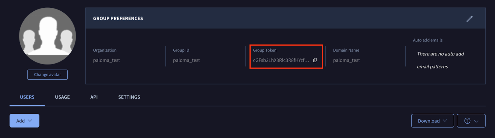
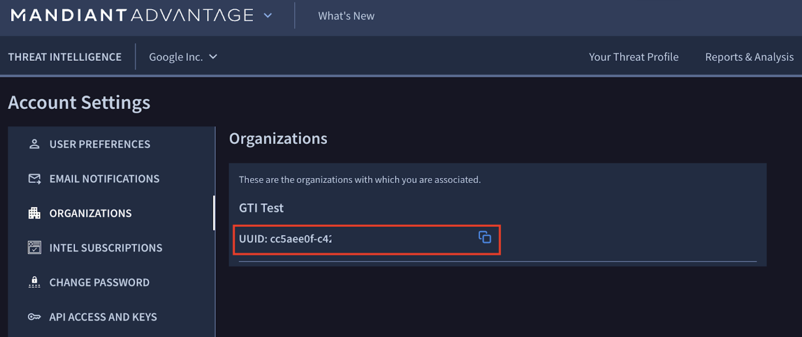

[gtidocs](../../README.md) › [Guides](../README.md) › [Introduction](README.md) › Google Threat Intelligence Customer Migration

---

# google-threat-intelligence-customer-migration

This guide provides everything you need to know when transitioning from **VirusTotal (VT)** and/or **Mandiant Advantage Threat Intelligence (MATI)** to **Google Threat Intelligence (Google TI)**.

It outlines what to expect before, during, and after your migration — covering contractual updates, onboarding steps, product capabilities, integrations, API changes, and how to access support.

Our goal is to make your migration **smooth, transparent, and beneficial,** so that you can quickly start using Google TI’s **unified intelligence capabilities**.

**Table of Contents**

* [Contracting Changes, Billing, and Invoicing](#contracting-changes-billing-and-invoicing)
  * [Contracting Changes](#contracting-changes)
  * [Billing and Invoicing](#billing-and-invoicing)
* [Provisioning and initial form](#provisioning-and-initial-form)
  * [Provisioning Form](#provisioning-form)
* [Sign-in and Activation](#sign-in-and-activation)
* [Capabilities](#capabilities)
* [Integrations and API Migration](#integrations-and-api-migration)
  * [VirusTotal Integrations](#virustotal-integrations)
  * [Mandiant Advantage Integrations](#mandiant-advantage-integrations)
* [Need Help?](#need-help)
* [Support](#support)
  * [Getting Started with Support](#getting-started-with-support)

# contracting-changes,-billing,-and-invoicing

## contracting-changes

As part of your transition to Google Threat Intelligence, your services move under a **new agreement with Google or a Google Cloud reseller and are governed by the Google Cloud [Terms of Service](https://cloud.google.com/terms/secops), or an offline variant**.

If you move to Google TI prior to the end of your current contract(s), this agreement **replaces** prior contracts you may have held with **Mandiant** and/or **Chronicle**/ **VirusTotal**. From the effective date of your Google TI contract, it becomes the **single governing document** for your services, with its own **start date, end date, cost, and billing frequency**.

In many cases, this requires updating your vendor records to include **Google** as the contracting entity (e.g., bank details, addresses, or tax/security forms). If you purchase through a **reseller**, they will manage this process.

For mid-term contract changes, any associated credits or discounts will be applied following the approach described next.

## billing-and-invoicing

\*If you transact through a partner, work with your partner for next steps. The following applies to customers transacting directly with Google.

### key-principle

Regardless of the scenario, the guiding principle is the same: we do not intend for you to pay twice for the same service period. The Google TI agreement governs from its effective date, and any adjustments are applied at the start of service to ensure a fair and transparent transition.

Whether financial adjustments are needed depends on the timing of your migration:

* **Migration at renewal (no overlap)**
  If you start Google TI when your existing VirusTotal or Mandiant contract naturally ends, the transition is straightforward. Your old contract expires, the new Google LLC agreement begins, and you simply receive invoices for Google TI services. No billing adjustments are needed in this case.
* **Migration before renewal (contracts overlap)**
  If you begin Google TI before a current contract ends, we reconcile any unused, prepaid value so you do not pay twice for the same period:
  * **From Mandiant Advantage (MATI)**: Typically, the unused portion is managed through a credit and re-invoicing process. The legacy contract is canceled, usage to date is invoiced, and the remaining prepaid balance is credited against your first Google TI invoice.
  * **From VirusTotal (VT)**: Prepaid funds cannot be transferred as a credit. Instead, the unused portion is applied as a discount on your Google TI purchase.
  * **From both MATI and VT**: A combination of the above methods may be used.

# provisioning-and-initial-form

Provisioning for Google Threat Intelligence begins once your organization designates an admin contact during purchase or renewal which should be communicated to your sales representative or partner. After the agreement is signed, that designated admin receives an email from the Google TI Provisioning team with a secure link to the provisioning form. The admin must complete this form to confirm the necessary details so that the correct Google TI account can be set up.

## provisioning-form

The form asks the administrator to confirm:

* Google TI product/package purchased
* Add-ons (e.g., File Feeds, additional daily API quota)
* Contract start and end dates
* Google TI group admin email (the designated administrator)
* Company details (industry, headquarters country, contact emails)

### information-required-for-migration

**To migrate your existing configurations (e.g., VirusTotal LiveHunts, Mandiant DTM monitors, Mandiant ASM projects) into your new Google Threat Intelligence license**, you will need to provide the following details in the provisioning form:

#### virustotal-customers

* If the person receiving the provisioning email is already part of your company’s VirusTotal group, they will simply be asked to log in with their VirusTotal account, no further action is required.
* If the person is not part of the existing VirusTotal group, they must request the VirusTotal Group Token from someone who is inside their current VirusTotal group. A member of the group can find it under their group view at: `https://www.virustotal.com/gui/group/{group_id}/`

> 🚧
>
> **Important note**
> A user cannot belong to both a VirusTotal group and a Google TI group at the same time. For that reason, make sure someone from the existing VirusTotal group provides the Group Token, and ensure it is included in the provisioning form.

#### mandiant-customers-–-organization-uuid

You will need to provide your Mandiant Organization UUID:

* If the person receiving the provisioning email is already part of the Mandiant organization, they will see a list of organizations they belong to. They should select the correct one to migrate existing configurations, or choose to create a new one. If your Mandiant organization is not part of the list, select other and provide the Mandiant organization UUID. A member of the organization will be able to look at this information by logging into their account and checking this URL: <https://advantage.mandiant.com/accountmanagement#organizations>
* If the person receiving the provisioning email is not part of the organization, they must request the UUID from someone who is. A member of the organization can find it in their account management portal at:
  <https://advantage.mandiant.com/accountmanagement#organizations>

### after-the-google-ti-group-is-created-or-upgraded

Once the provisioning form is submitted and validated, your Google TI group will be created and provisioned (or, in the case of VirusTotal, upgraded) at the start date of your contract. What happens next depends on the migration path:

* VirusTotal customers: Migration is seamless. The VT group is upgraded to Google TI, with existing integrations, YARA rules, and group members carried over automatically. Users receive an email notifying them of the upgrade and linking to resources to get started. You can find more details on group admin capabilities in this guide: [Admin’s Guide](../02-group-management/admins-guide.md).
  * **Custom Integrations & Automations (Recommended)** Existing VirusTotal integrations will continue to work. However, we recommend **leveraging the new Google TI endpoints** to take full advantage of the platform’s enhanced capabilities. You can find more information about the Google TI API [here](google-threat-intelligence-customer-migration/vt-migration-guide.md#integrations-and-automations-with-google-threat-intelligence-api).
  * **Out-of-the-Box (OOTB) Integrations (Recommended)** Your legacy third-party integrations (such as SIEM or SOAR plugins) can still be used for proactive detection and IoC enrichment during the transition. However, we recommend **upgrading to the new Google Threat Intelligence integrations** to take full advantage of the platform. Please check the available Google TI OOTB integrations [here](../13-integrations/migrate-from-virustotal.md).
* **Mandiant customers**: The administrator of the selected Mandiant Organization UUID will receive an email asking them to confirm the migration (if the person who submitted the form was already an admin of the Mandiant org, this step will be skipped). Once confirmed, the Google TI group is created and existing configurations within that organization (such as DTM monitors or ASM projects) are migrated automatically. **The designated admin can then add users to the new Google TI group**. Added users receive an email with instructions to create their Google TI accounts and resources to begin using the platform.
  You can find more details on group admin capabilities in this guide: [Admin’s Guide](../02-group-management/admins-guide.md).
  * **Custom Integrations & Automations (Action Required)** Any custom scripts or applications currently pointing to Mandiant Advantage endpoints must be refactored to use the unified **Google Threat Intelligence API v3**. This involves updating your base URLs and authentication methods. Please refer to the **[API Migration guide for Mandiant Advantage former users](google-threat-intelligence-customer-migration/mati-api-migration-guide.md)**  for detailed endpoint mappings
  * **Out-of-the-Box (OOTB) Integrations (Action Required)** Your legacy third-party integrations (such as SIEM or SOAR plugins) can still be used for proactive detection and IoC enrichment during the transition. However, you'll need to update to the new **Google Threat Intelligence API Key**. Learn more about the steps [here](google-threat-intelligence-customer-migration/mati-migration-guide.md#out-of-the-box-third-party-integrations).
* **Customers of both VT and Mandiant**: Both migration flows apply. The administrator of the selected Mandiant organization first receives an email to confirm the migration (if the person who submitted the form was already an admin of the Mandiant org, this step will be skipped) before the Google TI group is finalized. Once confirmed, the Google TI group admin can add any remaining users, who will then receive account setup emails with resources to begin using the platform. You can find more details on group admin capabilities in this guide: [Admin’s Guide](../02-group-management/admins-guide.md).

In parallel, the VT group is upgraded automatically, and existing VT users receive an email notifying them of the upgrade along with resources to get started.

* **Mandiant Integrations (Action Required)**
  * **Custom Integrations & Automations**: Any custom scripts or applications currently pointing to Mandiant Advantage endpoints must be refactored to use the unified Google Threat Intelligence API v3. This involves updating your base URLs and authentication methods. Please refer to the [API Migration guide for Mandiant Advantage former users](google-threat-intelligence-customer-migration/mati-api-migration-guide.md) for detailed endpoint mappings.
  * **Out-of-the-Box (OOTB) Integrations**: Legacy Mandiant integrations (SIEM or SOAR) remain supported during the transition but require an update to your new **Google Threat Intelligence API Key**.
  * To fully leverage the platform's enhanced capabilities, however, we recommend **switching to the native Google Threat Intelligence integrations**. View the available Google TI OOTB integrations [here](google-threat-intelligence-customer-migration/mati-migration-guide.md#out-of-the-box-third-party-integrations).
* **VirusTotal Integrations (Recommended)**
  * **Custom Integrations & Automations**: Existing VirusTotal integrations will continue to work. However, we recommend **leveraging the new Google TI endpoints** to take full advantage of the platform’s enhanced capabilities. You can find more information about the Google TI API [here](google-threat-intelligence-customer-migration/vt-migration-guide.md#integrations-and-automations-with-google-threat-intelligence-api).
  * **Out-of-the-Box (OOTB) Integrations**: Your legacy VirusTotal third-party integrations can still be used. However, we recommend **upgrading to the new Google Threat Intelligence integrations** to take full advantage of the platform. Please check the available **Google TI OOTB integrations [here](google-threat-intelligence-customer-migration/vt-migration-guide.md#out-of-the-box-third-party-integrations)**.

# sign-in-and-activation

Once your Google TI group is provisioned and users are added, each user receives an automated email depending on their case:

* **Existing VirusTotal users**: Users who were already part of a VirusTotal group will receive an **upgrade notification email**. This message confirms that their group has been upgraded to Google TI and provides resources to start exploring the platform. Since their permissions and configurations are carried over automatically, **no further action is required to activate their account**.
* **All other users**: This includes users without a prior VirusTotal account, users from a Mandiant Advantage organization, and any new users added to the Google TI group. These users receive two emails to complete their setup:
  * An **account activation email**, asking them to create their Google TI account using a personalized link.
  * A **confirmation email**, notifying them that they have been added to their organization’s Google TI group. This message also includes useful links to documentation and resources to help them get started.

Once users activate their account, they can log in with their corporate email address (or existing VirusTotal credentials, if applicable) and immediately access Google TI services.

# capabilities

Google Threat Intelligence brings together and enhances the functionality from both VirusTotal and Mandiant Advantage Threat Intelligence (MATI). To understand how your existing features and workflows transition into Google TI, please refer to the dedicated migration guides:

* **For former VirusTotal customers**: see the [VirusTotal to Google  TI migration guide](google-threat-intelligence-customer-migration/vt-migration-guide.md).
  This guide details how your existing VirusTotal features — such as file and URL analysis, YARA LiveHunts, and search capabilities — are carried over into Google TI,  while also outlining **the new capabilities available to you and where to find and explore them.**
* **For former Mandiant Advantage customers**: see the [Mandiant to Google  TI migration guide](google-threat-intelligence-customer-migration/mati-migration-guide.md).
  This guide explains how Mandiant Advantage capabilities — such as threat actor profiles, campaign insights, Digital Threat Monitoring (DTM), and Attack Surface Management (ASM) — are mapped into Google TI, while highlighting the **new features available in the unified experience and where to explore them**.

Together, these resources explain how Google TI combines the strengths of both platforms with **Google-scale intelligence, unified search, expanded APIs, and deeper integrations**, ensuring a smooth transition and helping you make the most of Google TI’s enhanced capabilities.

# integrations-and-api-migration

As part of the migration to Google Threat Intelligence, it is critical to understand how your existing integrations will be affected and how to update them to leverage the unified platform.

## virustotal-integrations

While existing VirusTotal integrations will continue to function after the migration, we strongly recommend updating them to take full advantage of the platform’s enhanced capabilities.

* **Custom Integrations & Automations**: We recommend updating your internal scripts and custom tools to use the **Google TI API v3**. New API endpoints have been introduced to cover all recently added features (such as new Threat Intelligence objects). For detailed information on available endpoints, refer to the **[Google  TI API Reference Documentation](https://gtidocs.readme.io/reference/api-overview)**.
* **Out-of-the-Box (OOTB) Integrations**:  For third-party tools (SIEM/SOAR), your existing integrations with VirusTotal will continue to function. However, we recommend exploring the [Technology Integration](https://www.virustotal.com/gui/technology-integrations) menu to identify and adopt integrations marked as "Google Threat Intelligence" to access enhanced capabilities.

## mandiant-advantage-integrations

**Action Required:** To keep your security operations running smoothly, you’ll need to update your integrations to connect with Google Threat Intelligence. This ensures that both your custom automations and your third-party (OOTB) tools continue to function as expected in the new environment.

1. **Authentication Changes**

Unlike Mandiant Advantage, which utilized Bearer Token and Basic Authentication, Google Threat Intelligence primarily uses **API Keys**.

* **User Keys**: Each user has a unique API key associated with their account.
* **Service Accounts (Recommended for Out-of-the-Box Integrations and Automated Production Workflows)**: Service accounts are not tied to individual users and do not require an email address. They provide authentication solely via API keys. **Note**: Only Group Administrators can create service accounts and generate these keys.

2. **API URL & Path Mapping**

The most critical change is the update to API server URLs. Functionality from Mandiant's modules (ASM, DTM, Threat Intelligence) has been consolidated under the Google Threat Intelligence umbrella.

**Mapping Table**:

| Service                 | Mandiant Advantage Base URL + Path       | Google TI Base URL + Path        |
| ----------------------- | ---------------------------------------- | -------------------------------- |
| **Threat Intelligence** | `api.intelligence.mandiant.com/v4/`      | `www.virustotal.com/api/v3/`     |
| **DTM**                 | `api.intelligence.mandiant.com/v4/dtm/`  | `www.virustotal.com/api/v3/dtm/` |
| **ASM**                 | `asm-api.advantage.mandiant.com/api/v1/` | `www.virustotal.com/api/v3/asm/` |

For a detailed list of endpoint mappings and more information, please refer to the [API Migration guide for Mandiant Advantage former users](google-threat-intelligence-customer-migration/mati-api-migration-guide.md)

3. **Out-of-the-Box (OOTB) Integrations**

Legacy "out-of-the-box" integrations (e.g., SIEM plugins) can still be used for proactive detection and IoC enrichment during the transition.

* **Required Action**: You must update the configuration of these tools to use a new **[Google Threat Intelligence API Key](google-threat-intelligence-customer-migration/mati-migration-guide.md#out-of-the-box-third-party-integrations)**.
* **Recommended Action**: To fully leverage the platform's capabilities, we recommend upgrading to the native **[Google Threat Intelligence integrations where available](https://www.virustotal.com/gui/technology-integrations)**.

# need-help?

If you need assistance updating integrations, configuring the API, or planning your migration, please contact our [**support team**](https://pantheon.corp.google.com/support?e=13802955\&mods=-ai_platform_fake_service,-ai_platform_staging_service\&project=virustotalcloud).
The next section explains the **Google TI support model** and how to access help during and after your migration.

# support

Google Threat Intelligence support is delivered through the **Google Cloud Customer Care model**, giving you access to a centralized and consistent support experience.

> 🚧
>
> **Attention**: Technical support for Google Threat Intelligence is transitioning from the legacy VirusTotal support form to the unified **Google Cloud console**.
> A transition period will run from **September 2, 2025, to December 2, 2025**. During this time, you may use either the legacy VirusTotal support channels or the Google Cloud console. As of **December 2, 2025**, the VirusTotal support channel for Google Threat Intelligence customers will be discontinued, and all technical support cases must be submitted through the Google Cloud console.

## getting-started-with-support

Google TI Support is offered through the unified **Google Cloud console**. As part of your onboarding, your organization’s designated admin and bill will receive a **welcome email from the Google TI support team to support the process**.

### how-to-get-support-via-google-cloud-console

| Action               | Description                                                                                                                                          |
| -------------------- | ---------------------------------------------------------------------------------------------------------------------------------------------------- |
| **Grant Access**     | Your administrator must grant you the required IAM permissions to view and manage support cases in the console.                                      |
| **Create a Project** | You must first create a project within the Google Cloud console before you can submit any support tickets.                                           |
| **Submit a Case**    | Once permissions and a project are set up, you can raise a technical support case with Customer Care for any technical issue.                        |
| **Manage Cases**     | You can manage cases from the **Cases** page. Any user with edit permissions can comment, upload attachments, or modify case attributes.             |
| **Escalate a Case**  | If an issue has a pressing negative business impact, you can use the **Escalate** option to involve a Case Escalation Manager for faster resolution. |

### comprehensive-support

As a part of your Google Threat Intelligence subscription, you are eligible for **Comprehensive Support** at no additional cost. This service is designed to address defects, product usage questions, and outages.

* **P1 cases are not offered**.
* **Initial Response Times**: P2 cases receive a response within 1 business day; P3 and P4 cases within 2 business days.
* **Service Times**: Support is available 8/5 during local hours of operation, and all support is provided in **English** for SecOps Services.
* **Upgrade Availability**: Customers have the option to upgrade to paid support services (Standard, Enhanced, and Premium Support) at any time.
  * **Important**: While Comprehensive Support is included with the subscription, it is **not automatically provisioned**. You must onboard to the **Google Cloud console** and have an active **Google Cloud organization ID** to be eligible. A dedicated customer care Onboarding team will reach out to your account representative to guide them through this setup process before the December 2, 2025 deadline.

For more information on how these changes affect you, see [FAQs](https://cloud.google.com/support/docs/integrations#integration-support-faqs) and [Additional Google Threat Intelligence-Specific FAQs](https://cloud.google.com/support/docs/integrations#google-threat-intel-specific-faqs).

---

← [Google Threat Intelligence Platform Navigation](google-threat-intelligence-navigation.md) · [up](README.md) · [Google Threat Intelligence - Migration guide for VirusTotal former users](google-threat-intelligence-customer-migration/vt-migration-guide.md) →

*Archived from <https://gtidocs.virustotal.com/docs/google-threat-intelligence-customer-migration>.*
