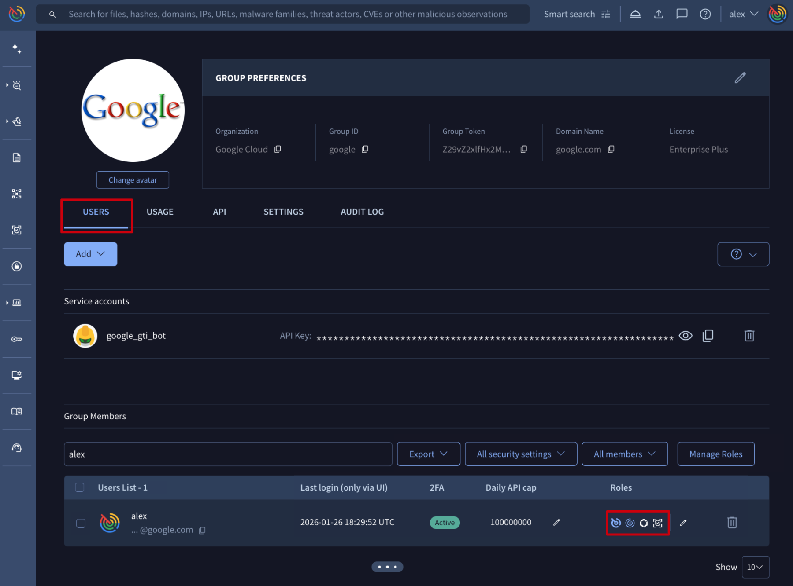
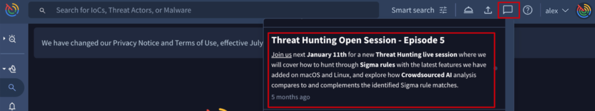

[gtidocs](../../../README.md) › [Guides](../../README.md) › [Introduction](../README.md) › [Google Threat Intelligence Customer Migration](../google-threat-intelligence-customer-migration.md) › Google Threat Intelligence - Migration guide for Mandiant Advantage former users

---

# google-threat-intelligence---migration-guide-for-mandiant-advantage-former-users

This guide is designed to help Mandiant Advantage Threat Intelligence users seamlessly transition to and effectively utilize the new Google Threat Intelligence platform.

Former Mandiant Advantage Threat Intelligence users now also have access to the Threat Intelligence community data from VirusTotal and to Google's unparalleled threat visibility.

Crowdsource community and industry threat knowledge within VirusTotal adds breadth to Mandiant's existing knowledge, empowering users with almost real-time actionable insights, ensuring immediate preparedness for potential imminent attacks.

# get-started

You can find [here](https://gtidocs.readme.io/docs/google-threat-intelligence-provisioning-guide) the provisioning process with all details on each step and all information required for closing the contract. Our provisioning team will support you during the  entire process.

For a smooth transition, we'll need your previous **Mandiant organization UUID**, and **VirusTotal group Token** if you've used both solutions before (check [here](vt-migration-guide.md) the migration guide for former VirusTotal users). All existing users will be automatically upgraded to Google Threat Intelligence and can **[access the platform](https://www.virustotal.com/gui/sign-in)** once their accounts are fully activated.

Our provisioning team will assist during the entire process and will provide all the necessary.

Let's start by clarifying three fundamental user-level concepts in Google TI.

## 1.-group

In Google Threat Intelligence, all members of a Mandiant **organization** are consolidated under a single Google Threat Intelligence **[group](../../02-group-management/admins-guide.md#group-information)**.

## 2.-users

[**User**'s group roles](../../02-group-management/admins-guide.md#123-managing-user-privileges-or-role) are broadly categorized into two types: **Members** (regular users) and **Admins** (administrators). During the initial provisioning process, the first group administrator will be designated. This individual will be able to view certain features of other users and manage all users access and permissions. Group administrators can refer to [this resource](../../02-group-management/admins-guide.md) for a comprehensive overview of their capabilities on the platform.

Furthermore, access to [Attack Surface Management](../../11-asm/asm-roles-and-permissions.md) (ASM) and [Digital Threat Monitoring](../../12-dtm/dtm-user-roles.md) (DTM) is managed separately. Similar levels of access are granted in Google TI based on the roles previously held by users in Mandiant.

**Remarks**

* If an existing Mandiant user's email address matches a pre-existing VirusTotal account, their Mandiant account will be linked to it and they should continue to log in using their existing VirusTotal credentials.
* On the contrary, Mandiant users who do not have an existing VirusTotal account will receive an email invitation to [create a new Google Threat Intelligence account](https://www.virustotal.com/gui/join-us).
* Completely new users must be added to the group by the group administrator. They will then receive an invitation email to activate their new accounts.

## 3.-service-account

Groups can also include **[service accounts](../../02-group-management/admins-guide.md#service-account-information)**, which are specifically designed for automation tasks. They are not tied to individual users, do not require an email address for [creation](../../02-group-management/admins-guide.md#131-adding-a-new-service-account-to-an-existing-google-threat-intelligence-group), and provide API authentication solely via API keys [accessible](../../02-group-management/admins-guide.md#133-getting-a-service-accounts-api-key) only to group administrators.

Note that Service Accounts from Mandiant are not migrated to Google Threat Intelligence.

# google-threat-intelligence-tools

Google Threat Intelligence integrates the power of VirusTotal's community-driven data with Mandiant Advantage Threat Intelligence's curated insights, all enhanced by Google's unparalleled visibility.

Depending on your Google Threat Intelligence subscription, you can access these resources through the new left [navigation menu](../google-threat-intelligence-navigation.md), where some of the tools and services are grouped by different topics for effortless exploration and navigation:

The table below enumerates the UI tools available within Google Threat Intelligence.This presentation highlights which capabilities will be familiar from your MATI experience and which are new additions designed to expand your threat intelligence resources.

  
| Module | Tool | Status for MATI Users | Description |
| --- | --- | --- | --- |
| <b>Threat Landscape</b> | <a href="../../05-global-landscape/manage-threat-profiles.md" target="_blank"><b>Manage Threat Profiles</b></a> | New Capability in Google TI | Personalized, dynamic lens that filters curated <b>Google Threat Intelligence</b>'s vast data to highlight threats most relevant to your organization, based on your own custom criteria. |
| <a href="../../05-global-landscape/threat-actors-card.md" target="_blank"><b>Threat Actors</b></a> | Familiar from Mandiant Advantage | Highly contextualized Threat Actors cards providing curated details verified by <b>Google Threat Intelligence</b> analysts and our community <b>Partners</b>. |  |
| <a href="../../05-global-landscape/malware-tools.md" target="_blank"><b>Malware & Tools</b></a> | Familiar from Mandiant Advantage | Rich, contextualized details on Malware families and Toolkits, powered by <b>Google Threat Intelligence</b> analysts and our community <b>Partners</b>. |  |
| <a href="../../05-global-landscape/campaigns.md" target="_blank"><b>Campaigns</b></a> | Familiar from Mandiant Advantage | Curated intelligence on malware Campaigns continuously monitored by our <b>Google Threat Intelligence</b> analysts. |  |
| <a href="../../05-global-landscape/ioc-collections.md" target="_blank"><b>IoC Collections</b></a> | New Capability in Google TI | Live reports of indicators of compromise. Our <b>Google Threat Intelligence</b> analysts create them, as do our community <b>Partners</b> who track indicators in malicious campaigns. We also incorporate <b>Crowdsourced</b> threats observed by the wider community as Open Source Intelligence (OSINT). |  |
| <a href="../../05-global-landscape/ttp-analysis.md" target="_blank"><b>TTP Analysis</b></a> | Familiar from Mandiant Advantage | Powerful tool for exploring and analyzing threat objects, vulnerabilities, and reports, from the perspective of aligning the malicious activity represented  by them against the MITRE ATT\&CK framework. |  |
| <b>IoC Investigation</b> | <a href="../../06-ioc-investigation/check-vt.md" target="_blank"><b>Check with VirusTotal</b></a> | New Capability in Google TI | Evolving from VirusTotal Intelligence, this tool serves as a robust <b>IoC search engine</b> for querying based on specific criteria and for uploading files for analysis. Additionally, its advanced <b>semantic search</b> goes beyond just IoC lists, delivering a broader spectrum of threat intelligence including Threats, Reports, Vulnerabilities, Rules, Graphs, and valuable community Comments. |
| <a href="../../06-ioc-investigation/livehunt-guide.md" target="_blank"><b>Livehunt</b></a> | New Capability in Google TI | Constantly running <b>YARA rulesets jobs</b>, which analyze new IoCs submitted to the platform and generate notifications on IoCs that match the implemented conditions (search in the future). |  |
| <a href="../../06-ioc-investigation/retrohunt-guide.md" target="_blank"><b>Retrohunt</b></a> | New Capability in Google TI | <b>YARA rulesets</b> running against our extensive file database to pinpoint files that satisfy the rule's conditions (search in the past). |  |
| <a href="../../06-ioc-investigation/ioc-stream-guide.md" target="_blank"><b>IoC Stream</b></a> | New Capability in Google TI | The <b>centralized notifications hub</b> for Livehunt and Retrohunt matches, Threat Intelligence objects subscriptions and Managed Threat Profiles. |  |
| <a href="../../06-ioc-investigation/diff.md" target="_blank"><b>Diff</b></a> | New Capability in Google TI | The assistant for creating files-based Yara rules. |  |
| <b>Reports & Analysis</b> | <a href="../../07-report-analysis/reports-and-analysis.md#2-reports-cards" target="_blank"><b>Reports & Analysis</b></a> | Familiar from Mandiant Advantage | Curated reports from <b>Google Threat Intelligence</b> analysts or community <b>Partners</b> as well as <b>Crowdsourced</b> reports from the rest of the community. |
| <b>Threat Graph</b> | <a href="../../08-threat-graph/get-started-threat-graph.md" target="_blank"><b>Threat Graph</b></a> | New Capability in Google TI | Previously known as <b>VT Graph</b>, a tool for visually exploring relations between Indicators. |
| <b>Private Scanning</b> | <a href="../../09-private-scanning/private-scanning.md" target="_blank"><b>Private Scanning</b></a> | New Capability in Google TI | VirusTotal Private Scanning for files and URLs that cannot be shared with the rest of the community. |
| <b>Vulnerability Intelligence</b> | <a href="../../10-vulnerability-intelligence/explore-vulnerabilities.md" target="_blank"><b>Vulnerability Intelligence</b></a> | Familiar from Mandiant Advantage | A <b>curated database</b> providing actionable insights to prioritize and implement effective security fixes. |
| <b>Attack Surface Management</b> | <a href="../../11-asm/get-started-asm.md" target="_blank"><b>Attack Surface Management</b></a> | Familiar from Mandiant Advantage | <b>ASM</b> for assets and issues discovery. |
| <b>Digital Threat Monitoring</b> | <a href="../../12-dtm/get-started-dtm.md" target="_blank"><b>Digital Threat Monitoring</b></a> | Familiar from Mandiant Advantage | <b>DTM</b> to ​​explore open-source and dark web data. |

# out-of-the-box-third-party-integrations

Legacy "out-of-the-box" (OOTB) integrations can still be used for proactive detection, allowing you to obtain curated Indicators of Compromise (IoCs) and merge Attack Surface Management (ASM) alerts into your preferred work management tools. To continue leveraging these, you'll need to **update to the new Google Threat Intelligence API Key** and we recommend to:

1. [Create a Service Account](../../02-group-management/admins-guide.md#131-adding-a-new-service-account-to-an-existing-google-threat-intelligence-group) (note that only group administrators can do this)
2. [Retrieve Service Account API key](../../02-group-management/admins-guide.md#133-getting-a-service-accounts-api-key) (note that only group administrators can do this)
3. Replace your current integration API key Secret (`api_secret`) with the new Service Account API key
4. Replace your current integration API key ID (`api_key`) by the string `gti-user`

New Google Threat Intelligence integrations enhance event and indicator enrichment, offering **curated** and **crowdsourced** data. We're continually expanding integrations for broader tool compatibility. Find available integrations, marked ***Compatible with Google Threat Intelligence***, under the [**Technology Integration** menu](https://www.virustotal.com/gui/technology-integrations).

Furthermore, you will find existing VirusTotal "out-of-the-box" (OOTB) integrations listed under the [Technology Integration](https://www.virustotal.com/gui/technology-integrations) menu as well as on the [INTEGRATION](../../13-integrations/migrate-from-virustotal.md) dedicated section on our documentation portal. These can be utilized during their ongoing migration to Google Threat Intelligence.

> 🚧 API migration guide
>
> Please refer to our [API migration guide](mati-api-migration-guide.md), created specifically for users transitioning from Mandiant Advantage.

# official-documentation-portal

Explore our [documentation portal](https://gtidocs.readme.io/docs/) to discover everything you need to know about Google Threat Intelligence. You'll find in-depth information on features and services, plus helpful guides and walkthroughs to accelerate your learning journey.

To automate your workflows, we've compiled a comprehensive list of all [API v3](https://gtidocs.readme.io/reference/) endpoints, each with detailed descriptions and code snippets to help you get started.

> 🚧 API migration guide
>
> Please refer to our [API migration guide](mati-api-migration-guide.md), created specifically for users transitioning from Mandiant Advantage.

Stay informed on the latest platform updates in our [Release Notes](../../../changelog/README.md) and discover our new webinars and relevant blog posts announced through our **In-app** notification tool.

Ask for platform technical support on our Google Threat Intelligence [contact portal](https://www.virustotal.com/gui/contact-us/). Additionally, if you need immediate assistance for an incident from here you can contact our Incident Response Team which will be happy to help you.

---

← [Google Threat Intelligence - Migration guide for VirusTotal former users](vt-migration-guide.md) · [up](../README.md) · [Google Threat Intelligence - API Migration guide for Mandiant Advantage former users](mati-api-migration-guide.md) →

*Archived from <https://gtidocs.virustotal.com/docs/mati-migration-guide>.*
