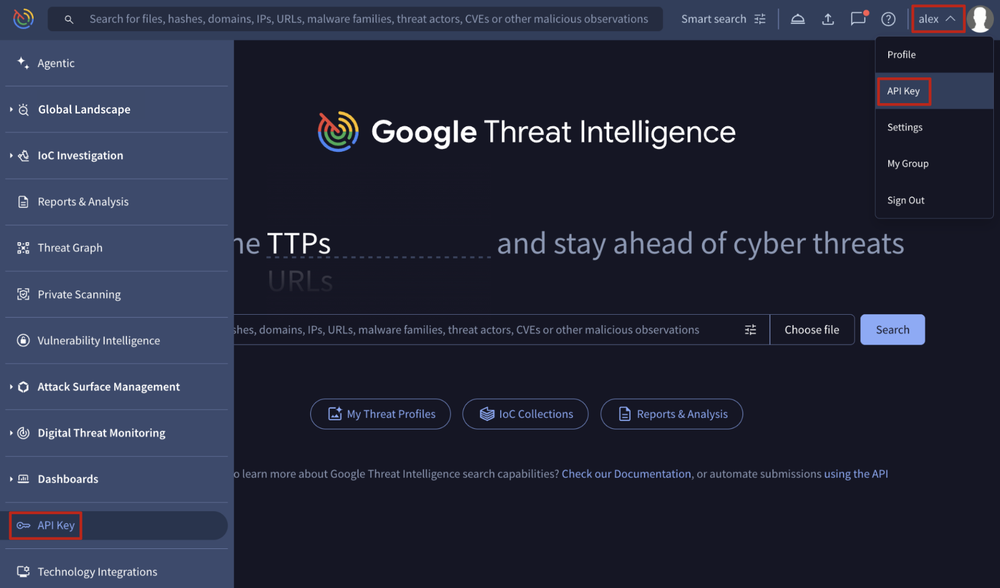

[gtidocs](../../README.md) › [Guides](../README.md) › [Introduction](README.md) › Google Threat Intelligence API key

---

# google-threat-intelligence-api-key

All Google Threat Intelligence **users** can access their API key by [logging into the platform ](https://www.virustotal.com/gui/sign-in)and selecting the **API Key** option found either in the top-right corner or via the left-hand menu or by simply accessing this [link](https://www.virustotal.com/gui/my-apikey).

Your personal key will be listed in the section labeled **GOOGLE THREAT INTELLIGENCE API KEY**.

For **integrations**, Google TI **group administrators** can [create **Service Accounts** ](../02-group-management/admins-guide.md#131-adding-a-new-service-account-to-an-existing-google-threat-intelligence-group)and utilize [their API keys](../02-group-management/admins-guide.md#133-getting-a-service-accounts-api-key) instead. These are ideal because they are not tied to a specific individual and do not require email addresses or the completion of invitation forms.

# legacy-mandiant-api-keys

Customers using legacy Mandiant Threat Intelligence integrations **must replace their existing basic authentication configuration with a Google Threat Intelligence API key**. Following the [migration guide](google-threat-intelligence-customer-migration/mati-migration-guide.md#out-of-the-box-third-party-integrations), update your credentials as follows:

* **API Secret** (`api_secret`): Replace your Mandiant API Secret with your [new Google TI Service Account](../02-group-management/admins-guide.md#131-adding-a-new-service-account-to-an-existing-google-threat-intelligence-group) [API key](../02-group-management/admins-guide.md#133-getting-a-service-accounts-api-key).
* **API Key ID** (`api_key`): Replace your Mandiant API Key ID with the string `gti-user`.

---

[up](README.md) · [Google Threat Intelligence Platform Navigation](google-threat-intelligence-navigation.md) →

*Archived from <https://gtidocs.virustotal.com/docs/how-get-gti-api-keys>.*
