[gtidocs](../../README.md) › [Guides](../README.md) › [Group Management](README.md) › Walkthrough guide for Google Threat Intelligence group administrators

---

# walkthrough-guide-for-google-threat-intelligence-group-administrators

Google Threat Intelligence categorizes premium users into two primary **group** roles: **Users** (standard users) and **Admins** (group administrators). Additionally, role-based access controls are applied to users for certain features and tools available across the platform.

This document outlines the enhanced privileges of group administrators, detailing the management actions available to them at both the organizational group and individual user levels.

# general-notions

All management actions restricted to group administrators are accessible from the **web interface** under **My group** menu option, on the top right corner.

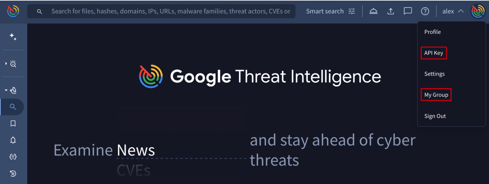

## group-information

Here you can find the group's preferences including two of the most important group level parameters, the **group's ID** and the **group's Token**, which are required in multiple automation and object-sharing tasks. Additional group related information is split in several tabs which allow the management of different types of features.

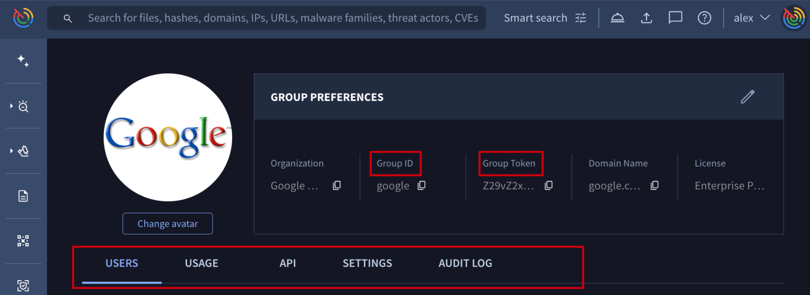

## user-information

Going down to the user level, they are listed in the **USERS** tab, where group administrators can easily filter shown group members by security settings and group role and also by typing the name or email address of the user of interest.

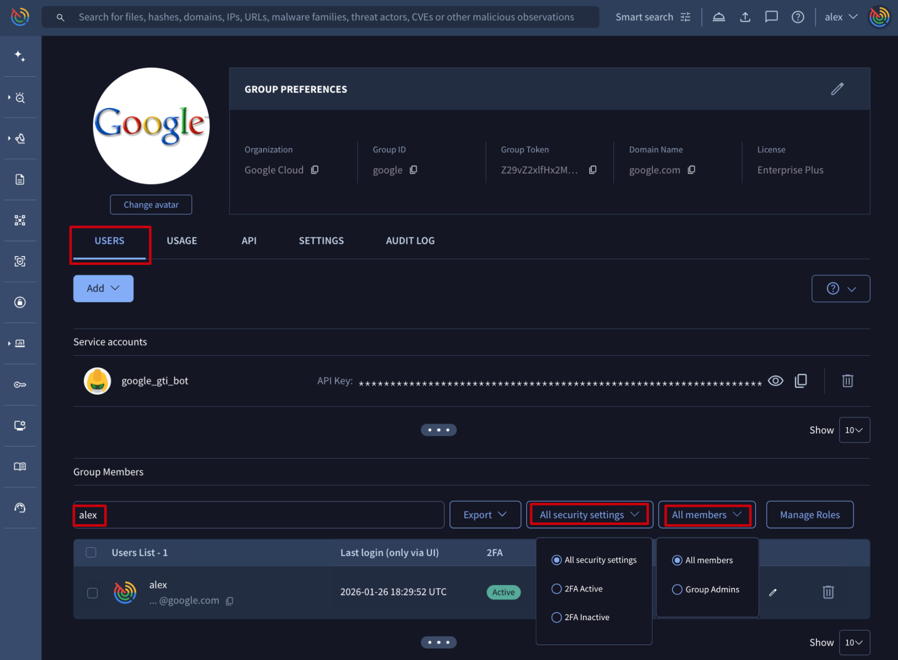

Additionally, by clicking on a user name, admins can automatically pivot to the user's profile where **user ID** is shown next to the user's avatar. This ID is required in multiple automation tasks that are shown in next sections.

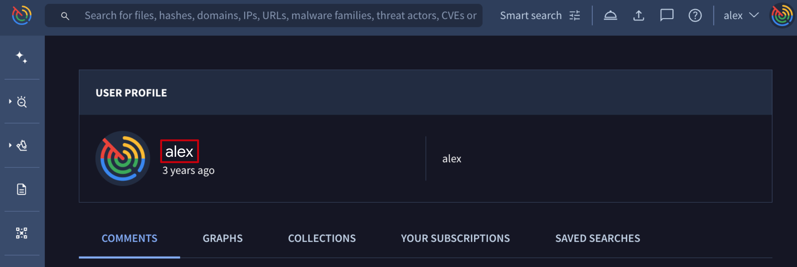

## service-account-information

Apart from users, a **group** could also have **service accounts** which are very useful for tasks automation since they are unaffected by people changes, as they are not tied to any specific individual and they don't require an email address to be created. This makes them a more reliable and consistent way to grant access to automation resources than user accounts. Service accounts are listed on the **Service accounts** section available on the **USERS** tab where group admins can check their **IDs**.

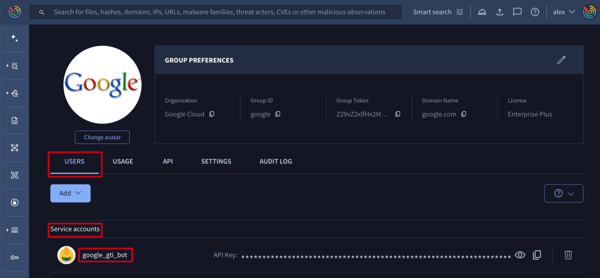

## api-notions

In addition to the web interface there is a set of **API v3** endpoints designed to automate most administrative tasks (more on this later) under the same server URL `https://www.virustotal.com/api/v3/`. These endpoints are shown on the "**USERS & GROUPS ADMINISTRATION**" section of the Google Threat Intelligence [API v3 documentation](https://gtidocs.readme.io/reference/) - please note that NOT all of them require group administrator privileges. Their usage requires authentication/authorization through the admin's API key that can be found [here](https://www.virustotal.com/gui/my-apikey) (or on the navigator bar at the left -> API key menu option).

# everything-a-google-threat-intelligence-admin-can-do

As we discussed, almost every action can be performed in 2 ways: via web interface and via API v3 requests. We grouped all actions reserved for group administrator users in the following categories.

* [1. Group members management](#1-group-members-management)
  * [1.1. Getting group members](#11-getting-group-members)
    * [1.1.1. Getting the list of users and service accounts](#111-getting-the-list-of-users-and-service-accounts)
  * [1.2. Users management](#12-users-management)
    * [1.2.0. Setting default users roles and permissions](#120-setting-default-users-roles-and-permissions)
    * [1.2.1. Adding new user to an existing Google Threat Intelligence group](#121-adding-new-user-to-an-existing-google-threat-intelligence-group)
    * [1.2.2. Removing user from a Google Threat Intelligence group](#122-removing-user-from-a-google-threat-intelligence-group)
    * [1.2.3. Managing user privileges or role](#123-managing-user-privileges-or-role)
    * [1.2.4. Managing user API allowance](#124-managing-user-api-allowance)
    * [1.2.5. Resetting Two-Factor Authentication for a user](#125-resetting-two-factor-authentication-for-a-user)
  * [1.3. Service accounts management](#13-service-accounts-management)
    * [1.3.1. Adding a new service account to an existing Google Threat Intelligence group](#131-adding-a-new-service-account-to-an-existing-google-threat-intelligence-group)
    * [1.3.2. Removing a service account from a Google Threat Intelligence group](#132-removing-a-service-account-from-a-google-threat-intelligence-group)
    * [1.3.3. Getting a service accounts API key](#133-getting-a-service-accounts-api-key)
  * [2. Group management](#2-group-management)
    * [2.1. General settings](#21-general-settings)
    * [2.1.1. Editing organization name, domain name and avatar](#211-editing-organization-name-domain-name-and-avatar)
    * [2.1.2. Managing AI features preferences](#212-managing-ai-features-preferences)
  * [2.2. Security features](#22-security-features)
    * [2.2.1. Editing all group members session timings](#221-editing-all-group-members-session-timings)
    * [2.2.2. Single Sign On - SSO](#222-single-sign-on---sso)
    * [2.2.3. Two-Factor Authentication enforcement](#223-two-factor-authentication-enforcement)
  * [2.3. Private Scanning settings](#23-private-scanning-settings)
    * [2.3.1. Editing Private Scanning retention period and storage region](#231-editing-private-scanning-retention-period-and-storage-region)
* [3. Consumption](#3-consumption)
  * [3.1. Google Threat Intelligence features consumption](#31-google-threat-intelligence-features-consumption)
    * [3.1.1. Getting current month group overall consumption](#311-getting-current-month-group-overall-consumption)
    * [3.1.2. Getting users individual consumption](#312-getting-users-individual-consumption)
  * [3.2. Google Threat Intelligence API consumption](#32-google-threat-intelligence-api-consumption)
    * [3.2.1. Getting group overall API consumption](#321-getting-group-overall-api-consumption)
    * [3.2.2. Getting users individual API consumption](#322-getting-users-individual-api-consumption)
* [4. Audit Log](#4-audit-log)
  * [4.1. Filtering logs](#41-filtering-logs)
  * [4.2. Exporting logs](#42-exporting-logs)
  * [4.3. Seeing details](#43-seeing-details)

## 1.-group-members-management

### 1.1.-getting-group-members

#### 1.1.1.-getting-the-list-of-users-and-service-accounts

**Web interface =>** On the **My group** menu option -> **USERS** tab, the list of users is shown under the **Group Members** section, and the list of service accounts under the **Service accounts** section. All of them can be exported by group administrators through the **Export** button in several file formats, as shown in the following image.

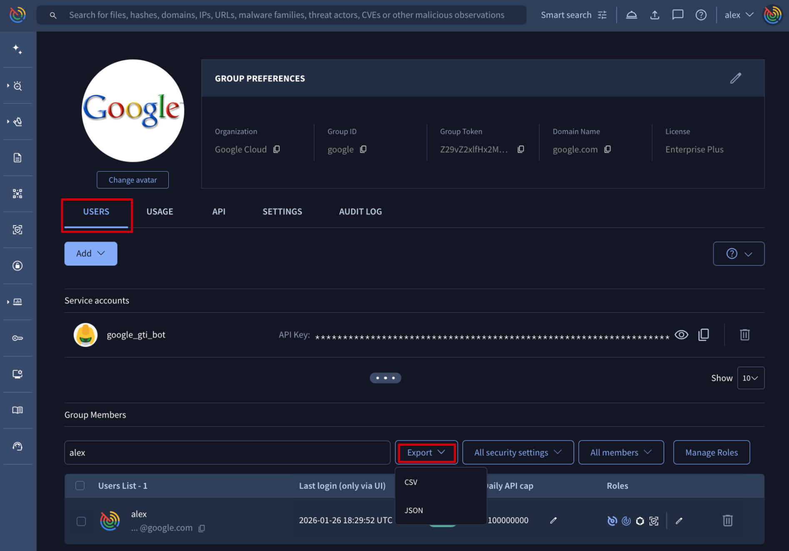

The resulting file will include the following information: username, first name, last name, email and type to identify whether it is a user or a service account.

**Google Threat Intelligence API =>** The endpoint [/v3/groups/{id}/{relationship}](https://gtidocs.readme.io/reference/groups-relationships) returns the objects related to the group based on group's ID [(check group ID)](#group-information) and relationship which identifies the type of objects to request and whose values in this case are  "users" and "service\_accounts". Other endpoints provide the list of users and service accounts, but they don't provide the same information as the already mentioned one: [/v3/groups/{id}/relationships/users](https://gtidocs.readme.io/reference/get-group-users) and [/v3/groups/{id}/relationships/service\_accounts](https://gtidocs.readme.io/reference/get-service-accounts-of-a-group).

[Back to top](#walkthrough-guide-for-google-threat-intelligence-group-administrators)

### 1.2.-users-management

#### 1.2.0.-setting-default-users-roles-and-permissions

**Web interface =>** From **My group** menu option -> **ROLES** tab, a group administrator is able to establish the baseline roles and permissions that all new users will automatically inherit when they are added to the group.

Note that the roles and permissions shown here are determined by your license.

* **GTI Alerts**: grants access to the **My Landscape** / **Alerts** portal module and the automated **Relevance System**, as well as authorization for the GTI Alerts API.

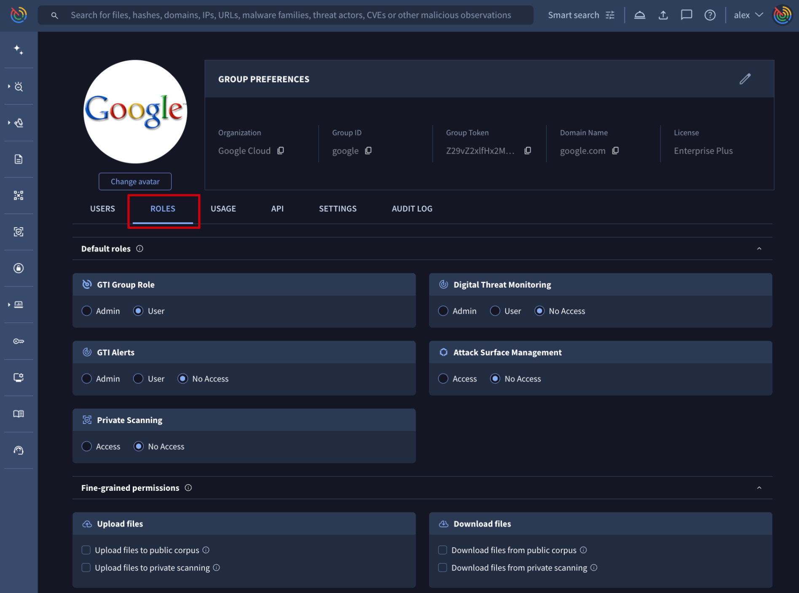

[Back to top](#walkthrough-guide-for-google-threat-intelligence-group-administrators)

#### 1.2.1.-adding-new-user-to-an-existing-google-threat-intelligence-group

**Web interface =>** From **My group** menu option -> **USERS** tab -> **Add** dropdown button -> **User** option, a group administrator is able to create or add new members to their group by entering a comma-separated list of email addresses.

The [**ROLES**](#120-setting-default-users-roles-and-permissions) tab determines the default roles and permissions for new users, however, administrators can override these settings for individual requests via the checkboxes provided in the **Add user** form.

Note that the roles and permissions shown here are determined by your license.

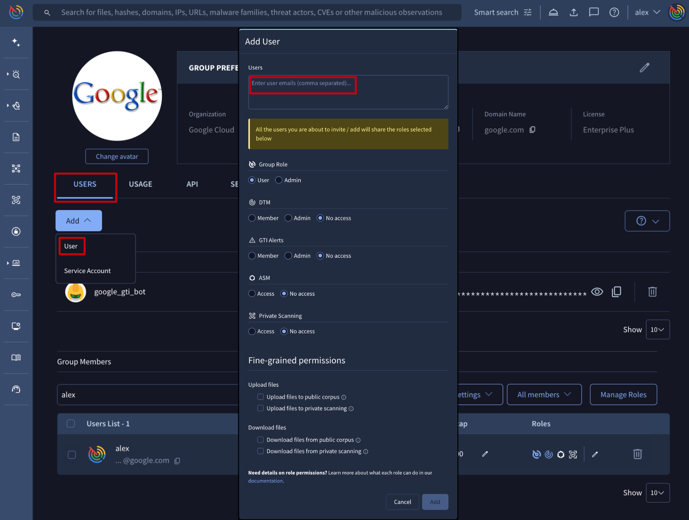

If a user is added to a group but doesn't yet have an account, they will be sent an email invitation to create one. Upon account creation, the user will be automatically added to the group. On the contrary, if the user already has an existing account, they will be automatically added to the group and receive a welcome email.

Please note that users can only belong to one group at a time. If a user is already a member of another group, they must be [removed](#122-removing-user-from-a-google-threat-intelligence-group) from it before they can be added to yours.

**Google Threat Intelligence API** => The [/v3/groups/{id}/relationships/users](https://gtidocs.readme.io/reference/update-group-users) endpoint allows group administrators to add users to the group as standard members. This endpoint requires the group ID [(check group ID)](#group-information) as a parameter, and a list of user objects identified by their email addresses to convert in new group members as in the following example:

```json
payload = {
  "data": [
    {"type":"user","id":"user_1_email_address"},
    {"type":"user","id":"user_2_email_address"}
  ]
}
```

There's no specific endpoint for creating group administrators as in the web interface, although there's a way of granting group admin privileges to common users when needed. Check out the ["**Managing users privileges or role**"](#123-managing-user-privileges-or-role) section.

[Back to top](#walkthrough-guide-for-google-threat-intelligence-group-administrators)

#### 1.2.2.-removing-user-from-a-google-threat-intelligence-group

**Web interface =>** The list of users is given on **My group** menu option -> **USERS** tab -> **Group Members** section. Each user has a **bin** icon on the right, which allows group administrators to remove them from the group. Once removed, they become a VirusTotal free user with limited access to VirusTotal products.

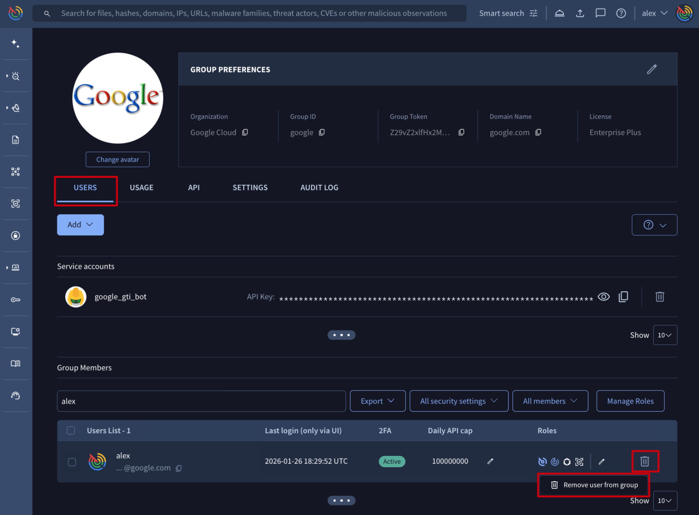

**Google Threat Intelligence API =>** The [/v3/groups/{id}/relationships/users/{user\_id}](https://gtidocs.readme.io/reference/delete-user-from-group) endpoint removes a given user from a given group, based on their identifiers. [(Check group ID)](#group-information) [(Check user ID)](#user-information) When removing a user from the group, it becomes a free user with limited access to VirusTotal's products.

[Back to top](#walkthrough-guide-for-google-threat-intelligence-group-administrators)

#### 1.2.3.-managing-user-privileges-or-role

**Web interface =>** The list of users is given on **My group** menu option -> **USERS** tab -> **Group Members** section. Users' group roles are displayed in the **Roles** column, represented by color-coded symbols:

* Blue: administrative access

* White: standard access

* Gray: no access

Administrators can manage these settings **individually** via the **pen** (edit) button in the **Roles** column, or in **bulk** by selecting multiple users and clicking the **Manage Roles** button at the top of the **Group Members** section, as shown in the image below.

* **Individual Management**: the edit form displays the user's current configuration, allowing for precise adjustments.
* **Bulk Management**: no current settings are displayed. Any roles selected in the form will be applied to all highlighted users, and any roles left unselected will remain unchanged from their original state.

Users selected in the image below will get administrative access to DTM and standard access to ASM while all other roles will remain unchanged (No change).

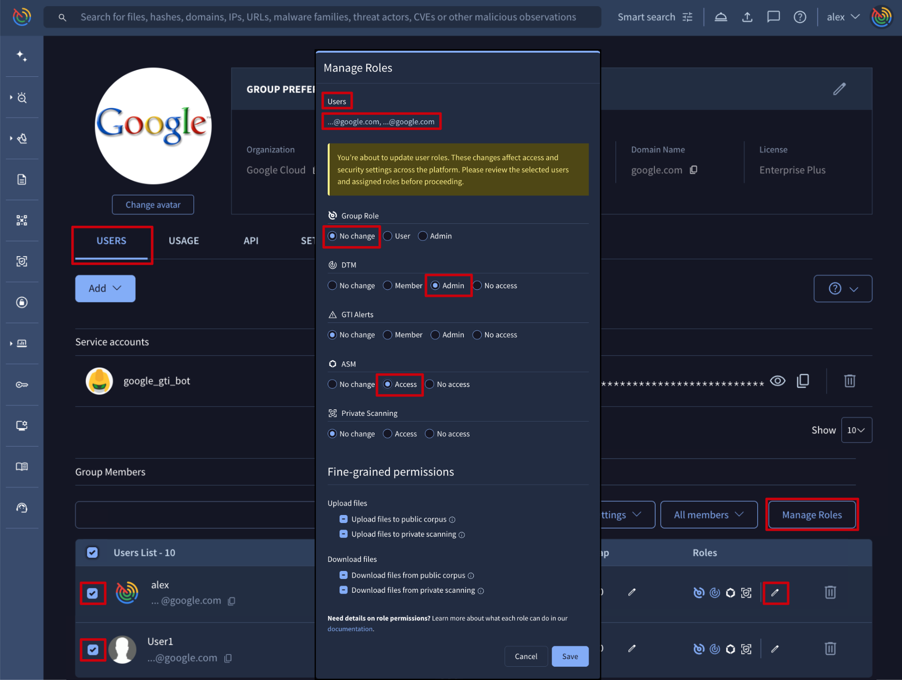

**Google Threat Intelligence API =>** The [/v3/groups/{id}/relationships/users](https://gtidocs.readme.io/reference/patch-group-users-roles) endpoint allows to manage users roles and privileges based on their user IDs and the group ID parameter. [(Check user ID)](#user-information) [(Check group ID)](#group-information)

[Back to top](#walkthrough-guide-for-google-threat-intelligence-group-administrators)

#### 1.2.4.-managing-user-api-allowance

**Web interface =>** The list of users is given on **My group** menu option -> **USERS** tab -> **Group Members**. Each of them has a **pen** (edit) button for the **Daily API cap** column which allows group administrators to change the user's daily API allowance.

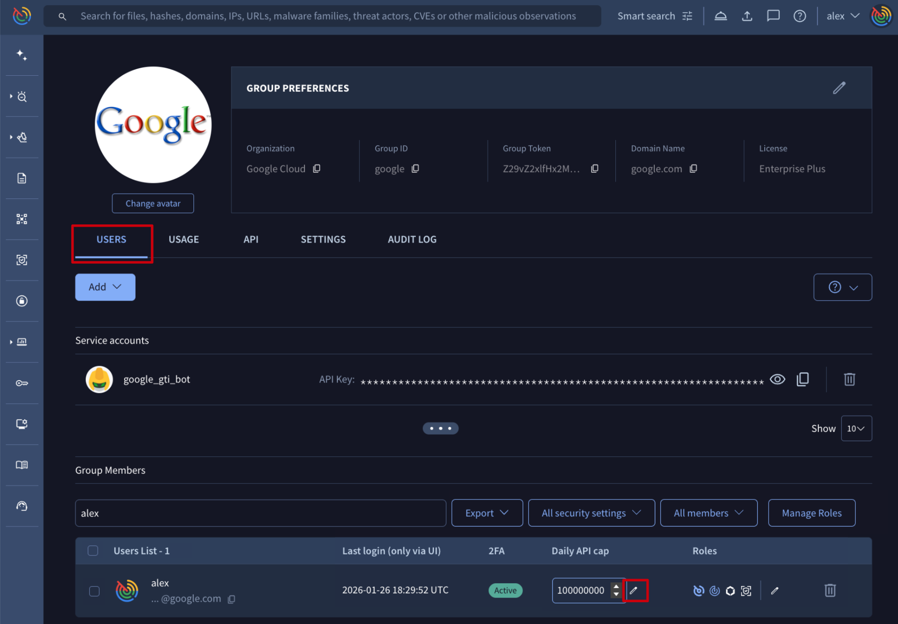

**Google Threat Intelligence API =>** The [/v3/groups/{id}/relationships/users](https://gtidocs.readme.io/reference/patch-group-users-roles) endpoint can be used to PATCH relationships between user objects and a Google Threat Intelligence group based on its ID. [(Check user ID)](#user-information) [(Check group ID)](#group-information) This endpoint also serves to change users' daily API cap as in the following example:

```json
payload = {
  "data": [
    {
      "id": "user_id",
      "type": "user"
      "context_attributes": {
        "quota_limits": {
          "api_requests_daily": {
            "allowed": 10
          }
        }
      }
    },
  ]
}
```

[Back to top](#walkthrough-guide-for-google-threat-intelligence-group-administrators)

#### 1.2.5.-resetting-two-factor-authentication-for-a-user

**Web interface =>** The list of users is given on **My group** menu option -> **USERS** tab -> **Group Members**. Each user entry has a **circular arrow** icon on the right, which allows administrators to reset the user's 2FA. This is particularly useful if a user loses access to their authentication device or offline codes.

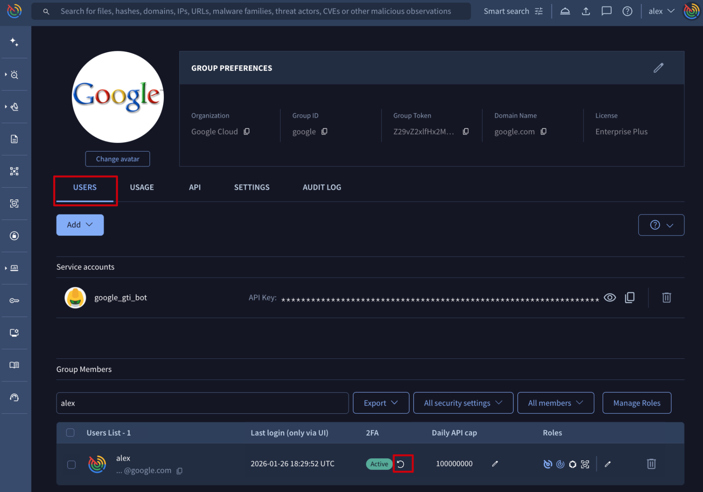

[Back to top](#walkthrough-guide-for-google-threat-intelligence-group-administrators)

### 1.3.-service-accounts-management

#### 1.3.1.-adding-a-new-service-account-to-an-existing-google-threat-intelligence-group

**Web interface** => Service accounts are very useful in automating enrichment and other automation tasks, since they are not tied to any specific individual. From **My group** menu option -> **USERS** tab -> **Add** dropdown button -> **Service Account** option, group administrators are able to create new service accounts.

On the opened form, group administrators only have to specify the name or identifier that the new service account will receive, before saving the request. Please note that the final name will be the result of concatenating the group ID with the typed name, separated by the "\_" character. [(Check group ID)](#group-information)

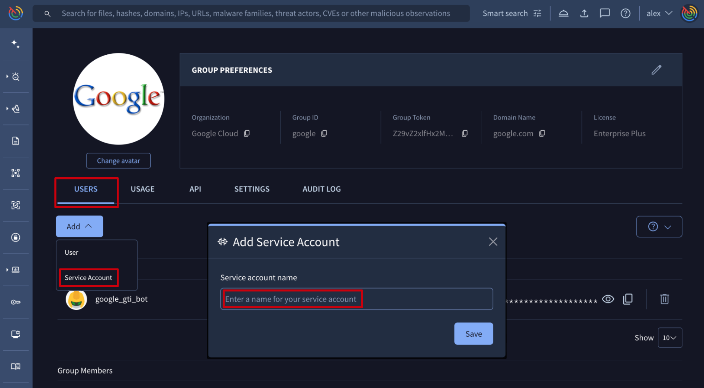

**Google Threat Intelligence API =>** Although creating new service accounts is a very occasional activity and you might not need to automate it because the web interface serves well for this purpose, the [/v3/groups/{id}/relationships/service\_accounts](https://gtidocs.readme.io/reference/create-a-new-service-account) endpoint can be used as well. It only requires the group ID [(check group ID)](#group-information) and a new service account object with the ID that it will receive as in the following example:

```json
payload = {
  "data": [
    {"id": "google_gti_bot", "type": "service_account"}
  ]
}
```

[Back to top](#walkthrough-guide-for-google-threat-intelligence-group-administrators)

#### 1.3.2.-removing-a-service-account-from-a-google-threat-intelligence-group

**Web interface =>** The list of service accounts is given on **My group** menu option -> **USERS** tab -> **Service accounts** section. Each of them has a bin icon at the right, that allows group administrators to delete the specific service account.

Please make sure that you are not going to interfere with any integration with Google Threat Intelligence by removing service accounts whose API keys are being used internally.

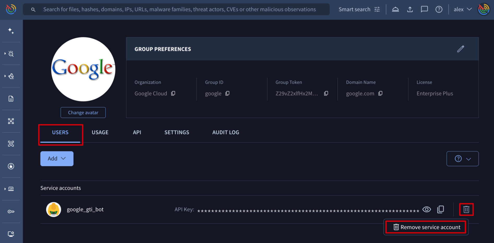

[Back to top](#walkthrough-guide-for-google-threat-intelligence-group-administrators)

#### 1.3.3.-getting-a-service-accounts-api-key

> 📘 **Services accounts API keys and ASM projects**
>
> When using a Google TI Service Account API key, the service account must be added as a owner/member to the target ASM Project and assigned the appropriate roles (e.g., Viewer, Editor) to grant it the necessary permissions to access project data.

**Web interface =>** The list of service accounts is given on **My group** menu option -> **USERS** tab -> **Service accounts** section. Each of them has an icon for unhiding the API key and another icon for copying it to the clipboard. Only group administrators are able to get the API key of a service account to use it on automation tasks such as IoCs enrichment.

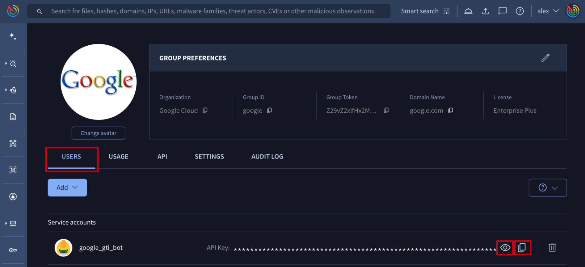

**Google Threat Intelligence API =>** Although checking service accounts API keys is a very occasional activity and you might not need to automate it because the web interface serves well to this purpose, the [/v3/service\_accounts/{id}](https://gtidocs.readme.io/reference/get-a-service-account-object) endpoint can be used as well. It only requires the service account ID or name. [(Check service account ID)](#service-account-information)

[Back to top](#walkthrough-guide-for-google-threat-intelligence-group-administrators)

## 2.-group-management

### 2.1.-general-settings

#### 2.1.1.-editing-organization-name,-domain-name-and-avatar

**Web interface =>** On the web platform, group administrators can find 2 ways of modifying organization name and domain name.

* The first one is on **My group** menu option -> **GROUP PREFERENCES**. By selecting the pen icon, group administrators are able to edit **Organization** and **Domain name** parameters.

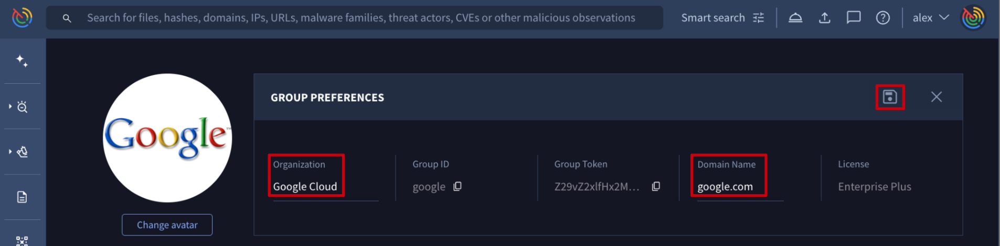

* The second way of editing this data is from **My group** menu option -> **SETTINGS** tab -> **Group info** section -> **Organization** and **Domain name** text boxes.

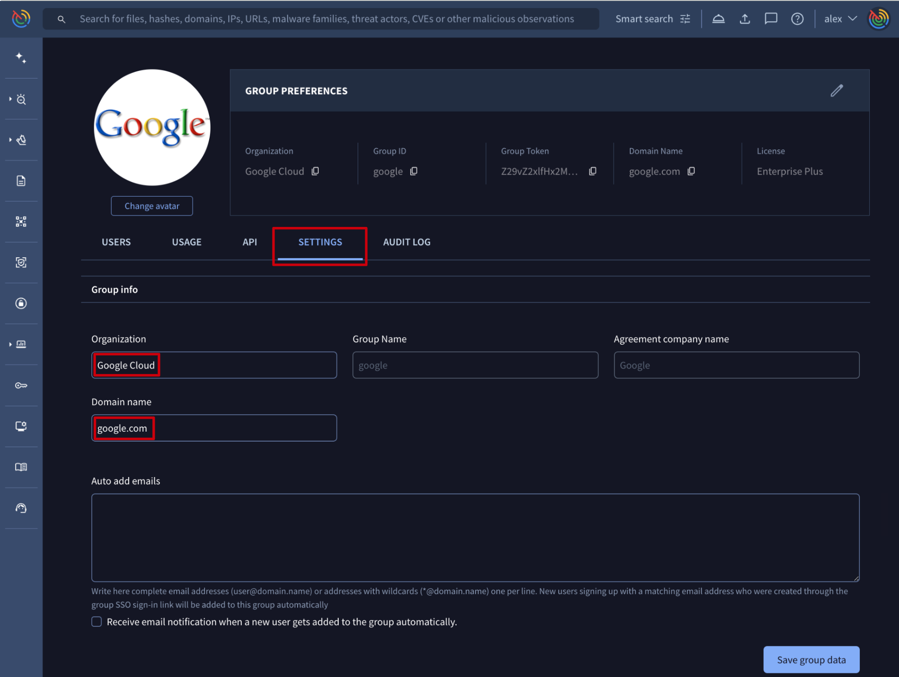

As for the group avatar, on **My group** menu option, at the top left is a **Change avatar** button that allows not only administrators but also common users to change group's avatar.

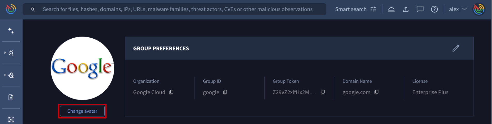

[Back to top](#walkthrough-guide-for-google-threat-intelligence-group-administrators)

#### 2.1.2.-managing-ai-features-preferences

**Web interface =>** From **My group** menu option -> **SETTINGS** tab -> **Preferences** section, group administrators can enable or disable AI-powered capabilities across the organization.

> 📘 **Impact of disabling AI features**
>
> When AI features are disabled for the group:
>
> * **Automated Threat Detection (ATD / GTI Alerts)**: The Alerts section and Relevance System will be hidden from the web navigation bar and inaccessible in the portal for all group members.
> * **Code Insight & AI Summaries**: Generative AI features, including automated file and URL code analysis and AI-generated threat summaries, will be disabled.
> * **API Usage Note**: While programmatic API access is governed by RBAC roles and your assigned Project ID, users in groups with AI features disabled will not be able to navigate to the web portal to retrieve their Project ID or review findings via the UI.

[Back to top](#walkthrough-guide-for-google-threat-intelligence-group-administrators)

### 2.2.-security-features

#### 2.2.1.-editing-all-group-members-session-timings

**Web interface =>** On **My group** menu option -> **SETTINGS** tab -> **Security controls** section, group administrators are able to define session maximum lifetime and inactivity time. Both of them are represented in seconds although they also show some default options by clicking on the input box. When these times are exceeded, users are forced to re-authenticate.

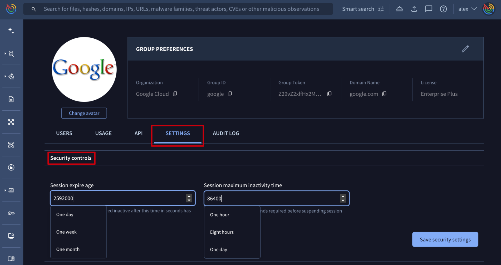

[Back to top](#walkthrough-guide-for-google-threat-intelligence-group-administrators)

#### 2.2.2.-single-sign-on---sso

**Web interface =>** On **My group** menu option -> **SETTINGS** tab -> **Single sign-on** section, group administrators are able to configure the **Identity provider** for SSO. Through the dropdown option, group administrators can enable one of the 3 SSO services already integrated or configure other preferred identity providers via Security Assertion Markup Language (**SAML**).

Please note that this only affects the authentication on the web platform. Google Threat Intelligence API authentication is not affected.

* ***Already integrated identity provider services***

If users have accounts in any of the 3 services (Google, GitHub, Microsoft), they can use those services to authenticate on our platform. For more information, refer to this [document](sso-authentication.md). Please note that users can always use one of these accounts without having to modify the Google Threat Intelligence enterprise group SSO configuration, but once configured, no one no longer will be able to authenticate on the platform via common credentials.

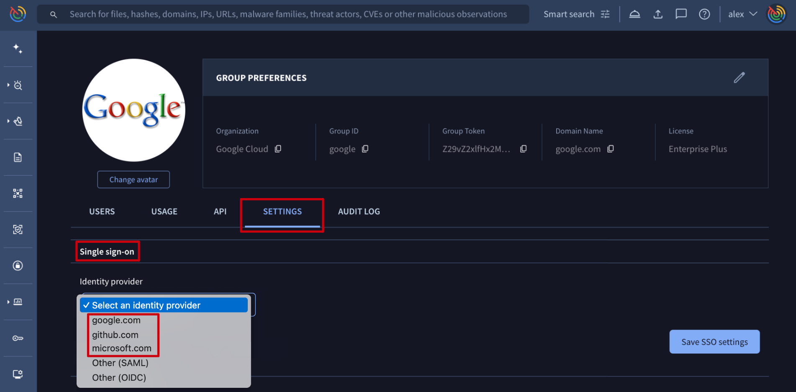

* ***SAML***

For configuring SAML, group administrators can check out these guide examples for [Okta](saml-okta.md),[Ping](saml-ping.md) or [Entra ID](saml-entraid.md) and replicate it to the preferred identity provider. The information needed to configure it is shown when selecting the **Other (SAML)** option in the **Identity provider** dropdown element. Please note that for forcing users to only authenticate via SAML, a checkbox is provided. If this checkbox is not selected, users can use both methods of authentication: SAML and common credentials. We recommend allowing both authentication mechanisms during SAML configuration to avoid losing access to the platform in case of any misconfiguration.

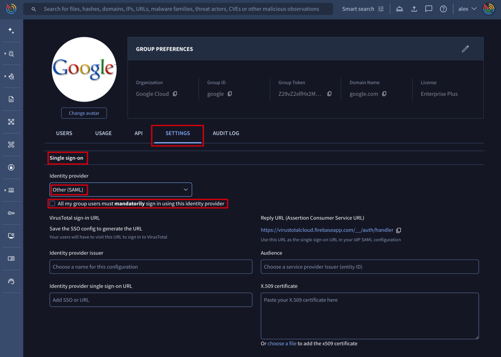

Please note that you must update rotated certificates manually in the SAML settings on the platform or via [API](https://gtidocs.readme.io/reference/groups-patch-samlconfig).

* ***OIDC***

The information needed to configure it is shown when selecting the **Other (OIDC)** option in the **Identity provider** dropdown element. Please note that for forcing users to only authenticate via OIDC, a checkbox is provided. If this checkbox is not selected, users can use both methods of authentication: OIDC and common credentials. We recommend allowing both authentication mechanisms during OIDC configuration to avoid losing access to the platform in case of any misconfiguration.

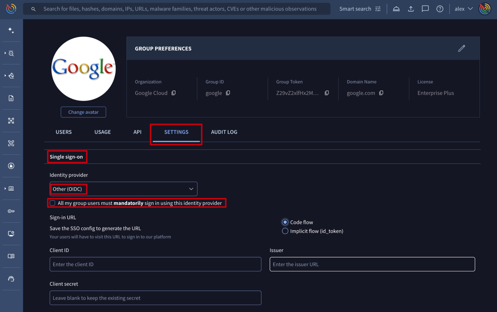

* ***SCIM integration***

After completing a **SAML** or **OIDC** setup, admins can enable a **SCIM** (System for Cross-domain Identity Management) webhook to automate user deprovisioning. This integration ensures that when a user is deactivated in your Identity Provider (IdP), they are automatically removed from your group.

Once a user is deactivated, a **7-day grace period begins**. Group administrators will receive an email notification regarding the pending removal and can contact the [support](https://www.virustotal.com/gui/contact-us/support) team to cancel the action if necessary. If no action is taken, the user will be removed after 7 days, and their associated assets including graphs, collections, Livehunt rules, etc, will be automatically reassigned to a randomly selected administrator of the group.

At the bottom of the **Single Sign-On** section, you will find the **SCIM Webhook URL** and **SCIM Secret Token**. These are automatically generated once your SSO configuration is finalized and are required for your IdP application setup, as shown in the Okta example [here](sso-authentication.md#scim-integration).

Note that the **SCIM Secret Token** is provided in the following format: `Bearer <token>`.

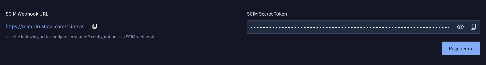

> 🚧
>
> Administrators can regenerate the SCIM Secret Token at any time. However, generating a new key **immediately invalidates the previous one**. To avoid service disruption, **ensure the new token is updated in your Identity Provider (IdP) immediately, and pause all provisioning activity in your IdP until the update is complete**.

* ***Adding new user to an existing Google Threat Intelligence group - automatically***

**Web interface =>** On **My group** menu option -> **SETTINGS** tab -> **Group info** section -> **Auto add emails** text box. Additionally, here group administrators can enable the below checkbox to be notified every time a new user is added to their group as a group member. This text box supports 2 types of inputs or conditions: complete email addresses and/or organization domain names regular expressions, with wildcards, (<_@google.com>,\_ @virustotal.com, \*@mandiant.com), *one entry per line*. When enabling this feature, new users whose email addresses meet one of the configured conditions and who are created through the group SSO sign-in link, are automatically added to the group, inheriting group's default configurations.

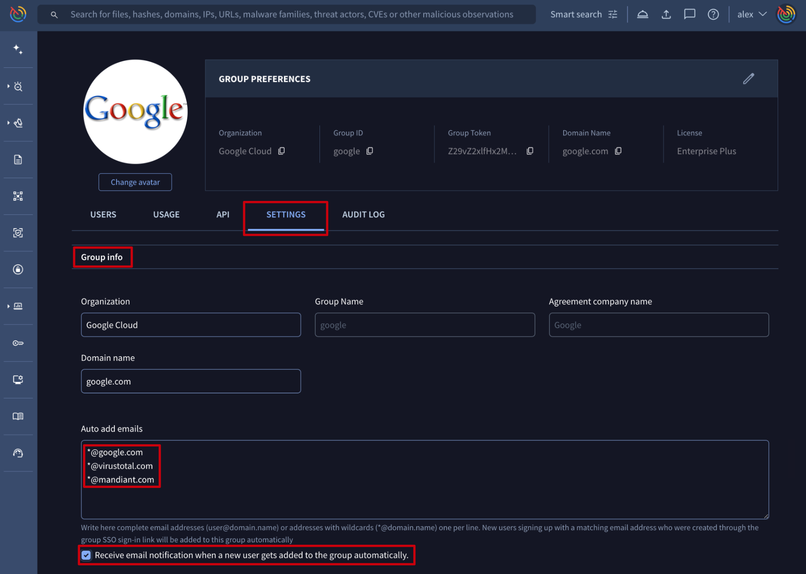

**Google Threat Intelligence API =>** The [/v3/groups/{id}](https://gtidocs.readme.io/reference/patch-group) endpoint can be used to PATCH a Google Threat Intelligence group object based on its group ID. [(Check group ID)](#group-information) The parameter associated with the automatically adding users to groups feature is *data->attributes->auto\_add\_users*. This parameter is a list of regular expressions (\*@company\_domain) and complete email addresses that are going to be checked with every new user, and those meeting any entry will be automatically added to the group as a new member. When using this endpoint, don't forget to specify the object `'type': 'group'` in the payload parameter as in the following example:

```json
payload = {
  "data": {
    "type": "group",
    "attributes": {
      "auto_add_users":["*@google.com", "*@virustotal.com", "*@mandiant.com", "email_addres1", "email_address2"]
    }
  }
}
```

Please note that since this parameter is rarely edited and the web interface is more than enough to cover it, we highly recommend editing this parameter manually through the web interface.

[Back to top](#walkthrough-guide-for-google-threat-intelligence-group-administrators)

#### 2.2.3.-two-factor-authentication-enforcement

**Web interface =>** From **My group** menu option -> **SETTINGS** tab -> **Two-factor authentication** section -> **Enforcement method** drop-down menu, group administrators can enforce Two-Factor Authentication (2FA) regardless of whether Single Sign-On (SSO) is enabled. The available options are:

* **Offline Codes**: users must provide a pre-generated recovery/offline code to authenticate. In this case, admins can specify the number of codes generated per user (between 10 and 100; 30 by default) via the **Offline codes quantity** field. The system will notify users when they are running low on codes; when only one code remains, the user must regenerate a new set before they can proceed.
* **2FA App**: users must provide a code from a registered 2FA device (such as an authenticator app) to authenticate.
* **Any**: users can choose between either method.

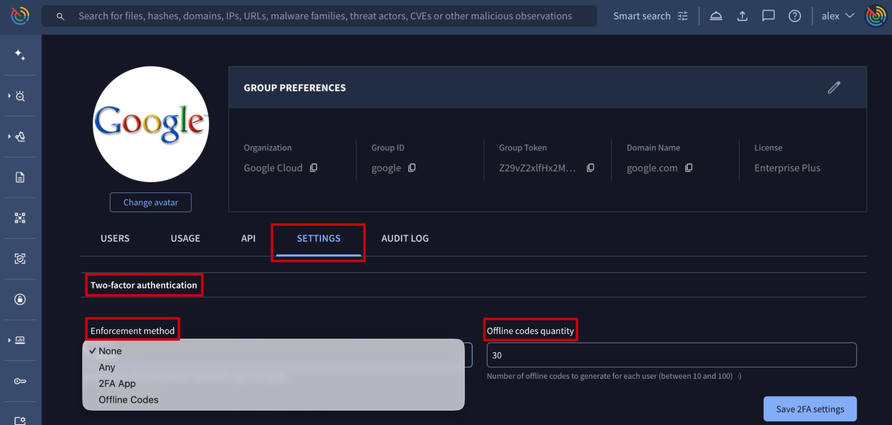

Once any of these options are enabled, new group members will be prompted to **set up 2FA during the sign-up** process, while existing users will be required to do so **upon their next sign-in**.

Admin-enforced 2FA requirements override individual user preferences. Even if **users can configure 2FA manually in their account settings**, they are restricted to the administrator's chosen methods and cannot disable the requirement.

Note that admins can **define sessions duration and expiration** as described [here](#221-editing-all-group-members-session-timings) and perform 2FA resets for individual users as detailed [here](#125-resetting-two-factor-authentication-for-a-user).

[Back to top](#walkthrough-guide-for-google-threat-intelligence-group-administrators)

### 2.3.-private-scanning-settings

#### 2.3.1.-editing-private-scanning-retention-period-and-storage-region

**Web interface =>** On **My group** menu option -> **SETTINGS** tab -> **Private scanning** section, group administrators can configure the default **Retention period days** of files submitted to Private Scanning, their **Storage region** during their lifetime in Google Threat Intelligence's database and also some analysis preferences such as **detonating the sample in dynamic analysis sandboxes** to be not just statically but also dynamically analyzed. For this, other configurations are available such as **enabling internet access** to allow external communications of the file and **intercepting HTTP/TLS communications**. Additionally, there's an option for **enabling live interactions** of analysts with the sandbox where the sample is detonated.

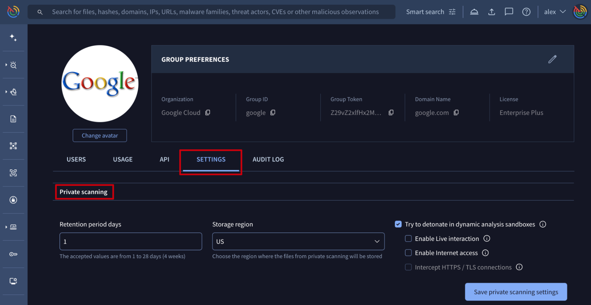

This configuration will be used by default, although users are able to configure these parameters for each file they are submitting to Private Scanning directly from the submission form.

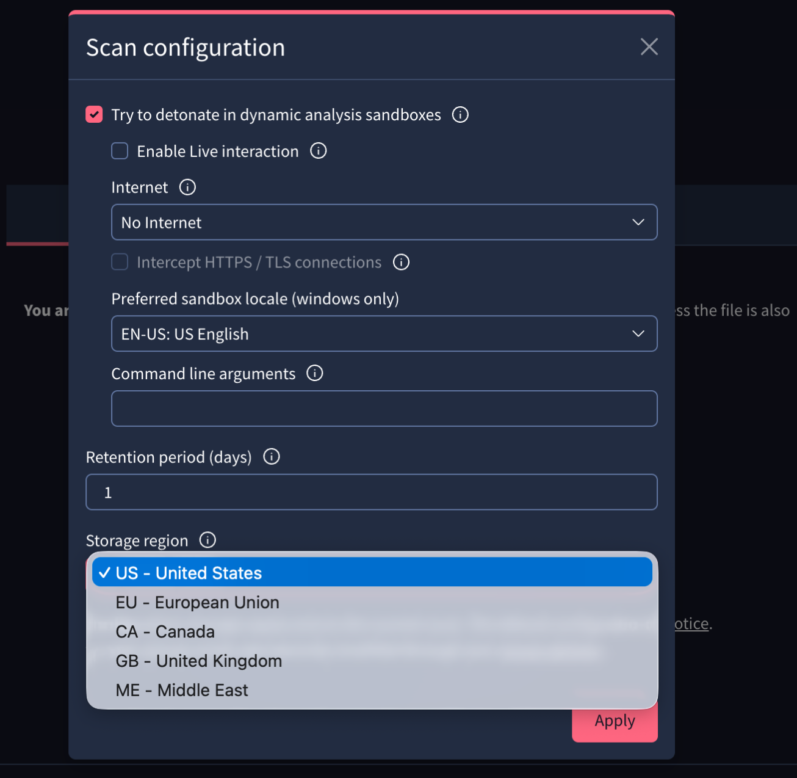

[Back to top](#walkthrough-guide-for-google-threat-intelligence-group-administrators)

## 3.-consumption

### 3.1.-google-threat-intelligence-features-consumption

#### 3.1.1.-getting-current-month-group-overall-consumption

**Web interface =>** On the **My group** menu option -> **USAGE** tab -> the **Consumption current month** section displays usage per feature relative to your monthly allowance. Exceeded consumption will be highlighted in red.

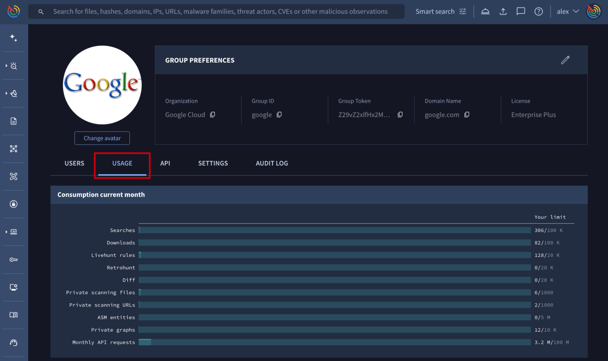

[Back to top](#walkthrough-guide-for-google-threat-intelligence-group-administrators)

#### 3.1.2.-getting-users-individual-consumption

**Web interface =>** On **My group** menu option -> **USAGE** tab, there are several sections providing a breakdown of the group’s monthly consumption by feature and  user, displaying only those features with active usage:

* **Search consumption by user**
* **Downloads consumption by user**
* **Livehunt rules consumption by user**
* **Retrohunt consumption by user**
* **Private scanning files consumption by user**
* **Private scanning URLs consumption by user**
* etc

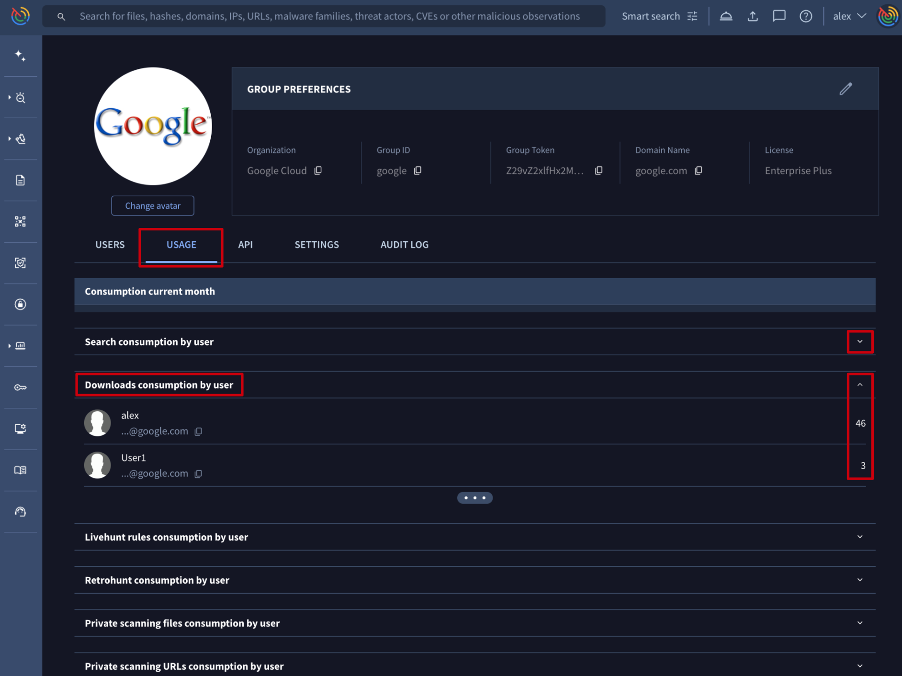

[Back to top](#walkthrough-guide-for-google-threat-intelligence-group-administrators)

### 3.2.-google-threat-intelligence-api-consumption

#### 3.2.1.-getting-group-overall-api-consumption

**Web interface =>** On **My group** menu option -> **API** there's a section showing the **Access level** and API allowance assigned to the group as the **Daily quota** and the **Request rate** per minute.

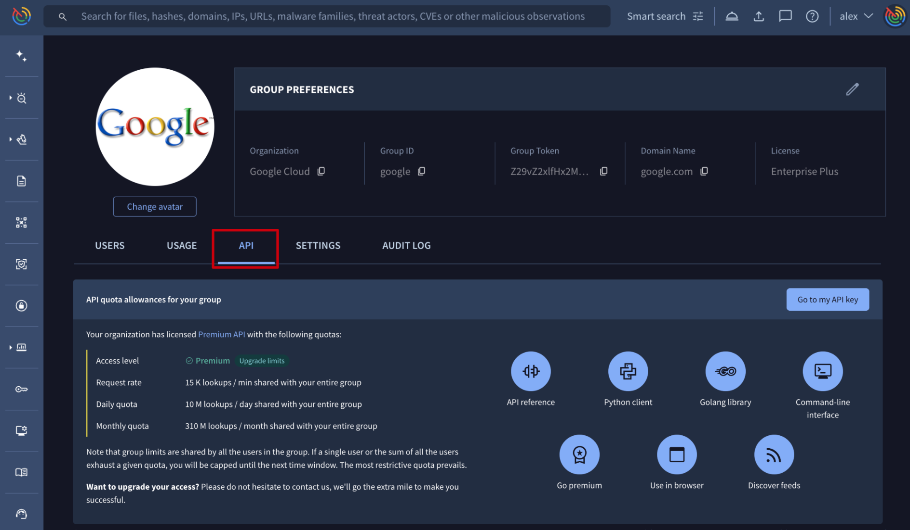

There are 2 additional sections showing the group's overall API consumption: **Consumption last 30 days** breaks down the group's last 30 days API consumption by day, and **Consumption by endpoint** shows previous day consumption by endpoint. For more granular details please use the Google Threat Intelligence APIv3.

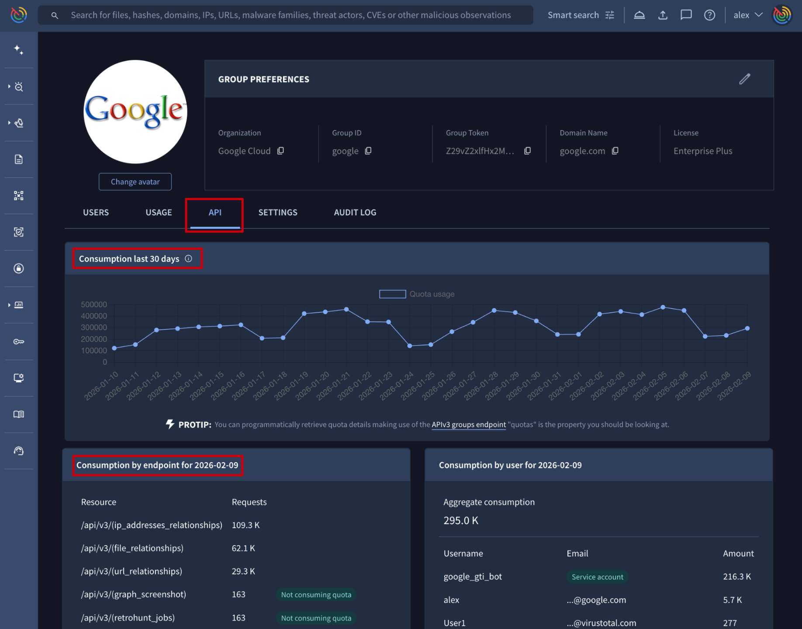

**Google Threat Intelligence API =>** The [/v3/groups/{id}/api\_usage](https://gtidocs.readme.io/reference/group-api-usage) endpoint shows a group's API usage broken down by day and endpoint, pointing out the endpoints that really consume API as well as those that do not (`not_consuming_quota`). The data available includes only the last 30 natural days and the required parameter is the group ID. [(Check group ID)](#group-information) Additionally, you can specify the start day and last day parameters of the time range you want to track (yyyymmdd format).

[Back to top](#walkthrough-guide-for-google-threat-intelligence-group-administrators)

#### 3.2.2.-getting-users-individual-api-consumption

**Web interface =>** On the **My group** menu option -> **API** tab -> **Consumption by user** section shows previous day's consumption by user. For more granular details please use the APIv3.

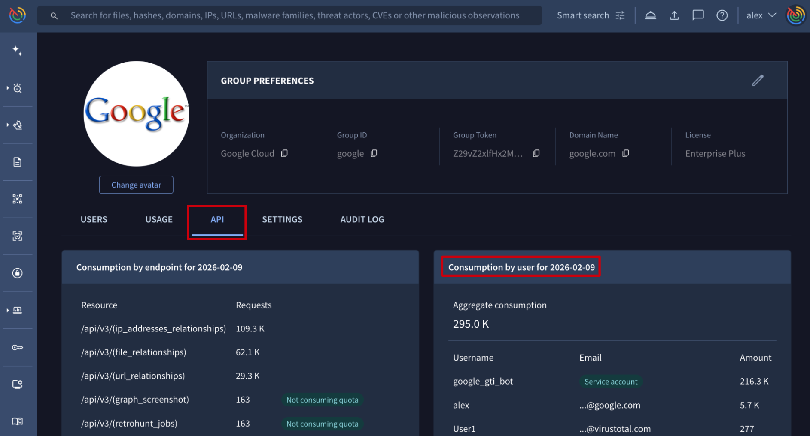

**Google Threat Intelligence API =>** The [/v3/users/{id}/api\_usage](https://gtidocs.readme.io/reference/user-api-usage) endpoint shows an user's API usage broken down by day and endpoint, pointing out the endpoints that really consume API as well as those that do not (`not_consuming_quota`). The data available includes only the last 30 natural days and the required parameter is the user ID. [(Check user ID)](#user-information) Additionally, you can specify the start day and last day parameters of the time range you want to track (yyyymmdd format).

[Back to top](#walkthrough-guide-for-google-threat-intelligence-group-administrators)

## 4.-audit-log

### 4.1.-filtering-logs

**Web interface =>** From the **My group** menu option -> **AUDIT LOG** tab -> administrators can view the Audit Log, detailing the platform's most relevant actions. The log includes fields like **Timestamp (UTC)**, **Username**, **User Email**, **Source IP**, **Target Type**, **Target Identifier**, and the **Action** taken.

Logs can be filtered using the collapsible left-side panel, which features key attributes like **Date**, **User**, **Action** and **Target Identifier**.

The **User** filter, along with the **Username** and **User Email** fields in the log table, all refer to the user who performed the action.

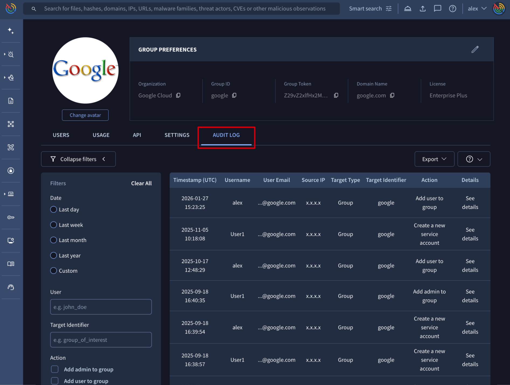

**Google Threat Intelligence API =>** The [/api/v3/groups/{group}/activity\_log\_entries](https://gtidocs.readme.io/reference/get-activity-log) endpoint retrieves a list of activity logs. It supports a `filter` query parameter that allows you to narrow the results using the same criteria available in the UI.

Be aware that unlike the UI (where **Username** and **User Email** are direct columns), the API requires you to access the user who performed the action through the dedicated `user` relationship. Consult the endpoint document for details.

[Back to top](#walkthrough-guide-for-google-threat-intelligence-group-administrators)

### 4.2.-exporting-logs

**Web interface =>** From the **My group** menu option -> **AUDIT LOG** tab -> **Export** drop-down menu, administrators can export the Audit Log in **CSV** or **Json** format, or **Copy to clipboard** in JSON format. The current filters are applied to all exported logs.

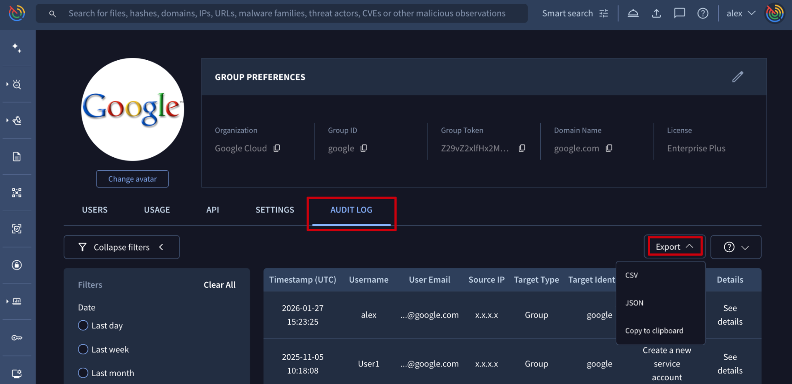

**Google Threat Intelligence API =>** Use the [/api/v3/groups/{group}/activity\_log\_entries](https://gtidocs.readme.io/reference/get-activity-log) endpoint to retrieve activity logs in JSON format, applying the filters and relationships detailed in the endpoint documentation.

[Back to top](#walkthrough-guide-for-google-threat-intelligence-group-administrators)

### 4.3.-seeing-details

**Web interface =>** From the **My group** menu option -> **AUDIT LOG** tab -> administrators can view the Audit Log of the platform's most relevant actions. For detailed context on an event, like which user was granted admin privileges or which user was removed from the group, admins can click the **See details** button located on the right of each log entry, which automatically displays the **Audit Log Event Details**.

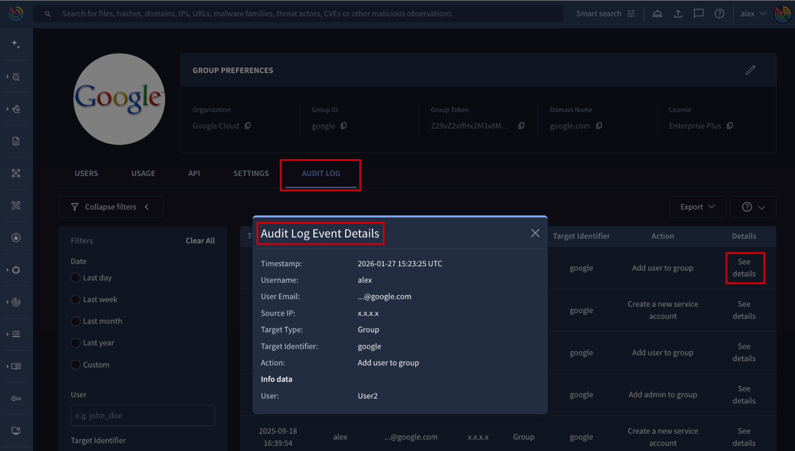

**Google Threat Intelligence API =>** The [/api/v3/groups/{group}/activity\_log\_entries](https://gtidocs.readme.io/reference/get-activity-log) endpoint retrieves activity logs allowing the application of filters and relationships as detailed in the endpoint documentation.

[Back to top](#walkthrough-guide-for-google-threat-intelligence-group-administrators)

---

← [Terms of Service and Privacy Policy](../01-introduction/tos-pp-section.md) · [up](README.md) · [Single Sign On Authentication](sso-authentication.md) →

*Archived from <https://gtidocs.virustotal.com/docs/admins-guide>.*
