[gtidocs](../../README.md) › [Guides](../README.md) › [Group Management](README.md) › Multi-tenancy

---

# multi-tenancy

This guide aims to make group administrators familiar with the Google Threat Intelligence (Google TI) multi-tenancy, once the client has been provided with the multi-tenancy privileges.

From the initial membership creation and member onboarding to ongoing permissions management, content moderation, and performance tracking, this handbook covers every practical action an administrator can perform.

Many of the administrative actions discussed here refer back to the [**Walkthrough guide for Google Threat Intelligence group administrators**](admins-guide.md). The primary difference is that these actions, while detailed in the Walkthrough, can now be executed across various groups or tenants managed by the parent group, not just an individual one.

***Table of content***

* [Getting Started: Core Concepts](#getting-started-core-concepts)
  * [Multi-Tenancy](#multi-tenancy)
  * [Group ID and Group Token](#group-id-and-group-token)
  * [Cross-Tenant Platform Usage and Consumption](#cross-tenant-platform-usage-and-consumption)
* [Multi-tenancy Management](#multi-tenancy-management)
  * [Tenants Management](#tenants-management)
    * [1. Create a new child tenant: Organic method](#1-create-a-new-child-tenant-organic-method)
    * [2. Adopt an existing group: Adoption method](#2-adopt-an-existing-group-adoption-method)
    * [3. Delete a linked tenant](#3-delete-a-linked-tenant)
  * [Tenants Quota Allowance and Add-ons Management](#tenants-quota-allowance-and-add-ons-management)
    * [1. Manage organic tenant quota allowance](#1-manage-organic-tenant-quota-allowance)
  * [Tenant Members Management](#tenant-members-management)
  * [Tenant Group Management](#tenant-group-management)
  * [Tenant Feature Consumption Monitoring](#tenant-feature-consumption-monitoring)

# getting-started:-core-concepts

Before diving into the actions, let's clarify some core concepts and important data related to platform multi-tenancy. This will make it easier to understand their references throughout the rest of this document.

## multi-tenancy

In Google TI, an organization's members are organized into user **groups**. Organizations can tailor their structure to have one or several additional child sub-groups/tenants (**multi-tenancy**), based on their operational requirements.

There are two ***multi-tenancy*** types, and both of them feature a **parent group** and **multiple child groups**. However, only administrators of the parent group are authorized to link the parent group with the child groups. They are able to manage the child groups and their specific permissions based on the method used to link them.

| *Adoption* method                                                                                                                                                                                                | *Organic* method                                                                                                                                   |
| ---------------------------------------------------------------------------------------------------------------------------------------------------------------------------------------------------------------- | -------------------------------------------------------------------------------------------------------------------------------------------------- |
| The parent group **adopts** an already existing group (**adopted tenant**) that have its own Google TI license                                                                                                   | The parent group creates a new sub-group (**organic tenant**) that doesn't have its own separate licenses, instead it is inherited from the parent |
| The child tenant acts as an **independent** group with its own license, features access and quota allowance                                                                                                      | The child tenant is **entirely dependent** on the parent group, inheriting its license, including features access and allowances                   |
| The parent group has **no administrative capabilities** over distributing quota to the child tenants                                                                                                             | The parent group has **unrestricted administrative capabilities** over child tenants                                                               |
| The parent group has **administrative capabilities** over distributing quota to the child tenant members                                                                                                         | The parent group has **unrestricted administrative capabilities** over child tenant members                                                        |
| The parent group has **complete visibility** into the child tenant's usage and any elements shared across all its members                                                                                        | The parent group has **complete visibility** into the child tenant's usage and any elements shared across all its members                          |
| This method proves beneficial in scenarios such as an organization acquiring another with an existing Google TI license, or for an MSSP seeking to streamline the management of new or expiring client contracts | This method is ideal for organizations looking to control and separate platform access and member activity visibility among different teams        |

> ⚠️
>
> Multi-tenancy supports **only two levels of group hierarchy**. Consequently, a child group cannot subsequently serve as a parent for additional tenants.

[Back to top](#content-head)

## group-id-and-group-token

The **Group ID** and **Group Token** are essential parameters for various management actions, including adopting existing tenants or checking a tenant's consumption. Both of them can be found in the UI via the **My group** option in the top-right user menu.

Within this view, group setups and additional information are organized into different tabs. Note that the **TENANTS** tab is *exclusively available to parent group administrators* and allows them to manage tenants, as detailed in the [Multi-tenancy Management](#multi-tenancy-management) section.

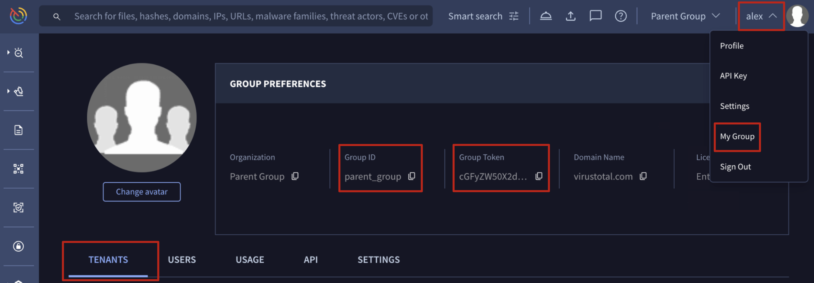

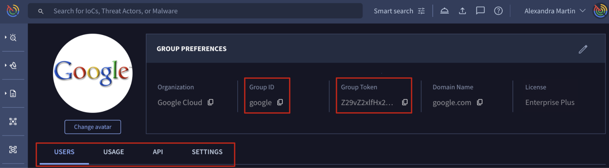

[Back to top](#content-head)

## cross-tenant-platform-usage-and-consumption

When a user belongs to multiple sub-groups/tenants in addition to the parent group (for instance, a parent group user also added to several tenant groups for collaboration) a new menu becomes available. This menu, located at the top right near the user's main menu, allows them to quickly pivot to the tenant whose quota they wish to use. Once a tenant is selected, all subsequent actions performed by the user in the web interface will be charged against that selected tenant's quota.

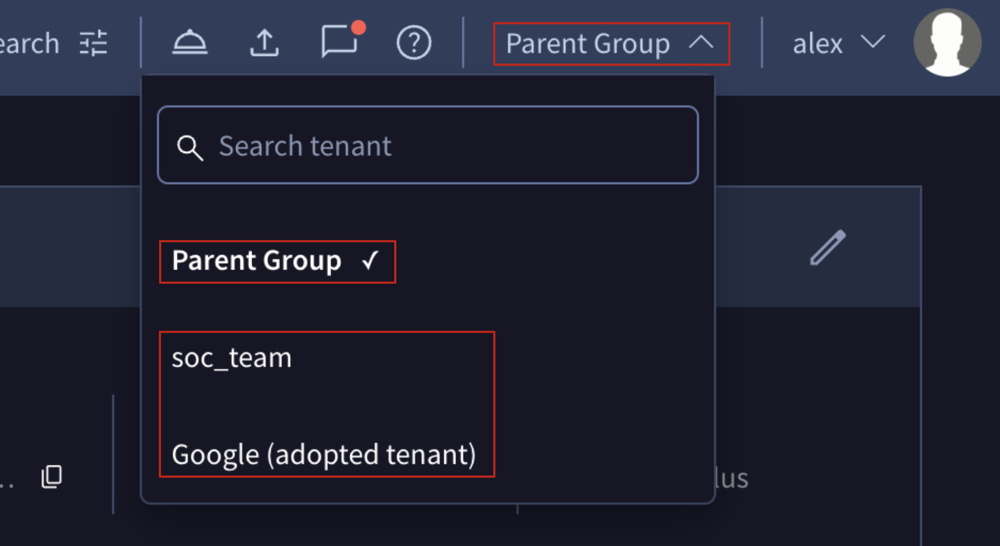

# <a-name="menu-callout"-/>

> ⚠️
>
> If you don't see your desired tenant in the new menu options, please make sure you've been added as a member or administrator for that tenant.

# <a-name="api-callout"-/>

> ⚠️
>
> Note that **API** quota consumption is also affected when a user belongs to multiple groups (parent + one or more tenants). If you're using a **personal API key** that's tied to several groups, you must **specify the [Group ID](#group-id-and-group-token) whose API quota you want to use**. You do this by including the optional **`X-Active-Group`** parameter in the request body. If you don't specify it, the parent group's quota will be used by default.

For example, this is how you would [get a file analysis report](https://gtidocs.readme.io/reference/file-info):

```python
import requests
id = "<file-sha256-hash>"
url = f"https://www.virustotal.com/api/v3/files/{id}"

headers = {
    "accept": "application/json",
    "x-apikey": <api-key>,
    "X-Active-Group": <group-id>
}
response = requests.get(url, headers=headers)
```

[Back to top](#content-head)

# multi-tenancy-management

## tenants-management

Only administrators of multi-tenancy-enabled groups can take these actions:

### 1.-create-a-new-child-tenant:-organic-method

From the top right corner User menu -> **My group** option -> **TENANTS** tab -> **Add new tenant** button -> *Select* **Create a new Tenant** option and enter the desired **Tenant Name**.

Automatically a new tenant will be created with ID = $(parent group id)\_$(child provided name) and it will be listed under the **Summary** section of the **TENANTS** tab from where administrators can access and edit tenant's settings and information.

The user who creates the tenant is automatically added as a group administrator of it. Their specific permissions within the tenant can be adjusted later, as outlined in the [Tenant Members Management](#tenant-members-management) section.

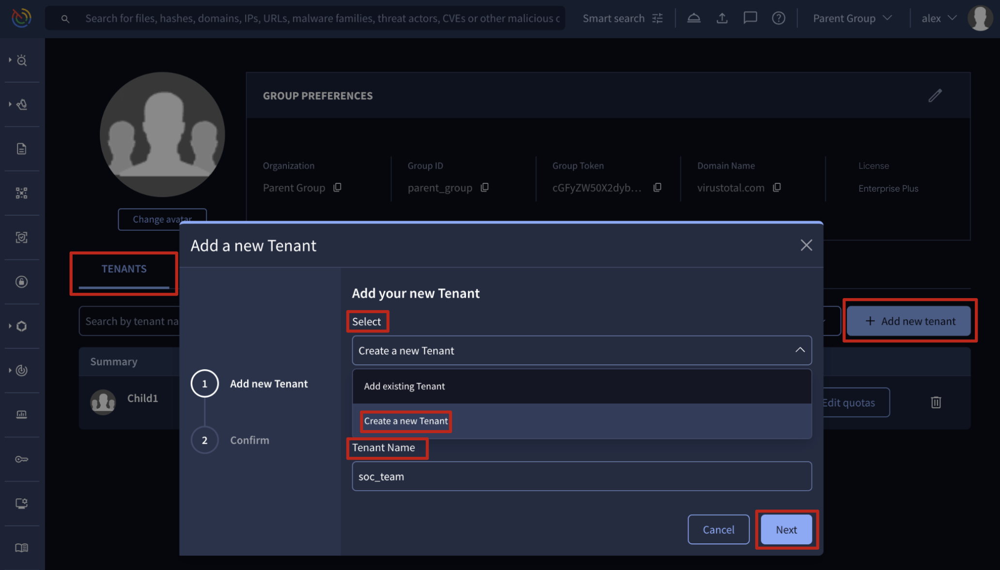

> ⚠️
>
> Be aware that new organic tenants will inherit the same parent group's quota. However, ASM, DTM, and IoC Feeds are exceptions and require an administrator to enable them as detailed [**here**](#tenants-quota-allowance-and-add-ons-management).
> It's crucial to edit tenant feature quota allowances because, by default, these groups share the parent group's quota. Effectively [managing these quota allowances](#tenants-quota-allowance-and-add-ons-management) is highly recommended to prevent losing access to critical features precisely when you need them most.

#### quota-distribution-strategies

The most common strategies for distributing quotas are:

* **Equal Distribution**: For a fast, low-effort approach, equally distribute quotas to each new tenant, especially when unsure of a team's specific needs.

* **Task-Based Allocation**: An advanced strategy involves tailoring quota allowances based on each tenant's primary tasks. For example, an API and integrations team might need a higher API quota allowance than a team focused on fixing exposed assets detected by ASM, though both may require access to both features for testing.

* **Monitor and Adapt**: A hybrid approach involves equally distributed quotas initially and then reviewing consumption over two to three months to fine-tune allocations. This is useful when you're unsure of each tenant's main goals.

Regardless of the strategy, quota management is an ongoing process. The tighter your quota allowance configuration, the more frequently you'll need to adapt and adjust it.

All group administrators get an email **notification when a quota is reached**, specifying the group and the feature involved. This information is also reflected on the **USAGE** tab within the [tenant administrative view](#tenant-feature-consumption-monitoring) and is valuable for adjusting quotas.

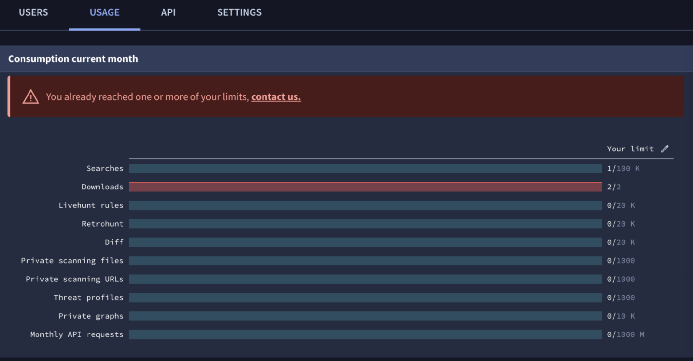

[Back to top](#content-head)

### 2.-adopt-an-existing-group:-adoption-method

From the top right corner User menu -> **My group** option -> **TENANTS** tab -> **Add new tenant** button -> *Select* **Add existing Tenant** option and fill in the **Group Token** of the group you want to adopt. To adopt an existing group as a tenant, you'll first need its [Group Token which can only be provided by an administrator of that sub-group](#group-id-and-group-token).

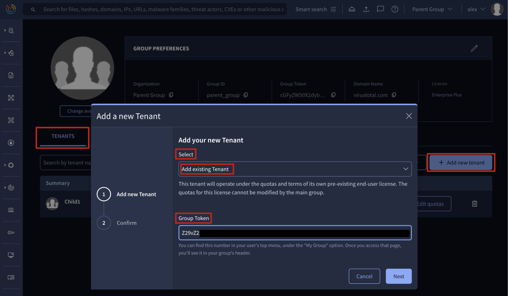

Once completed this step, an invitation email is sent to the administrators of the adopted group. **This group will only link with the parent group after that invitation is accepted by any of its administrators**. Until then, **Pending** invitations are listed in the **Tenant invitations** section of the **TENANTS** tab of the parent group, and from there, parent group administrators can delete or resend invitations.

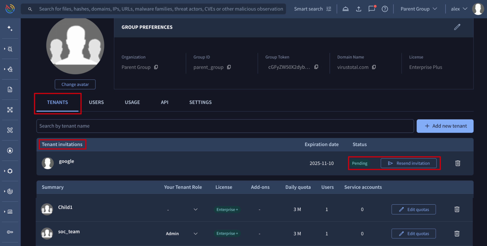

[Back to top](#content-head)

### 3.-delete-a-linked-tenant

On the top right corner User menu -> **My group** option -> **TENANTS** tab, the **Summary** section lists all linked tenants, whether they are organic or adopted. Each of them is provided with a bin icon at the right from where parent group administrators can delete or unlink children tenants.

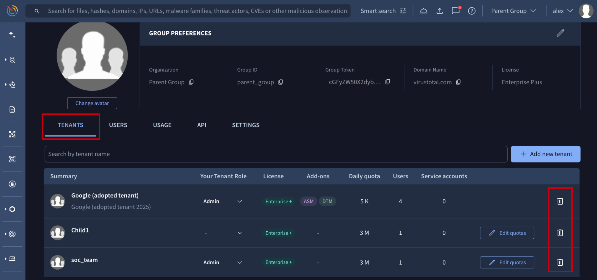

In addition to the method described above, there is another way to unlink a tenant from its parent group, led in this case by the administrators of the tenants instead of the administrators of the parent group.

Administrators of the tenant itself can go to the top right corner User menu -> **My group** option and on the **GROUP PREFERENCES** section of the accessed administrative view of the tenant they can click on the **Unlink from parent group** or **Delete tenant** button for adopted and organic tenants respectively.

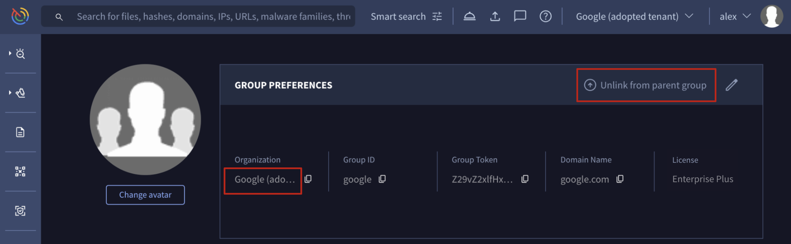

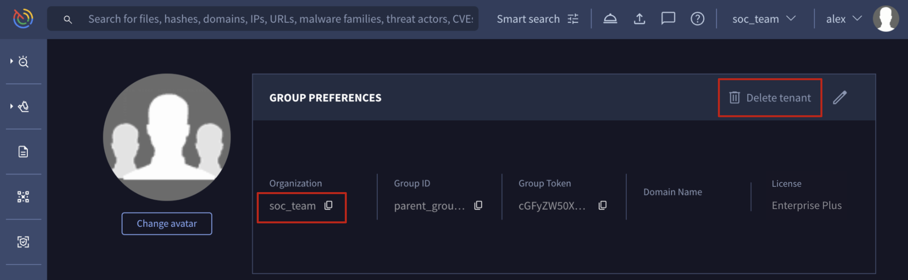

**Adopted tenants**

Deleting an adopted tenant unlinks it from the parent group, removing the parent group administrators' access to its information and settings, unless they are administrator members of the tenant. The tenant continues to operate independently with its own license.

**Organic tenants**

When an organic tenant is deleted:

* Non-private elements like Livehunt rules, Threat Graphs, IoC collections and Threat Profiles are transferred to a parent group's administrator.
* ASM, DTM, and all private elements (including Private Scannings files and URLs analysis reports) are not transferred.
* Users that previously belonged to the tenant are removed from it and converted to free VirusTotal users.

[Back to top](#content-head)

## tenants-quota-allowance-and-add-ons-management

### 1.-manage-organic-tenant-quota-allowance

On the top right corner User menu -> **My group** option -> **TENANTS** tab, the **Summary** section lists all linked tenants, whether they are organic or adopted. Only organic tenants are provided with the **Edit quotas** button which shows the edition view of the tenant. Clicking the tenant name opens the same editing view.

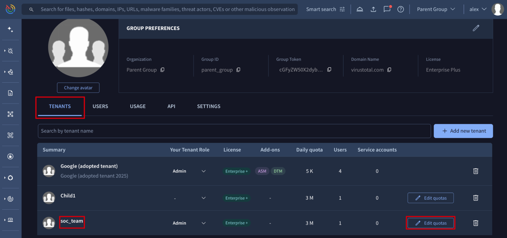

On the **USAGE** tab of this view, parent group administrators can edit the tenant feature quota allowances by clicking **Your limit** pen button at the top right corner of the **Consumption current month** section and adjusting the quota allowance range slider, and then saving settings using the new **Limits** saving button that has appeared in the same place as the pen button.

On the same **USAGE** tab of this edit view, parent group administrators can also enable or disable the tenant's access to **Add-ons** like ASM, DTM and IoC Feeds.

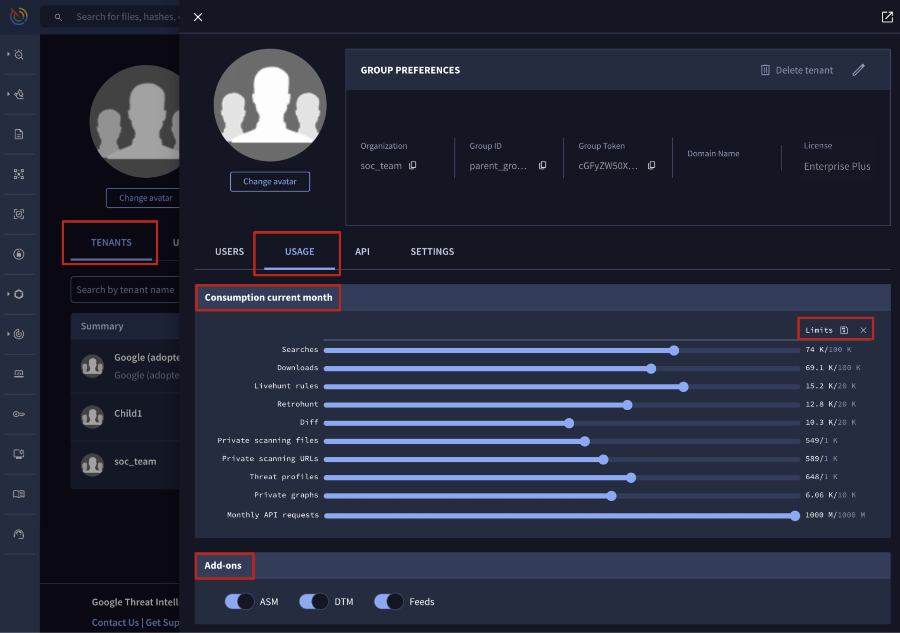

[Back to top](#content-head)

## tenant-members-management

Managing tenant members involves actions that mirror those doable on a standard isolated group as detailed in the [**Group members management**](admins-guide.md#1.-group-members-management) section of the [**Walkthrough guide for Google Threat Intelligence group administrators**](admins-guide.md), with one exception, **parent group administrator who are member of a tenant**.

First, any **parent group administrators**, regardless of whether they are members of the tenant, must first navigate to the top right corner User menu -> **My group** option -> **TENANTS** tab. The **Summary** section then displays all linked tenants, whether they are organic or adopted.

From here, **administrators who are members of the tenants** can manage their specific permissions for those tenants right from the **Summary** table. The **Your Tenant Role** column allows them to assign themselves the **Admin** or **Member** role, or use the **-** option to revoke their access entirely.

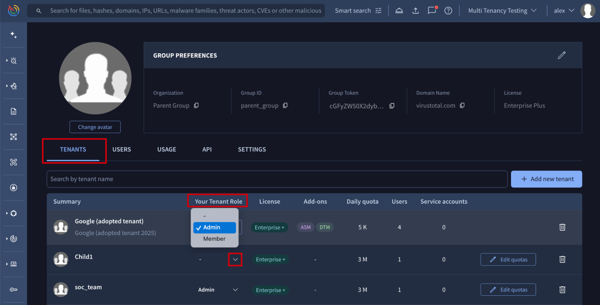

To manage all other tenant users, any **parent group administrator** must first access the tenant's dedicated edit view by simply clicking the tenant name.

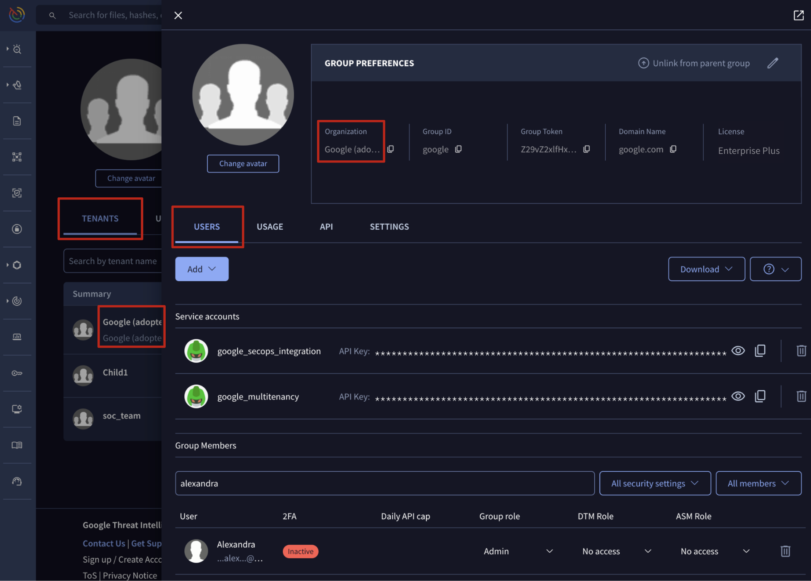

With this view accessed, all actions in this section are restricted to the **USERS** tab. The procedures are identical to those for a standard isolated group, but they're now applied within the specific context of a child tenant, rather than a main parent group.

Actions Available to Parent Group Administrators for Child Tenants:

1. [Getting group members](admins-guide.md#1.1.-getting-group-members)

   1.1. [Getting the list of users and service accounts](admins-guide.md#1.1.1.-getting-the-list-of-users-and-service-accounts)

2. [Users management](admins-guide.md#1.2.-users-management)

   2.1. [Adding new user to an existing Google Threat Intelligence group](admins-guide.md#1.2.1.-adding-new-user-to-an-existing-google-threat-intelligence-group)

   2.2. [Adding new user to an existing Google Threat Intelligence group - automatically](admins-guide.md#122-adding-new-user-to-an-existing-google-threat-intelligence-group---automatically)

   2.3. [Removing user from a Google Threat Intelligence group](admins-guide.md#123-removing-user-from-a-google-threat-intelligence-group)

   2.4. [Managing user privileges or role](admins-guide.md#124-managing-user-privileges-or-role)

   2.5. [Managing user API quota allowance](admins-guide.md#125-managing-user-api-allowance)

3. [Service accounts management](admins-guide.md#1.3.-service-accounts-management)

   3.1. [Adding a new service account to an existing Google Threat Intelligence group](admins-guide.md#1.3.1.-adding-a-new-service-account-to-an-existing-google-threat-intelligence-group)

   3.2. [Removing a service account from a Google Threat Intelligence group](admins-guide.md#1.3.2.-removing-a-service-account-from-a-google-threat-intelligence-group)

   3.3. [Getting a service accounts API key](admins-guide.md#1.3.3.-getting-a-service-accounts-api-key)

[Back to top](#content-head)

## tenant-group-management

Managing tenant group settings involves actions that mirror those available for a standard isolated group as detailed in the [**Group management**](admins-guide.md#2.-group-management) section of the [**Walkthrough guide for Google Threat Intelligence group administrators**](admins-guide.md).
However, as mentioned in the previous section, an additional initial step is required: accessing the tenant's dedicated editing view.

To do so, **parent group administrators** can go to the top right corner User menu -> **My group** option -> **TENANTS** tab. The **Summary** section lists all linked tenants, whether they are organic or adopted. Clicking a tenant name opens the editing view.

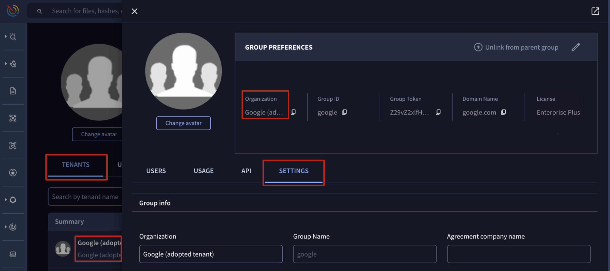

From the edit view, all actions described in this section can be performed from the **SETTINGS** tab, and they're now applied within the specific context of a child tenant, rather than a main parent group.

Actions Available to Parent Group Administrators for Child Tenants:

1. [General settings](admins-guide.md#2.1.-general-settings)

   1.1. [Editing organization name, domain name and avatar](admins-guide.md#2.1.1.-editing-organization-name,-domain-name-and-avatar)

2. [Security features](admins-guide.md#2.2.-security-features)

   2.1. [Editing all group members session timings](admins-guide.md#2.2.1.-editing-all-group-members-session-timings)

   2.2. [Single Sign On - SSO](admins-guide.md#2.2.2.-single-sign-on---sso)

3. [Private Scanning settings](admins-guide.md#2.3.-private-scanning-settings)

   3.1. [Editing Private Scanning retention period and storage region](admins-guide.md#2.3.1.-editing-private-scanning-retention-period-and-storage-region)

[Back to top](#content-head)

## tenant-feature-consumption-monitoring

Accessing tenant group features consumption mirrors the process detailed in the [**Consumption**](admins-guide.md#3.-consumption) section of the [**Walkthrough guide for Google Threat Intelligence group administrators**](admins-guide.md). The key difference is that it has to be performed from the tenant's dedicated view.

To do so, **parent group administrators** must navigate to the top right corner User menu -> **My group** option -> **TENANTS** tab and from the **Summary** section click on any of the listed linked tenants name.

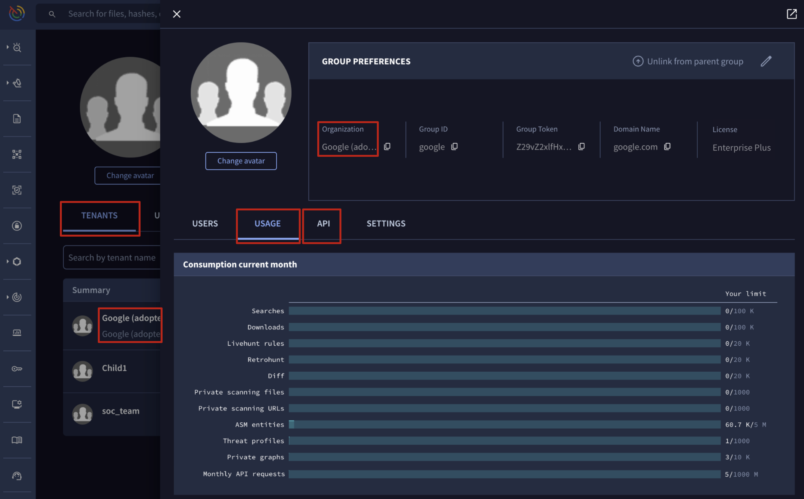

In this view, the **USAGE** tab displays features consumed via the UI, while the **API** tab shows API consumption, all within the context of the child tenant, rather than a main parent group.

1. [Google Threat Intelligence features consumption](admins-guide.md#3.1.-google-threat-intelligence-features-consumption)

   1.1. [Getting current month group overall consumption](admins-guide.md#3.1.1.-getting-current-month-group-overall-consumption)

   1.2. [Getting users individual consumption](admins-guide.md#3.1.2.-getting-users-individual-consumption)

2. [Google Threat Intelligence API consumption](admins-guide.md#3.2.-google-threat-intelligence-api-consumption)

   2.1. [Getting group overall API consumption](admins-guide.md#3.2.1.-getting-group-overall-api-consumption)

   2.2. [Getting users individual API consumption](admins-guide.md#3.2.2.-getting-users-individual-api-consumption)

[Back to top](#content-head)

---

← [How consumption quotas are handled](quota-consumption/consumption-quotas-handled.md) · [up](README.md) · [Agentic Platform](../03-agentic/agentic-platform.md) →

*Archived from <https://gtidocs.virustotal.com/docs/multi-tenancy-guide>.*
