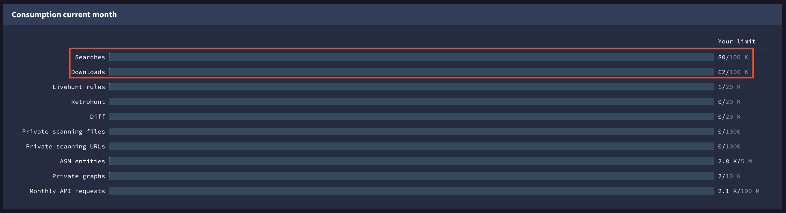
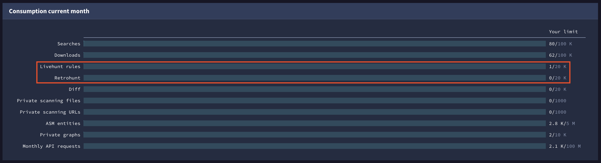
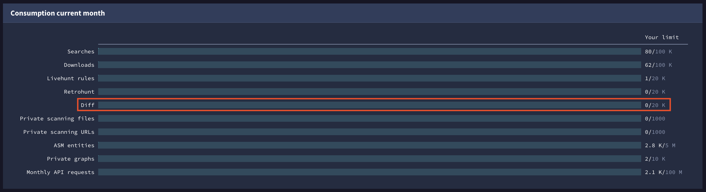
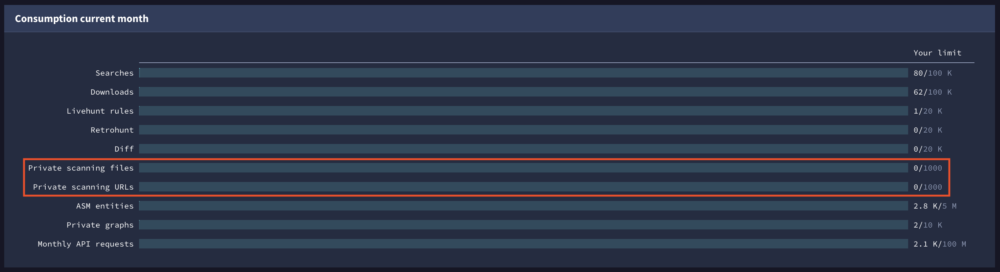
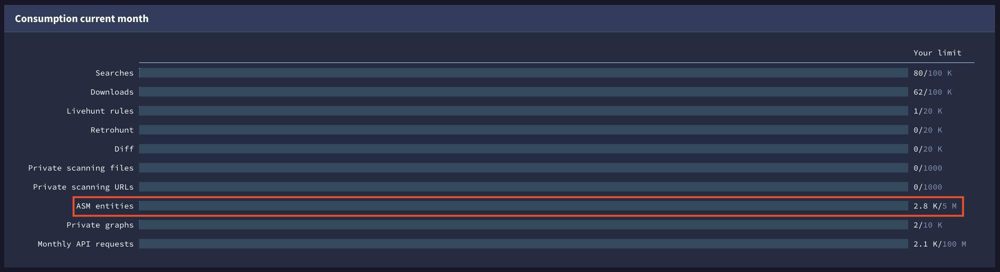
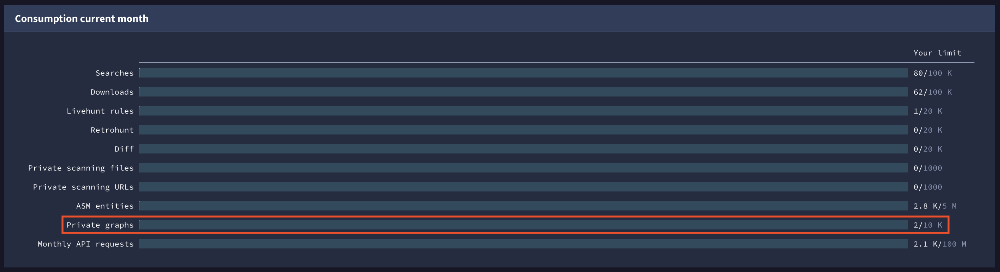

[gtidocs](../../README.md) › [Guides](../README.md) › [Group Management](README.md) › Understanding Consumption

---

# understanding-consumption

Here you can find how we measure consumption depending on each one of our services.

> ⚠️
>
> Group quota is shared between all group members. This means that for premium services, each individual user consumption is subtracted from the group quota. Therefore, it will be reflected in both the user and their group consumptions.

Summary table:

| **SERVICE / QUOTA CONSUMPTION**                                       | **Searches / Downloads** | **API requests**                 | **Livehunt** | **Retrohunt** | **Diff Sessions** | **Private Scanning Files** | **Private Scanning URLs** | **ASM Entities**   | **Private Graphs** |
| --------------------------------------------------------------------- | ------------------------ | -------------------------------- | ------------ | ------------- | ----------------- | -------------------------- | ------------------------- | ------------------ | ------------------ |
| [API](#api)                                                           |                          | X                                |              |               |                   |                            |                           | When using ASM API |                    |
| [Web searching and file downloads](#web-searching-and-file-downloads) | X                        | When using API                   |              |               |                   |                            |                           |                    |                    |
| [Livehunt](#livehunt)                                                 |                          | If using Livehunt API endpoints  | X            |               |                   |                            |                           |                    |                    |
| [Retrohunt](#retrohunt)                                               |                          | If using Retrohunt API endpoints |              | X             |                   |                            |                           |                    |                    |
| [Diff](#diff)                                                         |                          |                                  |              |               | X                 |                            |                           |                    |                    |
| [Private Scanning files](#private-scanning-files)                     |                          |                                  |              |               |                   | X                          |                           |                    |                    |
| [Private Scanning URLs](#private-scanning-urls)                       |                          |                                  |              |               |                   |                            | X                         |                    |                    |
| [ASM entities](#asm-entities)                                         |                          |                                  |              |               |                   |                            |                           | X                  |                    |
| [Graph](#graph)                                                       |                          | When loading public graphs       |              |               |                   |                            |                           |                    | X                  |

# api

*\*Minute, daily and monthly limitations. E.g. requests/day*

Usually one API request consumes **one unit** from your quota. However, there are some **exceptions**:

* **Checking consumption and quota details:** Endpoints to check consumption or quota details such as `/users/`\[id]`/overall_quotas` or `/users/`\[id]`/api_usage` won't consume any API quota from your license.
* **IoC Feeds:** No quota consumption for IoC feeds endpoints. This includes file downloads using links provided by feeds endpoints.
* **IoCs [Delta](https://gtidocs.readme.io/reference/ioc-deltas) and [Backfill](https://gtidocs.readme.io/reference/iocs-batch-download)**:  Requests that return zero IoCs do not count against your API quota. Otherwise, each request consumes one unit.
* **Invalid analysis requests:** Analysis are retrieved via "/api/v3/analyses/`[id]`". Quota is not consumed for this endpoint if the `[id]` is invalid.
* **Uploading new files**: If a user uploads a new file that is not present in Google TI, no API quota will be consumed from their license. Further calls to retrieve this file's data (`GET /files/`\[sha256]`) or its analyses (`GET /files/analyses/`[id]`) won't consume quota either. Note that re-scanning the file (`POST /files/`\[sha256]`/analyse`) will consume quota as any other API call.
* **ASM API endpoints**: ASM endpoints won't consume API quota from your license, those requests will consume from your ASM entities quota.

[Link to our API documentation](https://gtidocs.readme.io/reference/api-overview)

# web-searching-and-file-downloads

*\*Monthly limitation. E.g. downloads/month*

Web searching and file downloads quotas are always consumed via **UI**.

* Searches quota will be consumed by any of these operations: direct search to get an IoC report, pivoting to another search or using pagination to get more results after an advance search.
* 1 unit from your File Downloads quota will be consumed by any file download made through Google Threat Intelligence's UI.

> ⚠️ If you perform searches or downloads via API, those requests will consume from your API quota

# hunting

*\*Monthly limitation. E.g. rules/month*

## livehunt

Each active YARA **rule** you create consumes **1 unit** from your quota (inactive rulesets won't consume any quota). This means that if you have 3 rules in 1 active ruleset, you will consume 3 YARA rules from your Livehunt quota.

## retrohunt

Each retrohunt **job** you create consumes **1 unit** from your quota, no exceptions. This means that it doesn't matter if your job was successful or not or whether it had matches or not.

# diff

*\*Monthly limitation. Diff sessions/month*

Each **diff** session you create consumes **1 unit** from your quota.

# private-scanning

*\*Monthly limitation. Private files uploaded/month*

## private-scanning-files

Each file submitted consumes **1 unit** from your quota of Private Scanning files.

## private-scanning-urls

Each URL submitted consumes **1 unit** from your quota of Private Scanning URLs.

# asm-entities

*\*Monthly limitation. ASM entities/month*

Each ASM entity discovered on any of your ASM projects will consume **1 unit** from your quota of ASM entities.

# graph

*\*Monthly limitation. Private graphs/month*

## private

Graph service only consumes from graph quota when creating **private graphs**.

If you create a private graph, it will consume 1 unit from your quota. No other consumption will be applied.

## public

However, creating a **public** graph will consume your **API quota** based on the API requests required to load all items. The more items you load, the more API requests will be made, and consequently, the more API quota will be used.

---

← [Configure SAML with Entra ID](saml-entraid.md) · [up](README.md) · [How consumption quotas are handled](quota-consumption/consumption-quotas-handled.md) →

*Archived from <https://gtidocs.virustotal.com/docs/quota-consumption>.*
