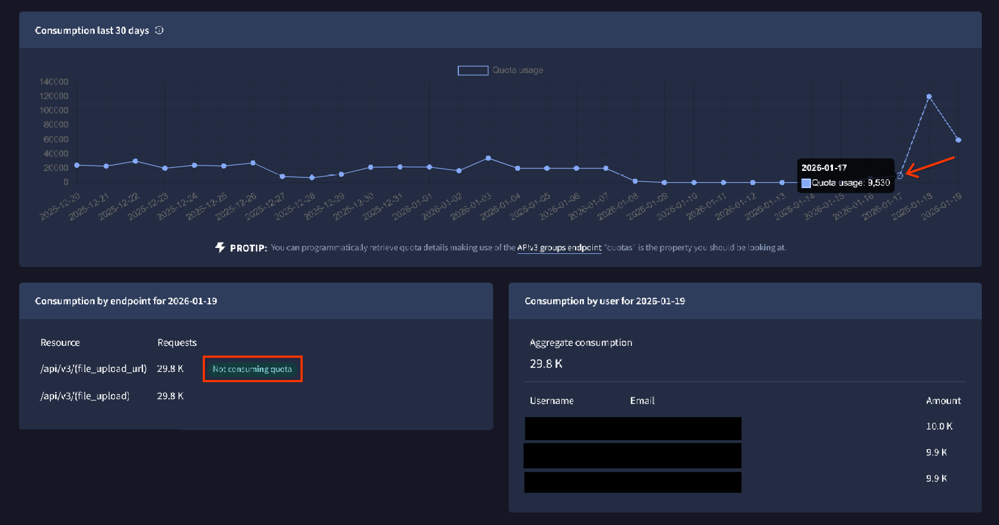

[gtidocs](../../../README.md) › [Guides](../../README.md) › [Group Management](../README.md) › [Understanding Consumption](../quota-consumption.md) › How consumption quotas are handled

---

# how-consumption-quotas-are-handled

Web searching and file downloads quotas are monthly. The quota consumption metrics for these features are reset at 00:00 UTC on the 1st of the month.

API quotas have 3 limits:

* Per minute.
* Daily.
* Monthly.

When you have reached your API quota, API requests will respond with 429.

To find your current quota usage click on the "API key" link on the menu under your username or visit <https://www.virustotal.com/gui/my-apikey>

On your API key page, you can find your quota allowances, and you can click on a specific day to view more details.

In the case of a group's API key you will find two columns:

* Consumption by endpoint for the specific date you select. Endpoints not consuming quota will be tagged accordingly.
* Consumption by users where there is a line per user.

Daily API quotas are reset every day at 00:00 UTC. If you have a monthly API quota, it is reset at 00:00 UTC on the 1st of the month.

---

← [Understanding Consumption](../quota-consumption.md) · [up](../README.md) · [Multi-tenancy](../multi-tenancy-guide.md) →

*Archived from <https://gtidocs.virustotal.com/docs/consumption-quotas-handled>.*
