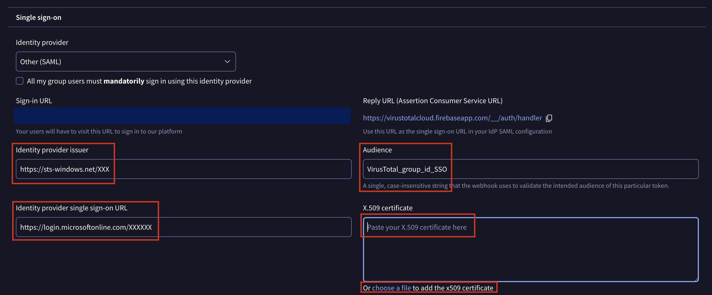
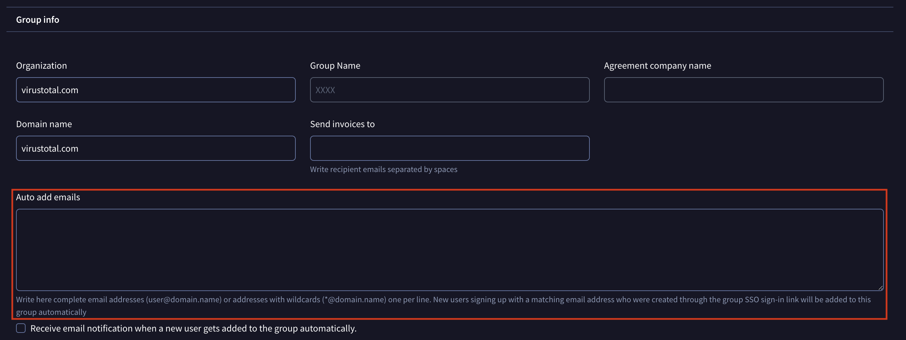

[gtidocs](../../README.md) › [Guides](../README.md) › [Group Management](README.md) › Configure SAML with Entra ID

---

# configure-saml-with-entra-id

You can configure Google Threat Intelligence to use SAML with Microsoft EntraID. These are the recommended steps for this set-up.

# configuring-the-entra-id-application

## 1.-entra-id-application

In your Azure portal, search for Enterprise Applications.

Press the "Create a new application" button.

## 2.-application-configuration

Provide a name to the new application (as an example, **VirusTotalSSO**).

Select the "Integrate any other application you don’t find in the gallery (Non-gallery)" option.

Press the "Create" button at the bottom in order to create the instance of the new application.

## 3.-single-sign-on-setup

On the "Overview" tab of the new application, press the "Set up single sign on" button.

Select the "SAML" option.

## 4.-saml-configuration

On the SAML setup, select "Basic SAML configuration" and press "Edit" button.

Press "Add identifier" in order to configure the **Entity ID**. The **Entity ID** must be the same as the **Audience** in the VirusTotal SAML configuration on the group page. Choose a unique string as an example, **VirusTotal\_group\_id\_SSO**.

Press "Add reply URL" in order to configure the **Reply URL**. The **Reply URL** must be `https://virustotalcloud.firebaseapp.com/__/auth/handler`.

Press "Save" in order to save the changes.

> ⚠️
>
> Note that both **Entity ID** and **Reply URL** are mandatory.

## 5.-required-data

> ℹ️
>
> Check those fields on the image at the bottom of the section.

### saml-certificate

Download the certificate from the "SAML Certificate" section.

> ⚠️
>
> Use the base64 format to download the certificate.

### login-url

Copy the **Login URL** from the section 4: "Setup VirusTotalSSO" section.

### azure-ad-identifier

Copy the **Azure AD Identifier** from the section 4: "Setup VirusTotalSSO".

# configuring-the-sso-in-virustotal

## 1.-group-settings-page

Open your group settings page: `https://www.virustotal.com/gui/group/<group_id>/settings`

> ℹ️
>
> Note that only Group admin are able to see the settings page.

On "Single sign-on" section select the **Other (SAML)** option in "Identity provider" dropdown.

> ⚠️
>
> Do **NOT** enable the "All my group users must mandatorily sign in using this identity provider" until you've fully confirmed your SAML configuration is working and your organization can successfully sign in. Enabling this setting with an incorrect configuration could lock all your users out of the platform.

## 2.-required-fields

Include the information provided by the Azure application on the different fields:

### identity-provider-issuer

Add the **Azure AD identifier** provided in [step 5: Required data](#5-required-data).

### identity-provider-single-sign-on-url

Add the **Login URL** provided in [step 5: Required data](#5-required-data).

### audience

Add the **Entity ID** used on [step 4: Configure SAML](#4-saml-configuration). In our example, the value "VirusTotal\_group\_id\_SSO".

### x.509-certificate

Add the content of the downloaded certificate in [step 5: Required data](#5-required-data).

Save your SSO settings to activate SAML.

## 3.-configure-auto-add-emails

In the **Group info** section of the group settings page, locate the **Auto add emails** field and enter your organization's corporate email domain patterns (e.g., `*@yourcompany.com` ) or specific email addresses, one entry per line.

> ⚠️
>
> This step is **mandatory** for users authenticating via Entra ID SSO to be automatically recognized and assigned to the group upon signing in. If this field is not configured or does not match the user's email domain, users trying to log in will encounter the following error: `Group <group_name> does not match any of the user's auto add group candidates`

## 4.-sign-in-url

The **Sign-in URL** will appear once the settings are saved.

> ℹ️
>
> Share this **Sign-in URL** with your group members so they can authenticate on the platform using SSO.

# manage-user-access-to-google-ti-on-entra-id-platform

Open the application you previously created within Entra ID.

Navigate to the "Users and Groups" section. Here, you can manage which users will have access to the Google TI platform via SSO.

> ℹ️
>
> Once you've confirmed that everything is working correctly, you can enforce SSO authentication for your group selecting the "All my group users must mandatorily sign in using this identity provider" option on the group settings page.

# troubleshooting

This section aims to provide steps to solve common issues when setting up SAML with Entra ID:

* **Group&#x20;**`<group_name>`**&#x20;does not match any of the user's auto add group candidates**: Make sure you have configured your organization's corporate email domain (e.g., `*@yourcompany.com`) in the **Auto add emails** field under the **Group info** section of your group settings page.
* **User is not assigned to this application**: Contact your Entra ID administrator to ensure that the user or group has been assigned to the Enterprise Application in Microsoft Entra ID under **Users and groups**.
* **Unable to process request due to missing initial state**: Check that the **Reply URL** (`https://virustotalcloud.firebaseapp.com/__/auth/handler`) and **Entity ID** / **Audience** match exactly in both Entra ID and Google Threat Intelligence.
* **Pop-up blocked**: The sign-in dialog opens in a pop-up window. Ensure that your browser allows pop-ups for `virustotal.com`.

If you still need assistance, [contact our support team](https://www.virustotal.com/gui/contact-us/technical-support) attaching the SAML XML configuration.

---

← [Configure SAML with Ping](saml-ping.md) · [up](README.md) · [Understanding Consumption](quota-consumption.md) →

*Archived from <https://gtidocs.virustotal.com/docs/saml-entraid>.*
