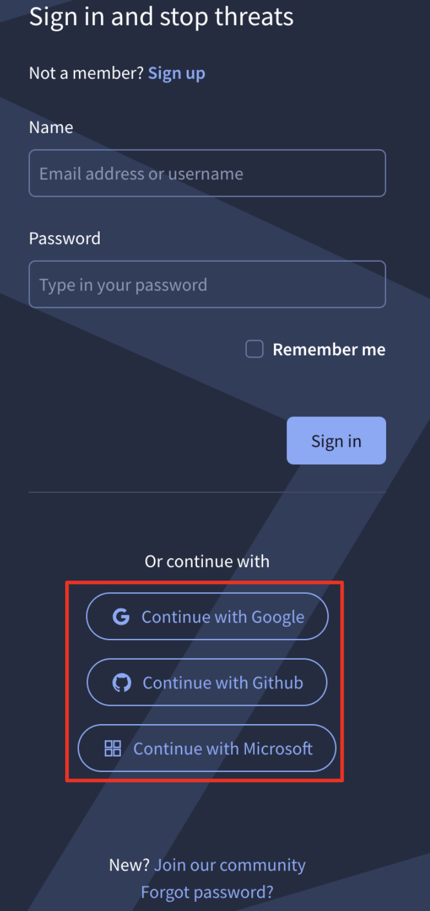
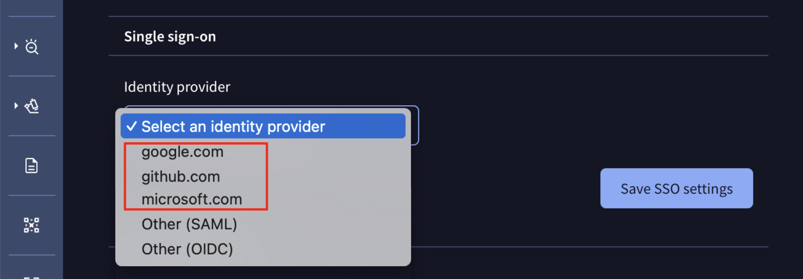
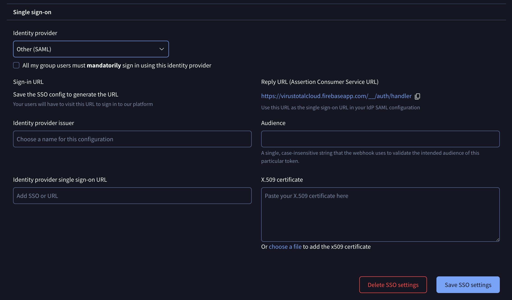
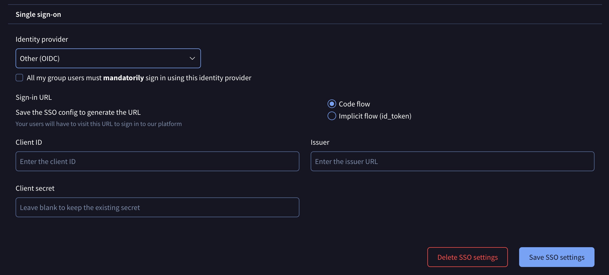
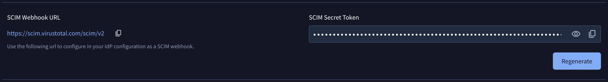
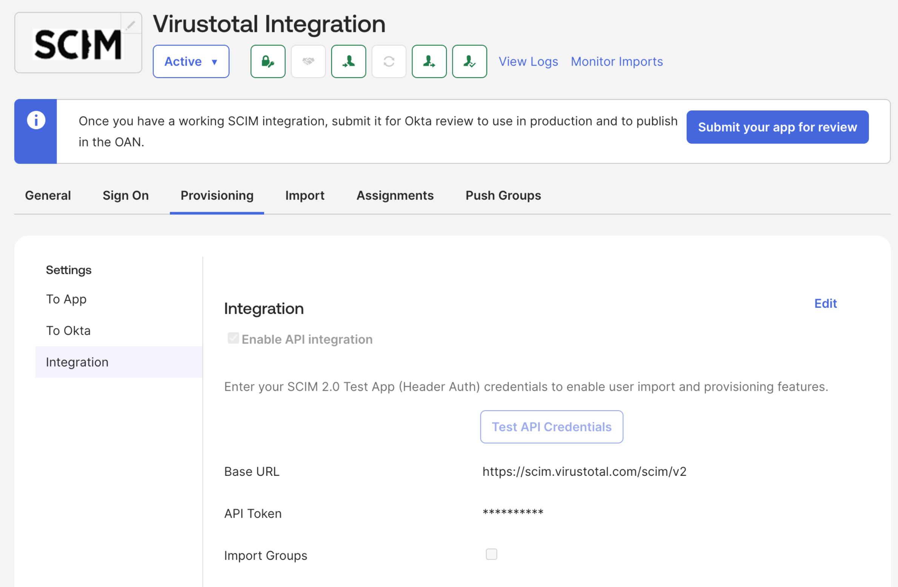
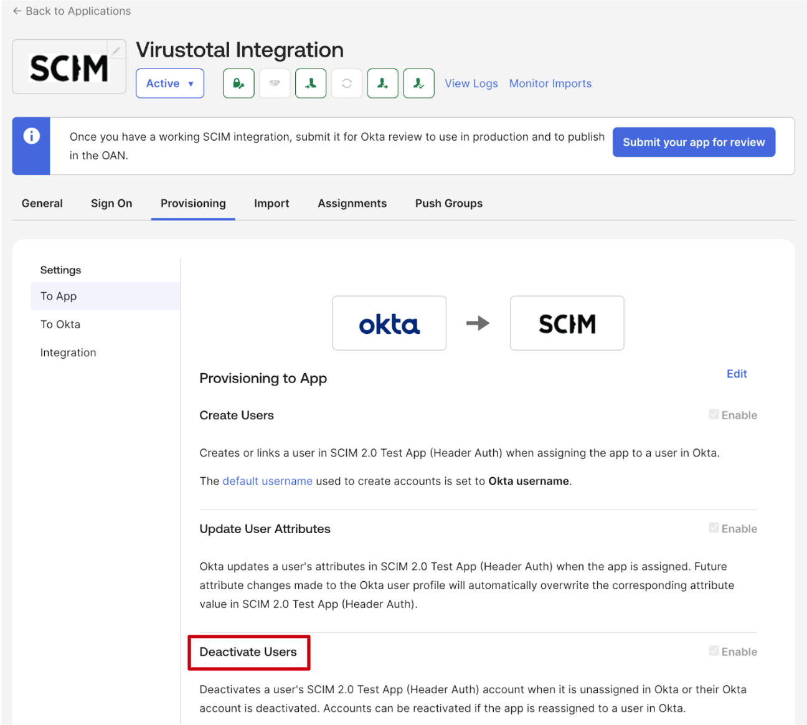

[gtidocs](../../README.md) › [Guides](../README.md) › [Group Management](README.md) › Single Sign On Authentication

---

# single-sign-on-authentication

Google Threat Intelligence currently supports SSO authentication with the following services:

* Google
* GitHub
* Microsoft

This means, if you have an account in any of those services, you can use it at Google Threat Intelligence too!

# login-to-an-existing-account-using-sso

If you already have a Google Threat Intelligence account whose email address is also associated with an account at any of our supported SSO providers, you can login with that provider at Google Threat Intelligence too.

When login using SSO, no 2FA is necessary. If the login at the SSO provider is successful you’ll be automatically redirected to Google Threat Intelligence’s main page.

# group-sso-settings

In the group settings page, a group administrator can choose among a set of already configured SSO identity providers: **google.com**, **github.com** and **microsoft.com**.

When any of these 3 providers is enabled for the group, all group users will be forced to authenticate exclusively through that provider. If no specific provider is enabled, users have the flexibility to sign in using either basic authentication (username and password) or SSO method if their account is linked to any of the listed services.

## saml

Clients with different identity providers can enable SAML for SSO by selecting that option in the drop-down menu and filling out the required details in the displayed form to complete the setup.

Please note that for forcing users to only authenticate via SAML, a checkbox is provided. If this checkbox is not selected, users can use both methods of authentication: SAML and common credentials.

We have articles with examples of how to [configure SAML with Okta](saml-okta.md), [configure SAML with Ping](saml-ping.md) or [configure SAML with EntraID](saml-entraid.md)

Please note that you must update rotated certificates manually in the SAML settings on the platform or via [API](https://gtidocs.readme.io/reference/groups-patch-samlconfig).

## oidc

Clients with other identity providers that prefer OIDC for SSO, can select that option in the drop-down menu and fill out the required data in the displayed form to complete the setup.

Again note that for forcing users to only authenticate via OIDC, a checkbox is provided. If this checkbox is not selected, users can use both methods of authentication: OIDC and common user/password credentials.

## scim-integration

After completing your **SAML** or **OIDC** setup, you can enable a **SCIM** (System for Cross-domain Identity Management) webhook to automate user deprovisioning. This integration ensures that when a user is deactivated in your Identity Provider (IdP), they are automatically removed from your Google TI group.

Once a user is deactivated, a **7-day grace period** begins. Group administrators will receive an email notification regarding the pending removal and can contact the [support](https://www.virustotal.com/gui/contact-us/support) team to cancel the action if necessary. If no action is taken, the user will be removed after 7 days, and their associated assets including graphs, collections, Livehunt rules, etc, will be automatically reassigned to a randomly selected administrator of the group.

At the bottom of the **Single Sign-On** section you can find **SCIM Webhook URL** and **SCIM Secret Token** automatically generated once your SSO configuration is finalized.

Note that the **SCIM Secret Token** is provided in the following format: `Bearer <token>`.

Configure these details in your IdP using this [Okta](https://developer.okta.com/docs/guides/scim-provisioning-integration-connect/main/) example as a reference.

Currently, we only support SCIM-based deprovisioning, so you only need to enable the Deactivate Users feature in your application settings.

> 🚧
>
> Administrators can regenerate the SCIM Secret Token at any time. However, generating a new key **immediately invalidates the previous one**. To avoid service disruption, **ensure the new token is updated in your Identity Provider (IdP) immediately, and pause all provisioning activity in your IdP until the update is complete**.

---

← [Walkthrough guide for Google Threat Intelligence group administrators](admins-guide.md) · [up](README.md) · [Configure SAML with Okta](saml-okta.md) →

*Archived from <https://gtidocs.virustotal.com/docs/sso-authentication>.*
