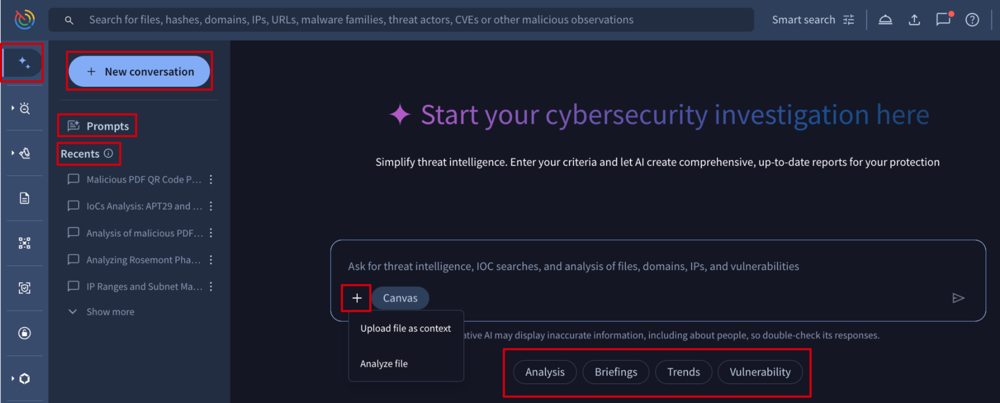
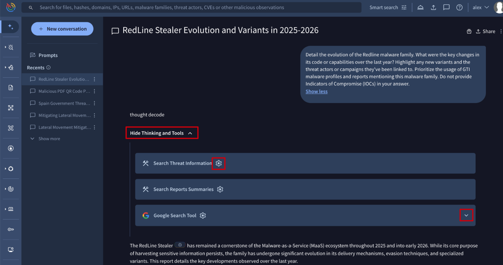
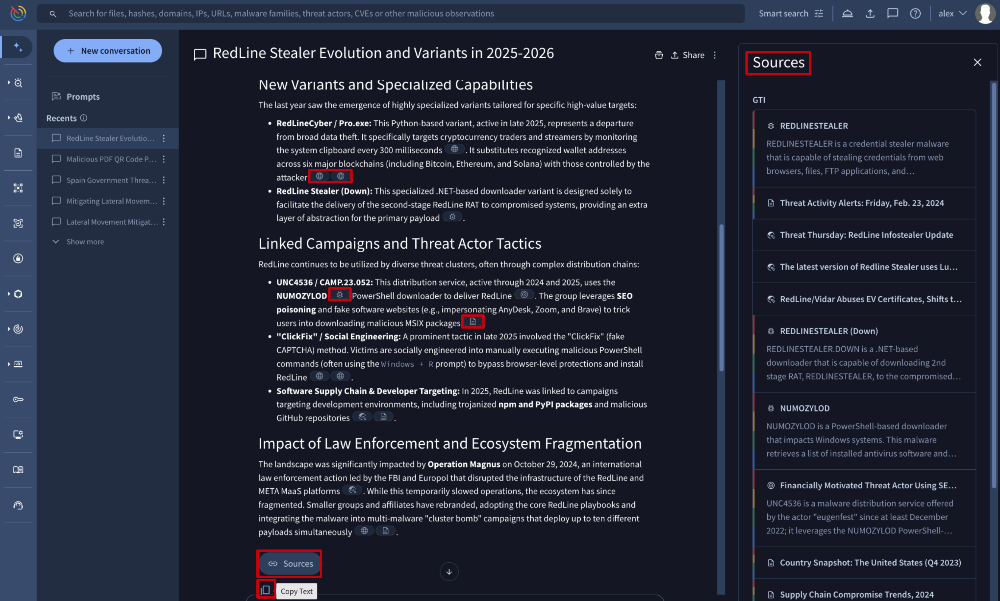
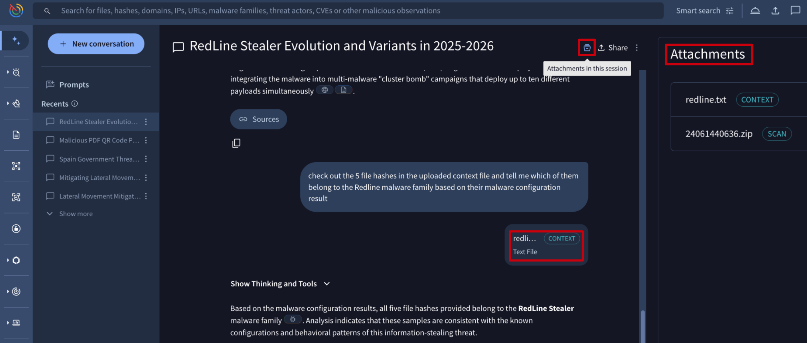
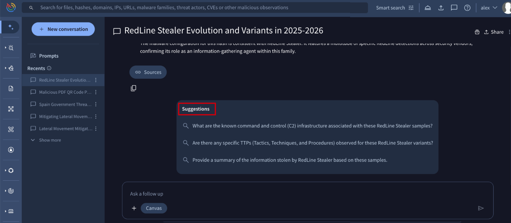
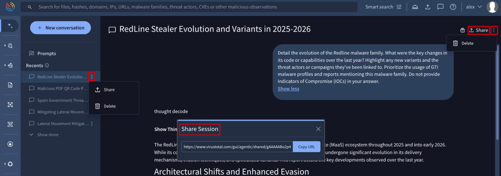
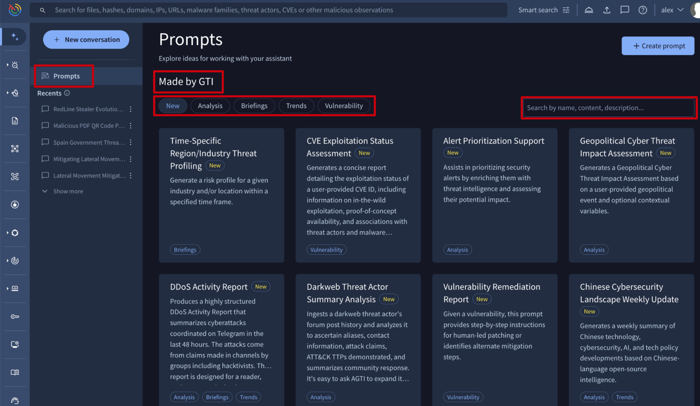
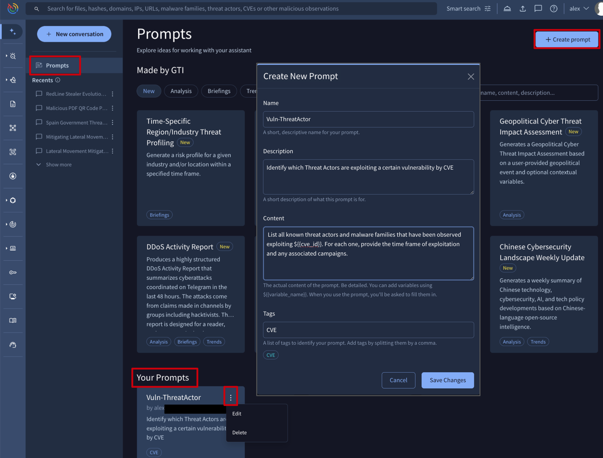
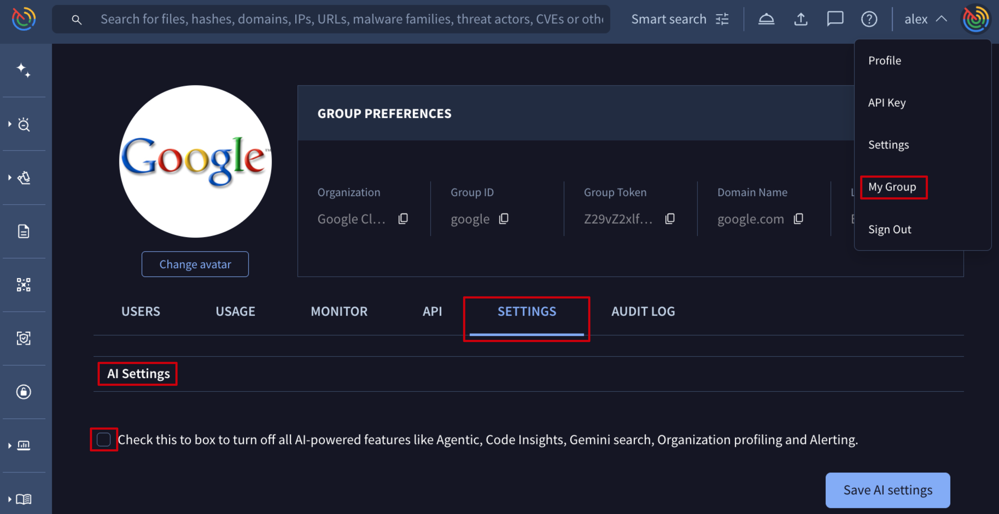

[gtidocs](../../README.md) › [Guides](../README.md) › [Agentic](README.md) › Agentic Platform

---

# agentic-platform

> 🚧 Special privileges required
>
> The **Agentic** platform is only available to users with the Google Threat Intelligence (Google TI) Enterprise or Enterprise Plus licenses, with no quota limitations on its use. Note that [uploading files to Private Scanning via Agentic](#11-starting-conversations) will consume your existing [Private Scanning](../09-private-scanning/private-scanning.md) quota.

> ❗️ Data Privacy
>
> Please **do not submit any personal or sensitive information** in your queries or file uploads. **You are responsible for the content of your submissions!**

[**Agentic platform**](https://www.virustotal.com/gui/agentic), the conversational interface to Google's vast threat intelligence, allows users to interact with specialized AI agents to accelerate security investigations, analyze potential threats, and get immediate answers to security questions.
The platform is designed to simplify threat intelligence by allowing users to chat directly with our agents, which are powered by Large Language Models (LLMs) and grounded in our comprehensive security data.

> 📘 AI is a tool
>
> While powerful, the generative AI may sometimes produce inaccurate information. Always use the provided responses as a starting point for your investigation and double-check critical information.

Powered by Gemini 3, Agentic provides seamless access to the complete Google Threat Intelligence ecosystem. By integrating IoC reports (files, URLs, domains IP addresses), threat objects (Actors, Malware, Campaigns, Reports, Vulnerabilities), the documentation portal, Private Scanning and IoC Stream among others, it enables users to resolve complex multi-language queries such as:

* "What is Private Scanning in Google Threat Intelligence?"
* "How do I query GTI for RedLine malware configuration files?" - which allows to **Execute** the query and **Compute commonalities** of IoCs in Agentic or **Open in Google Threat Intelligence**.
* "Do I have notifications from any Threat Profile in my IoC Stream?"
* "Has any Threat Actor generated notifications in my IoC Stream?"
* "What sources generated IoC notifications in the last week in my IoC Stream?"
* "Give me the mutexes most used by Emotet in the USA in the last 2 weeks"
* "Give me the countries where APT44 has used 035056655d155512e1z14z7dhz1020022fz most in the last month"
* "Provide a YARA-L rule to detect the Wannacry Ransomware"
* "Explain the CVE-2025-31324 vulnerability"
* "What are the mitigations for CWE-1255?"
* "Analyze the PDF using OCR to detect and explain anomalies in the embedded images"
* "How can I download feeds using Google Threat Intelligence API?"
* "Can you help me generate a Python script to consume Threat Lists?"

See the [2.1. Prompt Templates](#21-prompt-templates) section for instructions on accessing more examples.

With Agentic, you can:

* **Ask any question** on cybersecurity and threat intelligence in any **language**.
* **Generate reports or summaries** of cybersecurity and threat intelligence topics.
* **Retrieve details**, including maliciousness, on any IoC or IoC collection in our database.
* **Ask follow-up questions**, including those **suggested by our AI**, to dig deeper.
* **Save prompts for repeated tasks**, making recurring analysis simple and consistent.
* **Launch private scanning** and **perform a more in-depth analysis on files with our Malware Analysis agent** to receive a **natural language explanation** of their behavior.
* **Fork conversations** and **share** them with team members to strategically explore different analysis paths for a single use case.

**Table of contents**

* [1. Conversations](#1-conversations)
  * [1.1. Starting conversations](#11-starting-conversations)
  * [1.2. Conversation response & follow-ups](#12-conversation-response--follow-ups)
  * [1.3. Conversations history and management](#13-conversations-history-and-management)
* [2. Prompts](#2-prompts)
  * [2.1. Prompt Templates](#21-prompt-templates)
  * [2.2. Saving Prompts](#22-saving-prompts)
* [3. How It Works](#3-how-it-works)
  * [3.1. Malware Analyst Agent - Capabilities](#31-malware-analyst-agent---capabilities)
* [4. Privacy and AI tools disablement](#4-privacy-and-ai-tools-disablement)

# 1.-conversations

The primary feature of the Agentic platform is the ability to chat with our Threat Intelligence Agent. You can ask questions in natural language and receive detailed responses based on our extensive intelligence.

## 1.1.-starting-conversations

New conversations can be started from several places within the [Google Threat Intelligence](https://www.virustotal.com/gui/home) platform. To access the tool, navigate to the **[Agentic](https://www.virustotal.com/gui/agentic)** option in the left menu. Once there, you can begin a new conversation using one the following methods:

* **New Conversation** button
* Our pre-written **Prompt templates** (from the dedicated [**Prompts** view ](#21-prompt-templates) or via the quick-action tags such as **Analysis**, **Briefings** or **Trends** located beneath the conversation text box on the Agentic landing page)
* Users' **saved Prompts** (check out how to save a prompt [here](#22-saving-prompts))
* From areas within the platform via the **Brief** button such as an IoC report, a threat intelligence object card or a threat profile recommendation

When starting a new conversation from the **New Conversation** button, you can then:

* Enter your **question or prompt** in the text field.
* **Upload a file** from your local system for analysis using one of two methods:
  * **Analyze file**: our platform uses [Private Scanning](../09-private-scanning/private-scanning.md) for automatic analysis. The data from the private virtual machine, including the **Code Insight** explanation, drives the generation of the natural language analysis report of the submitted sample.
  * **File as context**: the platform treats the uploaded file as a reference. Use this to perform specific actions on the file's contents, such as extracting and acting upon a list of IoCs or applying a custom prompt to the data within the file.

## 1.2.-conversation-response-&-follow-ups

The agent response provides a detailed breakdown of how the answer was generated. This transparency is key to understanding and trusting the output. The response is composed of several parts:

* **Agent Thinking Process**: first the agent outlines its plan in collapsible sections that can have a status of *"Thinking and Tools"*, *"Show Thinking and Tools"*, *"Hide Thinking and Tools"*. These sections reveal the agent's step-by-step reasoning, how it interprets the prompt and how it decides which tools to use.
  * **Tool Calls**: a dedicated box is shown by each Tool Call the agent uses to gather the information, transitioning from *"Loading..."* status to the final raw data retrieved by the tool, such as **Search Threat Information** or **Google Search Tool**.
  * This information for helping detecting **hallucinations** to consequently generate new improved prompts specifically attempting to prevent further hallucinations.

* **Final Response**: the comprehensive, synthesized answer is provided as a compilation of the information gathered from the tool calls into a structured and readable report. To ensure transparency and allow for verification, every piece of information in the final response is backed by a source:
  * **Inline Citations**: you will find links to the original source documents and reports at the end of the response.
  * **Sources Drawer**: the **Sources** button at the bottom of the response opens the **Sources** panel at the right. This side panel displays the references used to generate the answer, organized into two sections: **GTI** (resources from the Google Threat Intelligence database) and **Web** (external global resources).
  * **Attachments Drawer**: the **Attachments in the session** button at the top opens the **Attachments** panel on the right. This panel lists all files uploaded during the conversation. Files are labeled for clarity: those uploaded as context are marked with a **CONTEXT** tag, while those submitted for analysis are marked with a **SCAN** tag.

* **Suggested Follow-ups**: at the bottom of the response, the platform provides a list of **Suggestions** for follow-up questions. These suggestions are designed to help you instantly dive deeper into the topic. Simply click a suggested question instead of formulating the next query from scratch.

## 1.3.-conversations-history-and-management

All user's conversations **with activity in the last 30 days** are logged in the **Recents** section on the left side of the screen, while those with no activity during this window will be automatically deleted. As long as you continue to interact with a specific conversation, it will remain accessible, ensuring your ongoing investigations are preserved while clearing out stale data.

From both the **Recents** list and within each **conversation session**, users have the option to **delete** a conversation or **share** it with others.

Each time the **Share** button is clicked on, a new, unique URL is automatically generated as a **conversation fork**. The person who receives the fork URL will get a copy of the conversation, allowing them to continue it independently without affecting the original.

# 2.-prompts

In the **Agentic platform**, prompts are treated as entities. The **Prompts** menu in Agentic provides access to a comprehensive list of all available prompts, including **pre-built templates** from our team and custom **prompts saved by the user** to expedite repetitive tasks within Google Threat Intelligence.

## 2.1.-prompt-templates

Prompt templates listed under the **Made by GTI** section serve as a starting point for users to leverage the agentic assistant's capabilities for common and complex security tasks. Templates are tagged by the following categories, with more to be added in the future:

* **New**: applied to all templates for the first 30 days following their addition to the library.
* **Analysis**, **Briefings**, **Trends**, **Vulnerabilities**: Thematic tags that align the agent's capabilities with specific security objectives.

These prompts are provided as a curated library of prompts designed to kickstart investigations and analysis covering multiple topics and tagged with the following criteria:

* Supply chain attacks
* Malware evolution and variants
* Ransomware trends
* Threat Actors TTPs comparison
* Vulnerabilities mapping to Threat Actors
* Daily summary
* File analysis report
* and more

In this view, prompts are easily searchable and filterable by tag. To begin a conversation, simply click on a prompt and provide the required parameters.

## 2.2.-saving-prompts

All prompts saved by the user are listed under the **Your Prompts** section of the **Prompts** menu option.

From here, new prompts can be created via the **+ Create prompt** button. This action displays a form for you to define the prompt's **name**, **description** detailed **content** and the **tags** of your choice. The content can include dynamic variables using placeholders such as `${{variable_name}}`. When the prompt is used, a form will appear to collect the values for these variables.

All prompts created by the user can be **edited**, **deleted**, and **reused** for starting new conversations by simply clicking on any of them.

# 3.-how-it-works

Our Agentic platform is built on a sophisticated framework that combines Large Language Models with our internal security systems.

* **Retrieval Augmented Generation (RAG)**: instead of relying solely on its training data, the agent uses a technique called Retrieval Augmented Generation (RAG) to dynamically retrieve the **most relevant and up-to-date threat intelligence** from our internal Threat Analysis Service, which processes data from a variety of sources.
* **Specialized Agents**: the platform uses agents optimized for specific tasks, such as the **Threat Intel Agent** for general queries and the **Malware Analysis Agent** for file-based investigations.
* **Knowledge Library**: our agents access a structured *knowledge library*, ensuring their answers are based on verified and timely threat intelligence.

## 3.1.-malware-analyst-agent---capabilities

The **Malware Analyst Agent** (MA agent) focuses on **dynamic malware analysis and sample interpretation**, distinguishing it from the CTI Analyst Agent, which concentrates on Indicators of Compromise (IoCs). The agent handles a variety of technical requests related to file analysis, reverse engineering, and triage, with a strong emphasis on providing transparency regarding its reasoning and actions to build user trust.

The primary functions of the Malware Analyst Agent are categorized by common user journeys (CUJs):

**File Triage and Reporting**

| Capability                                         | Details and Examples                                                                                                                                                                                                                                                                                                                                            |
| -------------------------------------------------- | --------------------------------------------------------------------------------------------------------------------------------------------------------------------------------------------------------------------------------------------------------------------------------------------------------------------------------------------------------------- |
| File Triage via Hash & Maliciousness Determination | The agent triages files via standard hashes (SHA256, SHA1, or MD5) to evaluate potential threats. By analyzing [GTI scores](../06-ioc-investigation/google-threat-intelligence-indicator-score.md), AV detections, and file associations, it can deliver a maliciousness verdict tailored to the data's privacy status, utilizing public intelligence or restricted private telemetry. |
| Basic File Report Generation                       | Provides a quick answer regarding what a file is or what it does, highlighting relevant functionality details. For **public** file (part of the public dataset), the response is based on its existing public analysis while **private** samples (analyzed through [Private Scanning](../09-private-scanning/private-scanning.md) only), the response is based on private reports.    |
| Associations                                       | It identifies associated Threat Actors, Malware Families, or Campaigns when documented within the file report.                                                                                                                                                                                                                                                  |
| Analysis of Existing Files                         | If a customer uploads a file that already exists in the public corpus, the agent identifies the SHA256 of the uploaded file and performs an analysis similar to an inquiry using a hash.                                                                                                                                                                        |
| Analysis of New Files                              | If a customer uploads a file that is not part of the public corpus, the agent initiates a [private analysis](../09-private-scanning/private-scanning.md) and reports on the file. This full analysis is subject to restrictions like file type and size limitations.                                                                                                                  |

**Reverse Engineering and Deep Analysis**

| Capability                   | Details and Examples                                                                                                                                                                                  |
| ---------------------------- | ----------------------------------------------------------------------------------------------------------------------------------------------------------------------------------------------------- |
| Deep Reverse Engineering     | Capable of performing deep reverse engineering to investigate citations to code and inspect assembly or decompiled functions in binary files.                                                         |
| Executable & Binary Analysis | Can reverse engineer native binary files (PE, ELF, Mach-O), managed assemblies (.NET), and script-compiled executables (AutoIt3) to extract IoCs and reconstruct program logic.                       |
| Android APK Analysis         | Can triage and reverse engineer Android APK, DEX, and JAR files to inspect application manifests, permissions, and embedded libraries.                                                                |
| Document & Container Reports | Provides detailed reports and payload extractions for various file formats, including PDF files, Microsoft Office documents containing macros, compressed archives, and Windows shortcut (LNK) files. |

**Code and Script Analysis**

| Capability                   | Details and Examples                                                                                                                                                                       |
| ---------------------------- | ------------------------------------------------------------------------------------------------------------------------------------------------------------------------------------------ |
| Code Insights                | Provides code insights data on scripts and helps the user understand what the script does.                                                                                                 |
| Detailed Code Analysis       | The agent can give a detailed analysis of source code, including identifying specific command usage (e.g., locating where the eval command is used in a script's obfuscated code).         |
| Script & Macro Deobfuscation | Can analyze and deobfuscate various script formats (VBA, PowerShell, HTA, JavaScript), unrolling stagers and recovering encryption keys or Command and Control (C2) servers within a file. |

**Network Analysis**

| Capability                         | Details and Examples                                                                                                                           |
| ---------------------------------- | ---------------------------------------------------------------------------------------------------------------------------------------------- |
| Network Traffic Analysis           | Analyzes network traffic captures to evaluate communication flows and protocol activity (DNS, HTTP, TLS).                                      |
| HTTP Payload & Artifact Extraction | Extracts transferred files and payload objects from HTTP traffic captures, allowing the agent to chain tools and inspect suspicious downloads. |
| Granular Network Stream Tracing    | Performs detailed stream following on packet captures to inspect full C2 sessions, HTTP bodies, and raw protocol handshakes in ASCII or HEX.   |

# 4.-privacy-and-ai-tools-disablement

Please note that your data remains completely private by our [privacy policy](https://cloud.google.com/terms/secops/privacy-notice). Your prompts, the information provided within them, and any files submitted for analysis by the Malware Analysis Agent are never shared with anyone or used to train any AI system. When you submit a file, it is automatically detonated in Private Scanning to ensure all information stays confidential.

**Disabling AI Tools**

If you need to disable all AI tools (including the Agentic tool) for your group to meet legal and compliance requirements, follow these steps as an **administrator** of your Google Threat Intelligence group:

* Go to **My group**.
* Navigate to the **SETTINGS** tab.
* In the **AI Settings** section, enable the provided checkbox.
* Click **Save AI settings**.

 

---

← [Multi-tenancy](../02-group-management/multi-tenancy-guide.md) · [up](README.md) · [Agentic User Guide](agentic-user-guide.md) →

*Archived from <https://gtidocs.virustotal.com/docs/agentic-platform>.*
