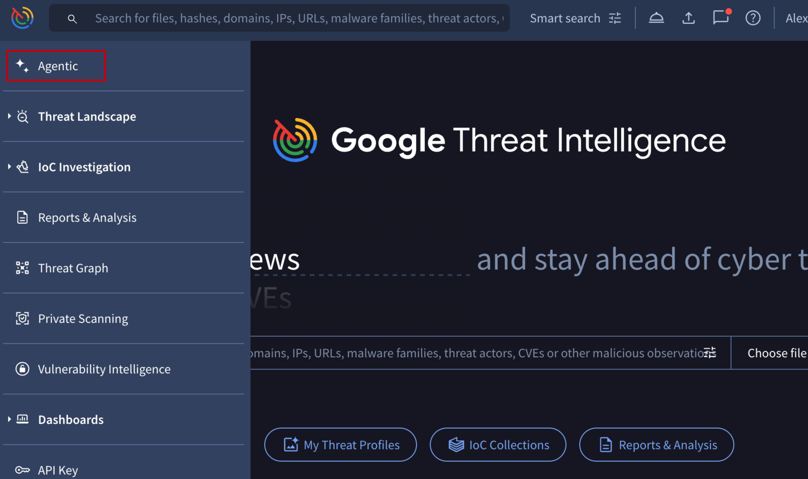
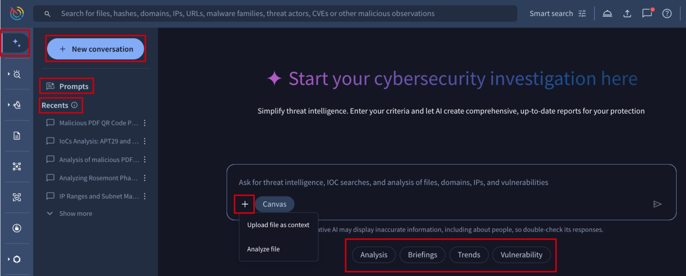
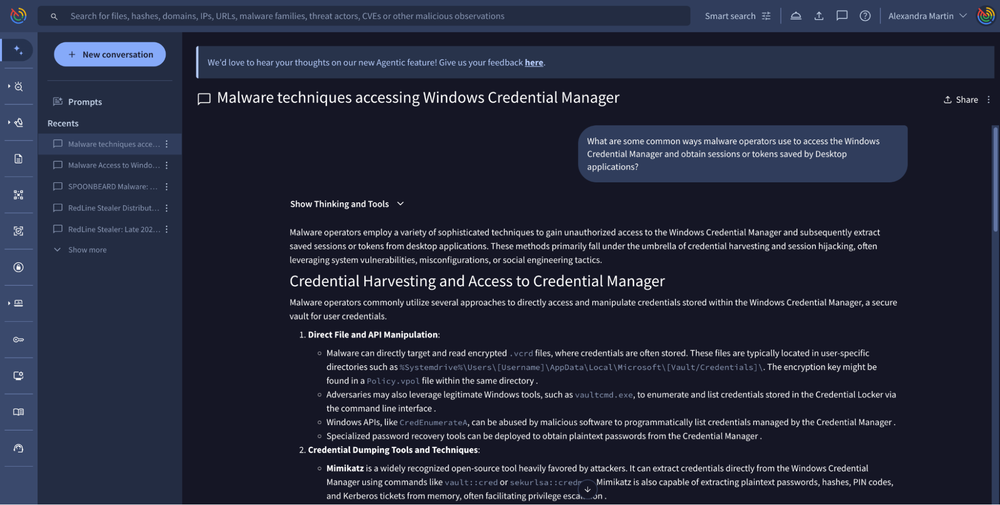
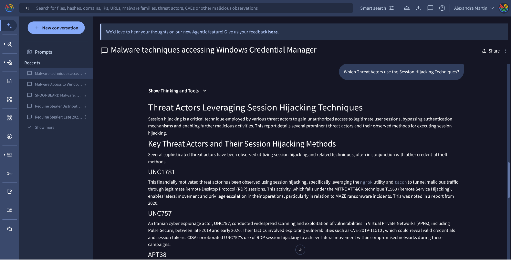
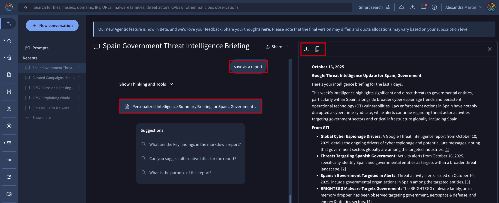

[gtidocs](../../README.md) › [Guides](../README.md) › [Agentic](README.md) › Agentic User Guide

---

# agentic-user-guide

Built on Large Language Models (LLMs) and grounded in Google Threat Intelligence comprehensive security dataset, the **Agentic Platform** simplifies threat intelligence. This conversational interface lets you interact directly with specialized AI agents to quickly analyze threats, accelerate security investigations, and receive immediate, precise answers.

# getting-started

You can start a conversation with our agents from the [Agentic menu option](https://www.virustotal.com/gui/agentic)

From here, you can directly place your prompt or questions in the provided text field, or you can initiate a conversation from the provided templates you'll find by clicking on the Prompts button at the left. Below the text field you will also find a selection of prompts you can use. We provide a variety of templates for different security aspects that we constantly update with new, relevant topics.

With Agentic, you can:

* Ask any question on any cybersecurity or threat intelligence topic covered by Google Threat Intelligence (Google TI) intelligence. Our agents retrieve all details based on our curated intelligence and previously filtered OSINT.
  * For example: “Analyze the recent supply chain attack targeting 'xxx'. Identify the initial compromise vector, the affected services, the specific malware deployed, and the associated threat actor.”
* Generate reports or summaries of cybersecurity and threat intelligence topics.
  * For example: “Draft a concise threat brief for an executive audience on the activities of threat actor xxx for the last 90 days. The brief should explain who they are, their recent targeting and the potential impact.”
* Retrieve details, including maliciousness, on any Indicators of Compromise (IoC) or collection of IoCs in Google TI.
  * For example:“What is the current reputation, maliciousness and known associations with threat actors and campaigns of the IP address xxx?”
* Perform a more in-depth analysis on any malicious file with our (junior) Malware analysis agent. Receive a detailed natural language explanation, helping you to quickly understand its behavior and maliciousness.
  * For example: “Do a full reverse engineering analysis for the APK file with hash xxx, describing its main behavior”
  * Please note that, if you submit the file to Google TI, this will launch a private analysis. Full reverse engineering is limited to certain file types, which are continuously being expanded.
* Ask follow-up questions, including those suggested by Agentic.
* Save prompts for repeated tasks, making recurring analysis simple and consistent.
* Automate recurring investigations by scheduling prompts with [Flows](flows-guide.md), and optionally have the results emailed to you.
* Share and fork ongoing Agentic sessions with colleagues to strategically explore different analysis paths for a single use case.

Agentic's methodology is to prioritize retrieving and analyzing curated information from Google TI to construct the most relevant answers. It also incorporates previously filtered OSINT and, in certain cases, may utilize Google Search to supplement the information with additional details. For every answer provided, Agentic includes all relevant citations, which may encompass Google TI references, reports, threat actors, campaigns, vulnerabilities, malware families, OSINT, and external references as necessary.

We are continuously enhancing Agentic, focusing on clearer self-explainability of its capabilities, improved documentation, and a refined experience for working with IoCs, collections, and Google TI queries. We appreciate your patience as we finalize the testing and implementation of these new features to ensure the best possible experience. Please help us improve it with your [feedback](https://docs.google.com/forms/d/e/1FAIpQLSelcZycOb_dHcX7SyI4jUP-o_BLkTrQ7I2AAYwHu35f1GPlOA/viewform).

# prompting

Agentic provides a multi-language conversational interface.

You can start the conversation as you like, for example “Provide a list of file hashes related to the RedLine infostealer”,  **in any language**: “Proporcione una lista de hash de ficheros relacionados con el infostealer RedLine”, “Fournissez une liste des hachages de fichiers liés au voleur d'informations RedLine”. You can also instruct Agentic regarding the format, language of the output.

Agentic will suggest potential **follow up questions** displayed at the bottom of the answer, but you can ask your own:

Your last 10 past conversations are automatically saved. You can access them anytime from the left-hand menu, where each conversation is given a relevant title based on its topic.

You can find the "**New conversation**" button in the top left corner. To ensure optimal responses, always use "New conversation" when shifting topics. This action clears the Agent's previous context, preventing it from influencing new answers.

You can also **submit your own files** for getting insights through the "**+**" button on a conversation text box.
Samples are then automatically detonated in a virtual private environment, and the **Malware Analysis Agent** provides the report in natural language, explaining its capabilities. In this case, the file remains completely private, available only to you and your group, and accessible from the Private Scanning module.

For additional insights into prompting, check out this dedicated community [article](https://security.googlecloudcommunity.com/google-threat-intelligence-40/agentic-gti-prompting-6236).

## best-practices

For better results you can use a more specific prompt following some **best practices**:

* The more information you provide, the better the response is.
* Clearly state what you want the final result to be.
* Specify what to ignore or what boundaries to stay within.
* If you receive an output that seems off, don't ignore it. Ask for the reasoning, which can help detect potential AI "hallucinations".
* If the first response isn't perfect, don't start from scratch. Use follow-up prompts to refine the existing output.
* Instead of using "latest" or "new", provide a date for accuracy.
* Before submitting a file for malware analysis, please check if the IoC is available in Google TI. This will save consuming your Private Scanning quota.
* Providing a role (like "you are a malware analyst").
* Providing output formatting guidance.
* Parametrize your prompts to make them reusable.
* Use keywords as "curated" or "osint" in case you want to specify what Google TI data to use.

## saving-prompts-for-repeated-tasks

Once you are happy with the deliverable of a prompt that you will have to use recurrently, you can simply save it. To do so, you will have to go to the Prompts view from the Prompts button at the left, and the "**+ Create Prompt**" button will allow you to save the prompt once you have fulfilled the pop up form. Saved prompts are listed under the **Your Prompts** section from where you can simply click on any you want to start a conversation with.

The prompt content can include dynamic variables using placeholders such as `${{variable_name}}`, and that will be the only requested parameter you will have to fill out when reusing the prompt.  For example:

`Give me a report on ${{file_hash}}`

In Prompts you can find some prompts provided by Google TI for different use cases. A selection of them will be also available under the conversational text field.

## malware-analysis

The Malware Analysis Agent offers a comprehensive range of functionalities, from identifying IoCs as malicious to providing in-depth details on malware technical capabilities. This agent is automatically triggered when Google TI Agentic identifies malware analysis as the intent of your prompt. For clarity, you can explicitly state your need for "details on this malware's capabilities" or "full reverse engineering" of a sample, identified by its hash.

For effective malware analysis, provide the hashes of the samples you wish the agent to examine. Most samples can be found within Google TI, allowing the agent to leverage all available platform information, including sandbox detonation and Code Insight details.

If a sample is not found in Google TI, you have the option to submit it for analysis. The sample will be securely executed in your Private Scanning environment, and the agent will utilize this data to generate a detailed report. Please be aware that submitting a sample will consume your Private Scanning quota, regardless of whether the sample was previously in Google TI. Therefore, use this feature wisely.

Please note that malware analysis capabilities are continuously being developed and refined. Currently, these capabilities are not universally applicable to all file types or able to circumvent all anti-analysis techniques that malware may employ.

## fork-conversations

Every conversation offers a sharing feature, enabling you to create a shareable copy (fork). This is beneficial for sharing your analysis, allowing colleagues to explore new solutions for your use case starting the investigation where you left it.

## exporting-results

By requesting Agentic to "**save into a report**" (or equivalent), this will create a dedicated widget with the last answer provided by the agent, facilitating copying results and exporting in Markdown format. This will be improved shortly with more additional actions and a more intuitive interface.

## prompt-examples

* “What are some common techniques used for privilege escalation and the subsequent installation of rootkits?”
* “Which are the top 5 most used procedures to steal sensitive information within the Healthcare industry and what preventative measures should be implemented to mitigate each of these threats?”
* “Provide an overview of the Spanish government Threat Landscape including Threat Actors, active campaigns and last 5 critical intrusions.“
* “Based on current trends and available data, what do you think will be the cyber threat trends in 2026?”
* “Analyze the following file hash ac00dd7d54764e0389de434f3203c2a3384d2ffcc20615f40f09c4c0646c8d3f as if you were a malware analyst.”
* “Tell me what curated campaigns are related to the "User Execution: Malicious Copy and Paste" (T1204.004) technique.“
* “List the main technical capabilities of the Lumma malware family.”
* “Summarize all relevant information ingested in the last 72 hours of threats targeting the financial sector.”
* “What are your recommendations to mitigate the following Microsoft SharePoint vulnerabilities? (CVE-2025-53770 and CVE-2025-6543)”
* “Fait moi un résumé des cyber attaques subits par les entreprises française au mois de Juillet et Aout, classe les par catégorie”

---

← [Agentic Platform](agentic-platform.md) · [up](README.md) · [Flows](flows-guide.md) →

*Archived from <https://gtidocs.virustotal.com/docs/agentic-user-guide>.*
