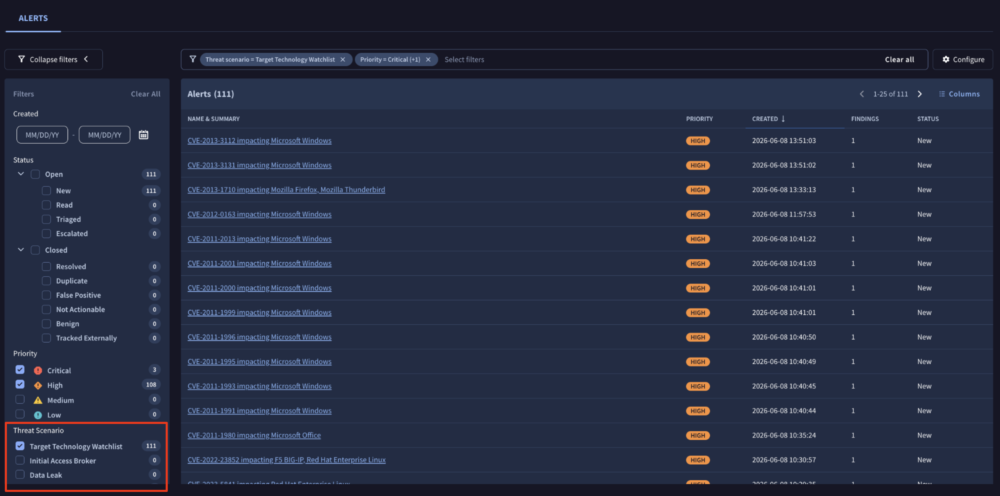
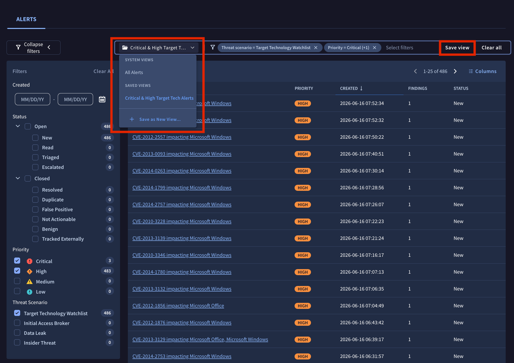
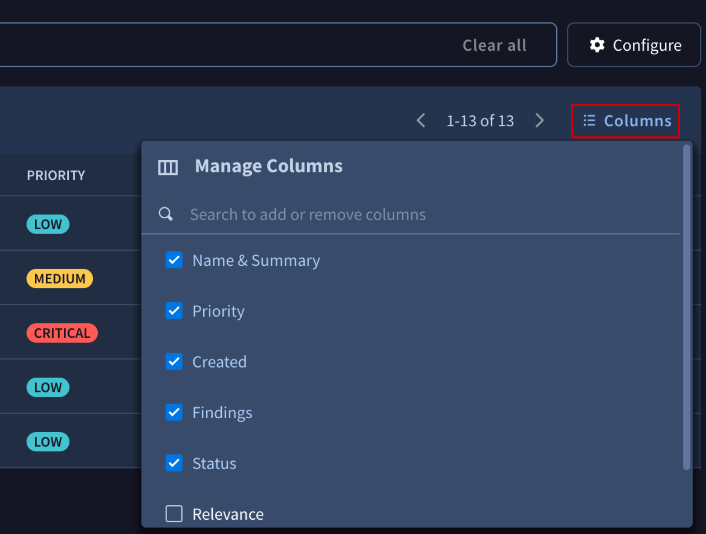
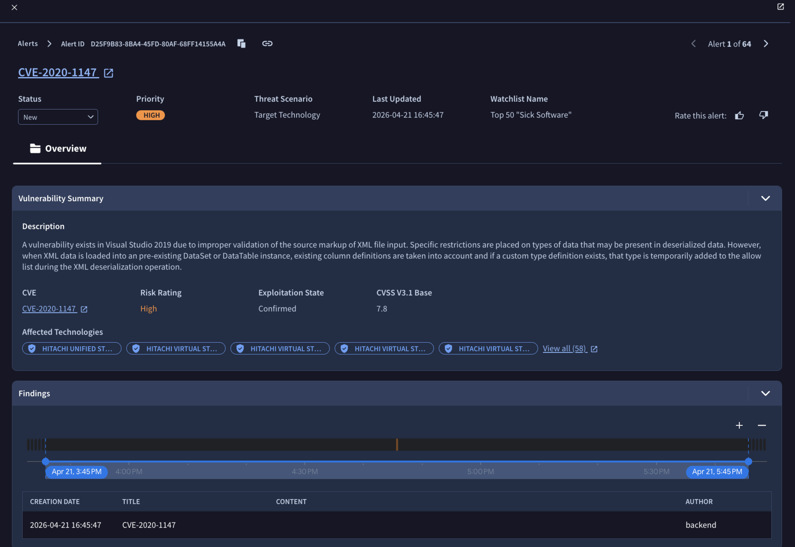
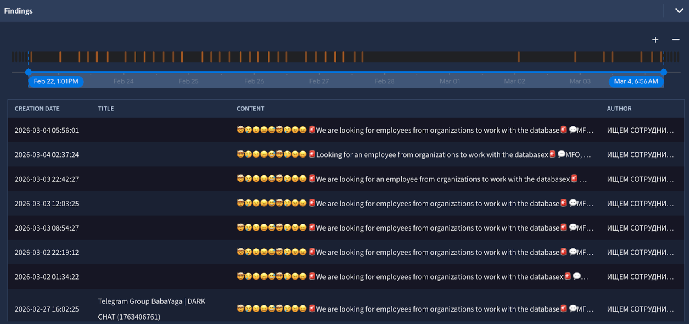
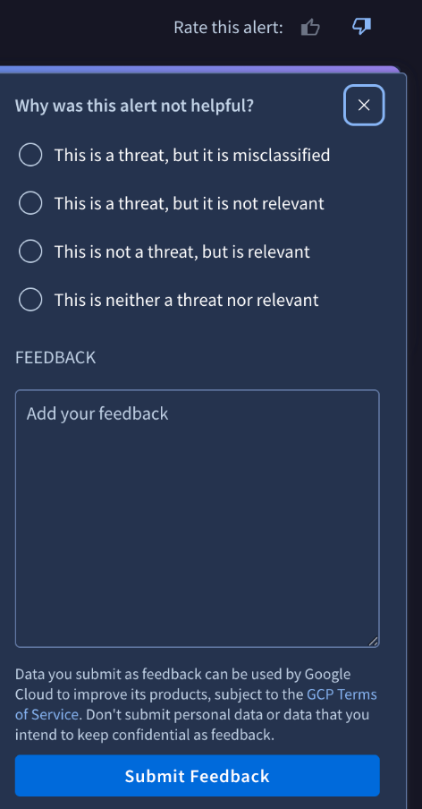

[gtidocs](../../../README.md) › [Guides](../../README.md) › [My Landscape](../README.md) › [Getting Started with our new Dark Web Intel capabilities, powered by the relevance system](../dark-web-intel.md) › Alerts

---

# alerts

An **Alert** is the core unit of action within the My Landscape module. It is a dynamic, stateful container that the **Relevance System** creates whenever global threat intelligence intersects with your unique [Organization Profile](my-landscape-organization-profile.md) under a given [Threat Scenario](my-landscape-threat-scenarios.md).

Instead of flooding you with raw detections, the Relevance System groups one or more related **Findings** — the granular, immutable records of individual threat events — into a single Alert, enriches it with **Gemini**-powered analysis, and scores it by **Relevance**, **Severity** and **Priority** so your team focuses only on the risks that actually matter to your business.

Every Alert answers three questions at a glance — *what* the threat is, *why* it was flagged for your organization, and *how urgent* it is — and moves through an operational lifecycle (from **New** to **Resolved**) as your analysts triage it.

## findings-vs.-alerts

In Google Threat Intelligence, there is a distinct architectural difference between a **Finding** and an **Alert**:

* **A Finding is an immutable, granular record of a specific threat detection event**. For example, a single leaked credential on a dark web forum, a single IP address communicating with a known Command & Control server, or a specific vulnerable software version found on one of your assets.
* **An Alert is a dynamic, stateful container that groups one or more related Findings into a broader Threat Scenario**.

**What it means to have multiple findings for an alert**: If an alert has multiple findings, it means the overarching threat campaign has intersected with your organization's profile in several different ways. For example, if there is an alert for an *APT41 Phishing Campaign*, having multiple findings might mean the system found three different employee emails targeted (3 findings) and two different external assets hosting the vulnerability the APT is exploiting (2 findings). Multiple findings generally increase the confidence and priority of the alert, as the threat is highly active against your specific attack surface.

## alerts-list-view

The **Alerts list view** is your central dashboard for triaging everything the Relevance System has surfaced for your organization. Each row is a single **Alert**, giving you an at-a-glance, prioritized worklist. To access it, navigate to **My Landscape (Beta)** -> **Alerts**, or go directly to [the alert list](https://proactive.virustotal.com/alerts).

Every alert is summarized across five columns: **Name & Summary** (the Gemini-generated title of the threat), **Priority** (Critical to Low), **Created** (the date and time the alert was generated; sortable), **Findings** (how many Findings are grouped under it), and **Status** (its position in the lifecycle, e.g. New or Resolved).

### filtering-the-alert-list

You can refine the list using the **filter bar** at the top and the **Filters** panel on the left — the two stay in sync, active filters show as removable chips, and a live count sits next to each option. You can narrow by **Created**, **Status**, and **Priority**, but the most powerful control is the **Threat Scenario** filter, which isolates alerts by *why* they were raised rather than just their urgency.

Selecting **Target Technology Watchlist**, for instance, shows only the vulnerability alerts affecting the technologies and CPEs you track, while **Initial Access Broker** and **Data Leak** surface those scenarios. This lets each team focus on the slice of intelligence relevant to them.

### saving-and-reusing-views

Once you have a combination of filters you want to come back to, click **Save view** in the top-right of the filter bar to store it as a reusable **View**. A view keeps your chosen filters together so you can reapply them in a single click instead of rebuilding the filter set each time.

Use the **views dropdown** at the top of the list to switch between them. It is organized into two groups:

* **System views:** built-in defaults that always exist, such as **All Alerts**.
* **Saved views:** the custom views you have created (for example, *Critical & High Target Tech Alerts*).

To create a new view from your current filters, open the dropdown and select **+ Save as New View…**, then give it a name.

### customizing-columns

You can tailor which columns appear in the list to match how your team works. Click the **Columns** button at the top-right of the table to open the **Manage Columns** menu, then use the checkboxes to show or hide a column, or the search box to quickly find one by name.

By default the list shows **Name & Summary**, **Priority**, **Created**, **Findings**, and **Status**. The **Relevance** and **Severity** scores are hidden by default and can be added from this menu whenever you want to triage by those values directly.

## alert-view

Clicking any row in the list opens the **Alert view**, the full investigation workspace for a single alert. It brings together the original underground content, Gemini's analysis, the scoring rationale, and every Finding behind the alert in one place.

### header

The top of the view shows the alert's **breadcrumb and Alert ID** (with quick copy and link buttons to share it), followed by the Gemini-generated **title**. Directly beneath, four fields summarize its current state:

* **Status:** A dropdown you use to move the alert through its lifecycle (New, Read, Triaged, Escalated, or any closed state).
* **Priority:** The overall ranking of the alert (Critical to Low).
* **Threat Scenario:** The scenario that generated the alert (for example, Insider Threat).
* **Last Updated:** The date and time the alert last received new intelligence.

On the right, use **Rate this alert** (thumbs up / thumbs down) to give feedback and help the Relevance System tune future alerts to your organization.

### gemini-summary

A highlighted panel at the top gives you Gemini's read of the threat at a glance, split into two parts:

* **Gemini Summary:** A concise, plain-language explanation of what the threat is, how it works, and why it was flagged for your organization.
* **Relevance Analysis:** A direct comparison between the threat and your Organization Profile, calling out the specific assets, identifiers, or attributes that matched.

### overview

The **Overview** tab holds the underlying evidence:

* **Content:** The observed event exactly as it appeared at the source. All content is automatically translated to English — the detected language is shown, and you can click **See original** to view the untranslated post. A **Search Dark Web Content** link lets you pivot into the wider Google Threat Intelligence search experience.
* **Author Information:** Details about the actor behind the post, including their handle and the languages observed.
* **Source Information:** Context about where the content was found, such as the service (e.g. Telegram) and the URL.

### scoring-criteria

A table breaks down how the alert was scored, with one row per criterion — **Priority**, **Relevance**, and **Severity**. For each, you see the assigned **Score** and the **Reasoning** behind it, so you can understand not just how urgent and relevant the alert is, but exactly why the system rated it that way.

### findings

Finally, the **Findings** section lists every individual Finding grouped under the alert. An interactive **timeline** plots the Findings by time (with zoom controls to widen or narrow the window), and a table below details each one with its **Creation Date**, **Title**, **Content**, and **Author**. Click any Finding to open its original content.

## understanding-the-scores:-relevance-vs.-severity-vs.-priority

To help you triage effectively, the system evaluates threats across three distinct vectors:

* **Relevance Score:** *How closely does this threat match your organization?* This measures the overlap between the threat and your profile (e.g., it targets your specific industry, geography, and a piece of software in your tech stack).
  * **High**: You or a specific asset is directly mentioned.
  * **Medium**: An actor is likely referencing you, but the details are vague.
  * **Low**: This is likely not you, but could be related to a supply chain partner, supplier, or end-user.
* **Severity Score** *How objectively dangerous is this threat globally?* This measures the inherent danger of the threat regardless of who it is targeting. The logic for severity is defined differently for each threat scenario.
* **Priority:** *What should I work on right now?* Priority is the ultimate ranking mechanism. It dynamically combines your Relevance Score with the Severity Score:

| Relevance  | Severity High | Medium     | Low        |
| :--------- | :------------ | :--------- | :--------- |
| **High**   | **CRITICAL**  | **HIGH**   | **MEDIUM** |
| **Medium** | **MEDIUM**    | **MEDIUM** | **LOW**    |
| **Low**    | **LOW**       | **LOW**    | NO ALERT   |
| **None**   | NO ALERT      | NO ALERT   | NO ALERT   |

## managing-alerts

### alert-statuses

You can move alerts through a standard operational lifecycle:

| Open      | Closed             |
| :-------- | :----------------- |
| New       | Resolved           |
| Read      | Duplicate          |
| Triaged   | False Positive     |
| Escalated | Not Actionable     |
|           | Benign             |
|           | Tracked Externally |

### alert-feedback

Every organization is unique. If you receive an alert that technically matches your profile but isn't useful, use the **Feedback mechanism** located at the top of the alert.

---

← [Threat Scenarios](my-landscape-threat-scenarios.md) · [up](../README.md) · [Threat Profiles](../../05-global-landscape/manage-threat-profiles.md) →

*Archived from <https://gtidocs.virustotal.com/docs/my-landscape-alerts>.*
