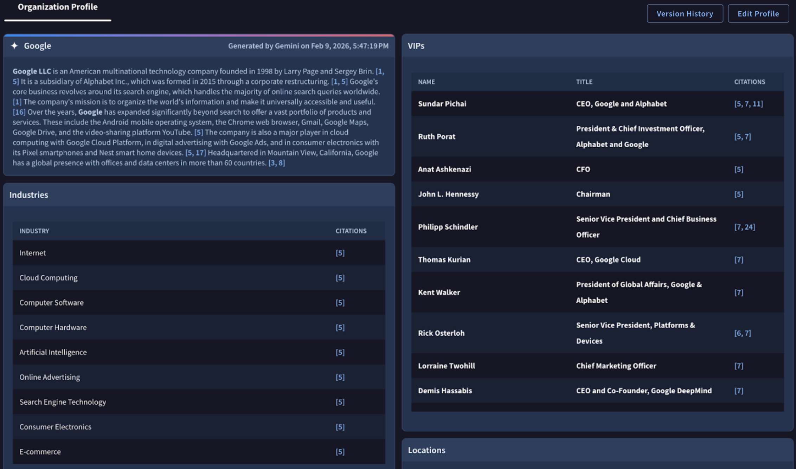
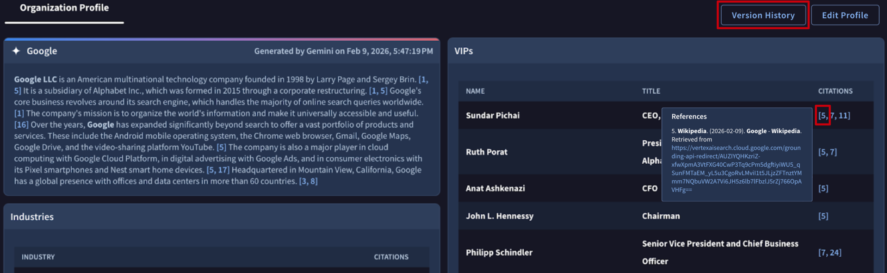
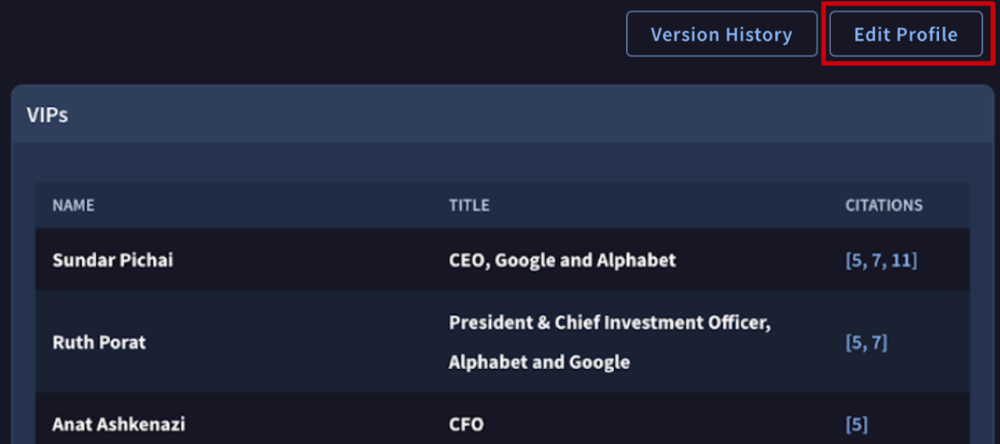

[gtidocs](../../../README.md) › [Guides](../../README.md) › [My Landscape](../README.md) › [Getting Started with our new Dark Web Intel capabilities, powered by the relevance system](../dark-web-intel.md) › Organization Profile

---

# organization-profile

***

title: Organization Profile
excerpt: >-
Set up and refine the Organization Profile the Relevance System uses as a lens
to evaluate global threat intelligence against your business.
deprecated: false
hidden: false
metadata:
robots: index
-------------

The engine behind The Relevance System is your **Organization Profile**. The system uses this profile as a lens to evaluate every single piece of threat intelligence Google processes globally.

To access it, navigate to **My Landscape (Beta)** -> **[Organization Profile](https://proactive.virustotal.com/configuration/org-profile)** from the left sidebar of the Google Threat Intelligence platform.

**Automated Setup:** Setting up your profile is virtually frictionless. Upon your first login as an Admin, [simply input](https://proactive.virustotal.com/configuration/org-profile) your **Organization Name** and **Primary Domain**.

The Relevance System will instantly use this information to automatically **build your baseline profile by discovering your core business, associated brands, and industry vertical**.

**Alert backfilling**

After creating your organization profile, recent alerts that would have been created before configuration will start to flow in.

> 📘
>
> Note that it may take up to 48-72 hours for historical alerts to complete backfilling.

> 🚧
>
> Note that you may experience very few alerts (zero to a few per day, sometimes more). **The Relevance System is tuned to only create alerts that are likely relevant to your mission**. If you are worried that you are missing important information, please use the [dark web search](../../05-global-landscape/dark-web-guide.md) capability and other tools, like [DTM](../../12-dtm/get-started-dtm.md).

> 📘
>
> **Each tenant only has one organization profile**. If you would like multiple tenants, please reach out to [support](https://www.virustotal.com/gui/contact-us/technical-support) .

## citations-and-versioning

To maintain accountability and an audit trail, the Organization Profile utilizes citations and versioning.

* **Citations:** Every time a user manually adds or [edits a component within the Organization Profile](#refining--editing-your-profile) (e.g., adding a new software to the Tech Stack), the system automatically cites that specific user next to the entry. This allows teams to see exactly who defined which parts of the attack surface.
* **Versioning:** The Organization Profile is version-controlled. If you need to review past versions, you can see a log of previous iterations of your profile. To access, click **Version history** button at the top of your organization profile.

## refining-&-editing-your-profile

While the automated setup does the heavy lifting, your environment will inevitably change over time.

Click the **Edit Profile** button in the top-right corner to enter edit mode. This action displays edit (**pen**) and delete (**trash can**) icons next to each adjustable parameter, allowing you to update your profile and keep your alerts hyper-relevant.

Once your changes are complete, click **Save Changes** button in the top-right corner to apply them and exit edit mode. To dismiss your updates and revert to the previous settings, click **Cancel Changes** next to the save button.

---

← [Getting Started with our new Dark Web Intel capabilities, powered by the relevance system](../dark-web-intel.md) · [up](../README.md) · [Threat Scenarios](my-landscape-threat-scenarios.md) →

*Archived from <https://gtidocs.virustotal.com/docs/my-landscape-organization-profile>.*
