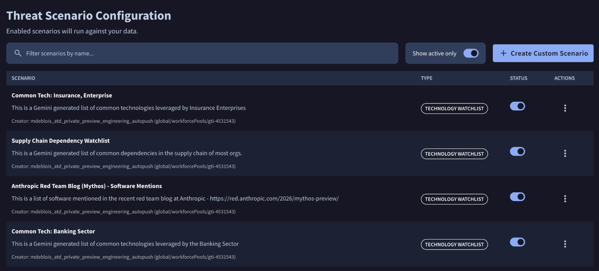
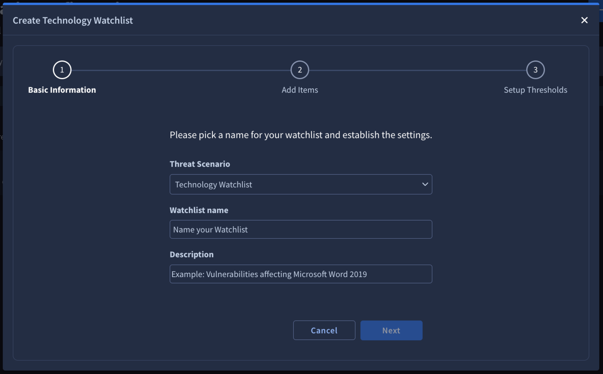
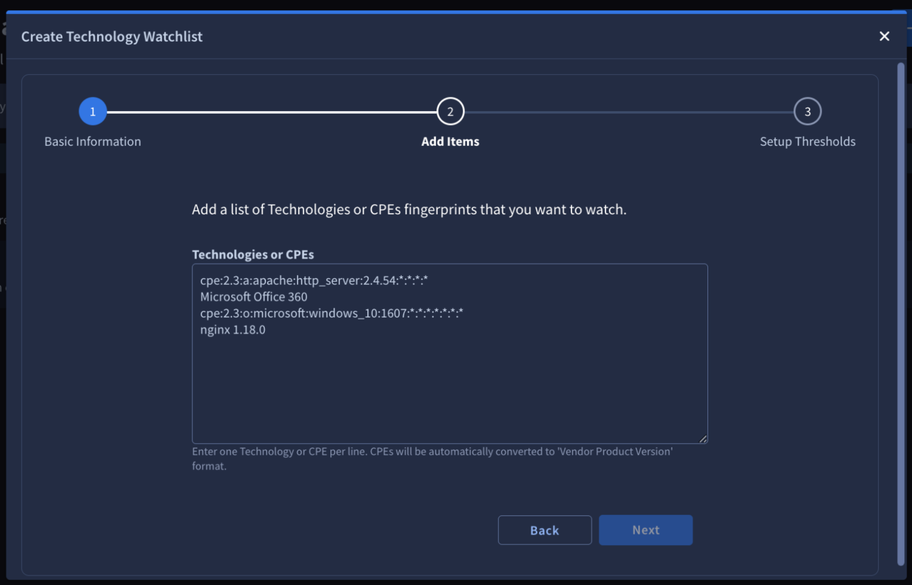
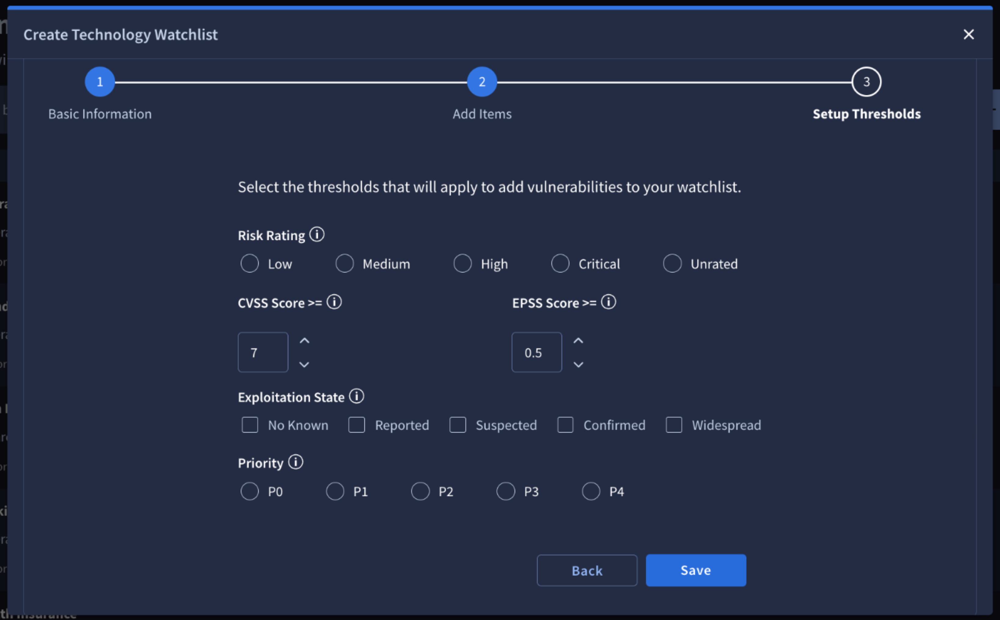

[gtidocs](../../../README.md) › [Guides](../../README.md) › [My Landscape](../README.md) › [Getting Started with our new Dark Web Intel capabilities, powered by the relevance system](../dark-web-intel.md) › Threat Scenarios

---

# threat-scenarios

***

title: Threat Scenarios
excerpt: >-
Understand system-inherited and custom Threat Scenarios, and learn how to
create, edit, enable, and disable your own monitoring configurations.
deprecated: false
hidden: false
metadata:
robots: index
-------------

A Threat Scenario is a broad, contextual narrative of an attack (e.g., an overarching campaign targeting specific vulnerabilities or industries) generating [alerts](my-landscape-alerts.md) whenever global threat data aligns with your organization's unique digital profile.

There are 2 distinct types of Threat Scenarios within the system:

### **system-inherited-threat-scenarios**

These are built-in, out-of-the-box scenarios embedded directly into the Relevance System. The system currently evaluates global data against three core starting scenarios: **Initial Access Broker**, **Data Leak**, and **Insider Threat**.

Because these scenarios are managed automatically by the system, they cannot be manually configured. They are visible only within the Alerts section when a relevant match is generated for your organization.

### **custom-threat-scenarios**

These are tailored monitoring configurations managed within the My Landscape module. They allow you to continuously track threat intelligence relevant to your organization by aligning your unique digital profile with customized risk criteria, automatically triggering high-priority alerts whenever global events match your definitions.

The primary active scenario of this type is the **Target Technology Watchlist**, which alerts you exclusively to vulnerabilities that match your specific technology configuration and pose a threat to your environment.

Only users with Alerts Admin permissions can create and edit Threat Scenarios.

## custom-threat-scenarios-list-view

The **custom Threat Scenarios list view** is accessible from the **My Landscape (Beta)** -> **[Threat Scenarios](https://proactive.virustotal.com/manage-threat-scenarios)** left sidebar of the Google Threat Intelligence platform.

The main dashboard displays a comprehensive list of your group configured custom **Threat Scenarios**, detailing the following for each entry:

* **Name & Description:** The identifier and specific scope of the monitoring configuration.
* **Owner:** The user who initially configured the scenario.
* **Type & Status**: The categorical classification of the scenario, alongside an interactive toggle switch showing its current operational state (active or inactive).

To quickly locate specific configurations, the list view provides two management tools at the top of the table:

* **Status Filter:** Use the **Show active only** toggle to instantly filter the view between only running scenarios or all existing configurations.
* **Search Bar:** Search for specific scenarios by typing keywords found in either the scenario's name or its description.

## creating-a-custom-threat-scenario

> 🚧
>
> Please note that only alert admins are able to create custom Threat Scenarios

To create a new scenario, go to the **custom Threat Scenarios list view** and click the **+ Create Custom Scenario** button. A three-step configuration wizard will open:

1. Select your threat scenario type (e.g., Target Technology Watchlist) and provide a unique **Name** and **Description**.

   

2. Enter your target technologies or CPEs (one per line) to specify what the scenario should track.

   

3. Configure the Risk Rating, Priority, CVSS Score, EPSS Score, and Exploitation State to determine which **Vulnerabilities** trigger an alert.

   

Once you have completed these steps, click **Save** to activate your configuration. The newly created scenario will immediately appear in your list view, and the Relevance System will begin continuously scanning incoming intelligence against your specified criteria, generating alerts whenever matching events are detected.

## editing,-enabling-and-disabling-a-custom-threat-scenario

From the custom Threat Scenarios list view, owner can modify or toggle the operational status of a configuration.

> 🚧
>
> Please note that only the creator (owner) of a custom Threat Scenario has the permission to edit, enable, or disable it.

### **editing-a-custom-threat-scenario**

To modify an existing configuration, click the **Actions** menu button (`⋮`) at the end of the scenario's row and select **Customize**. This reopens the configuration wizard, allowing you to update the scenario's metadata, scope, or alert criteria.

### **enabling-and-disabling-a-custom-threat-scenario**

To pause or resume monitoring, use the interactive switch in the **Status** column of the scenario's row. Toggling this switch to **Active** enables continuous scanning, while toggling it off disables the scenario and stops it from generating new alerts.

---

← [Organization Profile](my-landscape-organization-profile.md) · [up](../README.md) · [Alerts](my-landscape-alerts.md) →

*Archived from <https://gtidocs.virustotal.com/docs/my-landscape-threat-scenarios>.*
