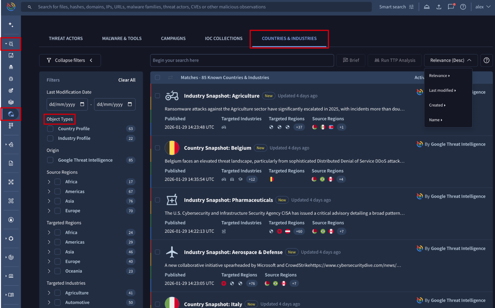
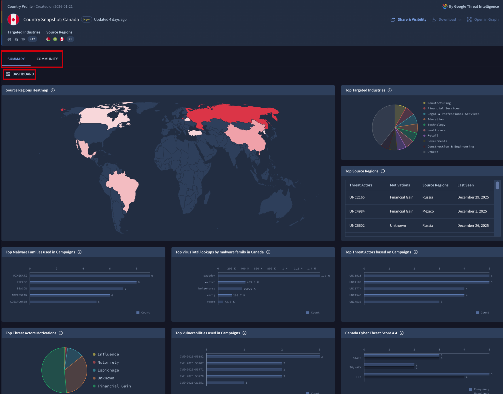
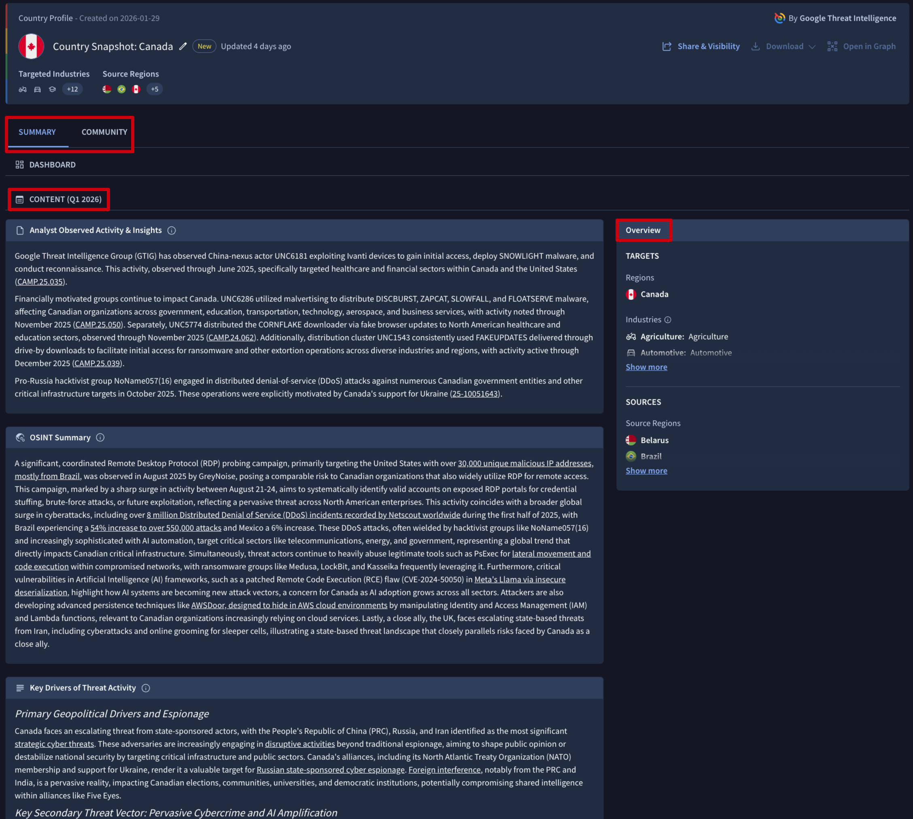

[gtidocs](../../README.md) › [Guides](../README.md) › [Global Landscape](README.md) › Countries & Industries Profiles

---

# countries-&-industries-profiles

> 🚧 Special privileges required
>
> Country Profiles and Industry Profiles are only available to users with the Google Threat Intelligence (Google TI) Enterprise or Enterprise Plus licenses.

Expanding on our [Threat Profiles](manage-threat-profiles.md), the **[Countries and Industries Profiles](https://www.virustotal.com/gui/threat-landscape/countries-and-industries?order%253Drelevance-)** within the Global Landscape module provide consolidated, targeted intelligence tailored to your specific geography and sector.

These profiles are updated quarterly  and designed to streamline your defensive strategy by filtering out the noise and focusing on the most pertinent risks.

To streamline your workflow, these profiles provide AI-generated summaries that synthesize [relevant curated data](https://www.virustotal.com/gui/reports/reports?filter%253D%252528report_type%2525253A%25252522Country%2525252520Profile%25252522%25252520OR%25252520report_type%2525253A%25252522Industry%2525252520Reporting%25252522%252529%2526order%253Drelevance-) from our GTIG team, selected relevant [OSINT articles](https://www.virustotal.com/gui/reports/reports?filter%253D%252528origin%2525253A%25252522Crowdsourced%25252522%252529%2526order%253Drelevance-) and content describing key drivers of threat environments to keep the user informed on what’s more relevant eliminating the need for manual data triaging, allowing you to make informed security decisions in a fraction of the time.

To provide a comprehensive view of the threat landscape, these profiles leverage **Visual Analytics** to transform complex datasets into intuitive, actionable intelligence through heat maps illustrating the source of threats at a glance, the top targets and charts on Threat Actors + Motivations, Malware Families and Vulnerabilities related to Campaigns targeting the selected region or sector.

These profiles are also available via API:

* [Country](https://gtidocs.readme.io/reference/country-profile-object) / [Industry](https://gtidocs.readme.io/reference/industry-profile-object) profile objects
* [Endpoints](https://gtidocs.readme.io/reference/threat-actors-malware-tools-campaigns-ioc-collections) section

# 1.-countries-&-industries-list-view

The **Countries & Industries** list view is accessible from the **Countries & Industries** platform's left-hand menu option -> **COUNTRIES & INDUSTRIES** tab.

The Countries & Industries entries displayed in this view provide a short **description**, the card's **creation date**, and the **sources and targets** of the activity, and they can be **sorted** by several attributes. To focus on what’s most relevant, you can apply **filters** based on relevant criteria such as:

* **Object Types**: distinguish between **Country Profiles** and **Industry Profiles** to find the specific category of report you need. This is particularly useful for monitoring high-risk regions or origins of your particular interest.
* **Source Regions**: to filter by the geographic origin of the threat activity. Use this filter to track threats originated from a certain geographic location you worry about.
* **Targeted Regions**: to filter by the location being attacked. Use this to identify active threats within your own geographic footprint or areas where your organization has satellite operations.
* **Targeted Industries**: to focus on threats specifically impacting your sector. This filter ensures the intelligence you see is aligned with your organization’s industry-specific risk profile.

# 2.-countries-&-industries-cards

To visualize a Country or Industry Profile card, simply click on it from the **COUNTRIES & INDUSTRIES** tab.

The profile card displays at the top information related to threats targets and sources as well as the creation date of the profile while the rest of information is split in several tabs as follows:

* The **SUMMARY** tab is the one that provides the core of the information. It is split in 2 sections:
  * The **DASHBOARD** section provides a specialized suite of **Visual Analytics**, offering a comprehensive overview of the threat landscape relative to your selected profile. This section transforms complex campaign data into the following intuitive visualizations:
    * **Source Regions Heatmap**: it provides an immediate geographic view of where threats originate and how active those countries are in attacking the selected region or sector.
    * **Top Source Regions**: a table identifying the primary geographic sources of threat activity against the selected region or sector. Records are enriched with threat actor attribution and motivations, prioritized by latest observed activity to highlight current movements.
    * **Targeting Distribution (Pie Chart)**: a dedicated chart highlighting the **Top Targeted Industries/Countries**, allowing you to see which regions/sectors are bearing the brunt of the threat activity.
    * **Campaign Intelligence (mostly Bar Charts)**: a series of charts detailing the "how" and "who" behind the threats, including:
      * **Threat Actors**: the most active groups targeting the region or sector.
      * **Motivations**: the primary drivers behind the attacks (e.g., financial gain, espionage) as pie chart.
      * **Malware Families**: the specific software strains used in campaigns.
      * **Vulnerabilities**: the CVEs and weaknesses most frequently exploited.
    * **Cyber Threat Score 4.4 (Bar Chart)**: which quantifies the current risk assessment across  **STATE** (state-sponsored), **IO/HACK** (hacktivism), and **FIN** (financial) threat categories for the selected region or sector. This score allows for immediate benchmarking and helps stakeholders understand the severity of the active threat environment at a glance.

* The **CONTENT** section is divided into three specialized modules designed to provide a 360-degree view of the threat environment:
  * **Analyst Observed Activity & Insights**: features AI-generated intelligence derived from curated data and proprietary findings from our Global Threat Intelligence Group (GTIG). This module provides deep visibility into confirmed campaigns and expert-validated threats.
  * **OSINT Summary**: provides AI-synthesized summaries of high-relevance Open Source Intelligence (OSINT) reports. This ensures you stay informed on global reporting, news, and external research without having to manually read through dozens of articles.
  * **Key Drivers of Threat Activity**:  delivers AI-summarized insights into the underlying factors such as geopolitical shifts, emerging technologies, or economic changes, that are currently shaping and motivating threat activity in the selected region or sector.
* The **COMMUNITY** displays insights and discussions from the broader user base. It allows you to review peer-contributed analysis related to the profile or contribute to the collective intelligence by posting your own comments and observations.

---

← [New dark web research](dark-web-guide.md) · [up](README.md) · [How Your Threat Landscape Uses AI Recommendations](threat-landscape-ai-recommendations.md) →

*Archived from <https://gtidocs.virustotal.com/docs/countries-industries-profiles>.*
