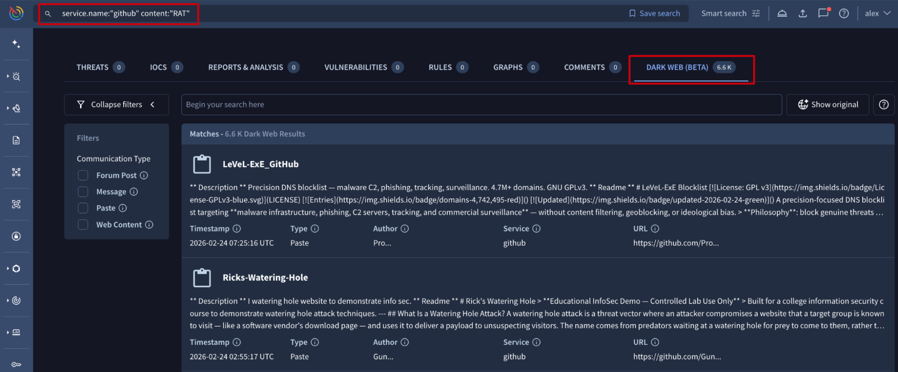

[gtidocs](../../README.md) › [Guides](../README.md) › [Global Landscape](README.md) › New dark web research

---

# new-dark-web-research

The Underground Intelligence feeds our **Dark Web** tool, expanding our indexing capabilities into the encrypted and unindexed layers of the web. This shift allows analysts to move beyond traditional, reactive defense by monitoring the specific environments where cybercriminals collaborate, trade and plan. By gaining access to these hidden forums and messaging channels, your team can identify indicators of an attack such as credential dumps or exploit discussions at their source, enabling a preventive security strategy.

All data ingested into the **Dark Web** module is normalized into 4 distinct categories:

* **Forum Post**: structured discussions, threads, and replies from dark web bulletin boards and underground hacking communities including .onion forums. These are often "long-form" communications. They are best for identifying reputation scores of threat actors, detailed tutorials, malware-as-a-service advertisements, and lengthy debates regarding vulnerabilities.
* **Message**: real-time, short-form communications originating from Telegram channels. This is high-velocity data. Messages are where "the action happens", it is the primary medium for coordinate-heavy tasks, quick data trades, and immediate alerts about ongoing attacks or newly discovered leaks.
* **Paste**: text snippets or code blocks typically found on "pastebin" style sites or code repositories. Pastes are often the first signal of a breach. They typically contain unstructured lists of leaked credentials, configuration files, private keys, or "doxxing" information that is too large to be sent as a standard message.
* **Web Content**: static or dynamic content indexed from dark web marketplaces, blog posts or news articles scraped from relevant sites, and onion-hosted leak sites. This provides a comprehensive overview of the illicit economy. It is used to monitor official announcements from ransomware groups or to track the pricing and availability of illegal goods and services on marketplaces.

## dark-web-advanced-searches

To ensure focus on what's most relevant to your specific intelligence requirements, we have developed a comprehensive library of search modifiers. These operators allow you to filter through vast quantities of raw messaging data in different aspects. By leveraging these modifiers, analysts can build high-precision queries that eliminate noise and isolate the most critical threats.

Note that when performing a free-text search, the query is applied across the most relevant text fields such as names, descriptions, original and translated content, urls, etc, simultaneously to retrieve the results.

In addition to specialized modifiers, you can use the **`entity:ddw`** operator to scope your search exclusively to the Dark Web module, excluding matches from other platform entities such as threat actor profiles or IoC reports.

| Modifier | Description |
| --- | --- |
| author.avatar_image.md5_hash | Filters results based on the MD5 hash of the author’s avatar. (Exact match) Examples: [author.avatar_image.md5_hash:397785f9f2937931c38a953a115beda0](https://www.virustotal.com/gui/search/author.avatar_image.md5_hash:397785f9f2937931c38a953a115beda0/Dark%20Web) |
| author.is_bot | Filters results based on whether the content was generated by a bot or a user. (Boolean exact match) Examples: [author.is_bot](https://www.virustotal.com/gui/search/author.is_bot/Dark%20Web), [not author.is_bot](https://www.virustotal.com/gui/search/not%20author.is_bot/Dark%20Web) |
| author.name | Filters results by the author's name. This field is tokenized, allowing for partial matches or keyword-based discovery. Examples: [author.name:"Ruth"](https://www.virustotal.com/gui/search/author.name:%22Ruth%22/Dark%20Web) |
| communication_channel.description | Filters results by their channel description. This field is tokenized, allowing for partial matches or keyword-based discovery. Examples: [communication_channel.description:"bank"](https://www.virustotal.com/gui/search/communication_channel.description:%22bank%22/Dark%20Web), [communication_channel.description:"news"](https://www.virustotal.com/gui/search/communication_channel.description:%22news%22/Dark%20Web) |
| communication_channel.invite_url | Filters results by the channel invitation URL. This field is tokenized, allowing for partial matches or keyword-based discovery. Examples: [communication_channel.invite_url:"exploit"](https://www.virustotal.com/gui/search/communication_channel.invite_url:%22exploit%22/Dark%20Web) |
| communication_channel.name | Filters results by their channel name. This field is tokenized, allowing for partial matches or keyword-based discovery. Examples: [communication_channel.name:"news"](https://www.virustotal.com/gui/search/communication_channel.name:%22news%22/Dark%20Web), [communication_channel.name:"exploit"](https://www.virustotal.com/gui/search/communication_channel.name:%22exploit%22/Dark%20Web) |
| communication_channel.url | Filters results by their channel URL. This field is tokenized, allowing for partial matches or keyword-based discovery. Examples: [communication_channel.url:"rat"](https://www.virustotal.com/gui/search/communication_channel.url:%22rat%22/Dark%20Web), [communication_channel.url:"apt"](https://www.virustotal.com/gui/search/communication_channel.url:%22apt%22/Dark%20Web) |
| origin_url | Filters results by the service URL. This field is tokenized, allowing for partial matches or keyword-based discovery. Examples: [origin_url:"webshell"](https://www.virustotal.com/gui/search/origin_url:%22webshell%22/Dark%20Web) |
| service.name | Filters results by the service name. This field is tokenized, allowing for partial matches or keyword-based discovery. Examples: [service.name:"telegram"](https://www.virustotal.com/gui/search/service.name:%22telegram%22/Dark%20Web), [service.name:"github"](https://www.virustotal.com/gui/search/service.name:%22github%22/Dark%20Web) |
| subject | Filters communication objects by their subject as the title of a forum post. This field is tokenized, allowing for partial matches or keyword-based discovery. Examples: [subject:"ransomware"](https://www.virustotal.com/gui/search/subject:%22ransomware%22/Dark%20Web) , [subject:CVE-2026-21514](https://www.virustotal.com/gui/search/subject:CVE-2026-21514/Dark%20Web) |
| type | Filters results by their type. Available options are: forum, forum_post, messenger, paste, post, web_content. (Exact match) Example: [type:web_content](https://www.virustotal.com/gui/search/type:web_content/Dark%20Web), [type:messenger](https://www.virustotal.com/gui/search/type:messenger/Dark%20Web), [type:post](https://www.virustotal.com/gui/search/type:post/Dark%20Web) |
| content | Filters results by their content. The content of messages, posts and articles is tokenized, allowing for partial matches or keyword-based discovery. Example: [content:"credit card"](https://www.virustotal.com/gui/search/content:%22credit%20card%22/Dark%20Web), [content:"CVV"](https://www.virustotal.com/gui/search/content:%22CVV%22/Dark%20Web) |

Once an advanced search is executed, results are displayed within the **DARK WEB** tab. The interface is optimized with data type filters at the left of the results list view.

Each result card contains a title and the content description, followed by five pivotable metadata fields. Clicking any of these values will instantly launch a new advanced search, allowing you to "pivot" and discover related intelligence.

These fields are:

* **Timestamp**: time of artifact publication when possible, otherwise time of collection.
* **Type**: the classification of the data (Web Content, Message, Forum Post, or Paste).
* **Author**: the alias or handle of the entity that published the content.
* **Service**: the specific platform or onion service hosting the data (e.g., a specific forum or Telegram channel).
* **URL**: the direct source link where the artifact was originally located.

---

← [TTP Analysis](ttp-analysis.md) · [up](README.md) · [Countries & Industries Profiles](countries-industries-profiles.md) →

*Archived from <https://gtidocs.virustotal.com/docs/dark-web-guide>.*
