[gtidocs](../../README.md) › [Guides](../README.md) › [Global Landscape](README.md) › Threat Profiles

---

# threat-profiles

**Threat Profiles** serve as a customized lens through which you can view and analyze Google Threat Intelligence's vast data, by defining specific criteria such as the targeted industries, target regions, source regions, malware roles, and actors motivations. These criteria are then leveraged by our system to identify and recommend the most relevant threats ([Threat Actors](threat-actors-card.md), [Campaigns](campaigns.md), [Malware & Tools](malware-tools.md), [IoC Collections](ioc-collections.md), [Vulnerabilities](../10-vulnerability-intelligence/explore-vulnerabilities.md) and [Reports](../07-report-analysis/reports-and-analysis.md#2-reports-cards)) and create a personalized Threat Profile tailored to your organization's unique risk profile allowing users to focus on threats that matter most.

Note that all web interface functionalities are also accessible and automatable via our API. Visit the [**API documentation** here](https://gtidocs.readme.io/reference/create-threat-profile).

**Table of Contents**

1. [Creating new Threat Profiles](#1-creating-new-threat-profiles)

2. [Threat Profile card](#2-threat-profile-card)

   2.1. [Recommendations](#21-recommendations)

       2.1.1 [Threat Map Visualization](#211-threat-map-visualization)

       2.1.2 [Managing Recommendations - Adding and deleting objects](#212-managing-recommendations---adding-and-deleting-objects)

   2.2. [Activity Timeline](#22-activity-timeline)

   2.3. [Email Notifications](#23-email-notifications)

   2.4. [View in IoC Stream](#24-view-in-ioc-stream)

   2.5. [Run TTP Analysis](#25-run-ttp-analysis)

   2.6. [Exporting IoCs](#26-exporting-iocs)

3. [Managing existing Threat Profiles](#3-managing-existing-threat-profiles)

   3.1. [Managing existing Threat Profiles - Update Configuration](#31-managing-existing-threat-profiles---update-configuration)

   3.2. [Managing existing Threat Profiles - Access](#32-managing-existing-threat-profiles---access)

   3.3. [Managing existing Threat Profiles - Deletion](#33-managing-existing-threat-profiles---deletion)

# 1.-creating-new-threat-profiles

To create a Threat Profile on [Google Threat Intelligence](https://www.virustotal.com/):

* From the left menu, navigate to **Global Landscape** -> **My Threat Profiles** to access the list view, then click the **Create Threat Profile** button.
* First, give your new Threat Profile a **name** and indicate if you'd like to **share** it with your Google TI group members as view-only.
* Then, define your focus by selecting your **Target industries,** **Targeted regions**, and **Advanced options** (such as **Source regions**, **Malware roles**, and **Actor motivations**). The second step also allows you to choose the time period for your Threat Profile. For the most accurate recommendations, a minimum of 90 days is required.
* Finally, a list of third-party integrations is displayed. You can click on any third-party connector to learn how to integrate your Threat Profile with, and automatically ingest curated threat intelligence into your environment.

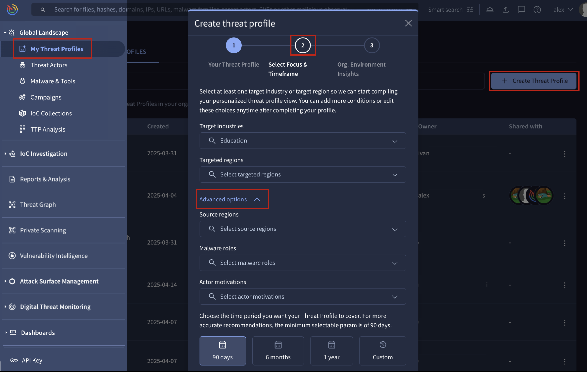

After creation, you'll find your new Threat Profile listed with your other accessible profiles under the **MANAGE THREAT PROFILE** tab. You'll have **owner** permission for Threat Profiles you create, which allows you to [fully manage them](#3-managing-existing-threat-profiles), [control other users' access to them](#32-managing-existing-threat-profiles---access), and [handle their Recommendations and associated objects](#21-recommendations) as needed.

Other users or members of your group can get access to your Threat Profiles as **viewers** or **editors**, as described in the section [3.2. **Managing existing Threat Profiles - Access**](#32-managing-existing-threat-profiles---access).

# 2.-threat-profile-card

Once created, a Threat Profile card can be opened directly from the list of Threat Profiles view, showing its name and threat-related configuration at the top.

You'll also find a **dropdown menu here, labeled with the current Threat Profile's name, for quick navigation to other Threat Profiles** you can access.

Apart from this you have other buttons to:

* [**Customize** or change the configuration settings](#31-managing-existing-threat-profiles---update-configuration)
* [**Share** or manage access to the profile](#32-managing-existing-threat-profiles---access)
* [**View in IoC Stream** notifications](#24-view-in-ioc-stream)
* **Export** IoCs associated to your Recommendations

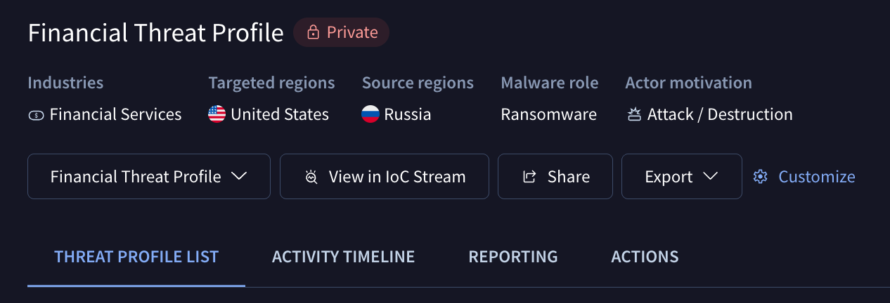

## 2.1.-recommendations

**Recommendations** are [Threat Actors](threat-actors-card.md), [Campaigns](campaigns.md), [Malware & Tools](malware-tools.md), [IoC Collections](ioc-collections.md), [Vulnerabilities](../10-vulnerability-intelligence/explore-vulnerabilities.md) and [Reports](../07-report-analysis/reports-and-analysis.md#2-reports-cards) objects associated with a Threat Profile by our system. This module takes into consideration the Threat Profile configuration settings and matching criteria to only link relevant objects.

| Matching criteria/categories | Matching configuration                                                                                       |
| ---------------------------- | ------------------------------------------------------------------------------------------------------------ |
| Targeted Industries          | Time Period: objects timeframe for recommendations.                                                          |
| Targeted Regions             | Matching Criteria: the number of categories matched among the configured criteria.                           |
| Source Regions               | Recommendations Count: the maximum number of recommendations per threat object type (actors, campaigns, etc) |
| Malware Roles                |                                                                                                              |
| Actor Motivations            |                                                                                                              |

Check out the [**Managing existing Threat Profiles**](#3-managing-existing-threat-profiles) section to adjust matching criteria and settings, including disabling automatic Recommendations and Third Party Connectors.

Threats are listed in the **REPORTING** tab (for reports only) and the **THREAT PROFILE LIST** tab (for all other object types) of the Threat Profile card. Both tabs offer **filters** on the left, allowing you to prioritize effectively by the matching criteria patterns and other parameters such as:

* **Recommendation Source**: refers to threat objects automatically **Recommended** by our system, **Observed** within third-party integrations when configured, or those **Added** by users.
* **Origin**:  refers to the source of the object data, which can be curated by our **Google Threat Intelligence** analysts, curated by our **Partners**, or **Crowdsourced** data from the community.

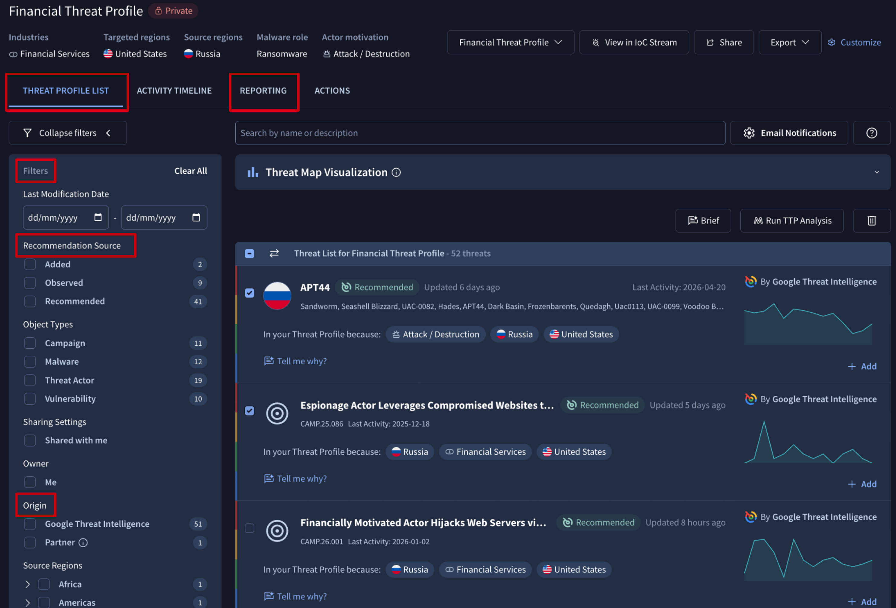

Each recommendation comes with a **Tell me why?** button that generates a natural language explanation of why the object was linked to the Threat Profile and a summary of the object. Users can rate this explanation and directly ask additional follow-up questions, pivoting to the **Agentic** tool for a more in-depth conversation with our AI agents.

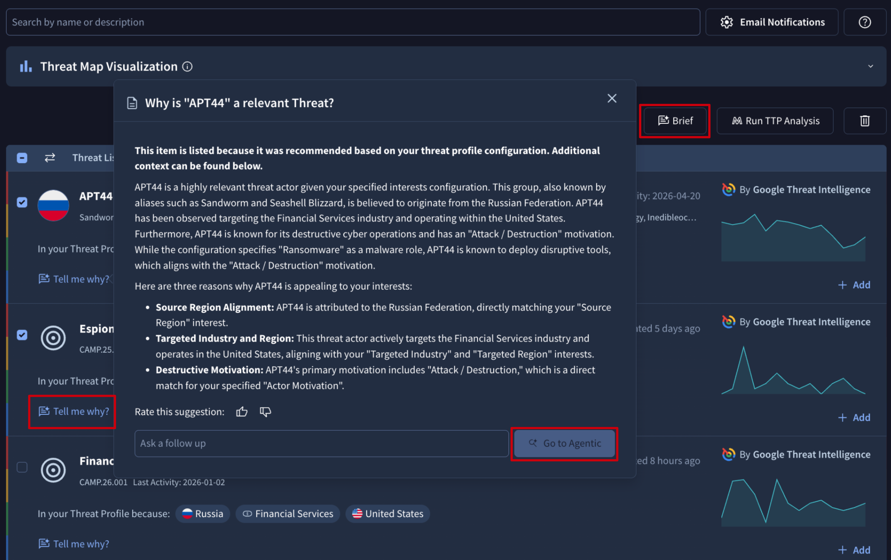

Additionally, after selecting one or more threats from the **REPORTING** or **THREAT PROFILE LIST** tabs, you can click the **Brief** button to launch the **Agentic** view with a ready-made prompt that returns a single summary of the chosen items, highlighting their most recent activity. Use it to get a quick consolidated read across related actors, campaigns, or malware families without opening each card individually.

### 2.1.1.-threat-map-visualization

The **Threat Map Visualization** on the **THREAT PROFILE LIST** tab is a unique Google Threat Intelligence scatter plot designed to help you prioritize threats by instantly showing a threat's global prevalence versus its specific relevance within the confines of the dimensions of a given threat profile. Together, this allows you to focus on what matters most and provide critical signals to prioritize threat-informed defense effectively.

* **X-Axis: Relevance** - The horizontal X-axis measures Relevance, answering the critical question: "How much should I care about this threat based on the configuration of the threat profile?" This is a configuration dependent metric tailored to the dimensions selected at the onset of creation. It calculates a relevance score by comparing the threat against your configured threat profile dimensions and can include factors like:
  * Your industry (e.g., financial sector)
  * Your geographic locations (e.g., Americas)
  * Focus on threat source location (e.g., Russia)
  * Focus on threat actor motivation (e.g., financially motivated)
  * Focus on malware type (e.g., ransomware)

**Tooltip**: "Relevance measures how pertinent this threat is compared to your specific threat profile configuration such as industry, target geo, motivation, etc."

* **Y-Axis: Global Frequency** - The vertical Y-axis represents Global Frequency, answering the question: "How much is the security community and the world at large seeing this threat?" This is a global context metric that automatically calculates the "hotness" of a threat based on infrastructure (IoCs) seen submitted or looked up by VirusTotal community users.

**Tooltip**: "Global frequency automatically calculates hotness for each artifact based on signals like aggregate indicator prevalence based on submissions and lookups."

By plotting threats on these two axes, you can quickly identify the most critical items to investigate those located in **the top-right quadrant**, which are both highly relevant to you and trending globally.

Each object displays a hovercard containing key information: the object's name, its last seen date, the count of related reports and the matched criteria.

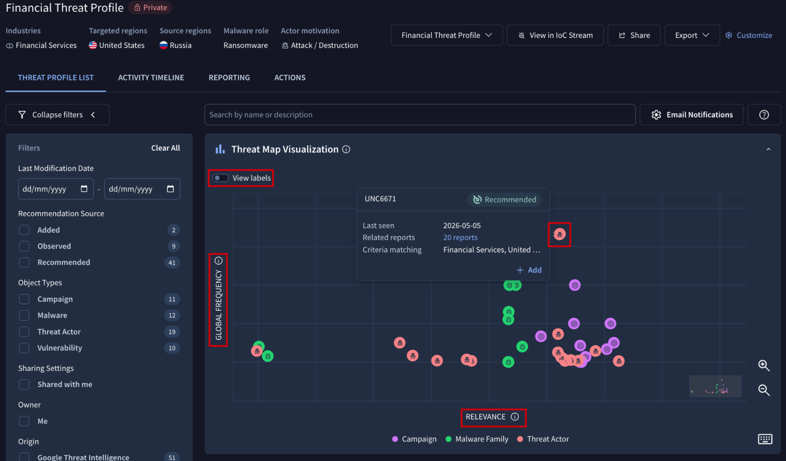

### 2.1.2.-managing-recommendations---adding-and-deleting-objects

As previously mentioned, **owners** and **editors** can manually **add/delete** Threat objects, Reports, and Vulnerabilities to/from a Threat Profile.

Objects suggested by our system or generated via third-party integrations can be **added** as a **confirmation of their relevance** via the **Follow** button within the object card or directly from the Threat Profile view through the **Add** button displayed for each object in the list.

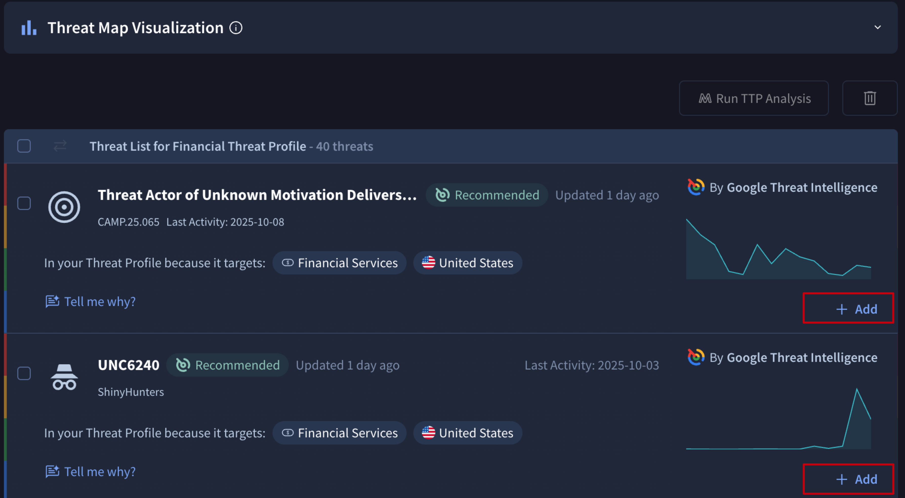

 

Objects can also be **deleted** from a given Threat Profile, by simply selecting them from the **REPORTING** or **THREAT PROFILE LIST** tabs and then clicking on the "bin" button.

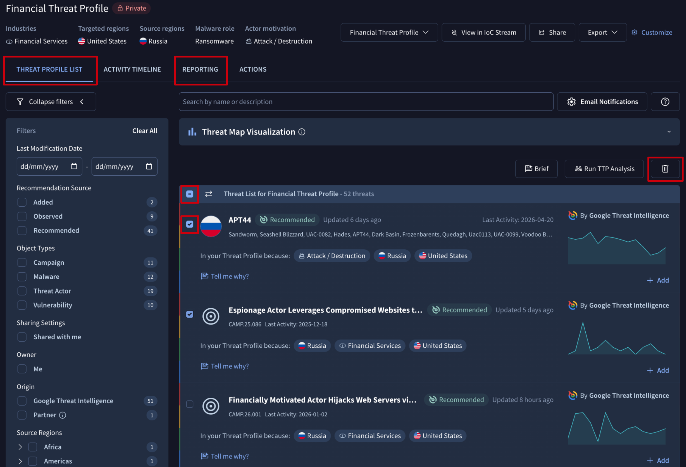

Note that this action will stop new [IoC Stream notifications](#24-view-in-ioc-stream) from being generated on deleted objects, but will not automatically delete existing ones; and [timeline events](#22-activity-timeline) are automatically updated.

Also note that **deleting Recommended objects will not stop the system from regenerating them the next day** if the object continues to match the configured criteria. Because of this we recommend you **confirm all recommended objects by adding them to your profile. This creates a user-curated list that can then be seamlessly used across the rest of your security processes.**

## 2.2.-activity-timeline

The **ACTIVITY TIMELINE** tab on a Threat Profile card displays a chronological history of relevant changes to its associated objects, helping you understand threat evolution over time, such as when bad actors shift tactics or when Google surfaces new detection rules (like YARA, SIGMA, or IDS rules from Mandiant or the community) relevant to the threats in your profile.

You can also find this information by navigating to each main object card and checking either the **Latest Activity** section in its **SUMMARY** tab or the **Associations timeline** sub-tab within the **ASSOCIATIONS** tab.

Additionally, the date and object type filters allow you to visualize precisely what matters most to you at each moment.

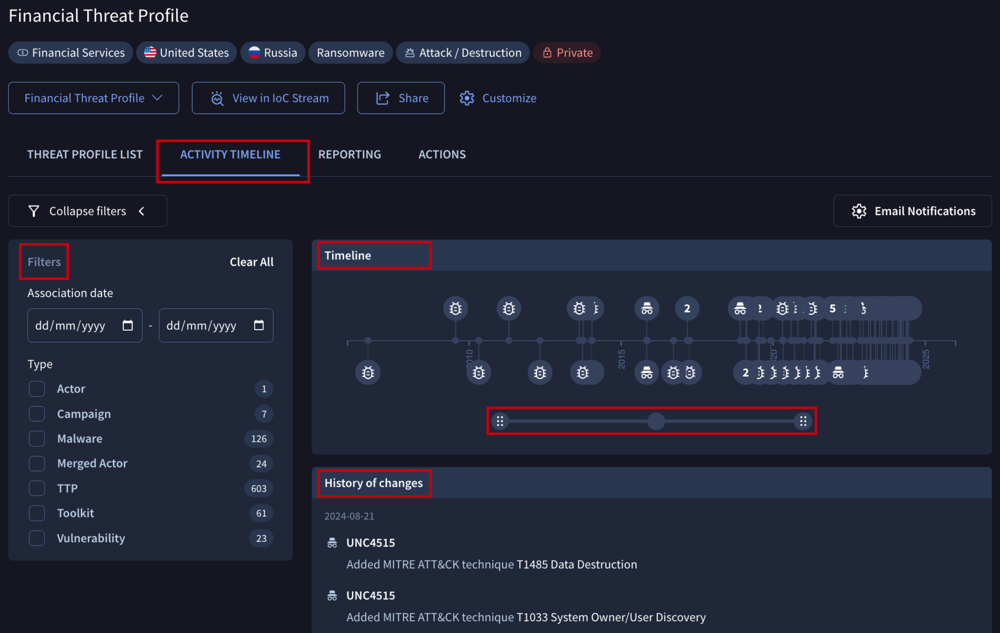

Never miss a tactical behavior pivot with our change event stream via [email notifications](#23-email-notifications) or [API](https://gtidocs.readme.io/reference/get-threat-profile-timeline-associations).

## 2.3.-email-notifications

All users can configure email notifications to stay informed about changes within a threat profile and remain updated on the threat landscape latest activity.

You can find an **Email Notifications** button on any tab of a Threat Profile card. Clicking it will take you to your user settings, where a **New Notification** button within the **Email Notifications** section allows you to open the notification configuration form.

On this form, you need to select the **Threat Profile Digest** option, give your digest a **Name** (email subject),  and choose the specific Threat Profile you're interested in from the dropdown menu as well as the type of objects you want to be notified on. You can also select between **Daily** and **Weekly** **Delivery Preferences**.

Once configured, digest will be sent at 9:00 AM UTC to the email address of the user who set it up, allowing the user to track any new activity.

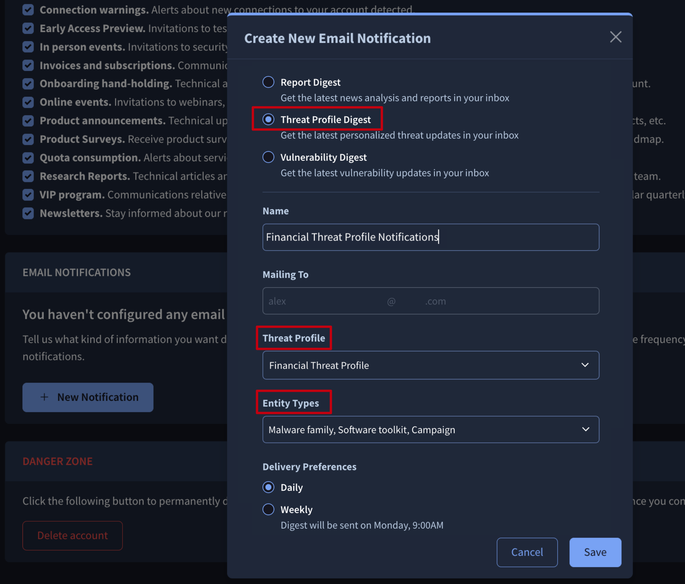

## 2.4.-view-in-ioc-stream

You can automatically convert Indicators of Compromise (IoCs) from a Threat Profile's associated Threat objects, Reports, and Vulnerabilities into a custom IoC stream for quick tactical actions. Simply click the **View in IoC Stream** button, accessible from any tab of the Threat Profile card, or click the **View Profile on IoC Stream** button in the **ACTIONS** tab.

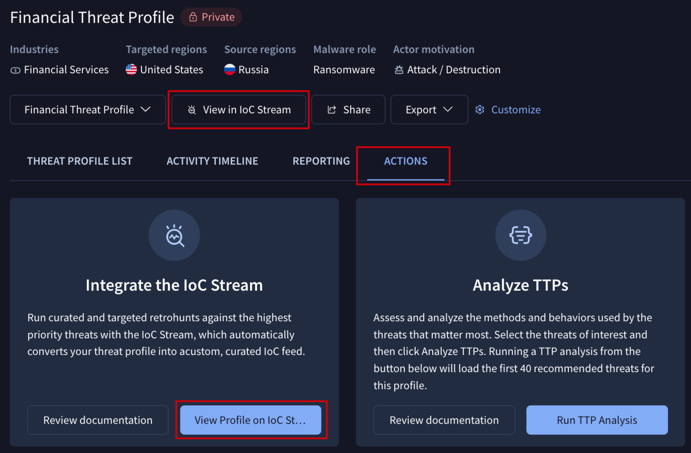

Leverage [**IoC Stream**](../06-ioc-investigation/ioc-stream-guide.md) to get real-time notifications of new indicators linked to your Threat Profile objects. This empowers you to visually filter and analyze indicators for **Commonalities**, explore their connections with **Graphs**, and collaborate with other explicitly selected users and groups members through private **IoC Collections**. Furthermore, it enables automatic **SIEM** integration via [API](https://gtidocs.readme.io/reference/get-objects-from-the-ioc-stream) and the execution of targeted Retrohunt queries to find these IoCs in your environment.

## 2.5.-run-ttp-analysis

You can analyze the tactics, techniques and procedures utilized by threats from your profile with our MITRE TTP Analysis tool, giving detection engineers a clear action plan to close gaps within your existing detection program.

To do this, you can either click the **Run TTP Analysis** button in the **ACTIONS** tab to process your entire Threat Profile, or select specific Reports or threats from the **REPORTING** or **THREAT PROFILE LIST** tabs and then click the **Run TTP Analysis** button.

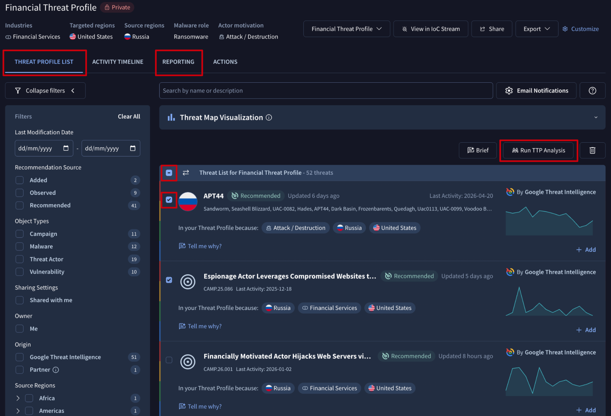

This action will open a [TTP Analysis](ttp-analysis.md) tool showing the Mitre matrix of tactics, techniques and procedures used by your threats.

## 2.6.-exporting-iocs

You can easily export the Indicators of Compromise (IoCs) associated with Recommendations in your Threat Profile to ingest them into your security infrastructure (e.g., SIEM, SOAR, EDR).

Use the **Export** menu in the top to choose between exporting **raw** IoCs or including their associated **metadata**. Both options are available in **JSON**, **CSV**, and **STIX** formats. If you opt to include metadata, a modal will appear allowing you to select the specific fields to include in the export file.

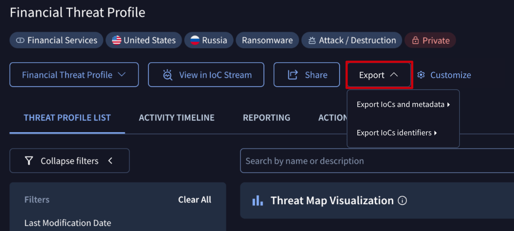

# 3.-managing-existing-threat-profiles

Next to each Threat Profile on the list of [Threat Profiles](https://www.virustotal.com/gui/threat-profiles), a 3-dot icon provides access to several management options and some of them can be accessed also from the Threat Profile card:

## 3.1.-managing-existing-threat-profiles---update-configuration

**Owners** and **editors** are able to update a Threat Profile's configuration any time they need it. This not only includes the Threat Profile's name and the redefinition of targeted industries, targeted regions, source regions, malware role and threat actors motivations, but also the time period our system has to cover to generate the recommendations.

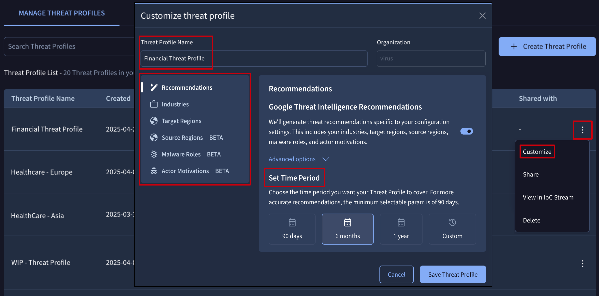

A dedicated **Customize** button can be found at the top of the Threat Profile card allowing to perform the same action too.

Note that changes on the configuration settings may take up to 5 minutes to update recommendations, and objects added by users to the Threat Profile won't suffer any change.

## 3.2.-managing-existing-threat-profiles---access

To facilitate collaboration, Threat Profiles can be shared with other **users** and **groups** members with different permission levels:

* **viewers** -  for only visualizing the Threat Profile, its configuration, Recommendations, Activity Timeline, Reporting, IoC Stream notifications, and TTPs analysis.
* **editors** - for editing the Threat Profile's configuration and managing access to it and its Recommendations and associated objects.

A dedicated **Share** button can be found at the top of the Threat Profile card allowing to perform the same action too.

## 3.3.-managing-existing-threat-profiles---deletion

Only **owners** are able to delete a Threat Profile as follows:

Note that this action will stop new [IoC Stream notifications](#24-view-in-ioc-stream) from being generated but will not automatically delete existing ones.

---

← [Alerts](../04-my-landscape/dark-web-intel/my-landscape-alerts.md) · [up](README.md) · [Threat Actors](threat-actors-card.md) →

*Archived from <https://gtidocs.virustotal.com/docs/manage-threat-profiles>.*
