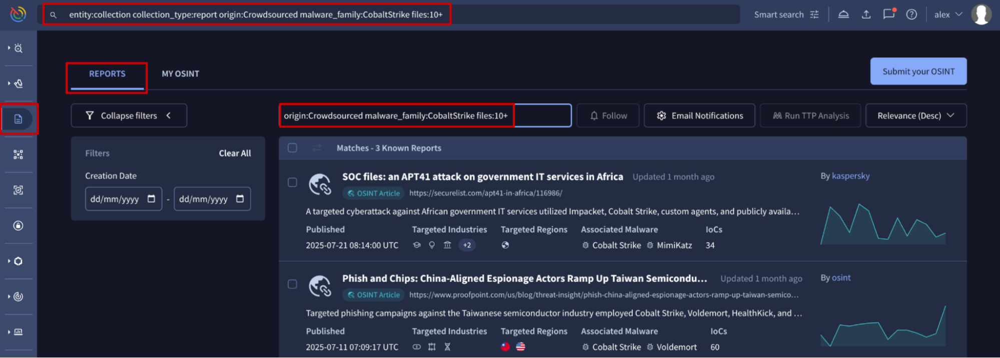

[gtidocs](../../../README.md) › [Guides](../../README.md) › [IOC Investigation](../README.md) › [Intelligence / Web searching](../intelligence.md) › Reports search modifiers

---

# reports-search-modifiers

> 🚧 Special privileges required
>
> This feature is only available to users with the Enterprise or Enterprise Plus module.
> Google Threat Intelligence allows you to perform advanced searches over the historical set of [Reports & Analysis](../../07-report-analysis/reports-and-analysis.md). These searches can act on basically all the metadata that we generate for collections: name, threat actor, references, urls, malware role, tags, etc.

Advanced searches can be placed in the UI in two places:

* The **Reports search bar**, found on the **Reports & Analysis list view**, allows users to perform advanced searches by using report-specific search modifiers. It is not required to specify the object type to look for, which streamlines the search process.
* The **top search bar** or **home search bar**, which is available from almost all locations in the UI, requires to specify both the search logic and the object type to look for. For reports, you would need to enter `entity:collection collection_type:report` followed by the rest of conditions.

The following table outlines all advanced search modifiers for reports:

| Search modifier           | Description                                                                                                                                                                                                                                                                                                                                                                                                                                                                   |
| ------------------------- | ----------------------------------------------------------------------------------------------------------------------------------------------------------------------------------------------------------------------------------------------------------------------------------------------------------------------------------------------------------------------------------------------------------------------------------------------------------------------------- |
| Open free text            | Text without modifiers matching against object's name or description                                                                                                                                                                                                                                                                                                                                                                                                          |
| `name`                    | Searches for words within the report's title. E.g.: [name:lolbin](https://www.virustotal.com/gui/reports/reports?order%253Drelevance-%2526holisticFilter%253Dname%25253Alolbin)                                                                                                                                                                                                                                                                                               |
| `description`             | Searches for words within the report's description. E.g.: [description:ransomware](https://www.virustotal.com/gui/reports/reports?order%253Drelevance-%2526holisticFilter%253Ddescription%25253Aransomware)                                                                                                                                                                                                                                                                   |
| `creation_date`           | Searches for reports based on their creation date. Note that for OSINT reports, this refers to the source's creation date rather than our database entry date. E.g.: [creation\_date:2025-01-01+ AND creation\_date:2025-03-01-](https://www.virustotal.com/gui/reports/reports?order%253Drelevance-%2526holisticFilter%253Dcreation_date%25253A2025-01-01%25252B%252BAND%252Bcreation_date%25253A2025-03-01-)                                                                |
| `last_modification_date`  | Searches for reports based on their creation date. E.g.: [last\_modification\_date:3d+](https://www.virustotal.com/gui/reports/reports?order%253Drelevance-%2526holisticFilter%253Dlast_modification_date%25253A3d%25252B) (modified in the last 3 days)                                                                                                                                                                                                                      |
| `origin`                  | Searches for reports based on their origin. E.g.: [origin:"Google Threat Intelligence"](https://www.virustotal.com/gui/reports/reports?order%253Drelevance-%2526holisticFilter%253Dorigin%25253A%252522Google%252BThreat%252BIntelligence%252522) or [origin:Crowdsourced](https://www.virustotal.com/gui/reports/reports?order%253Drelevance-%2526holisticFilter%253Dorigin%25253ACrowdsourced)                                                                              |
| `publisher`               | Searches for OSINT/Crowdsourced reports based on the name of the publisher. In the UI, this is displayed on the report card as "By publisher\_name". If the publisher's name isn't available, the owner's name will be displayed in the UI instead. E.g.: [publisher:osint](https://www.virustotal.com/gui/reports/reports?order%253Drelevance-%2526holisticFilter%253Dpublisher%25253Aosint)                                                                                 |
| `owner`                   | Searches for reports based on the username of the user that has created the object. If the publisher's name isn't available, the owner's name will be displayed in the UI instead. E.g.: [owner:vt\_reference\_scraper](https://www.virustotal.com/gui/reports/reports?order%253Drelevance-%2526holisticFilter%253Downer%25253Avt_reference_scraper)                                                                                                                          |
| `report_type`             | Searches for reports based on their types. See available options [here](threat-intelligence-objects-modifiers-values.md). E.g.: [report\_type:"Industry Reporting"](https://www.virustotal.com/gui/reports/reports?order%253Drelevance-%2526holisticFilter%253Dreport_type%25253A%252522Industry%252BReporting%252522)                                                                                                                                                       |
| `source_region`           | Searches for reports based on the region where the threat described in the report was initiated. See available options [here](threat-intelligence-objects-modifiers-values.md). E.g.: [source\_region:Europe](https://www.virustotal.com/gui/reports/reports?order%253Drelevance-%2526holisticFilter%253Dsource_region%25253AEurope), [source\_region:KP](https://www.virustotal.com/gui/reports/reports?order%253Drelevance-%2526holisticFilter%253Dsource_region%25253AKP) |
| `targeted_region`         | Searches for reports based on the region targeted by the threat described in the report. See available options [here](threat-intelligence-objects-modifiers-values.md). E.g.: [targeted\_region:USA](https://www.virustotal.com/gui/reports/reports?order%253Drelevance-%2526holisticFilter%253Dtargeted_region%25253AUSA)                                                                                                                                                   |
| `targeted_industry`       | Searches for reports based on the specific industry affected by the threat. See available options [here](threat-intelligence-objects-modifiers-values.md). E.g.: [targeted\_industry:"Academia - University"](https://www.virustotal.com/gui/reports/reports?order%253Drelevance-%2526holisticFilter%253Dtargeted_industry%25253A%252522Academia%252B-%252BUniversity%252522)                                                                                                |
| `targeted_industry_group` | Searches for reports based on the specific group of industries affected by the threat. See available options [here](threat-intelligence-objects-modifiers-values.md). E.g.: [targeted\_industry\_group:Education](https://www.virustotal.com/gui/reports/reports?order%253Drelevance-%2526holisticFilter%253Dtargeted_industry_group%25253AEducation)                                                                                                                        |
| `operating_system`        | Searches for reports based on the operating system affected by the described threat. See available options [here](threat-intelligence-objects-modifiers-values.md). E.g.: [operating\_system:windows](https://www.virustotal.com/gui/reports/reports?order%253Drelevance-%2526holisticFilter%253Doperating_system%25253Awindows)                                                                                                                                             |
| `malware_role`            | Searches for reports based on the associated malware role. See available options [here](threat-intelligence-objects-modifiers-values.md). E.g.: [malware\_role:stealer](https://www.virustotal.com/gui/reports/reports?order%253Drelevance-%2526holisticFilter%253Dmalware_role%25253Astealer)                                                                                                                                                                               |
| `motivation`              | Searches for reports based on the motivation of the threat. See available options [here](threat-intelligence-objects-modifiers-values.md). E.g.: [motivation:Espionage](https://www.virustotal.com/gui/reports/reports?order%253Drelevance-%2526holisticFilter%253Dmotivation%25253AEspionage) or [motivation:Hacktivism](https://www.virustotal.com/gui/reports/reports?order%253Drelevance-%2526holisticFilter%253Dmotivation%25253AHacktivism)                            |
| `threat_actor`            | Searches for reports based on the associated Threat Actor name (case-sensitive). E.g.: [threat\_actor:APT41](https://www.virustotal.com/gui/reports/reports?order%253Drelevance-%2526holisticFilter%253Dthreat_actor%25253AAPT41)                                                                                                                                                                                                                                             |
| `malware_family`          | Searches for reports based on the associated Malware Family name (case-sensitive). E.g.: [malware\_family:CobaltStrike](https://www.virustotal.com/gui/reports/reports?order%253Drelevance-%2526holisticFilter%253Dmalware_family%25253ACobaltStrike)                                                                                                                                                                                                                         |
| `software_toolkit`        | Searches for reports based on the associated Software or Toolkit name (case-sensitive). E.g.: [software\_toolkit:COBALTSTRIKE](https://www.virustotal.com/gui/reports/reports?order%253Drelevance-%2526holisticFilter%253Dsoftware_toolkit%25253ACOBALTSTRIKE)                                                                                                                                                                                                                |
| `files`                   | Searches for reports based on the number of files linked to them. E.g.: [files:5+](https://www.virustotal.com/gui/reports/reports?order%253Drelevance-%2526holisticFilter%253Dfiles%25253A5%25252B) or [files:10-](https://www.virustotal.com/gui/reports/reports?order%253Drelevance-%2526holisticFilter%253Dfiles%25253A10-)                                                                                                                                                |
| `urls`                    | Searches for reports based on the number of URLs linked to them. E.g.: [urls:3+](https://www.virustotal.com/gui/reports/reports?order%253Drelevance-%2526holisticFilter%253Durls%25253A3%25252B) or [urls:8-](https://www.virustotal.com/gui/reports/reports?order%253Drelevance-%2526holisticFilter%253Durls%25253A8-)                                                                                                                                                       |
| `domains`                 | Searches for reports based on the number of domains linked to them. E.g.: [domains:9+](https://www.virustotal.com/gui/reports/reports?order%253Drelevance-%2526holisticFilter%253Ddomains%25253A9%25252B) or [domains:15-](https://www.virustotal.com/gui/reports/reports?order%253Drelevance-%2526holisticFilter%253Ddomains%25253A15-)                                                                                                                                      |
| `ip_addresses`            | Searches for reports based on the number of IP addresses linked to them. E.g.: [ip\_addresses:1](https://www.virustotal.com/gui/reports/reports?order%253Drelevance-%2526holisticFilter%253Dip_addresses%25253A1)                                                                                                                                                                                                                                                             |

---

← [File - List of Engines](file-list-of-engines.md) · [up](../README.md) · [Threat Intelligence objects search modifiers](threat-intelligence-objects-modifiers-values.md) →

*Archived from <https://gtidocs.virustotal.com/docs/reports-search-modifiers>.*
