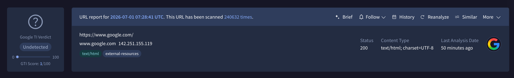
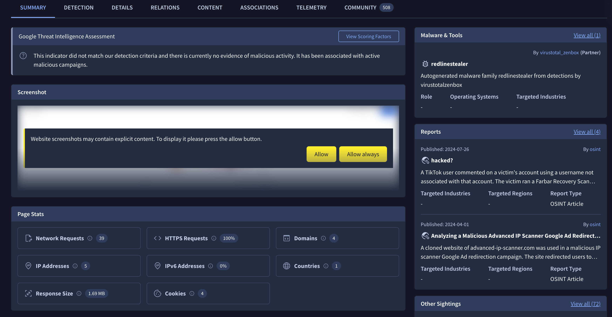

[gtidocs](../../README.md) › [Guides](../README.md) › [IOC Investigation](README.md) › IoC Reports

---

# ioc-reports

Here are the key elements of Google Threat Intelligence reports. We'll look at a typical URL report first, then a typical report for files. The last two sections will focus on domain and IP address reports.

[URL Report Summary](#url-report-summary)
[URL Report Details](#url-report-details)
[File Report Summary](#file-report-summary)
[File Report Details](#file-report-details)
[Domain and IP address reports](#domain-and-ip-address-reports)

# url-report-summary

***

After your URL is scanned, you'll see a report that looks like this. Note that this is a sample report and does not reflect the actual ratings of any of the vendors listed. We've numbered the elements in the screenshot above for easy reference. They are:

1. The Google Threat Intelligence Score and Verdict of the scanned URL.

2. The URL you scanned. Note that the URL may not match exactly your submission, this is because we canonicalize URLs, i.e. we normalize them in order to make sure that different variations of the same URL do not affect its detections.

3. The link to the domain repo which this url belongs to.

4. The date and time (UTC) of the analysis you are currently viewing. The header indicates **which analysis** is being shown — when you land on a URL you see its **latest** analysis by default. You can pivot to a previous analysis of the same URL by clicking **History** and choosing another point in time.

5. Content type of the resource analyzed. For example: html, xml, flash, fla, iecookie, bittorrent, email, outlook, cap.

6. Favicon from the domain that belongs to the url scanned.

7. You can reanalyze the URL to get an updated report. URLs statuses are updated frequently by Google Threat Intelligence as they are distributed by antivirus companies.

8. Search for the URL in Google Threat Intelligence.

9. More options including: Explore the Graph for this URL or adding the URL to a collection.

# url-report-details

***

URL reports now expose much richer per-visit information, including a **screenshot** of the rendered page, the **identified brands**, **page stats** and the **web technologies** detected on the page. Each tab shows the information specific to the **analysis you are currently viewing** — by default the latest analysis when you land on a URL; use **History** in the Summary to switch to a previous one. The only exception is the **Relations** tab, whose results are an aggregate of every analysis ever run on this URL rather than a single visit (see below).

A URL report contains the following tabs:

1. **Summary:** A high-level overview of the scanned resource, including the **screenshot** of the rendered page, the **identified brands**, **page stats**, the **web technologies** detected on the page, key details, telemetry, and any associated threat actors, malware families, etc.

2. **Detection:** The verdict of each reviewing partner. Possible findings are: - **Clean site:** no malware detected. - **Unrated site:** the partner never reviewed this site. - **Malware site:** distributes malware. - **Phishing site:** tries to steal users' credentials. - **Malicious site:** contains exploits or other malicious artifacts. - **Suspicious site:** the partner considers the site suspicious (grey area). - **Spam site:** involved in unsolicited email, popups, automatic commenting, etc.

3. **Details:** Additional technical information about the resource **for the analysis you are viewing**. It includes the content **categories** assigned by our partners; the analysis **history** (from which you can switch to a previous analysis); the **HTTP response** returned by the server (final URL, status code, served content type and length, and the full **response headers**); **HTML info** extracted from the page (such as title and meta tags); the site's **favicon** and its hash (useful for pivoting to sites sharing the same icon); the **network requests / HTTP(s) transactions** the page issued while loading; the **external outbound links** found on the page; the **JavaScript global variables** defined in its execution context; the **console messages** logged during rendering; the **cookies** set during the visit; and the **contacted domains** and **contacted IPs** reached during this analysis.

4. **Relations:** The files related to this URL — **downloaded files**, **communicating files** and **referrer files**. Unlike the other tabs, this information is **aggregated across all analyses ever conducted on this URL**, giving you the complete relational footprint rather than only what the latest visit saw.

5. **Content:** The captured content of the visited page. This now includes the **screenshot** of the rendered page and its **DOM** (the HTML document as it was rendered during the analysis), so you can inspect exactly what the page looked like and served at scan time.

6. **Associations:** The threat-intelligence context around this URL — the **collections**, **threat actors**, **malware families**, **campaigns** and **reports** that reference or are linked to it. This is where you see whether the URL is already tracked as part of known malicious activity. Results can be filtered (e.g. by object type or origin) to narrow the view.

7. **Telemetry:** Additional information about how this URL has been looked up and submitted over time, including lookup and submission activity.

8. **Community:** Comments made by members of the VirusTotal and Google Threat Intelligence community, most recent first, together with the community votes cast on this URL.

# file-report-summary

***

When you scan a file or search for a file given its hash, you'll see a report that looks like this:

Again, this report is a sample only and does not reflect the actual ratings of any vendor listed. And again we have numbered the most characteristic elements in the screenshot above for reference. They are:

1. The Google Threat Intelligence score of the submitted file.
2. The security level of the submitted file.
3. The total number of Google Threat Intelligence partners who consider this url harmful (in this case, 49) out of the total number of partners who reviewed the file (in this case, 70) and the sandboxes that considered this file harmful.
4. SHA-256 (a cryptographic hash function) is a unique way to identify a file and used in the security industry to unambiguously refer to a particular threat. For more info see:
   <https://en.wikipedia.org/wiki/Cryptographic_hash_function>
   <https://en.wikipedia.org/wiki/SHA-2>
5. File name of last submission, and access to search by file names.
6. Tags.
7. The date and time (UTC) of the last modification of the submission.
8. Icon for the file type.
9. Button to follow the file.
10. Button to reanalyze the file.
11. Download sample.
12. Search for similar files.
13. More options like explore the file in Google Threat Intelligence Graph and learn how to automate via API.

# file-report-details

***

1. A summary including information about the file, curated threat actors, curated malware families, etc.
2. A list of each reviewing partner and their findings. Possible findings are:

* Undetected: The given engine does not detect the file as malicious.
* Suspicious:  The given engine flags the file as suspicious.
* Unable to process file type: The given engine does not understand the type of file submitted and so will not produce verdicts for it.
* Timeout: The given engine reached Google Threat Intelligence's time execution limit when processing the file and so no verdicts were recorded for it.

3. Displays more information about the item being reviewed. For instance, for an Office document file this might list VBA code streams seen in document macros and other file type specific information. Similarly, Google Threat Intelligence specific metadata such as first submission and last submission dates, upload file names, etc are also recorded in this section.
4. Information about the relations between objects related to the scanned file, like contacted domains, contacted IPs, downloaded files, etc.
5. Additional information about the observed behaviour during the execution of the file.
6. The content of the file.
7. Additional information about the telemetry of the file, including information about lookups and submissions.
8. These are comments made by members of the Google Threat Intelligence Community. Most recent comments are listed first. This section also records the votes made by members of the Google Threat Intelligence Community on this file or URL.
9. See the detections evolution through time.
10. Copy detections as plain text to clipboard.

# domain-and-ip-address-reports

***

Unlike file and URL reports, network location views do not record partner verdicts for the resource under consideration. Instead, these reports condense all of the recent activity that Google Threat Intelligence has seen for the resource under consideration, as well as contextual information about it. These details include:

* Autonomous System and location country for IP addresses.
* Passive DNS replication information: all the IP-domain name mappings that Google Threat Intelligence has seen over time for the item being studied. These resolutions are performed when contacting URLs submitted to Google Threat Intelligence for scanning, when executing files in sandboxes, through partnerships with third-parties, etc.
* Whois lookups: registered users or assignees of an Internet resource, such as a domain name, an IP address block, or an autonomous system, but is also used for a wider range of other information.
* Observed subdomains: domains seen hierarchically under another domain stored in Google Threat Intelligence.
* Sibling domains: domains at the same hierarchical level as the domain being studied.
* URLs: latest URLs seen under the domain or IP address being studied. Note that the date reflected in this section is not the date at which the URL was contacted but rather the date of the last report that we have for the resource, this might be more recent or older than the retrieval date.
* Downloaded files: latest files that have been retrieved from URLs sitting at the domain or IP address under study. Note that the date recorded in this section is not the date at which the file was downloaded but rather the date of the last report that we have for the resource.
* Communicating files: latest files that, through their execution in a sandboxed virtual environment, have been seen to perform some kind of communication with the IP address or domain under consideration. Note that the date recorded in this section is not the date at which the communication took place but rather the date of the last report that we have for the resource.
* Files referring: Google Threat Intelligence will inspect the strings contained in files submitted to the service and apply certain regular expressions to these in order to identify domains and IP addresses. This section records files that have referenced the domain or IP address under consideration. Note that the date recorded in this section is not the date at which the file that give raise to the relationship was submitted but rather the date of the last report that we have for the resource.

 

---

← [Threat Intelligence objects search modifiers](intelligence/threat-intelligence-objects-modifiers-values.md) · [up](README.md) · [Google Threat Intelligence Indicator Score](google-threat-intelligence-indicator-score.md) →

*Archived from <https://gtidocs.virustotal.com/docs/results-reports>.*
