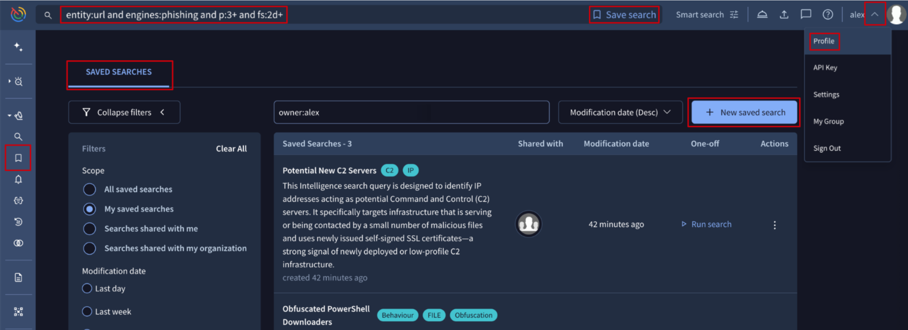
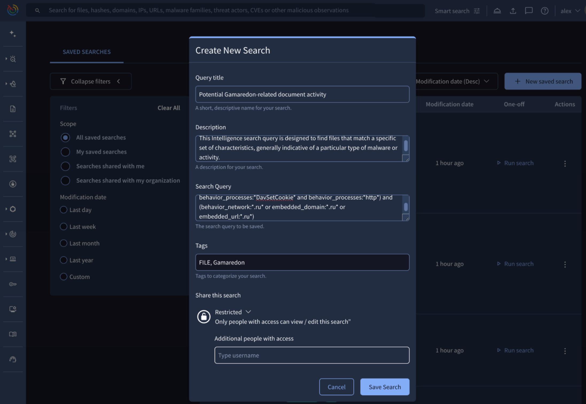
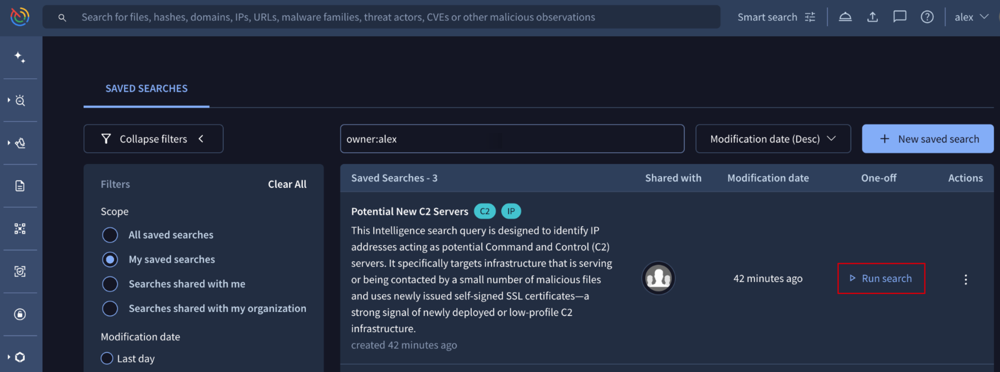
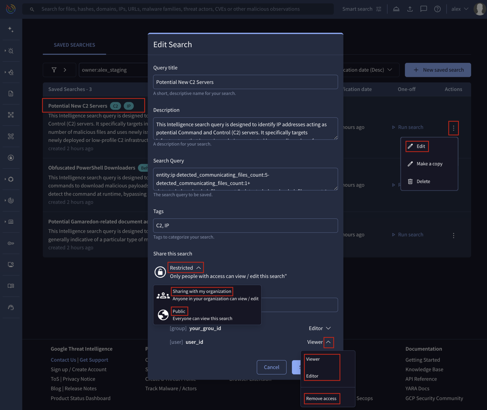
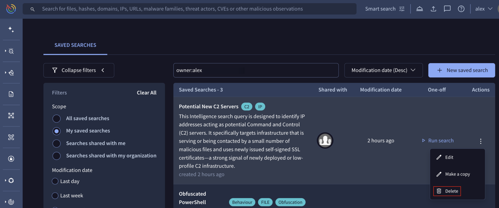
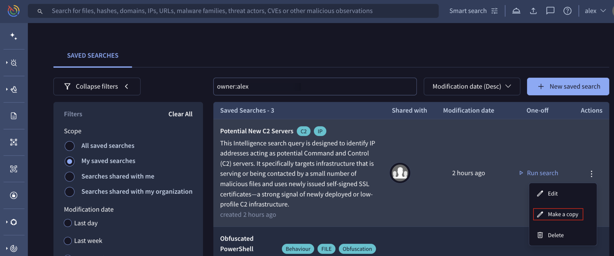

[gtidocs](../../README.md) › [Guides](../README.md) › [IOC Investigation](README.md) › Saved Searches

---

# saved-searches

The **Saved Searches** feature is designed to empower users to efficiently **store and reuse** complex or frequently executed threat **intelligence searches** across our vast database of **IoC** analysis reports (files, URLs, domains, IP addresses).

Instead of manually reassembling the required [**search modifiers**](intelligence.md) for a specific use case every time a search has to be performed, you can save the entire configuration under a unique, descriptive name and run it repeatedly with a single action. This ensures consistency, accuracy, and significant time savings across all operational use cases.

The queries management interface is accessed through the left menu navigation bar via **IoC Investigation** -> **Saved Searches**.

Here, the  **SAVED SEARCHES** tab view provides a comprehensive list of all queries to which the user has access, whether as **Owner**, **Editor** or **Viewer**. This view defaults to displaying searches owned by the user, and includes both robust **filtering** capabilities to narrow queries and full **management** controls for complete administration.

# 1.-saving-a-search---creating-a-saved-search

The process of creating a new saved search allows you to store complex search logic for instant reuse later, and you automatically become the Owner of the saved query. Creation can be initiated from 3 places:

* From the left menu navigation bar, go to **IoC Investigation** -> **Saved Searches**. Then, within the **SAVED SEARCHES** tab, click the **+ New saved search**.
* From the user menu at the top-right corner, select the **Profile** menu option. Then, within the **SAVED SEARCHES** tab, click the **+ New saved search** button.
* After entering an **IoC-related query**, click the **Save search** button that appears near the **top search bar**.

In all creation scenarios, a configuration form will appear, prompting you to define the search's **Name** alongside a **Description** and **Tags** for more context, and the **Search Query** which is automatically populated if the saving process was initiated directly from the **top search bar**.

Beyond the mandatory settings, you can **Share** your search with specific users, your organization or the entire community. See [Editing Saved Search's Attributes & Access](#32-editing-saved-searchs-attributes--access)  section for additional details.

## 1.1.-running-a-saved-search---reusing-queries

Saved searches are designed for instant, on-demand reuse, regardless of users’ specific role (owner, editor, or viewer).

To execute a saved query, simply navigate to the **SAVED SEARCHES** view and click the **Run search** button corresponding to the desired entry.

Executing the query instantly applies the stored logic to the main search bar, automatically displaying the resulting list of matching IoCs. This action fully empowers the user by granting access to available IoCs **filtering**, **sorting**, **exporting** and additional investigative capabilities leveraged from the results view via the **Tools** option.

# 3.-managing-saved-searches

## 3.1.-filtering-saved-searches

The **SAVED SEARCHES** tab features a consistent and comprehensive set of filtering options. These options allow users to efficiently narrow and focus the displayed lists based on specific criteria:

* **Scope** filters: these filters focus on how the user gained access to the saved searches, allowing lists to be narrowed based on categories such as: searches the user owns, searches shared directly with the user, searches shared with the user's organization, or all of them.
* **Modification Date** filters: users can filter saved searches by standard presets (Last **Day**, **Week**, **Month**, **Year**) or define a **custom** timeframe.

## 3.2.-editing-saved-search's-attributes-&-access

Only the **Owner** and users granted **Editor privileges** can modify a saved search.

A saved query can be edited from the **SAVED SEARCHES** view by simply clicking its name or description, or by selecting the **Edit** option from the corresponding **Action menu** dropdown.

This action displays the full configuration form, where editors can modify all query parameters, including the underlying search logic and its **Sharing** configuration.

The Sharing section displays 3 dropdown options:

* **Restricted (private)**:  view and edition access is limited to users with whom it is explicitly shared by adding the user identifier in the text box immediately below.
* **Sharing with organization (private)**: view and edition access is extended to all users within the owner's organization, depending on whether the owner/editor selects the **Editor** or **Viewer** privilege option. Specific access privileges can still be granted to individual users by entering their user identifier in the text box immediately below.
* **Public**: view access is extended to the complete community members. Specific access privileges can still be granted to individual users by entering their user identifier in the text box immediately below.

The same **Sharing** section allows for the **removal of access** for specific users or the owner's group by selecting the **Remove Access** option from the dropdown menu located near their user/group identifiers.

> 🚧
>
> Note that **editor** privileges can **only be granted to members belonging to the same group or organization** as the owner of the saved search.

## 3.3.-deleting-a-saved-search

Only the **Owner** can delete an existing saved search. This is done from the **SAVED SEARCHES** view by clicking the **Action menu** corresponding to the query, and selecting the **Delete** option from the dropdown menu. Deleting the query removes it from the **SAVED SEARCHES** view for all users who previously had access to it.

## 3.4.-making-a-copy-of-a-saved-search

The **Make a copy** feature is available to **all users** with any access level (owner, editor, or viewer) who have access to the saved search. To duplicate a query, simply navigate to the **SAVED SEARCHES** view, click the **Action menu** corresponding to the query, and select the **Make a copy** option from the dropdown menu which instantly creates an independent copy of the search logic **with its own ID** for the user to **edit and customize** at its discretion.

This functionality is crucial for two main reasons:

* **Modification**: it allows viewers to modify the search logic without affecting the original, shared query.
* **Data Preservation**: it serves as an essential backup mechanism, especially since a query can be permanently **deleted by its owner** or **modified by any user with editor privileges** at any time.

> 🚧
>
> We highly recommend utilizing the **Make a copy** feature for any saved search shared with you that might be relevant to your operational workflow.

---

← [Google Threat Intelligence Indicator Score](google-threat-intelligence-indicator-score.md) · [up](README.md) · [What's YARA Hunting?](whats-yara-hunting.md) →

*Archived from <https://gtidocs.virustotal.com/docs/saved-searches-guide>.*
