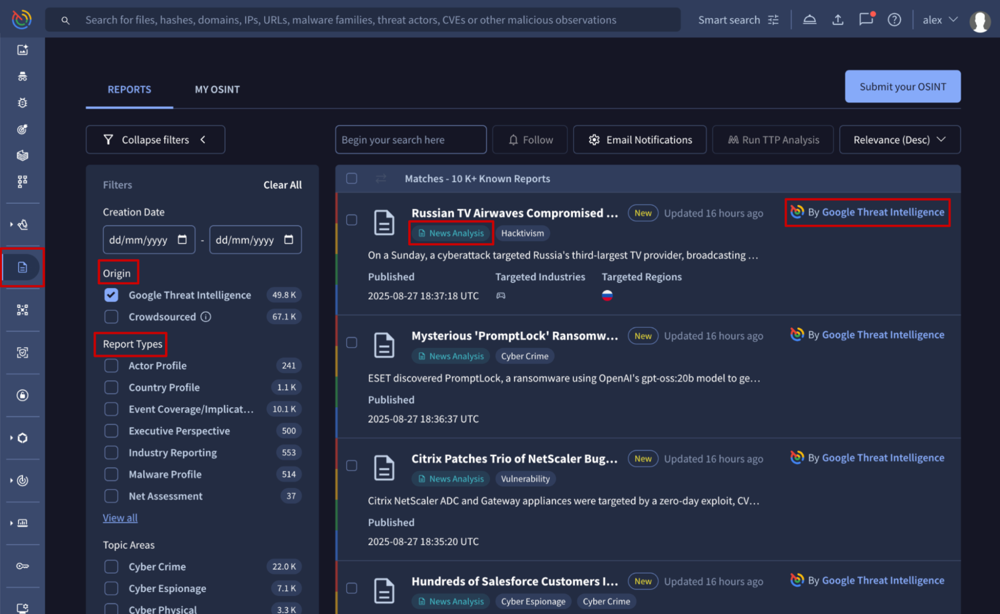

[gtidocs](../../README.md) › [Guides](../README.md) › [Report & Analysis](README.md) › Threat Intelligence Report Types

---

# threat-intelligence-report-types

Google Threat Intelligence provides continuously updated reports and analysis on threat actors, campaigns, vulnerabilities, malware, tools, and more. You can access these reports by navigating to the **Reports & Analysis**.

For easy reference, each report is tagged with its type, which is automatically extracted from the content.

# current-reports-types

The following table provides an overview of our current curated Threat Intelligence reports and the unique crowdsourced report type, OSINT Article.

| Report Type                                                                                                                                                                                                                     | Description                                                                                                                                                                                                                                                                                                                                                                                                           | Benefits                                                                                                                  |
| ------------------------------------------------------------------------------------------------------------------------------------------------------------------------------------------------------------------------------- | --------------------------------------------------------------------------------------------------------------------------------------------------------------------------------------------------------------------------------------------------------------------------------------------------------------------------------------------------------------------------------------------------------------------- | ------------------------------------------------------------------------------------------------------------------------- |
| **[Actor Profile](https://www.virustotal.com/gui/reports/reports?order%253Drelevance-%2526holisticFilter%253Dreport_type%25253A%252522Actor%252BProfile%252522)**                                                               | These **curated** reports provide an in-depth look into a specific threat actor's tactics, techniques, and procedures.                                                                                                                                                                                                                                                                                                | Proactive defense, improved detection rates, faster incident response, optimized security investments.                    |
| **[Event Coverage/Implication](https://www.virustotal.com/gui/reports/reports?order%253Drelevance-%2526holisticFilter%253Dreport_type%25253A%252522Event%252BCoverage%25252FImplication%252522)**                               | These **curated** reports generally contain analysis on the implications of a recent event or campaign conducted by a threat actor. This report type also includes first glance reports, which offer preliminary information on an incident while the analysis of related malware or other campaign aspects is still in progress.                                                                                     | Reduced exposure to breaking threats, improved crisis management, agile defense adjustments, minimized impact.            |
| **[Executive Perspective](https://www.virustotal.com/gui/reports/reports?order%253Drelevance-%2526holisticFilter%253Dreport_type%25253A%252522Executive%252BPerspective%252522)**                                               | These **curated** reports provide brief analysis about cyber threats relevant to events or business circumstances, geared toward a strategic leadership audience. This report type also includes **Intelligence at a Glance** reports, which provide a weekly snapshot into newly produced reports, blogs, webinars, as well as some insight into customer interests based on top search terms and most read reports. | Alignment of security with business goals, improved cyber resilience.                                                     |
| **[Malware Profile](https://www.virustotal.com/gui/reports/reports?order%253Drelevance-%2526holisticFilter%253Dreport_type%25253A%252522Malware%252BProfile%252522)**                                                           | These **curated** reports contain technical analysis of a representative sample of a code family. This report type typically includes file characteristics, host- and network-based indicators, configuration information, and details of code execution.                                                                                                                                                             | Enhanced malware detection, proactive IoC sweeping, technical malware capabilities understanding.                         |
| **[Net Assessment](https://www.virustotal.com/gui/reports/reports?order%253Drelevance-%2526holisticFilter%253Dreport_type%25253A%252522Net%252BAssessment%252522)**                                                             | These **curated** reports provide an overview of the top threats that Google Threat Intelligence reported on or observed throughout the past quarter.                                                                                                                                                                                                                                                                 | Holistic threat understanding, informed long-term planning.                                                               |
| **[News Analysis](https://www.virustotal.com/gui/reports/reports?order%253Drelevance-%2526holisticFilter%253Dreport_type%25253A%252522News%252BAnalysis%252522)**                                                               | These **curated** reports provide brief, daily intelligence insights into cyber security topics discussed in the news.                                                                                                                                                                                                                                                                                                | Informed perspective, improved communication.                                                                             |
| **[Threat Activity Alert](https://www.virustotal.com/gui/reports/reports?order%253Drelevance-%2526holisticFilter%253Dreport_type%25253A%252522Threat%252BActivity%252BAlert%252522)**                                           | These **curated** reports relay immediate observations of notable activities within the cyber threat environment. Activities continue to be monitored and may result in additional alerts or reports if anything significant occurs, or the issue warrants further analysis.                                                                                                                                          | Rapid risk mitigation, minimized damage.                                                                                  |
| **[Threat Activity Report](https://www.virustotal.com/gui/reports/reports?order%253Drelevance-%2526holisticFilter%253Dreport_type%25253A%252522Threat%252BActivity%252BReport%252522)**                                         | These **curated** reports relay historical and recent activities observed within the cyber threat environment whose relevance has become elevated by current circumstances. Activities continue to be monitored and may result in additional alerts or reports if anything significant occurs, or the issue warrants further analysis.                                                                                | Proactive response to evolving threats, enhanced detection capabilities, deeper understanding of threat actor lifecycles. |
| **[Trends and Forecasting](https://www.virustotal.com/gui/reports/reports?order%253Drelevance-%2526holisticFilter%253Dreport_type%25253A%252522Trends%252Band%252BForecasting%252522)**                                         | These **curated** reports provide analysis into threat actor tactics, trends, or types of threat activity, which may include review over a specified time frame and/or predictions based on identified trends.                                                                                                                                                                                                        | Understand evolution of threats, future-proofing security.                                                                |
| **[TTP Deep Dive](https://www.virustotal.com/gui/reports/reports?order%253Drelevance-%2526holisticFilter%253Dreport_type%25253A%252522TTP%252BDeep%252BDive%252522)**                                                           | These **curated** reports provide an in-depth look into a threat actor and the tactics, techniques, and procedures (TTPs) they use to achieve specific goals.                                                                                                                                                                                                                                                         | Deeper understanding of attacker methodology, improved detection of sophisticated attacks, targeted mitigation.           |
| **[Weekly Vulnerability Exploitation Report](https://www.virustotal.com/gui/reports/reports?order%253Drelevance-%2526holisticFilter%253Dreport_type%25253A%252522Weekly%252BVulnerability%252BExploitation%252BReport%252522)** | These **curated** reports summarize important developments concerning vulnerabilities that may pose a critical or high risk to enterprises that have been observed by Google Threat Intelligence on a weekly basis. This report is intended as a resource for decision makers on out-of-cycle patching decisions.                                                                                                     | Significant reduction in attack surface, actionable and timely intelligence.                                              |
| **[Country Profile](https://www.virustotal.com/gui/reports/reports?order%253Drelevance-%2526holisticFilter%253Dreport_type%25253A%252522Country%252BProfile%252522)**                                                           | These **curated** reports provides a strategic overview of the cyber threat landscape relevant to a specific geographic region. Additionally, you can also check out our AI-driven [Country Profiles](../05-global-landscape/countries-industries-profiles.md).                                                                                                                                                                             | Deeper understanding of the relevant cyber threat landscape of a country.                                                 |
| **[Industry Reporting](https://www.virustotal.com/gui/reports/reports?order%253Drelevance-%2526holisticFilter%253Dreport_type%25253A%252522Industry%252BReporting%252522)**                                                     | These **curated** reports reports provides a strategic overview of the cyber threat landscape relevant to a specific industry vertical. Additionally, you can also check out our AI-driven [Industry Profiles](../05-global-landscape/countries-industries-profiles.md).                                                                                                                                                                    | Deeper understanding of threats and trends assessed within specific industries.                                           |
| **[OSINT Article](https://www.virustotal.com/gui/reports/reports?order%253Drelevance-%2526holisticFilter%253Dreport_type%25253A%252522OSINT%252BArticle%252522)**                                                               | These crowdsourced reports are automatically ingested from the community, but users can also request the ingestion of not yet included articles. They cover a wide range of cybersecurity topics.                                                                                                                                                                                                                     | Rapid and broader threat coverage.                                                                                        |

# decommissioned-curated-reports-types-or-series

Decommissioned **series** or **types** of **curated Threat Intelligence Reports are no longer being generated**. Despite some exceptions indicated in the following table, the new information that would have been used to generate new Reports of those types or series, is now integrated into other reports or objects.

To avoid confusion, decommissioned report types are no longer in the initial filter menu since we don't produce them anymore. However, all historical reports are still available on the platform and can be found using **advanced or free text searches**.

The table below outlines the decommissioned Threat Intelligence Reports types or series, detailing alternative search methods for historical Reports and where new information is being integrated.

Note that the information from our objects is used to populate the Gemini summary when performing a [semantic search](../06-ioc-investigation/search-gemini.md) on the topic, specifically on the **top search bar**. This provides another way to find the same data listed below.

| Legacy Report                                                                        | Description                                                                                                                                                                                                                                                                                                                          | New Information Location                                                                                                                                                                                                                                                                                                                                                                                                                                                                                                                                                                                                                                                                                                                                                              | Alternative Search for Historical Legacy Reports                                                                                                                                                                                                                                                                                                                                                                                                                                                                                                                                                              |
| ------------------------------------------------------------------------------------ | ------------------------------------------------------------------------------------------------------------------------------------------------------------------------------------------------------------------------------------------------------------------------------------------------------------------------------------ | ------------------------------------------------------------------------------------------------------------------------------------------------------------------------------------------------------------------------------------------------------------------------------------------------------------------------------------------------------------------------------------------------------------------------------------------------------------------------------------------------------------------------------------------------------------------------------------------------------------------------------------------------------------------------------------------------------------------------------------------------------------------------------------- | ------------------------------------------------------------------------------------------------------------------------------------------------------------------------------------------------------------------------------------------------------------------------------------------------------------------------------------------------------------------------------------------------------------------------------------------------------------------------------------------------------------------------------------------------------------------------------------------------------------- |
| **Actor Overview**                                                                   | These reports provide a brief overview of a threat actor.                                                                                                                                                                                                                                                                            | This type of information is now included in the [**curated Threat Actors** cards](https://www.virustotal.com/gui/threat-landscape/threat-actors?filter%253D%252528origin%2525253A%25252522Google%2525252520Threat%2525252520Intelligence%25252522%252529%2526order%253Drelevance-), which are accessible from the **Threat Landscape** menu option of the platform.                                                                                                                                                                                                                                                                                                                                                                                                                   | Alternatively, find legacy Reports by using the following advanced search in the **Reports search bar** of the platform: [`report_type:"Actor Overview"`](https://www.virustotal.com/gui/reports/reports?order%253Drelevance-%2526holisticFilter%253Dreport_type%25253A%252522Actor%252BOverview%252522)                                                                                                                                                                                                                                                                                                      |
| **FireEye Labs Research**                                                            | These reports provide an in-depth look into a threat actor, malware, or tactics used by threat actors to achieve specific goals.                                                                                                                                                                                                     | This type of information is now included in the [**TTP Deep Dive** report type](https://www.virustotal.com/gui/reports/reports?order%253Drelevance-%2526holisticFilter%253Dreport_type%25253A%252522TTP%252BDeep%252BDive%252522).                                                                                                                                                                                                                                                                                                                                                                                                                                                                                                                                                    | Alternatively, find legacy Reports by using the following advanced search in the **Reports search bar** of the platform: [`report_type:"FireEye Labs Research"`](https://www.virustotal.com/gui/reports/reports?order%253Drelevance-%2526holisticFilter%253Dreport_type%25253A%252522FireEye%252BLabs%252BResearch%252522)                                                                                                                                                                                                                                                                                    |
| **Futures Scenario**                                                                 | These reports provide analysis into threat actor tactics, trends, or types of threat activity, which may include review over a specified time frame and/or predictions based on identified trends.                                                                                                                                   | This type of information is now included in the [**Trends and Forecasting** report type](https://www.virustotal.com/gui/reports/reports?order%253Drelevance-%2526holisticFilter%253Dreport_type%25253A%252522Trends%252Band%252BForecasting%252522).                                                                                                                                                                                                                                                                                                                                                                                                                                                                                                                                  | Alternatively, find legacy Reports by using the following advanced search in the **Reports search bar** of the platform: [`report_type:"Futures Scenario"`](https://www.virustotal.com/gui/reports/reports?order%253Drelevance-%2526holisticFilter%253Dreport_type%25253A%252522Futures%252BScenario%252522)                                                                                                                                                                                                                                                                                                  |
| **Horizons**                                                                         | These reports provide analysis into threat actor tactics, trends, or types of threat activity, which may include review over a specified time frame and/or predictions based on identified trends.                                                                                                                                   | This type of information is now included in the [**Trends and Forecasting** report type](https://www.virustotal.com/gui/reports/reports?order%253Drelevance-%2526holisticFilter%253Dreport_type%25253A%252522Trends%252Band%252BForecasting%252522).                                                                                                                                                                                                                                                                                                                                                                                                                                                                                                                                  | Alternatively, find legacy Reports by using the following advanced search in the **Reports search bar** of the platform: [`report_type:"Horizons"`](https://www.virustotal.com/gui/reports/reports?order%253Drelevance-%2526holisticFilter%253Dreport_type%25253A%252522Horizons%252522)                                                                                                                                                                                                                                                                                                                      |
| **Indicator Report**                                                                 | This report **series** contains malicious indicators associated with the respective malware family.                                                                                                                                                                                                                                  | Indicators are now directly associated with [**Malware & Tools**](https://www.virustotal.com/gui/threat-landscape/malware-and-tools?filter%253D%252528origin%2525253A%25252522Google%2525252520Threat%2525252520Intelligence%25252522%252529%2526order%253Drelevance-), through the **IOCS** tab. They are accessible from the **Threat Landscape** menu option of the platform. Additionally, indicators are searchable over the platform through [advanced search modifiers](../06-ioc-investigation/intelligence/full-list-of-google-threat-intelligence-search-modifiers.md).                                                                                                                                                                                                     | Alternatively, find legacy Reports by using the following advanced search in the **Reports search bar** of the platform: [`report_type:"Event Coverage/Implication" name:"Indicator Report"`](https://www.virustotal.com/gui/reports/reports?order%253Drelevance-%2526holisticFilter%253Dreport_type%25253A%252522Event%252BCoverage%25252FImplication%252522%252Bname%25253A%252522Indicator%252BReport%252522)                                                                                                                                                                                              |
| **Industry Intelligence Quarterly**                                                  | These reports provide a high-level summary of threats to an industry vertical, across adversary motivations, on a quarterly basis.                                                                                                                                                                                                   | This type of information is now included in the [**Industry Snapshot** reports of the **Industry Reporting** report type](https://www.virustotal.com/gui/reports/reports?order%253Drelevance-%2526holisticFilter%253Dreport_type%25253A%252522Industry%252BReporting%252522%252Bname%25253A%252522Industry%252BSnapshot%252522).                                                                                                                                                                                                                                                                                                                                                                                                                                                      | Alternatively, find old legacy Reports by using the following advanced search in the **Reports search bar** of the platform: [`report_type:"Industry Intelligence Quarterly"`](https://www.virustotal.com/gui/reports/reports?order%253Drelevance-%2526holisticFilter%253Dreport_type%25253A%252522Industry%252BIntelligence%252BQuarterly%252522)                                                                                                                                                                                                                                                            |
| **Malware Overview**                                                                 | These reports provide a brief overview of a malware family.                                                                                                                                                                                                                                                                          | This type of information is now included in the [**Malware & Tools** cards](https://www.virustotal.com/gui/threat-landscape/malware-and-tools?filter%253D%252528collection_type%2525253A%25252522malware-family%25252522%252529%252B%252528origin%2525253A%25252522Google%2525252520Threat%2525252520Intelligence%25252522%252529%2526order%253Drelevance-), accessible from the **Threat Landscape** menu option of the platform.                                                                                                                                                                                                                                                                                                                                                    | Alternatively, find legacy Reports by using the following advanced search in the **Reports search bar** of the platform: [`report_type:"Malware Overview"`](https://www.virustotal.com/gui/reports/reports?order%253Drelevance-%2526holisticFilter%253Dreport_type%25253A%252522Malware%252BOverview%252522)                                                                                                                                                                                                                                                                                                  |
| **Network Activity Reports**                                                         | These reports analyze network flow data against industrial TCP/UDP ports using third-party intelligence, leveraging Google's [Indicator Confidence Score](../06-ioc-investigation/google-threat-intelligence-indicator-score.md) to identify and prioritize potential threats to industrial environments.                            | This type of information is **not included in new objects**. Get similar data by: (1) checking IP addresses conducting port scanning from the [SANS Internet Storm Center](https://isc.sans.edu/data/), (2) checking IP addresses threat context and assessment in Google Threat Intelligence.                                                                                                                                                                                                                                                                                                                                                                                                                                                                                        | Alternatively, find legacy Reports by using the following advanced search in the **Reports search bar** of the platform: [`report_type:"Network Activity Reports"`](https://www.virustotal.com/gui/reports/reports?order%253Drelevance-%2526holisticFilter%253Dreport_type%25253A%252522Network%252BActivity%252BReports%252522)                                                                                                                                                                                                                                                                              |
| **Operational Net Assessment**                                                       | This report **series** provides an overview of the top threats that Google Threat Intelligence reported on or observed throughout the past quarter.                                                                                                                                                                                  | This type of information is now included in the [**Net Assessment** report type](https://www.virustotal.com/gui/reports/reports?order%253Drelevance-%2526holisticFilter%253Dreport_type%25253A%252522Net%252BAssessment%252522).                                                                                                                                                                                                                                                                                                                                                                                                                                                                                                                                                      | Alternatively, find legacy Reports by using the following advanced search in the **Reports search bar** of the platform: [`report_type:"Event Coverage/Implication" name:"Operational Net Assessment"`](https://www.virustotal.com/gui/reports/reports?order%253Drelevance-%2526holisticFilter%253Dreport_type%25253A%252522Event%252BCoverage%25252FImplication%252522%252Bname%25253A%252522Operational%252BNet%252BAssessment%252522)                                                                                                                                                                      |
| **Potential Targeted Malware Infection Lures**                                       | This report **series** highlights potential malware lures that threat actors may exploit or use in social engineering attempts based on previously observed operational patterns, specific subjects, events, and topics.                                                                                                             | This type of information is now included in the **Trends and Forecasting** report type.                                                                                                                                                                                                                                                                                                                                                                                                                                                                                                                                                                                                                                                                                               | Find legacy Reports by using the following advanced search in the **Reports search bar** of the platform: [`report_type:"Event Coverage/Implication" name:"Potential Targeted Malware Infection Lures"`](https://www.virustotal.com/gui/reports/reports?order%253Drelevance-%2526holisticFilter%253Dreport_type%25253A%252522Event%252BCoverage%25252FImplication%252522%252Bname%25253A%252522Potential%252BTargeted%252BMalware%252BInfection%252BLures%252522). Alternatively, this information can be retrieved via [semantic searches](../06-ioc-investigation/search-gemini.md) using the term "lures". |
| **Patch Report**                                                                     | This report summarizes the vulnerabilities addressed in a specific patch to help customers better consider and prioritize their patching efforts holistically across an entire patch instead of as individual vulnerabilities.                                                                                                       | This type of information is now included in the [**Vulnerability Intelligence** cards](https://www.virustotal.com/gui/vulnerabilities?order%253Drelevance-), accessible from the platform menu options. To find vulnerability summaries for a specific vendor, use the following advanced search in the search bar: [`vulnerable_vendor:"Microsoft"`](https://www.virustotal.com/gui/vulnerabilities?order%253Drelevance-%2526holisticFilter%253Dvulnerable_vendor%25253A%252522Microsoft%252522); or a more generic search [`"Oracle"`](https://www.virustotal.com/gui/vulnerabilities?order%253Drelevance-%2526holisticFilter%253D%252522Oracle%252522). Additionally set the **Creation Date** filter to the day or month of the advisories publication.                           | Alternatively, find legacy Reports by using the following advanced search in the **Reports search bar** of the platform: [`report_type:"Patch Report"`](https://www.virustotal.com/gui/reports/reports?order%253Drelevance-%2526holisticFilter%253Dreport_type%25253A%252522Patch%252BReport%252522)                                                                                                                                                                                                                                                                                                          |
| **Vulnerability Report**                                                             | This report captures information that Google Threat Intelligence knows about a given vulnerability and the risk and threat it poses to customer organizations. The information provided includes, Risk Rating, Exploitation State, known exploits, a list of vulnerable products and technologies, and many other technical details. | This type of information is now included in the [**Vulnerability Intelligence** cards](https://www.virustotal.com/gui/vulnerabilities?order%253Drelevance-), accessible from the platform menu options. To find vulnerability summaries for a specific vendor, use the following advanced search in the search bar: [`vulnerable_vendor:"Microsoft"`](https://www.virustotal.com/gui/vulnerabilities?order%253Drelevance-%2526holisticFilter%253Dvulnerable_vendor%25253A%252522Microsoft%252522); or a more generic search [`"Oracle"`](https://www.virustotal.com/gui/vulnerabilities?order%253Drelevance-%2526holisticFilter%253D%252522Oracle%252522). Additionally, vulnerability objects can be filtered by **Risk Rating**, **Exploitation State**, **Has Exploits** and more. | There's no workaround to get legacy reports, all of them were merged into Vulnerability cards.                                                                                                                                                                                                                                                                                                                                                                                                                                                                                                                |
| **Cyber Physical Security Roundup**                                                  | This report **series** refers to the protection of systems that bridge the digital world and the physical world.                                                                                                                                                                                                                     | This type of information is now included in the [**News Analysis** report type](https://www.virustotal.com/gui/reports/reports?order%253Drelevance-%2526holisticFilter%253Dreport_type%25253A%252522News%252BAnalysis%252522).                                                                                                                                                                                                                                                                                                                                                                                                                                                                                                                                                        | Alternatively, find legacy Reports by using the following advanced search in the **Reports search bar** of the platform: [`report_type:"ICS Security Roundup" name:"Cyber Physical Security Roundup"`](https://www.virustotal.com/gui/reports/reports?order%253Drelevance-%2526holisticFilter%253Dreport_type%25253A%252522ICS%252BSecurity%252BRoundup%252522%252Bname%25253A%252522Cyber%252BPhysical%252BSecurity%252BRoundup%252522)                                                                                                                                                                      |
| **Distribution Threat Cluster Update**                                               | This weekly report **series** identifies the most significant current threats and detailed the specific methods they were using to spread and infect systems.                                                                                                                                                                        | This type of information is now included in the [**Campaigns** cards](https://www.virustotal.com/gui/threat-landscape/campaigns?order%253Drelevance-) accessible from the **Threat Landscape** menu option of the platform.                                                                                                                                                                                                                                                                                                                                                                                                                                                                                                                                                           | Alternatively, find legacy Reports by using the following advanced search in the **Reports search bar** of the platform: [`report_type:"Event Coverage/Implication" name:"Distribution Threat Cluster Update"`](https://www.virustotal.com/gui/reports/reports?order%253Drelevance-%2526holisticFilter%253Dreport_type%25253A%252522Event%252BCoverage%25252FImplication%252522%252Bname%25253A%252522Distribution%252BThreat%252BCluster%252BUpdate%252522)                                                                                                                                                  |
| **Operational Technology Phishing Roundup**                                          | This report **series** reviews malicious phishing email attachments, which are uploaded to public file-scanning services. Our experts select the samples in this report by matching content and header strings to a series of OT-related keywords.                                                                                   | This type of information is **not included in new objects**, and there's no workaround to get similar data.                                                                                                                                                                                                                                                                                                                                                                                                                                                                                                                                                                                                                                                                           | Find legacy Reports by using the following advanced search in the **Reports search bar** of the platform: [`name:"Operational Technology Phishing Roundup" (report_type:"Trends and Forecasting" OR report_type:"Event Coverage/Implication")`](https://www.virustotal.com/gui/reports/reports?order%253Drelevance-%2526holisticFilter%253Dname%25253A%252522Operational%252BTechnology%252BPhishing%252BRoundup%252522%252B%252528report_type%25253A%252522Trends%252Band%252BForecasting%252522%252BOR%252Breport_type%25253A%252522Event%252BCoverage%25252FImplication%252522%252529)                     |
| **Actor update**                                                                     | This report **series** highlights new insights we have released during the past week on actors we track.                                                                                                                                                                                                                             | This type of information is now included in the [**curated Threat Actors** cards](https://www.virustotal.com/gui/threat-landscape/threat-actors?filter%253D%252528origin%2525253A%25252522Google%2525252520Threat%2525252520Intelligence%25252522%252529%2526order%253Drelevance-), which are accessible from the **Threat Landscape** menu option of the platform.                                                                                                                                                                                                                                                                                                                                                                                                                   | Alternatively, find legacy Reports by using the following advanced search in the **Reports search bar** of the platform: [`report_type:"Event Coverage/Implication" name:"Actor update"`](https://www.virustotal.com/gui/reports/reports?order%253Drelevance-%2526holisticFilter%253Dreport_type%25253A%252522Event%252BCoverage%25252FImplication%252522%252Bname%25253A%252522Actor%252Bupdate%252522)                                                                                                                                                                                                      |
| **Malware update**                                                                   | This report **series** highlights new insights we have released during the past week on malware families we track.                                                                                                                                                                                                                   | This type of information is now included in the [**Malware & Tools** cards](https://www.virustotal.com/gui/threat-landscape/malware-and-tools?filter%253D%252528origin%2525253A%25252522Google%2525252520Threat%2525252520Intelligence%25252522%252529%2526order%253Drelevance-) accessible from the **Threat Landscape** menu option of the platform.                                                                                                                                                                                                                                                                                                                                                                                                                                | Alternatively, find legacy Reports by using the following advanced search in the **Reports search bar** of the platform: [`report_type:"Event Coverage/Implication" name:"Malware update"`](https://www.virustotal.com/gui/reports/reports?order%253Drelevance-%2526holisticFilter%253Dreport_type%25253A%252522Event%252BCoverage%25252FImplication%252522%252Bname%25253A%252522Malware%252Bupdate%252522)                                                                                                                                                                                                  |
| **Alleged Extortion Victims**                                                        | This report **series** summarizes data leaks from various ransomware groups observed on dark web blogs, detailing the victims of their extortion and data exfiltration campaigns.                                                                                                                                                    | This type of information is now included in the [Ransomware Data Leaks](https://www.virustotal.com/gui/ransomware-dls) dashboard accessible from the Dashboards menu option of the platform.                                                                                                                                                                                                                                                                                                                                                                                                                                                                                                                                                                                          | Alternatively, find legacy Reports by using the following advanced search in the Reports search bar of the platform: [`report_type:"Threat Activity Report" name:"Alleged Extortion Victims"`](https://www.virustotal.com/gui/reports/reports?order%253Drelevance-%2526holisticFilter%253Dreport_type%25253A%252522Threat%252BActivity%252BReport%252522%252Bname%25253A%252522Alleged%252BExtortion%252BVictims%252522)                                                                                                                                                                                      |
| **OT Vulnerability Exploitation Roundup**                                            | This report **series** highlights new exploits and exploitation activity associated with operational technology (OT) and industrial control systems (ICS) vulnerabilities.                                                                                                                                                           | This type of information is now consolidated into the existing [Weekly Vulnerability Exploitation Report](https://www.virustotal.com/gui/reports/reports?order%253Drelevance-%2526holisticFilter%253Dreport_type%25253A%252522Weekly%252BVulnerability%252BExploitation%252BReport%252522) (WVER).                                                                                                                                                                                                                                                                                                                                                                                                                                                                                    | Alternatively, find legacy Reports by using the following advanced search in the Reports search bar of the platform: [report\_type:"Event Coverage/Implication" name:"OT Vulnerability Exploitation Roundup"](https://www.virustotal.com/gui/reports/reports?order%253Drelevance-%2526holisticFilter%253Dreport_type%25253A%252522Event%252BCoverage%25252FImplication%252522%252Bname%25253A%252522OT%252BVulnerability%252BExploitation%252BRoundup%252522)                                                                                                                                                 |
| **Industrial Control Systems and Medical Vulnerability Advisories Reported by CISA** | This report **series** is a summary of vulnerabilities disclosed by CISA in a month affecting ICS and Medical systems.                                                                                                                                                                                                               | This type of information is now consolidated into the existing [Weekly Vulnerability Exploitation Report](https://www.virustotal.com/gui/reports/reports?order%253Drelevance-%2526holisticFilter%253Dreport_type%25253A%252522Weekly%252BVulnerability%252BExploitation%252BReport%252522) (WVER).                                                                                                                                                                                                                                                                                                                                                                                                                                                                                    | Alternatively, find legacy Reports by using the following advanced search in the Reports search bar of the platform: [report\_type:"Trends and Forecasting" name:"Industrial Control Systems and Medical Vulnerability Advisories Reported by CISA"](https://www.virustotal.com/gui/reports/reports?order%253Drelevance-%2526holisticFilter%253Dreport_type%25253A%252522Trends%252Band%252BForecasting%252522%252Bname%25253A%252522Industrial%252BControl%252BSystems%252Band%252BMedical%252BVulnerability%252BAdvisories%252BReported%252Bby%252BCISA%252522)                                             |
| **Cloud Vulnerabilities**                                                            | This report **series** highlights important software vulnerabilities we believe could have an impact on patch management and prioritization decisions for cloud services.                                                                                                                                                            | This type of information is now consolidated into the existing [Weekly Vulnerability Exploitation Report](https://www.virustotal.com/gui/reports/reports?order%253Drelevance-%2526holisticFilter%253Dreport_type%25253A%252522Weekly%252BVulnerability%252BExploitation%252BReport%252522) (WVER).                                                                                                                                                                                                                                                                                                                                                                                                                                                                                    | Alternatively, find legacy Reports by using the following advanced search in the Reports search bar of the platform: [report\_type:"Trends and Forecasting" name:"Cloud Vulnerabilities"](https://www.virustotal.com/gui/reports/reports?order%253Drelevance-%2526holisticFilter%253Dreport_type%25253A%252522Trends%252Band%252BForecasting%252522%252Bname%25253A%252522Cloud%252BVulnerabilities%252522)                                                                                                                                                                                                   |

---

← [Reports & Analysis](reports-and-analysis.md) · [up](README.md) · [Get started with Threat Graph](../08-threat-graph/get-started-threat-graph.md) →

*Archived from <https://gtidocs.virustotal.com/docs/report-types>.*
