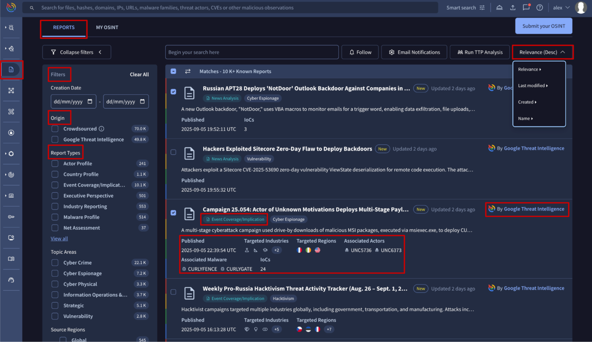
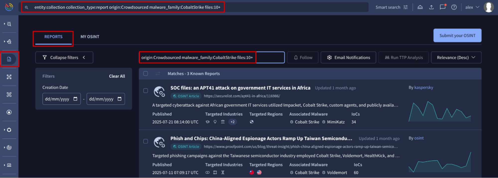
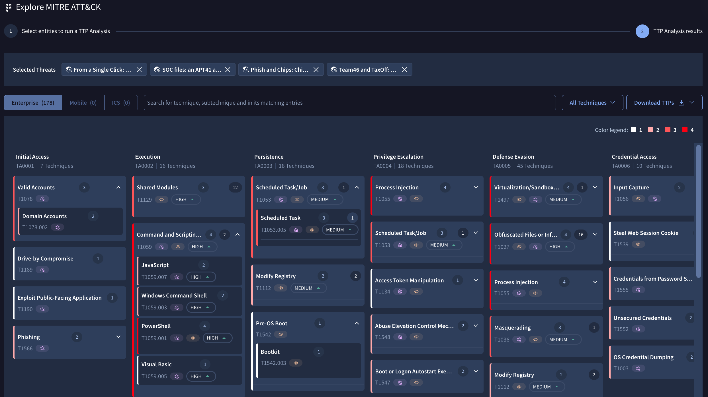
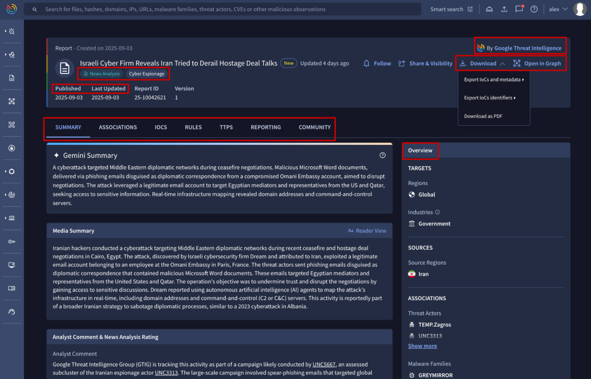
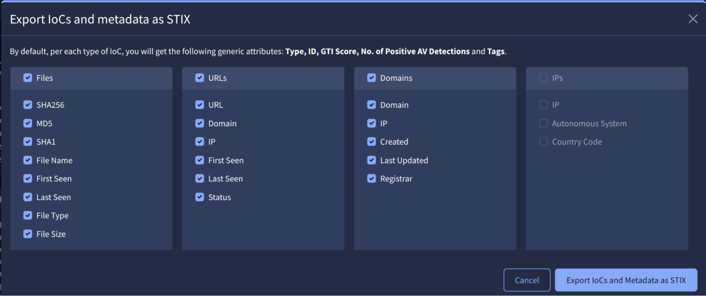
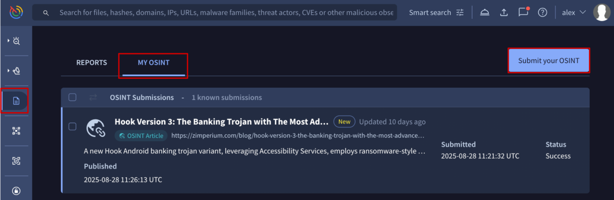
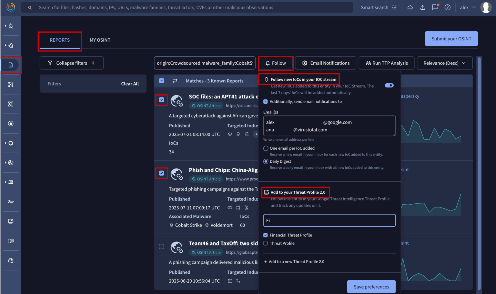
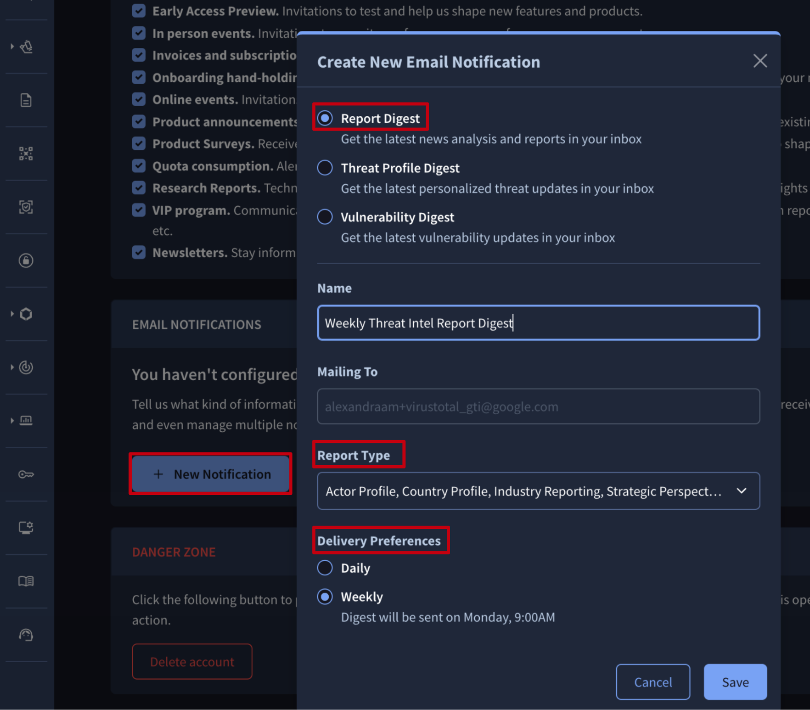

[gtidocs](../../README.md) › [Guides](../README.md) › [Report & Analysis](README.md) › Reports & Analysis

---

# reports-&-analysis

The **Reports & Analysis** module provides continuously updated, in-depth reports on a wide range of cybersecurity topics. These reports deliver crucial, timely information to help organizations navigate the complex threat landscape, enabling proactive defense, fostering informed decision-making, and improving threat detection and incident response.

Our Reports are created in two ways:

* Some are written and **curated** by Google Threat Intelligence analysts. These are identified by the **Google Threat Intelligence** *origin* and *creator*, and Google's brand colors.
* Others are a collaborative effort, fueled by our vast community's contributions. These are automatically ingested into our database, though users can also request the ingestion of articles that have not yet been processed. During this process, we automatically populate key attributes like the report's name, summary, targeted industries and regions, threat source region and motivation, and any mentioned IoCs and TTPs, if they are present in the source reference. These reports are identified by the **Crowdsourced** *origin* and other *creators*, and they are tagged as **OSINT Article** and do not use any specific branding colors.

This unique approach provides our users with the best of both worlds: highly specialized, expert-vetted analysis from Google's top threat experts, combined with the diverse, crowdsourced real-world insights and on-the-ground intelligence that only a broad and active community can provide.

To access the Reports & Analysis module, simply click on the **Reports & Analysis** option in the platform's left-hand menu.

Note that all features available through the web interface are also accessible and can be automated using [our API](https://gtidocs.readme.io/reference/reports).

**Table of contents**

1. [Reports & Analysis list view](#1-reports--analysis-list-view)

   1.1. [Reports advanced searches](#11-reports-advanced-searches)

   1.2. [Run TTP Analysis](#12-run-ttp-analysis)

2. [Reports cards](#2-reports-cards)

   2.1. [Explore relationships and download data](#21-explore-relationships-and-download-data)

3. [Request new OSINT Reports](#3-request-new-osint-reports)

4. [Follow and get notifications](#4-follow-and-get-notifications)

   4.1. [Add Reports to Threat Profiles](#41-add-reports-to-threat-profiles)

   4.2. [Ingest Report IoCs into Your IoC Stream](#42-ingest-report-iocs-into-your-ioc-stream)

   4.3. [Email Notifications](#43-email-notifications)

# 1.-reports-&-analysis-list-view

The **Reports & Analysis list view** is [accessible](https://www.virustotal.com/gui/reports/reports?order%253Drelevance-) from the **Reports & Analysis** platform's left-hand menu option -> **REPORTS** tab.

Reports entries displayed in this view provide a short overview of the threat **context** described in each one. They can be **sorted** by several attributes such as their relevance, creation or last modification date and name, to help you prioritize what to read first. To narrow down your search even further, you can apply **filters** based on specific criteria. This allows you to focus only on the reports that matter most to your needs.

The available filters include:

* **Origin**: filters by reports **curated** by **Google Threat Intelligence** analysts or those that are **Crowdsourced** from our community.
* **Report Types**: this attribute is automatically assigned when reports are added to our database. **OSINT Article** is the only type associated with all **crowdsourced** reports. The remaining types are assigned exclusively to **curated** reports. For more details, see our documentation on active and decommissioned [report types](report-types.md).
* **Topic Areas**: this attribute is only assigned to reports **curated** by our analysts, and therefore can be used to filter only those reports.
* **Source Regions**: this attribute is assigned to both **curated** and **crowdsourced** reports to identify the region where the threat described in the report was initiated. Use this filter to find reports relevant to your organization or to track threats originating from a specific geographic location.
* **Targeted Regions**: this attribute is assigned to both **curated** and **crowdsourced** reports to identify the region targeted by the threat described in the report. Use this filter to find reports relevant to your organization or area.
* **Targeted Industries**: this attribute is assigned to both **curated** and **crowdsourced** reports to identify the specific industry affected by the threat. Use this filter to find reports relevant to your organization or sector.

## 1.1.-reports-advanced-searches

In addition to the UI filters, advanced search modifiers can be used to perform more complex searches. Search modifiers are available for all the same filters found in the UI, plus others like: `name`, `description`, `operating_system`, `malware_role`, `software_toolkit`, `malware_family`, `threat_actor`, `files`, `urls`, `domains` and `ip_addresses` and more. These modifiers can be combined using Boolean operators (`AND`, `OR`, `NOT`) and grouping with parentheses (`()`) to construct highly specific and complex database queries. Check out the complete list of reports advanced search modifiers [here](../06-ioc-investigation/intelligence/reports-search-modifiers.md).

Advanced searches can be placed in the UI in two places:

* The **Reports search bar**, found on the **Reports & Analysis list view**, allows users to perform advanced searches by using report-specific search modifiers. It is not required to specify the object type to look for, which streamlines the search process.
* The **top search bar** or **home search bar**, which is available from almost all locations in the UI, requires to specify both the search logic and the object type to look for. For reports, you would need to enter `entity:collection collection_type:report` followed by the rest of conditions.

**Examples**

**Example #1**: Search for curated reports published in 2025 that are called "Industry Snapshot: Healthcare" or are mentioning "healthcare" in the description, that belong to the "Industry Reporting" type.

* **Top search bar** -> using all search modifiers from the statement: [entity:collection collection\_type:report origin:"Google Threat Intelligence" report\_type:"Industry Reporting" creation\_date:2025-01-01+ creation\_date:2026-01-01- (name:"Industry Snapshot: Healthcare" or description:healthcare)](https://www.virustotal.com/gui/reports/reports?order%253Drelevance-%2526holisticFilter%253Dorigin%25253A%252522Google%252BThreat%252BIntelligence%252522%252Breport_type%25253A%252522Industry%252BReporting%252522%252Bcreation_date%25253A2025-01-01%25252B%252Bcreation_date%25253A2026-01-01-%252B%252528name%25253A%252522Industry%252BSnapshot%25253A%252BHealthcare%252522%252Bor%252Bdescription%25253Ahealthcare%252529)
* (\*) **Top search bar** -> simplified version: [entity:collection collection\_type:report report\_type:"Industry Reporting" creation\_date:2025-01-01+ creation\_date:2026-01-01- (name:"Industry Snapshot: Healthcare" or description:healthcare)](https://www.virustotal.com/gui/reports/reports?order%253Drelevance-%2526holisticFilter%253Dreport_type%25253A%252522Industry%252BReporting%252522%252Bcreation_date%25253A2025-01-01%25252B%252Bcreation_date%25253A2026-01-01-%252B%252528name%25253A%252522Industry%252BSnapshot%25253A%252BHealthcare%252522%252Bor%252Bdescription%25253Ahealthcare%252529)
* **Reports search bar** -> using all search modifiers from the statement: [origin:"Google Threat Intelligence" report\_type:"Industry Reporting" creation\_date:2025-01-01+ creation\_date:2026-01-01- (name:"Industry Snapshot: Healthcare" or description:healthcare)](https://www.virustotal.com/gui/reports/reports?order%253Drelevance-%2526holisticFilter%253Dorigin%25253A%252522Google%252BThreat%252BIntelligence%252522%252Breport_type%25253A%252522Industry%252BReporting%252522%252Bcreation_date%25253A2025-01-01%25252B%252Bcreation_date%25253A2026-01-01-%252B%252528name%25253A%252522Industry%252BSnapshot%25253A%252BHealthcare%252522%252Bor%252Bdescription%25253Ahealthcare%252529)
* (\*) **Reports search bar** -> simplified version: [report\_type:"Industry Reporting" creation\_date:2025-01-01+ creation\_date:2026-01-01- (name:"Industry Snapshot: Healthcare" or description:healthcare)](https://www.virustotal.com/gui/reports/reports?order%253Drelevance-%2526holisticFilter%253Dreport_type%25253A%252522Industry%252BReporting%252522%252Bcreation_date%25253A2025-01-01%25252B%252Bcreation_date%25253A2026-01-01-%252B%252528name%25253A%252522Industry%252BSnapshot%25253A%252BHealthcare%252522%252Bor%252Bdescription%25253Ahealthcare%252529)

(\*) The simplified search version excludes the `origin` filter, as the required report type is exclusive to reports curated by our analysts.

**Example #2**: Search for Ransomware related reports.

* **Top search bar**: [entity:collection collection\_type:report (malware\_role:ransomware OR description:ransomware)](https://www.virustotal.com/gui/reports/reports?order%253Drelevance-%2526holisticFilter%253D%252528malware_role%25253Aransomware%252BOR%252Bdescription%25253Aransomware%252529) or just [entity:collection collection\_type:report description:ransomware](https://www.virustotal.com/gui/reports/reports?order%253Drelevance-%2526holisticFilter%253Ddescription%25253Aransomware)
* **Reports search bar**: [malware\_role:ransomware OR description:ransomware](https://www.virustotal.com/gui/reports/reports?order%253Drelevance-%2526holisticFilter%253Dmalware_role%25253Aransomware%252BOR%252Bdescription%25253Aransomware) or just [description:ransomware](https://www.virustotal.com/gui/reports/reports?order%253Drelevance-%2526holisticFilter%253Ddescription%25253Aransomware)

**Example #3**: Search for reports on Linux stealers.

* **Top search bar**: [entity:collection collection\_type:report operating\_system:linux malware\_role:stealer](https://www.virustotal.com/gui/reports/reports?order%253Drelevance-%2526holisticFilter%253Doperating_system%25253Alinux%252Bmalware_role%25253Astealer)
* **Reports search bar**: [operating\_system:linux malware\_role:stealer](https://www.virustotal.com/gui/reports/reports?order%253Drelevance-%2526holisticFilter%253Doperating_system%25253Alinux%252Bmalware_role%25253Astealer)

**Example #4**: Search for curated reports associated with the COBALTSTRIKE software card and the APT41 threat actor card.

* **Top search bar**: [entity:collection collection\_type:report origin:"Google Threat Intelligence" software\_toolkit:COBALTSTRIKE threat\_actor:APT41](https://www.virustotal.com/gui/reports/reports?order%253Drelevance-%2526holisticFilter%253Dorigin%25253A%252522Google%252BThreat%252BIntelligence%252522%252Bsoftware_toolkit%25253ACOBALTSTRIKE%252Bthreat_actor%25253AAPT41)
* **Reports search bar**: [origin:"Google Threat Intelligence" software\_toolkit:COBALTSTRIKE threat\_actor:APT41](https://www.virustotal.com/gui/reports/reports?order%253Drelevance-%2526holisticFilter%253Dorigin%25253A%252522Google%252BThreat%252BIntelligence%252522%252Bsoftware_toolkit%25253ACOBALTSTRIKE%252Bthreat_actor%25253AAPT41)

**Example #5**: Search for OSINT reports associated with the CobaltStrike malware family card and linked to 10 or more files.

* **Top search bar**: [entity:collection collection\_type:report origin:Crowdsourced malware\_family:CobaltStrike files:10+](https://www.virustotal.com/gui/reports/reports?order%253Drelevance-%2526holisticFilter%253Dorigin%25253ACrowdsourced%252Bmalware_family%25253ACobaltStrike%252Bfiles%25253A10%25252B)
* **Reports search bar**: [origin:Crowdsourced malware\_family:CobaltStrike files:10+](https://www.virustotal.com/gui/reports/reports?order%253Drelevance-%2526holisticFilter%253Dorigin%25253ACrowdsourced%252Bmalware_family%25253ACobaltStrike%252Bfiles%25253A10%25252B)

Note that the names of other Threat Intelligence objects are case-sensitive.

## 1.2.-run-ttp-analysis

Our **[TTP Analysis](../05-global-landscape/ttp-analysis.md)** tool examines the tactics and techniques (Mitre TTPs) associated with a set of threat intelligence objects, providing detection engineers with a clear action plan for closing any gaps in an existing detection program.

To use the tool, first filter and select the most relevant reports from the **Reports & Analysis list view** and then click the **Run TTP Analysis** button. This action will open the **TTP Analysis** tool, which displays a MITRE matrix of all TTPs found in your selected reports.

# 2.-reports-cards

To visualize a Report card, simply click on it from the Reports & Analysis list view or from any other object it's associated with. Typically, reports linked to another object are listed under the **REPORTING** tab on that object's card.

The [Report card](https://www.virustotal.com/gui/collection/report--25-10042621/summary) displays the following at the top: the title, key dates, a link to the source article (if available), and its origin (either curated by Google Threat Intelligence or Crowdsourced, created by other authors). It also shows the report's type tag and, for curated reports only, the covered topics as tags too.

The remaining information is organized into several tabs, which are displayed based on the type of information they contain.

* The **SUMMARY** tab is designed to help you quickly understand the report's key information. It starts with the **Gemini Summary**, followed by the full article content. Apart from this, it provides an **overview** of the threat context, the latest activity observed by our analysts on curated reports only, and direct links to other associated objects like Threat Actors, Malware & Tools, IoC Collections, and more.
* The **ASSOCIATIONS** tab lists all Threat Intelligence objects linked to the report, such as Threat Actors, Malware & Tools, Campaigns, IoC Collections, and Vulnerabilities. From here, users can pivot directly to the card of any associated object. This tab also includes the **Associations timeline** in a dedicated sub-tab.
* The **IOCS** tab lists IoCs extracted from the OSINT articles or associated by our analysts. From here, users can pivot directly to each IoC analysis report or view what we know about partial IoCs, such as for instance files we couldn't scan because their binaries weren't submitted to the platform. Additionally, the **Commonalities** sub-tab shows common attributes and relationships between IoC, while the **Telemetry** sub-tab displays relevant metadata from IoC submissions.
* The **RULES** tab shows the list of detection rules connected to the report. This includes **Curated YARA** rules, created and directly associated with the **curated** report by our analysts, and/or **Crowdsourced YARA, SIGMA, or IDS** rules that were triggered by files linked to the report during their static and dynamic analysis. These rules can be visualized by clicking on their names.
* The **TTPs** tab displays MITRE TTPs that were either extracted directly from the OSINT article or identified through the Sandbox analysis of linked files.
* The **REPORTING** lists other reports that are related to the current one. This includes both direct relationships created by our analysts on curated reports and indirect connections, such as when the linked IoCs are mentioned in other reports. From here, users can pivot directly to the card of any other related report.
* The **COMMUNITY** tab lists any comments from the community on the report.

## 2.1.-explore-relationships-and-download-data

Each Report card displays some available actions at the top. From there you can:

* click on the **Open in Graph** button to pivot to the Threat Graph tool and visually explore the relationships between the specific report and other objects linked to it.
* click on the **Download** dropdown to either download the report as a PDF file or export its linked IoCs (if any) in JSON, CSV or STIX format file. If you choose to download IoCs and their metadata, a prompt will appear before the download begins, asking you to select the specific attributes you want to include in the exported file.

The **Follow** button allows you to add the report to your Threat Profiles and/or automatically ingest all of the report's linked IoCs into your IoC Stream notification hub, as explained in the [last section](#4-follow-and-get-notifications).

# 3.-request-new-osint-reports

From the **Reports & Analysis** list view, you can submit an OSINT article for ingestion by clicking the **Submit your OSINT** button. This is useful for requesting reports that haven't been processed or included in our dataset yet, likely because the blog has not been added to our trusted sources yet.

You can track your requested articles ingestions on the **MY OSINT** tab of the Reports & Analysis list view. Initially they show a **Processing** status, and once the ingestion is complete, the generated reports cards entries will appear with a **Success** status.

# 4.-follow-and-get-notifications

## 4.1.-add-reports-to-threat-profiles

[Threat Profiles](../05-global-landscape/manage-threat-profiles.md) provide a customized view of the threat landscape. By defining specific criteria, a machine learning module recommends the most relevant threat intelligence objects to create a personalized profile tailored to your organization's unique risk profile, allowing you to focus on what matters most.

Apart from the automated Recommendations, you can customize your Threat Profiles by [manually adding reports to them](../05-global-landscape/manage-threat-profiles.md#212-managing-recommendations---adding-and-deleting-objects).
There are two ways to do this:

* From a **Report** card by clicking the **Follow** button at the top.
* From the **Reports & Analysis** list view by selecting the reports to be added and then clicking the **Follow** button.

In both cases you will have to select the Threat Profile from the provided list or create a new one through the **Add to a new Threat Profile** button.

## 4.2.-ingest-report-iocs-into-your-ioc-stream

**[IoC Stream](../06-ioc-investigation/ioc-stream-guide.md)** is a centralized notification hub that aggregates and delivers IoCs from the reports and other objects you follow. Think of it as a personalized feed of IoCs directly from the threat intelligence sources you care about most.

There are two ways to add IoCs from reports to your IoC Stream:

* From a **Report** card by clicking the **Follow** button at the top.
* From the **Reports & Analysis** list view by selecting the reports to be added and then clicking the **Follow** button.

Note that only IoCs submitted to the platform within the last 7 days will be added to your IoC Stream. The primary purpose of the IoC Stream is to help you track new IoCs as they are added to the platform. This means that for 7 days after a new IoC is added, you will see it in your hub.

Additionally, if you select the **Send email notifications to** option during this configuration process, you'll also receive an email notification for every new IoC added to the reports.

## 4.3.-email-notifications

You can schedule email notifications to get regular report digests on the topics you care about, helping you stay informed about the latest threat landscape activity.

From the **Reports & Analysis** list view, click the **Email Notifications** button. This will take you to your user settings. From there, click the **New Notification** button in the **Email Notifications** section to open the configuration form.

On this form, you need to select the **Report Digest** option, give your digest a **Name** (email subject), and choose the **Report Types** of your interest from the dropdown menu. You can also select between **Daily** and **Weekly Delivery Preferences**.

Once configured, digests will be sent at 9:00 AM UTC to the email address of the user who set it up, allowing the user to track any new activity.

---

← [In-house Sandboxes - behavioural analysis products](../06-ioc-investigation/in-house-sandboxes.md) · [up](README.md) · [Threat Intelligence Report Types](report-types.md) →

*Archived from <https://gtidocs.virustotal.com/docs/reports-and-analysis>.*
