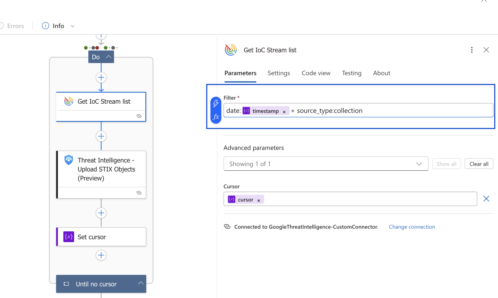

[gtidocs](../../README.md) › [Guides](../README.md) › [Integrations](README.md) › Google Threat Intelligence for MSFT Sentinel

---

# google-threat-intelligence-for-msft-sentinel

Configuration and use guide

## overview

Google Threat Intelligence for Sentinel integrates Google Threat Intelligence (Google TI) to enrich your security investigations with valuable context and threat information. It achieves this by deploying playbooks designed to automatically gather intelligence on indicators like IPs, file hashes and URLs from Google's extensive threat database.

## installation

### prerrequisites

This integration depends on a custom connector, this can be deployed by using the template located at [Raw Json](https://raw.githubusercontent.com/Azure/Azure-Sentinel/refs/heads/master/Solutions/Google%20Threat%20Intelligence/Playbooks/CustomConnector/GTICustomConnector/azuredeploy.json) or [Github](https://github.com/Azure/Azure-Sentinel/blob/master/Solutions/Google%20Threat%20Intelligence/Playbooks/CustomConnector/GTICustomConnector/azuredeploy.json)

<a href="https://portal.azure.com/#create/Microsoft.Template/uri/https%3A%2F%2Fraw.githubusercontent.com%2FAzure%2FAzure-Sentinel%2Frefs%2Fheads%2Fmaster%2FSolutions%2FGoogle%2520Threat%2520Intelligence%2FPlaybooks%2FCustomConnector%2FGTICustomConnector%2Fazuredeploy.json" target="_blank">
  
</a>

<br />

<br />

**If deploy button does not work**, you should deploy the custom connector by using Template Specs in Sentinel.

1. Download `azuredeploy.json` of the Custom Connector.
2. Open Template Specs in Sentinel.
3. Select Import Template and select `azuredeploy.json`.


4. Fill in the fields and click on Review + Create.


5. Click on Deploy.

### installing-playbooks

To install the Google Threat Intelligence playbooks, use the Content Hub and the provided templates.


1. Navigate to the Content Hub.
2. In the search bar, type and select Google Threat Intelligence.
3. Click Install.

Now you have Google Threat Intelligence playbook templates ready to use it.

### creating-and-configuring-playbooks

#### creating-playbooks

1. Navigate to the Automation Dashboard, which you can access from the Sentinel side panel.
2. Click the *Playbook Templates* tab.
3. Search for Google Threat Intelligence in the search bar.
4. Click the playbook you want to use and click *Create Playbook*.


5. Follow the steps to create a playbook.


6. And click on *Create Playbook*.

Now the playbook is created, but we need to configure it.

#### configuring-a-playbook

<br />

### important:-configuring-sentinel-connections-in-gti-threatlist

You must specifically configure the connection for any actions that require interaction with Microsoft Sentinel, such as the **"Threat Intelligence - Upload Indicators of Compromise (V2) (Preview)"** action in the **GTI-ThreatList** playbook. Failing to do so will result in a `401 Unauthorized` error during execution.

Follow these steps to resolve the issue:

1. Open the **"GTI-ThreatList"** Logic App playbook in the Azure portal and switch to the **Designer** view.
2. Navigate to the final action step: **"Threat Intelligence - Upload Indicators of Compromise (V2) (Preview)"**.
3. Select the step, then click **Change connection** > **Add new**.
4. When the sign-in window appears, ensure the authentication type is set to **"OAuth"** and click **Sign in**.
5. Re-authenticate using your **Azure credentials** (not your Google TI API key).
6. Save the playbook.

<br />

##### connections

1. Navigate to the *Active Playbooks* tab and select the one you want to configure.
2. Click on it and select Edit. You will see all the nodes of the playbook.


3. Nodes with warnings/invalids should be configured, click on each one and configure the connection to the Google TI API.


4. Click Change Connection.
5. Create a new connection.


6. Fill in the fields and click *Create New*.

You will need a Google Threat Intelligence API key.

7. Use this new connection for the rest of the nodes in the playbook that have an Invalid Google TI API connection.

##### sentinel-permissions

The created playbook needs Sentinel Contributor permissions to be able to edit incidents.

To install and authorize playbooks in Microsoft Sentinel, you need specific resource group permissions. While the **Microsoft Sentinel Contributor** and **Logic App Contributor** roles provide access to Sentinel features, they don't provide the necessary resource group-level permissions.

Microsoft recommends using managed identity for playbook authorization. This method requires the user performing the installation to have either the Owner role or the Role Based Access Control Administrator role for the resource group. This approach increases security by allowing playbooks to run without relying on user credentials.

1. In the Log Analysis workspace of your instance.
2. Navigate to Access Control (IAM).
3. Add > Add Role Assignment.


4. Select the Microsoft Sentinel Contributor role.
5. Select your playbook as member (Search by playbook name).


6. Review + Assign.

Now your playbook has the permissions for the resource group.

## using-playbooks

Google Threat Intelligence playbooks can be divided in:

* Enrichment
  * Entity triggered
  * Alert triggered
  * Incident Triggered

* Threat Intelligence Ingestion
  * Threat Lists
  * IoC Stream

### threat-intelligence-ingestion-playbooks

These playbooks add Google Threat Intelligence to your Sentinel instance. Use the Sentinel Threat Intelligence panel to view the threats.

#### threat-lists

The Threat Lists playbook ingests specific categories of threat intelligence from Google Threat Intelligence into your Microsoft Sentinel instance. To use this playbook:

1. **Configure Categories:** When setting up the playbook, you will need to specify which threat list categories you want to ingest. This allows you to tailor the intelligence feed to your specific needs.
2. **Enable Automation:** Once configured and enabled, the playbook will automatically trigger every hour. It will fetch the latest threat intelligence from the selected categories.
3. **View Ingested Threats:** The ingested threat intelligence data can be viewed and analyzed within the Microsoft Sentinel Threat Intelligence panel. This provides a centralized location to see the threats that have been imported from Google Threat Intelligence.

For more detailed information on available threat list categories and their specifics, please refer to the [Threat Lists Documentation](https://gtidocs.virustotal.com/reference/get-auth-token).


#### ioc-stream

The IoC Stream playbook continuously ingests Indicators of Compromise (IoCs) from Google Threat Intelligence into your Microsoft Sentinel Threat Intelligence. Due to the continuous nature and potential volume of data, this playbook has specific prerequisites and configuration considerations.

**Prerequisites:**

* **Azure Storage Account:** You must have an Azure Storage Account prepared.
  * **Purpose:** This storage account is used by the playbook to save the timestamp of its last execution. This ensures that in subsequent runs, it only fetches new IoCs since the last successful ingestion, preventing duplication and data gaps.
  * **Table Name:** The playbook will store this timestamp in a table named `GoogleThreatIntelligence` within the specified storage account.
* **Storage Table Data Contributor** This playbook will need this role to read/write in Table Storage

**Playbook Configuration:**

> ⚠️ **IMPORTANT: User-Specific Configuration**
>
> The API key used for the connection is user-specific. The IoC Stream is tied to a particular user's subscriptions in Google Threat Intelligence (such as collections, threat actors, and hunting rulesets).
>
> When configuring this playbook, you **must** use the API key belonging to the user account that has the desired IoC Stream subscriptions. The playbook will only ingest IoCs from that specific user's stream. This integration does not support group-level API keys or subscriptions.

1. **Storage Account Configuration:**
   * During the playbook setup, you will need to provide the name of your Azure Storage Account.
   * The playbook is designed to automatically create the `GoogleThreatIntelligence` table within that storage account if it doesn't already exist.

2. **Recurrence Interval (Recurrence Node):**
   * The playbook includes a "Recurrence" node that determines how frequently it runs to fetch new IoCs. This can be configured to suit your needs.
   * **Important Consideration for High-Volume Streams:** If you are ingesting IoC streams known for high data volume, it is crucial **not** to set a very wide interval between playbook runs (e.g., once every 24 hours for a very active stream).
   * **Reasoning:** A long interval for a high-volume stream can result in the playbook attempting to fetch an extremely large dataset in a single request. This may lead to timeouts, request failures, or potential loss of IoC information due to the sheer volume. Shorter, more frequent intervals are recommended for such streams to ensure reliable ingestion.


Once all connections are validated and the necessary configurations (like the Storage Account name and appropriate recurrence) are set, and the playbook is enabled, it will begin ingesting IoCs. These will then be available in the Microsoft Sentinel Threat Intelligence panel.

**Filtering the IoC Stream**

You can customize the IoC Stream playbook to ingest only specific types of IoCs by using the filter parameter. This is useful for tailoring the threat intelligence feed to your specific monitoring needs, reducing noise, and focusing on the most relevant threats. The filter is configured within the playbook's logic, specifically in the "Get IoC Stream lists" action.



<br />

As shown in the image, the filter field is a string where you can add your query. By default, the playbook includes a date filter that is dynamically updated to fetch only new IoCs since the last successful run. You can append additional filters to this query to further refine the data you ingest.

Available Filters:

* date:2023-02-07T10:00:00+: Returns objects from notifications generated after the specified UTC timestamp.
* date:2023-02-07-: Returns objects from notifications generated before the specified UTC timestamp.
* origin:hunting: Returns objects from notifications coming from Livehunt. Allowed values: hunting, subscriptions.
* entity\_id:objectId: Returns objects whose ID is objectId.
* entity\_type:file: Returns only a specific entity type. Allowed values: file, domain, url, ip\_address.
* source\_type:hunting\_ruleset: Filters by the type of source object that triggered the notification. Allowed values: hunting\_ruleset, retrohunt\_job, collection, threat\_profile.
* source\_id:objectId: Filters by the ID of the source object that triggered the notification (e.g., a specific hunting ruleset ID).
* notification\_tag:ruleName: Filters notifications by their tags. For Livehunt notifications, this can include the rule name or the username of the ruleset's owner.

Filters can be concatenated using AND/OR keywords.

Example:

```
(source_type:collection or source_id:objectId) and date:2023-02-07+
```

### enrichment-playbooks

These playbooks add comments to incidents with information about the IoCs. All enrichment comments are added to the incident comments section.

#### incident-triggered

1. In the Incidents panel, select the incident you want to enrich.
2. Click Actions > Run Playbook.


Here you will see all the entity triggered playbooks that you have deployed.

3. Select the playbook you want to use and click the *Run* button.


#### alert-triggered

Cannot be triggered manually, only for automation.

#### entity-triggered

If you only want to enrich 1 IoC:

1. In the Incident dashboard, select the incident that contains the IoC you want to enrich.
2. Click *View All* in the Entities panel.
3. Select the IoC you want to enrich.


4. Click Run Playbook.

## automation

Incident Trigger and Alert Trigger playbooks can be used in an automation process.

An automation process can be found \[here] (<https://learn.microsoft.com/en-us/azure/sentinel/automation/run-playbooks?tabs=after-onboarding%2Cincidents%2Cazure%2Cincident-details-new>).

### automation-example

**Creating an Automation Rule**

1. Create an automation rule in the Automation Dashboard.


This rule will be triggered when an incident is created and the GTI-IOCEnrichmentIncident playbook is run.

2. Configure the rule with the desired behavior.
3. Click Apply.

**Analytic query rule**

1. In the Analytics dashboard, choose Create > Scheduled Query Rule.


2. Enter the rule name and the severity of incidents generated by this rule.


3. In *Set rule logic* we will write a KQL query with our desired logic, in this example our query will match all rows in the IngestIoc\_CL table.
4. In the *Alert Enhancement* section, we define the mapping between Sentinel entities and the columns in our table.


5. In *Query Scheduling* you can select the frequency of this rule and the date of the data included in the query.
6. Once you have configured all the incident settings, in the *Automated Response* tab you will see the automation rules that you have created and that will be triggered by this rule.


7. Once selected, simply click Review + Create.

## release-notes

### version-3.0.0

* Added Custom Connector to connect to Google TI API.
* Added enrichment playbooks to add comments to the incidents with IoC information.

## support

* Contact <https://www.virustotal.com/gui/contact-us/technical-support>

**Copyright (c) 2025 Google. All rights reserved.**

---

← [List of Google TI Integrations](technology-integrations-list.md) · [up](README.md) · [MISP integration guide](gti4misp-guide.md) →

*Archived from <https://gtidocs.virustotal.com/docs/gti4sentinel-guide>.*
