[gtidocs](../../README.md) › [Guides](../README.md) › [Integrations](README.md) › Palo Alto XSOAR integration guide

---

# palo-alto-xsoar-integration-guide

This guide provides comprehensive, step-by-step instructions for integrating the Google Threat Intelligence (Google TI) capabilities with your *Palo Alto XSOAR* instance.

**Table of contents**

1. [Benefits](#1-benefits)

2. [Prerequisites](#2-prerequisites)

3. [Installation](#3-installation)

4. [Configuration](#4-configuration)

   4.1 [Google Threat Intelligence (Base component)](#41-google-threat-intelligence-base-component)

   4.2 [Google Threat Intelligence IoC Stream Feed](#42-google-threat-intelligence-ioc-stream-feed)

   4.3 [Google Threat Intelligence Threat Lists](#43-google-threat-intelligence-threat-lists)

5. [Integration usage](#5-integration-usage)

   5.1 [Tier 1 Analyst](#51-tier-1-analyst)

   5.2 [Tier 2 Incident response Analyst](#52-tier-2-incident-response-analyst)

   5.3 [Tier 3 Threat hunting analyst](#53-tier-3-threat-hunting-analyst)

   5.4 [Security Engineer](#54-security-engineer)

# 1.-benefits

The Google Threat Intelligence App for XSOAR provides a powerful combination designed to dramatically enhance security operations. This integration connects Google TI's vast repository of threat data directly into XSOAR's automated workflows. The key benefits are:

* **Automated Threat Enrichment and Triage**

The most immediate and impactful use case is the automatic enrichment of security alerts. When an alert from a SIEM, EDR, or email security tool arrives in XSOAR, it contains Indicators of Compromise (IoCs) such as file hashes, domains, IPs, or URLs. An XSOAR playbook automatically sends these IoCs to Google Threat Intelligence for analysis. Google TI instantly returns a comprehensive report, including multi-vendor reputation, sandbox analysis results, threat categorization, passive DNS history, and any known relationships to malware families or threat actors. This data is parsed and displayed directly within the XSOAR incident, eliminating the need for analysts to manually research indicators. This allows the playbook to perform automated triage, immediately escalating high-confidence threats while downgrading or closing alerts for known benign indicators, saving significant analyst time.

* **Automated Response and Proactive Defense**

Based on the high-fidelity intelligence received from Google TI, XSOAR playbooks can orchestrate an immediate and decisive response without human intervention. For instance, if GTI confirms a file hash is a known ransomware variant, a playbook can automatically trigger actions across other integrated tools: quarantine the endpoint via an EDR solution, block the hash enterprise-wide, and add any associated malicious domains or IPs to a firewall blocklist. Furthermore, the integration enables proactive defense. XSOAR can be configured to periodically query Google TI's custom threat feeds (e.g., those generated by Livehunt rules) and automatically ingest new IoCs related to specific threats, feeding them directly into defensive systems like firewalls and web proxies to block threats before an alert is even generated.

# 2.-prerequisites

Before proceeding, ensure the following requirements are met. Failure to meet these prerequisites is the most common source of operational issues.

* **XSOAR version compatibility**: Depending on the component:
  * Google Threat Intelligence (base): 6.10.0 and later.
  * IOC Stream: 5.5.0 and later.
  * Threat Lists: 5.5.0 and later.

* **XSOAR Administrator Privileges**: You need to  have **administrator** access to your XSOAR instance to install the application.

* **Required Content Packs**: Only the XSOAR Base as dependencies for the 1.3.6 version (September 4, 2025).

* **Google TI API Key**: A valid **API key** is required to authenticate with the Google TI service. It is strongly recommended to use a [service account](../02-group-management/admins-guide.md#service-account-information) API key rather than a key tied to an individual user account. *Service account* keys are better suited for automated systems. Please, notice that the usage of this integration entails API quota [consumption](../02-group-management/quota-consumption.md).

# 3.-installation

Follow these steps in order to install the Google Threat Intelligence App:

* **Log in** to the XSOAR platform and navigate to the **Marketplace** in the left menu.
* **Search** for “*Google Threat Intelligence*” in the search box.

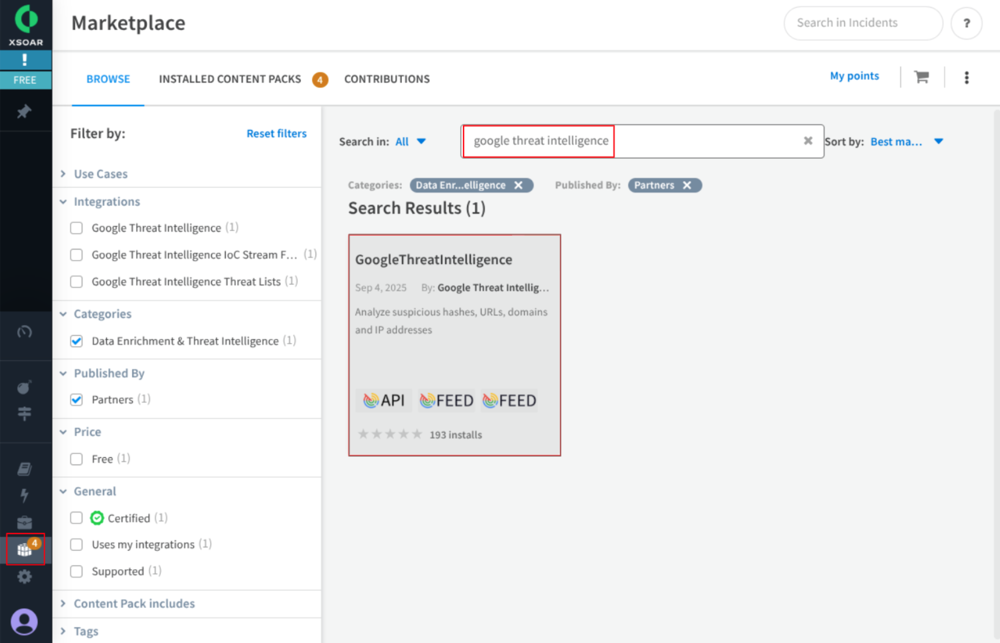

* **Select** the app and **click** on the “*Install*” button.
* **Check** that the app now appears as installed.

Once finished the Installation process you will be able to check that the content pack contains this components:

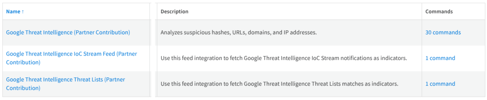

# 4.-configuration

To configure each of the different components, navigate to the **Settings > Integrations > Instances** using the left menu. In this section, you can configure the following components as described below.

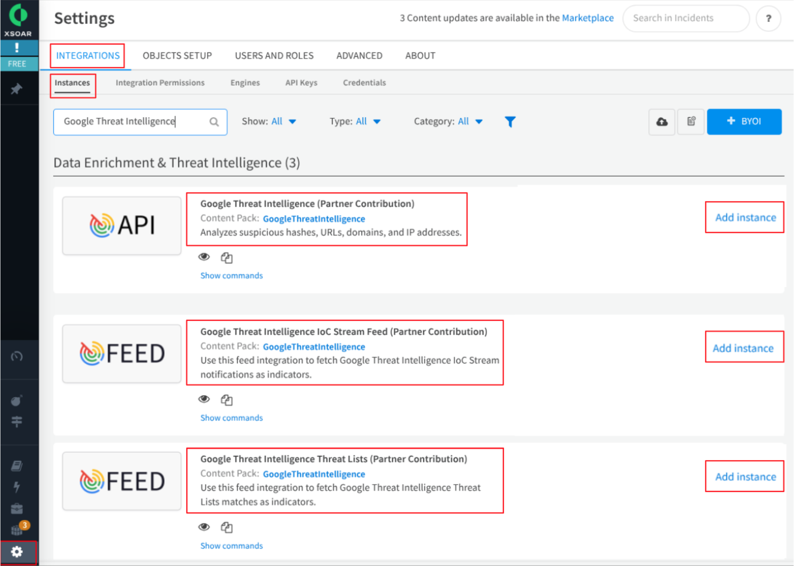

## 4.1-google-threat-intelligence-(base-component)

This component provides the analysis of suspicious hashes, URLs, domains, and IP addresses among others. Click on the following “*Add instance*” button to access this form and fill it with required information.

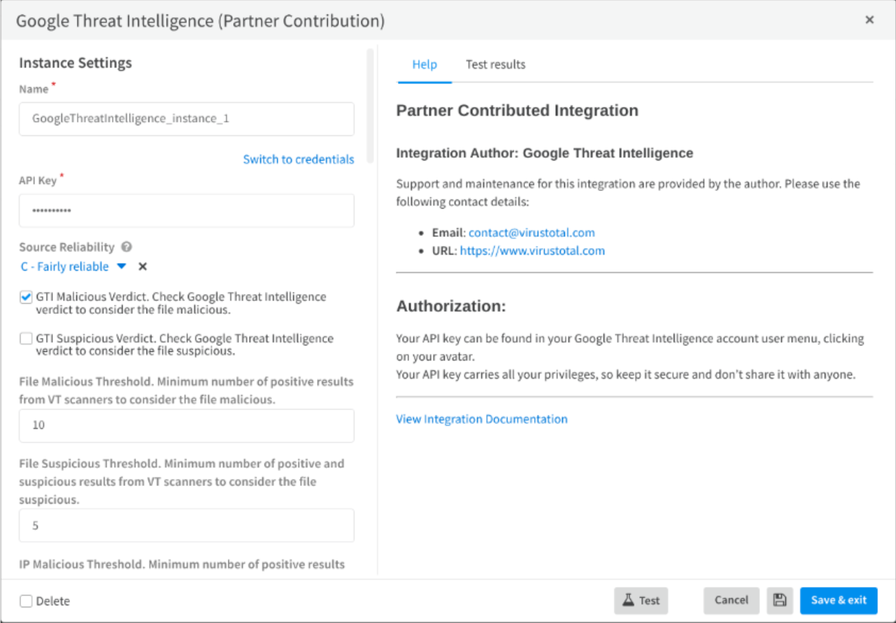

Follow these steps:

* Set a **name** for the instance.
* Introduce your **API KEY**.
* Configure **Source Reliability** and adjust the malicious and suspicious **Thresholds**.
* Finally, navigate to the **Test Results** tab and run a test.

For detailed information about each field and the available 30 commands for this component check this cortex XSOAR [documentation](https://xsoar.pan.dev/docs/reference/integrations/google-threat-intelligence).

## 4.2-google-threat-intelligence-ioc-stream-feed

This component provides the feed integration to fetch GoogleTI [IoC Stream](../06-ioc-investigation/ioc-stream-guide.md#feeds) notifications as indicators. Click on the following “*Add instance*” button to access this form and fill it with required information.

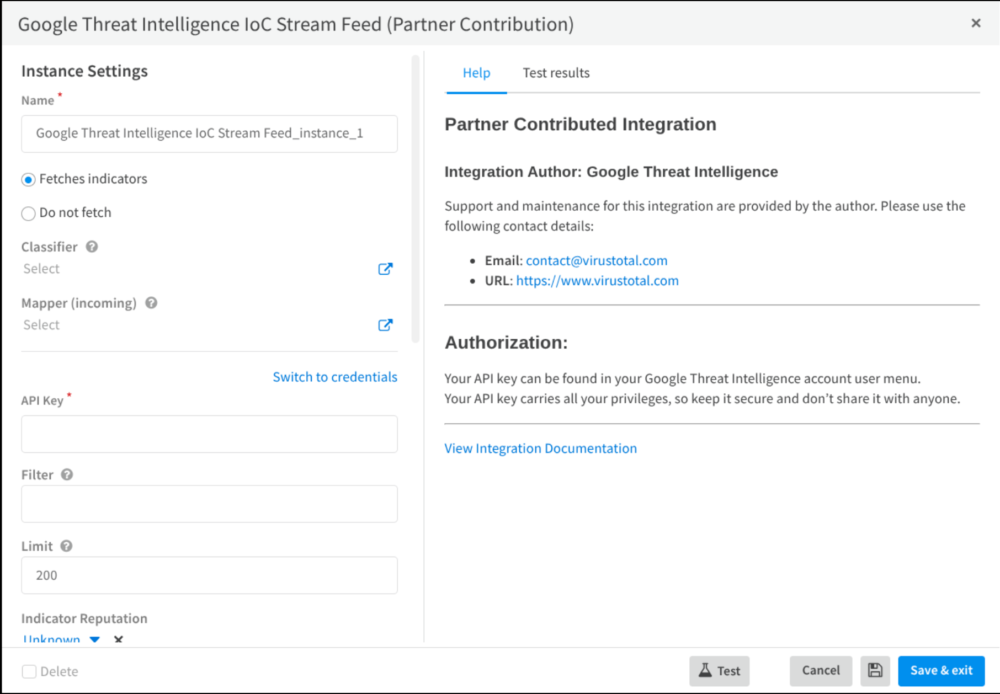

Follow these steps:

* Set a **name** for the instance.

* Select option **Fetches indicators**.

* Introduce your **API KEY**.

* Set a **Filter** using some of these options (Leave empty this field to receive all of them):
  * Filtering:
    * date: Filters notifications generated before or after a specific UTC timestamp.
    * origin: Returns objects from a specific notification source.
    * entity\_id: Finds a specific object by its unique ID.
    * entity\_type: Returns only specific types of objects (indicators).
    * source\_type: Filters by the type of source that triggered the notification.
    * source\_id: Finds items triggered by a specific source object ID.
  * Sorting:
    * date: Control the order in which notifications are returned.

* Finally, navigate to the **Test Results tab** and run a test.

For detailed information about each field and the available command for this component check this cortex XSOAR [documentation](https://xsoar.pan.dev/docs/reference/integrations/google-threat-intelligence-io-c-stream-feed).

## 4.3-google-threat-intelligence-threat-lists

This component fetch Google TI Threat Lists matches as indicators. There are 14 categorized threat list: *cryptominer, first-stage-delivery-vectors, infostealer, iot, linux, malicious-network-infrastructure, malware, mobile, osx, phishing, ransomware, threat-actor, trending and vulnerability-weaponization*.

The access to these threat lists depends on your Google TI license type, you can get more information [here](https://gtidocs.readme.io/reference/get-latest-threat-list).

Follow these steps:

* Set a **name** for the instance.
* Select option **Fetches indicators**.
* Introduce your **API KEY**.
* Select the **feed type** (categorized Threat list)
* Set a **Filter** (If needed) for your Threat List (e.g., "gti\_score:70+ positives:10- has:campaigns").
* Configure the **maximum number of results** to return. If 0 all results will be returned.
* Set a **Feed Fetch Interval**.
* Adjust The **Traffic Light Protocol (TLP)** designation to apply to indicators fetched from the feed.
* Finally, navigate to the **Test Results tab** and run a test.

For detailed information about each field and the available command for this component check this cortex XSOAR [documentation](https://xsoar.pan.dev/docs/reference/integrations/google-threat-intelligence-io-c-stream-feed).

# 5.-integration-usage

You can execute these previous commands from the CLI, as part of an automation, or in a playbook. Let’s see some examples of usage based on the different SOC role types:

## 5.1-tier-1-analyst

Quickly validate high volumes of alerts and escalate true positives. Their focus is speed and accuracy in triage. This analyst can automatically run some quick commands in XSOAR to check an indicator of compromise, for example, an email attachment where it is needed to retrieve information about the file:

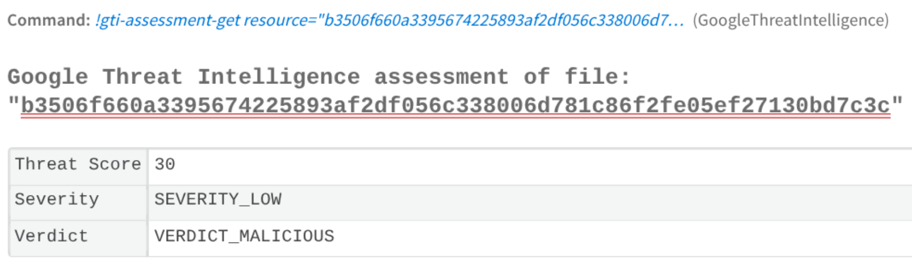

Another possibility for triaging a file is to obtain the matching sigma rules as is shown in the next image:

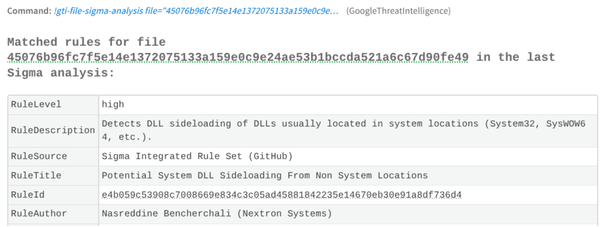

## 5.2-tier-2-incident-response-analyst

Usually investigate the full scope of the escalated incident, contain the threat, and begin remediation. The analyst wants to know if this engagement indicator is related to any known curated campaign in order to identify other related indicators relevant to the case.

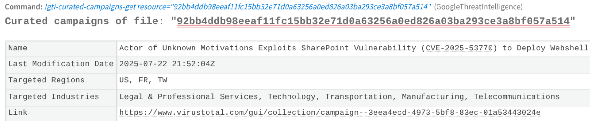

It is also possible for them to scan privately some URLs or files during the incident:

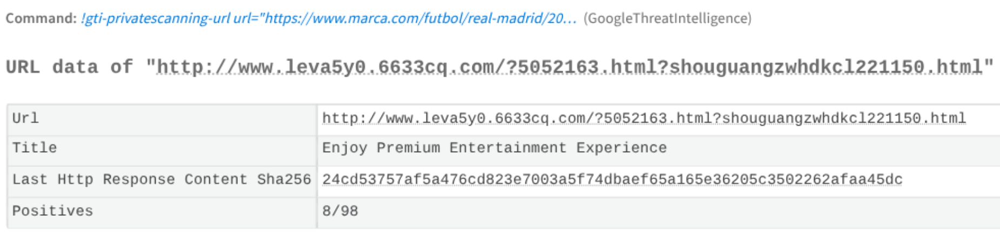

## 5.3-tier-3-threat-hunting-analyst

Proactively hunt for new and undiscovered threats. They can set up different Livehunts rules in GTI and bring the indicator that matches to XSOAR War room:

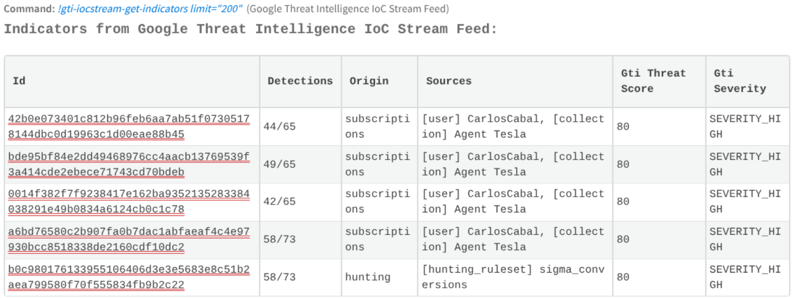

It could be also interesting to integrate these matches into a Playbook, for example, a"*retro-hunt*" playbook across the *SIEM* logs for the past 30 days to be able to discover undetected compromises.

## 5.4-security-engineer

This role automates threat prevention by integrating intelligence with defensive systems.

They can ingest the indicators available from your Google TI’s *categorized Threat Lists* (feeds).\
These indicators are related to specific threats types, and are used to feed them directly into defensive systems, such as firewalls and web proxies to block threats before an alert is even generated.

As you can see you  can retrieve these indicators directly to the War room or using a playbook.

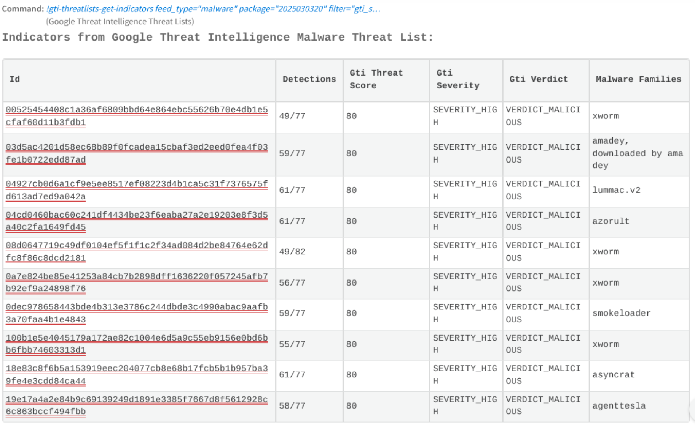

---

← [TIP integration guide](tip-integration-guide.md) · [up](README.md) · [VT4Browsers + Google TI](vt4browsers.md) →

*Archived from <https://gtidocs.virustotal.com/docs/gti4xsoar-guide>.*
