[gtidocs](../../README.md) › [Guides](../README.md) › [Integrations](README.md) › VT4Browsers + Google TI

---

# vt4browsers-+-google-ti

VT4Browsers evolves with the power of Google Threat Intelligence

**VT4Browsers** is our essential browser extension designed to **bring Google Threat Intelligence's power directly into your web activity**. It empowers analysts with actionable Threat Intelligence delivered directly within the browser. It allows you to gain immediate threat context for rapid triage, investigate IoCs in-depth without context-switching, and utilize seamless collaboration and tracking features to stay ahead of threats. Additionally, it provides an automatic security layer by scanning all downloaded files.

> 📘 Note for non-Google Threat Intelligence users
>
> If you do not have a valid **Google Threat Intelligence API key**, please refer to the general  *[VT4Browsers documentation](https://docs.virustotal.com/docs/vt4browsers)* for the correct setup instructions.

> ⚠️ WARNING!
>
> These are the options enabled by default when installing VT4Browsers for the first time, please take a close look:
>
> * **Scan downloads.** The extension will automatically submit to Google Threat Intelligence any files that you download that are not filtered out by other more granular settings. For non-executable files a prompt to confirm the upload will be displayed.
> * **Don’t scan documents.** The extension WILL NOT automatically submit to Google Threat Intelligence any documents that you open or download (DOCX, DOC, XLS, XLSX, PDF, etc.)
> * **Send anonymous passive DNS data.** The extension will share with Google Threat Intelligence domain name to IP address mappings for any DNS resolutions that your browser performs. Google Threat Intelligence WILL NOT link these resolutions to your user or any other piece of information that could identify you.
>
> Make sure you adjust this default configuration to your needs, you can do this in the "Scan and Upload Settings" tab.
>
> Remember you can change any options that you want at any time. Don't forget to check our [Terms of Service](https://cloud.google.com/terms) and [Privacy Policy](https://cloud.google.com/terms/secops/privacy-notice) for additional insights.

### activating-the-google-threat-intelligence-experience

When you first install the VT4Browsers extension, it will display the default styles and functionality. To unlock the enhanced features provided by your Google Threat Intelligence API key, you must configure the extension:

1. **Open the Extension:** Click on the VT4Browsers icon in your browser toolbar.
2. **Navigate to Settings:** Go to the Augment Settings tab.
3. **Insert the API Key:** Insert your valid Google Threat Intelligence API Key into the designated field.
4. **Save Changes:** Click Save (or the corresponding button) to apply the settings.

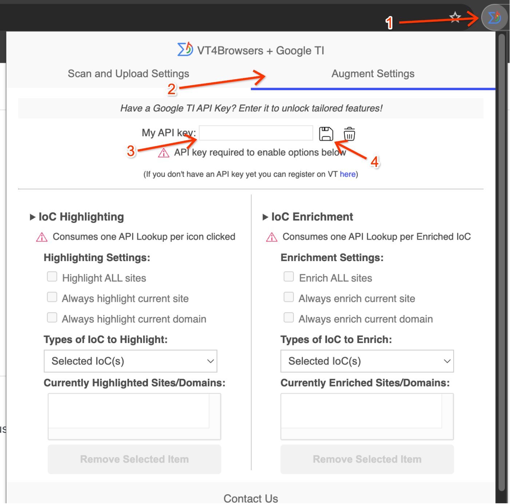

 

> 📘
>
> If you do not have a valid **Google Threat Intelligence API key**, please refer to the general  _[VT4Browsers documentation](https://docs.virustotal.com/docs/vt4browsers)_ for the correct setup instructions.

Once saved, the extension will refresh, and the **Google Threat Intelligence mode** with its additional functionality and specific styles will be applied, allowing you to begin using the full experience.

The functionality is divided into 5 categories:\
[1. Proactive Download Protection](#proactive-download-protection)\
[2. Instant Threat Triage and Prioritization](#instant-threat-triage-and-prioritization)\
[3. Unified Investigation Environment](#unified-investigation-environment)
[4. Seamless Collaboration and Tracking](#seamless-collaboration-and-tracking)
[5. Security analyst shortcuts via right-click](#security-analyst-shortcuts-via-right-click)\
[6. Keyboard shortcuts](#keyboard-shortcuts)

# proactive-download-protection

***

VT4Browsers can ease the task of submitting downloaded files to Google Threat Intelligence so as to have a second opinion by more than 70 antivirus solutions with respect to their maliciousness.

The first thing you will see when installing the extension is the VirusTotal/GTI icon in the browser's extensions toolbar. If you click on it you will see there are two different settings tabs. The default tab contains the scanning options:

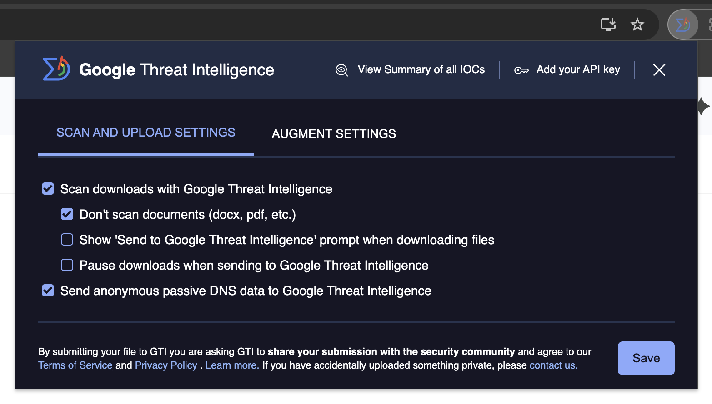

This will allow you to customize when downloaded or opened files are sent to Google Threat Intelligence and your desired level of contribution to the security community. Once you have tweaked your upload and scanning settings, you can continue browsing as usual. Let's take a closer look at the upload settings:

* **Scan downloads with Google Threat Intelligence.** \[Active by default] Deactivating this setting will never contribute any files to Google Threat Intelligence, thus, you will not see the antivirus scanning results for your downloads. Activating it does not mean that your browser will automatically upload any download to Google Threat Intelligence, the submission logic will be governed by the subsequent upload settings:
  * **Don't scan documents (docx, pdf, etc.):** \[Active by default] No matter the rest of upload settings, the extension will not try to upload any downloaded/opened documents to Google Threat Intelligence.
  * **Show 'Send to Google Threat Intelligence' prompt when downloading files:** \[Inactive by default] Instead of automatically uploading downloaded files to Google Threat Intelligence, display a confirmation dialog for each download instance. This will allow you to decide whether you want to scan any files you download prior to the download itself. **ATTENTION**: at Google Threat Intelligence we take privacy very seriously, hence, even if you do not check this option, we will still prompt you to confirm upload of files that are not executables.
  * **Pause downloads when sending to Google Threat Intelligence:** \[Inactive by default] By default the extension will not block your downloads, it will submit those files to Google Threat Intelligence but the download will proceed as usual. Activating this setting will first perform the pertinent scan and once the Google Threat Intelligence report is being displayed you may decide on whether you want to proceed with the download.
* **Send anonymous passive DNS data to Google Threat Intelligence:** \[Active by default] You can read more about [passive DNS and its usefulness for the cybersecurity community in the Security Intelligence blog](https://securityintelligence.com/how-to-use-passive-dns-to-inform-your-incident-response/). This setting will automatically submit to Google Threat Intelligence the domain name to IP address mappings for any resolutions that your browser performs, be it websites that you visit or any resources that these websites request. None of this data is stored tied to any piece of information that may identify you and each resolution event is treated independently.

As to the actual Google Threat Intelligence submission mechanics. When the extension detects a download, it will show a bubble where you can see the upload progress and the link to the file report:

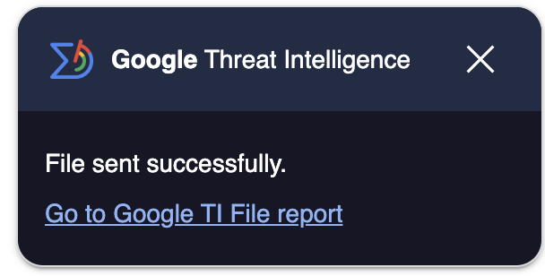

With the option to pause downloads you can even choose to resume or cancel your downloads after checking their Google Threat Intelligence report:

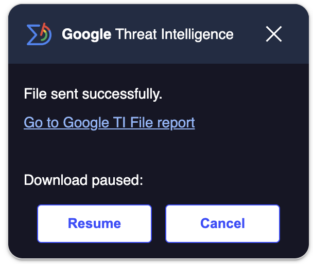

 

# instant-threat-triage-and-prioritization

***

This Extension automatically identifies IoCs (hashes, domains, IPs and URLs) in websites of your choice and incorporates Google Threat Intelligence reputation and threat context in a single pane of glass fashion.

In order to do so, you would need to configure the desired settings in the “Augment Settings” section in the Extension pop-up to decide exactly how your browser provides real-time context:

* **Specify Targets:** You can easily add specific sites or domains to be **Highlighted** (Passive, Click-to-Query) or **Enriched** (Active, Automatic Query).
* **Filter IoCs:** You gain granular control over the data displayed by selecting which types of IoCs (Hashes, IPs, Domains, etc.) are relevant to you.

  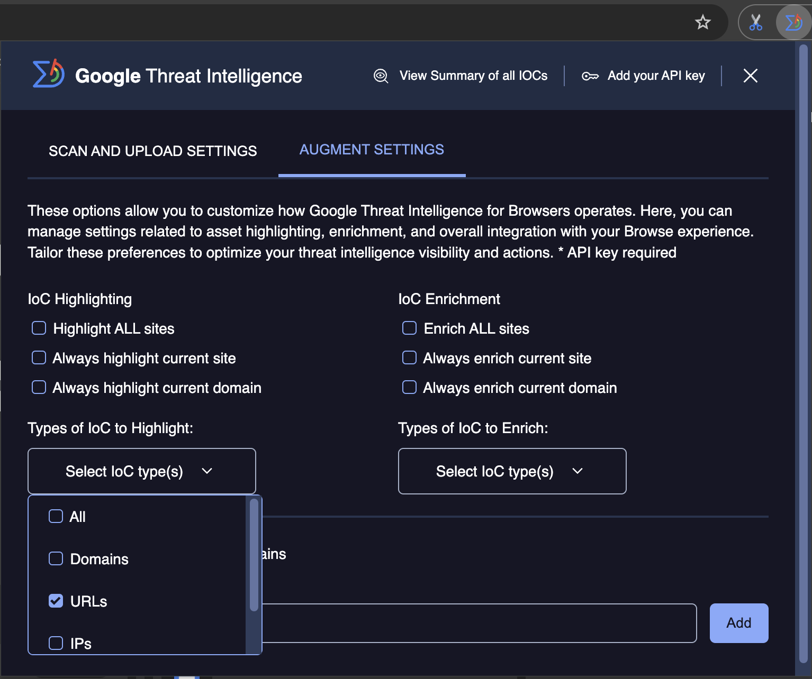

   

The core difference between the Highlighting and Enrichment features in VT4Browsers lies in when the Google Threat Intelligence API lookup is performed and what data is immediately displayed to the user.

Both features are designed to automatically identify Indicators of Compromise (IoCs) like hashes, domains, IP addresses, and URLs on any webpage you visit.

* **Live Investigation:** As you navigate the web and encounter Indicators of Compromise (IOCs), the extension leverages your Google TI permissions to automatically highlight/enrich the page.

  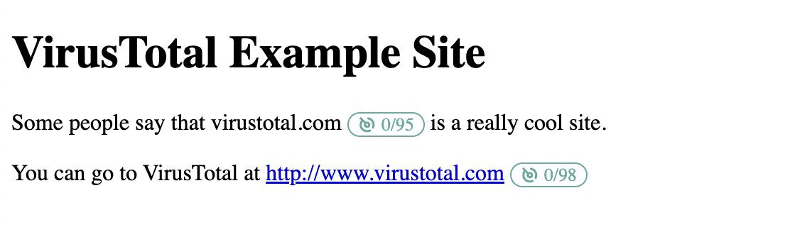

   
* **Quick Summary (Hover):** By simply hovering over any enriched IOC, you instantly get a summary of key Google TI information.

  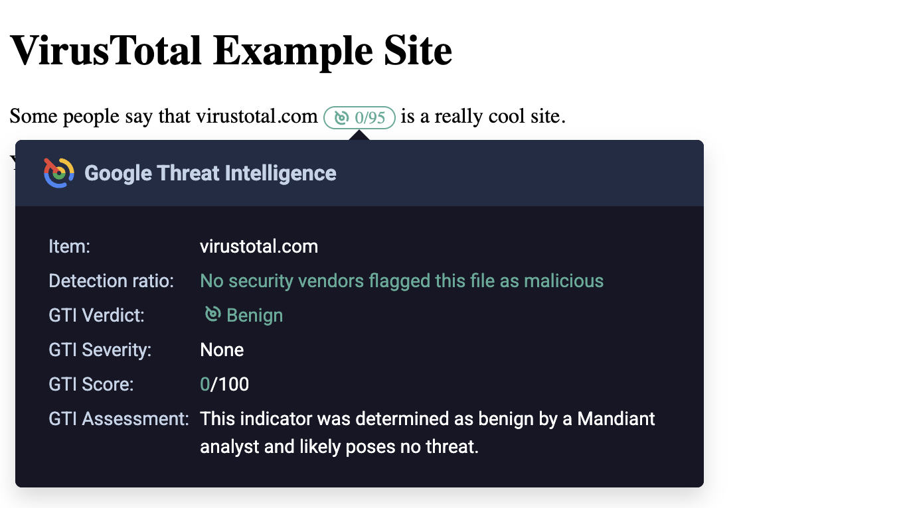

   

### highlighting-(click-to-query)

The highlighting feature is the more conservative option in terms of API consumption and network usage.

* **Action on Page Load:** VT4Browsers identifies all IoCs on the page and simply adds a small Google TI icon right next to each IoC.
* **API Consumption:** No API call is made upon page load.
* **Data Displayed:** Only the Google TI icon is visible initially.
* **Workflow:** The API lookup and quota consumption only occur when you manually click the icon next to an IoC. This click then retrieves and displays the IoC's information from Google Threat Intelligence and the VirusTotal detection ratio, opening the full GTI Augment side panel and giving the option to check a quick view summary on hover.

In summary, Highlighting is a passive option that requires a user action to initiate the security check.

### enrichment-(automatic-query)

The enrichment feature provides immediate security context, and it consumes your API quota automatically.

* **Action on Page Load:** VT4Browsers identifies all IoCs on the page and then automatically queries the API for each one.
* **API Consumption:** One API call is made for every IoC found on the page immediately upon loading.
* **Data Displayed:** The Google TI icon and the VirusTotal detection ratio are immediately displayed next to the item. Moreover, if you hover over the icon, a quick summary view is displayed.
* **Workflow:** Hovering over the icon opens a quick summary view. Clicking the icon will open the full Augment side panel.

In summary, Enrichment is an active option that provides security scores instantly.

As to the specific highlighting and enrichment options:

* **Highlight ALL sites:** Automatically identifies IoCs in any website that you visit and adds a Google Threat Intelligence icon next to each one. When clicking on the logo next to an IoC, a VT API lookup is triggered and the detection ratio gets added at the same time that the GTI Augment widget side panel gets displayed.
* **Always highlight current site:** Automatically identifies IoCs in the site being viewed, now and in the future. Adds a Google Threat Intelligence icon next to each IoC. When clicking on the logo next to an IoC, a VT API lookup is triggered and the detection ratio gets added at the same time that the GTI Augment widget side panel gets displayed.
* **Always highlight current domain:** Automatically identifies IoCs in any website under the domain being visited, now and in the future. Adds a Google Threat Intelligence icon next to each IoC. When clicking on the logo next to an IoC, a GTI API lookup is triggered and the detection ratio gets added at the same time that the GTI Augment widget side panel gets displayed.
* **Enrich ALL sites:** Automatically identifies IoCs in any website that you visit, automatically looks these up against Google Threat Intelligence (one API lookup per IoC found) and adds a Google Threat Intelligence icon and detection ratio next to each one. When clicking on the logo and detection ratio next o an IoC, the GTI Augment widget with the full IoC context gets displayed as a side panel.
* **Always enrich current site:** Automatically identifies IoCs in the website that you are visiting, now and in the future, automatically looks these up against Google Threat Intelligence (one API lookup per IoC found) and adds a Google Threat Intelligence icon and detection ratio next to each one. When clicking on the logo and detection ratio next o an IoC, the GTI Augment widget with the full IoC context gets displayed as a side panel.
* **Always enrich current domain:** Automatically identifies IoCs in any website under the domain that you are visiting, now and in the future, automatically looks these up against Google Threat Intelligence (one API lookup per IoC found) and adds a Google Threat Intelligence icon and detection ratio next to each one. When clicking on the logo and detection ratio next o an IoC, the GTI Augment widget with the full IoC context gets displayed as a side panel.

Some of these highlighting and enrichment actions can be performed via the right-click menu, under the VT4Browsers entry. **Right-clicking on a website will allow you to permanently add the pertinent domain to the automatic highlighting/enrichment settings and will also allow you to perform one-off contextualization for the given website**.

> ⚠️ ATTENTION:
>
> By default, the GTI Augment widget will be displayed as a side panel on the current page. However, due to [CSP restrictions](https://developer.mozilla.org/en-US/docs/Web/HTTP/CSP), some web pages won't allow this behavior. When this happens, the GTI Augment contextualization is displayed in a new tab.

### understanding-detection-colors

VT4Browsers uses a simple color-coding system next to the Indicators of Compromise (IoCs) to give you an immediate visual assessment of the threat level, based on the number of Antivirus (AV) vendor detections on VirusTotal:

* **Green**: Indicates 0 detections. The item is generally considered benign and has no flags from any major security vendor.
* **Orange**: Used when there are 1 to 3 detections from AV vendors. The item is suspicious, and further investigation is recommended to determine the risk.
* **Red**: Used when there are more than 3 detections. The item has a significant number of security flags and is highly likely to be malicious or dangerous.

# unified-investigation-environment

***

You can perform in-depth investigation on any IoC without changing your browser tab.

* **Deep Dive (Click):** If you click on the button next to the IoC, it will open the GTI Widget panel, offering you a detailed and profound analysis, all powered by Google's intelligence.

  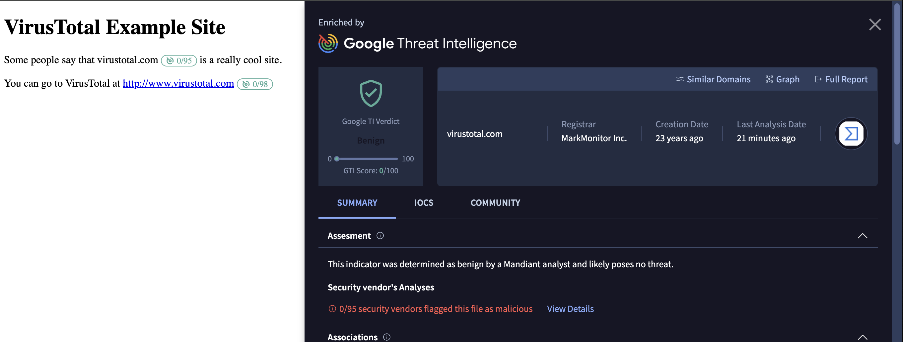
* **Seamless transition to Google Threat Intelligence:** You can choose to perform any follow-up investigation by clicking on Full Report or Graph in the GTI Widget, to be redirected to Google Threat Intelligence platform.

# seamless-collaboration-and-tracking

***

### view-summary-of-all-iocs:

This feature provides an instant security overview of the page you're visiting. By clicking on it, the extension automatically gathers all Indicators of Compromise (IOCs) detected on your current tab and immediately **opens a new investigation window within the Google Threat Intelligence platform**. This allows you to simultaneously run deep analyses and searches on all suspicious elements, significantly streamlining your triage workflow.

⚠️ **Important Requirement:** To utilize this feature, you must be actively logged into the Google Threat Intelligence platform in your browser.

⚠️ **Please note:** The feature will collect all displayed IOCs on the page, up to the maximum limit accepted by the investigation URL, ensuring you get the most comprehensive data possible within technical constraints.

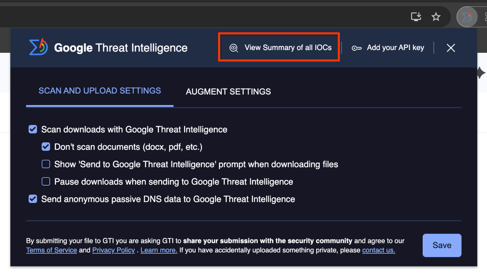

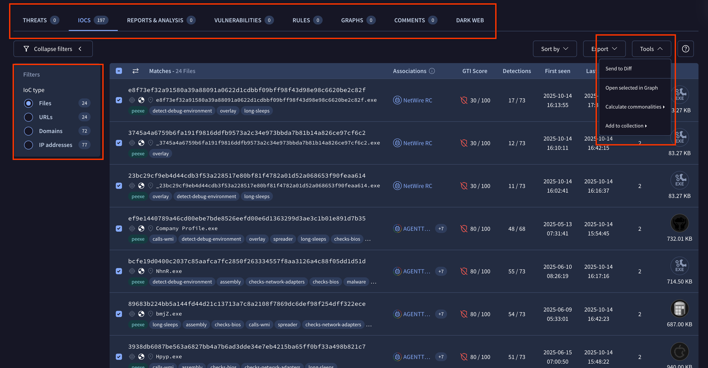

**Private Collection to unlock new use cases:** From the Page View Summary in Google Threat Intelligence, you can select specific IoCs and export them directly into a new [IoC collection](../05-global-landscape/ioc-collections.md) to unlock multiple use-cases to stay on top of the threats.

* Manage the IoC collection as a persistent object to add IoCs from other webpages and workflows.
* Share with your colleagues for collaboration
* You can convert it to an IoC stream to ingest into any SIEM to detect and investigate if your organization is impacted by the IoCs
* You can add a IoC collection to your desired Threat Profile in Google Threat Intelligence to understand its relevance to your organization.

# security-analyst-shortcuts-via-right-click

***

VT4Browsers adds a right-click menu entry to your browser allowing you to perform common security analyst tasks with a single click:

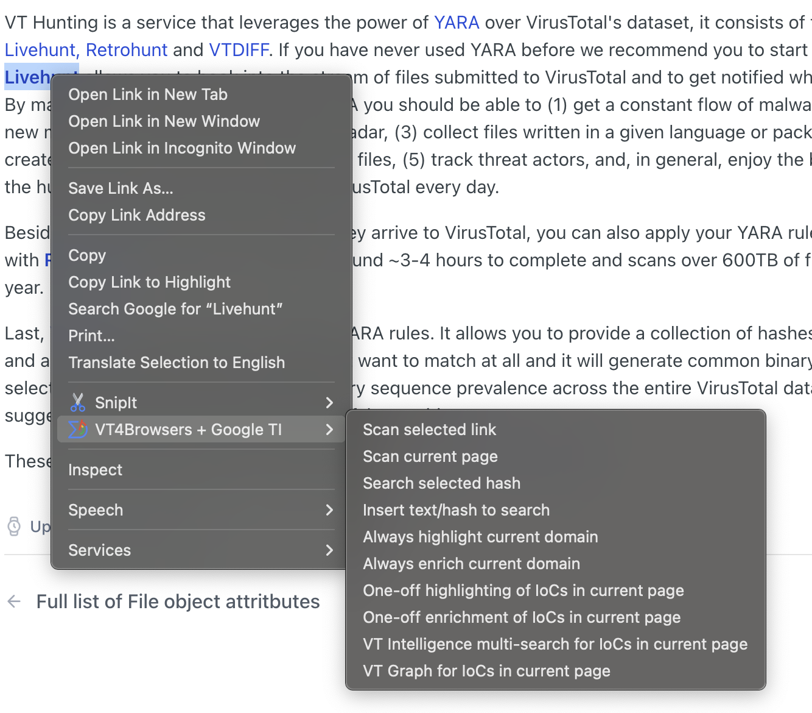

Let's take a closer look at the shortcuts available:

* **Scan selected link:** If you have right-clicked on a link in a website, this option will allow you to scan the destination link URL with Google Threat Intelligence, to get a maliciousness assessment by more than 70 security vendors and blocklists.
* **Scan current page:** Submit the website being viewed to Google Threat Intelligence, to get a maliciousness assessment on the URL by more than 70 security vendors and blocklists.
* **Search selected hash:** Provided that you have highlighted an MD5, SHA1 or SHA256 hash in a website, this option will open up the pertinent Google Threat Intelligence report for the corresponding file, if present in Google Threat Intelligence.
* **Insert text/hash to search:** Allows you to type in an MD5, SHA1 or SHA256 hash, or rather some comment tag or [advanced VirusTotal Intelligence](https://www.virustotal.com/gui/intelligence-overview) search to query Google Threat Intelligence.
* **Always highlight current domain:** This is a shortcut for the IoC contextualization functionality described in the previous section. For any websites under the domain being viewed, VT4Browsers will add a Google Threat Intelligence lookup icon next to each IoC identified within the site, now and in the future. Upon clicking such Google Threat Intelligence lookup icon a VT API lookup will be performed and the icon will get extended with the security vendors detection ratio for the IoC at the same time that the full analysis widget will be displayed as a side panel.
* **Always enrich current domain:** This is a shortcut for the IoC contextualization functionality described in the previous section. For any websites under the domain being viewed, VT4Browsers will automatically look up the pertinent IoC in Google Threat Intelligence and incorporate the security vendors detection ratio, now and in the future. Upon clicking the security vendors detection ratio a full analysis widget will be displayed as a side panel with the most relevant Google Threat Intelligence context for the pertinent threat.
* **One-off highlighting of IoCs in current page:** This is a shortcut for the IoC contextualization functionality described in the previous section. For any IoCs found in the website being viewed, VT4Browsers will add a Google Threat Intelligence lookup icon next to each, as a one-off task. Upon clicking such Google Threat Intelligence lookup icon a VT API lookup will be performed and the icon will get extended with the security vendors detection ratio for the IoC at the same time that the full analysis widget will be displayed as a side panel.
* **One-off enrichment of IoCs in current page:** This is a shortcut for the IoC contextualization functionality described in the previous section. For any IoC found under the domain being viewed, VT4Browsers will automatically look up the pertinent IoC in Google Threat Intelligence and incorporate the security vendors detection ratio, as a one-off task. Upon clicking the security vendors detection ratio a full analysis widget will be displayed as a side panel with the most relevant Google Threat Intelligence context for the pertinent threat.
* **VT Intelligence multi-search for IoCs in current page:** This option will automatically identify any IoCs (hashes, domains, IPs, URLs) in the website being viewed and will launch a [VT Intelligence search](https://www.virustotal.com/gui/intelligence-overview) for those in a new tab.
* **VT Graph for IoCs in current page:** This option will automatically identify any IoCs (hashes, domains, IPs, URLs) in the website being viewed and will display them as a threat graph in [VT Graph](https://www.virustotal.com/gui/graph-overview).

 

# keyboard-shortcuts

***

VT4Browsers lets you easily perform the following actions via keyboard shortcuts:

* **One-off highlighting** of IoCs on current page.
* **One-off enrichment** of IoCs on current page.

 

Assign your preferred keyboard commands on your browser settings:

* **Chrome**: Go to chrome://extensions/shortcuts

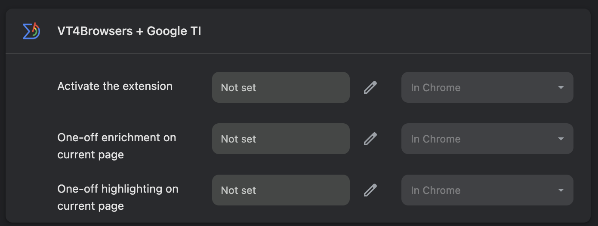

* **Firefox**: Go to about:addons and click on "Manage Extension Shortcuts"

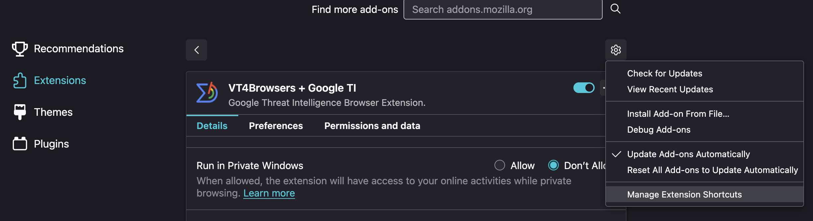

 

 

Want to try the enhanced investigation experience? Download or update the extension now:

* [Google Chrome / Edge](https://chromewebstore.google.com/detail/vt4browsers/efbjojhplkelaegfbieplglfidafgoka?authuser=0&hl=en)
* [Firefox](https://addons.mozilla.org/en-US/firefox/addon/vt4browsers/)

 

---

← [Palo Alto XSOAR integration guide](gti4xsoar-guide.md) · [up](README.md) · [Use cases and other resources](../14-use-cases-best-practices/use-cases.md) →

*Archived from <https://gtidocs.virustotal.com/docs/vt4browsers>.*
