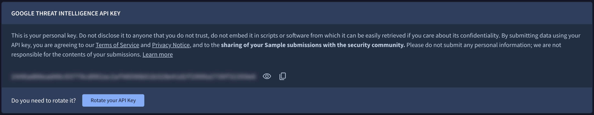

[gtidocs](../../README.md) › [Guides](../README.md) › [FAQ](README.md) › How can I rotate my API key

---

# how-can-i-rotate-my-api-key

You can rotate your Google Threat Intelligence API key at any time to maintain account security. Note that you may only rotate your key **once every 24 hours**.

To rotate your API key, log in to the platform and access the **API Key** section via the **top-right profile menu**, the **left-hand navigation bar**, or [**this direct link**](https://www.virustotal.com/gui/my-apikey). From there, you can click the **Rotate your API Key** button at the bottom of the **Google Threat Intelligence API Key** section.

> 🚧
>
> Note that once rotated, **any requests made using the old API key will fail immediately**. Ensure you **update all active scripts, tools, and integrations with the new key** immediately after rotation to avoid service disruption.
>
> For automated integrations and production environments, we highly recommend using [Service Account API keys](../02-group-management/admins-guide.md#13-service-accounts-management). These are more resilient and better suited for long-term programmatic access than individual user keys.

---

← [My Landscape](my-landscape-faq.md) · [up](README.md) · [I lost access to my authentication device/offline codes for 2FA](lost-access-2fa.md) →

*Archived from <https://gtidocs.virustotal.com/docs/rotate-api-key>.*
