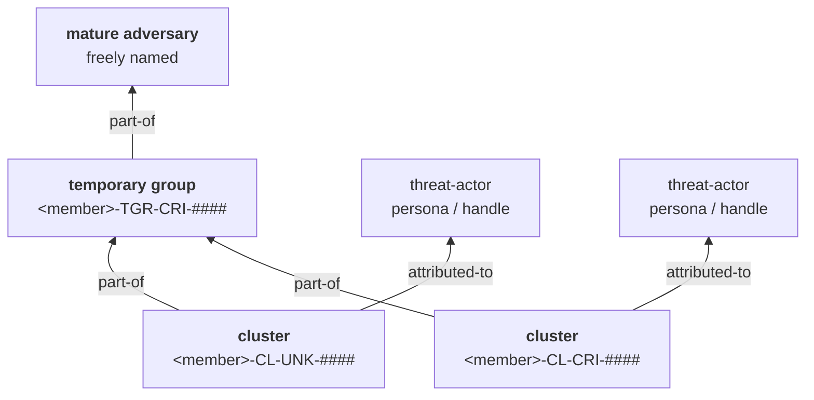
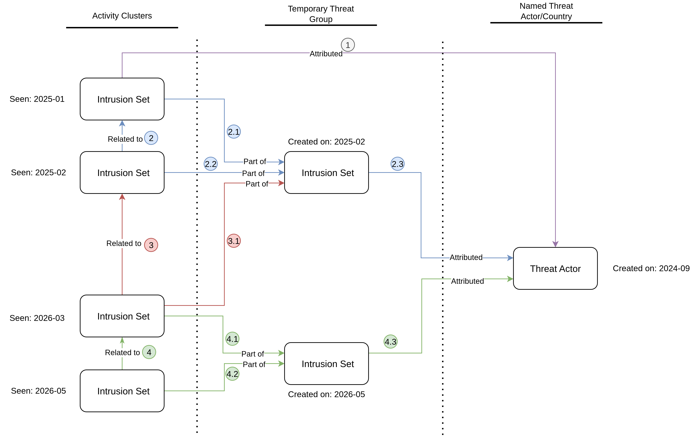
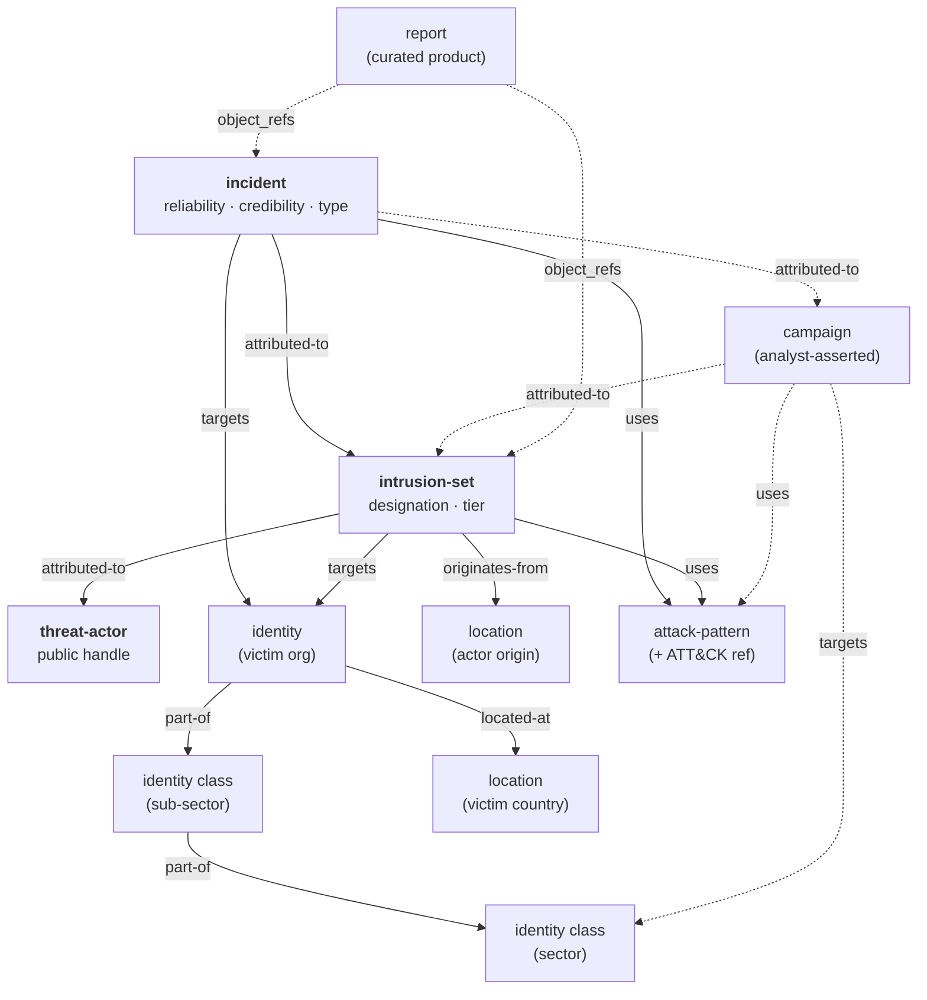

>TL:DR
> - **What this document is:** The description of what the framework classifies, with what  vocabularies, under what confidence and sharing rules, and how each construct traces back to  the standard it was borrowed from.
> - **How it was created.** We composed several publicly available, market-leading standards into one framework, That patching-together is why the framework is named **Patchwork**.

---

## Table-of-contents

1. [Purpose and scope](#1.-purpose-and-scope)
2. [Source standards and how they compose](#2.-source-standards-and-how-they-compose)
3. [What we track and how we scope it](#3.-what-we-track-and-how-we-scope-it)
4. [Adversary model and the attribution ladder](#4.1-three-tiers-of-object,-linked)
5. [Motivation and activity categorisation](#5.-motivation-and-activity-categorisation)
6. [Taxonomy](#6.-taxonomy)
7. [Confidence, sourcing and uncertainty](#7.-confidence,-sourcing-and-uncertainty)
8. [Sharing, handling and provenance](#8.-sharing,-handling-and-provenance)
9. [Serialisation and storage](#9.-serialisation-and-storage)
10. [Samples](#10.-samples)
11. [Divergences and gaps](#11.-divergences-and-gaps)

[Glossary](#glossary) · [Sources](#sources) · [Revision history](#revision-history)

---
## 1.-Purpose-and-scope

This framework exists to turn analyst observations of adversary activity into an actionable,
standards-conformant threat intelligence compatible with STIX 2.1, **in a record where each
judgement stays revisable without destroying the ones around it**.

**The problem it solves.** Threat intelligence is a record of provisional judgements, and
correction is routine rather than exceptional. Most data models make correction destructive:
renaming an actor, merging two clusters, or re-grading a source overwrites the reasoning that
produced the earlier view, so the record can no longer show what was believed, on what evidence,
or why it changed. Every construct below exists to keep each judgement separable — from the
evidence that supports it, and from the other judgements around it.

- **Attribution accumulates rather than overwrites.** An analyst who tracks an unattributed
  intrusion today, links it to a second body of activity next month, and assesses both as one
  adversary next year ends up with a structure that still holds all three — the two original
  clusters, the grouping assessment, and the evidence for each
  ([4.1](#4.1-three-tiers-of-object,-linked)).
- **Source grading attaches to the observation, not the adversary**, so a new report never
  overwrites the provenance of the last one
  ([7.1](#7.1-admiralty-grading-attaches-to-the-observation)).
- **Urgency and sourcing stay on separate axes**, because how close a threat is and how good the
  reporting is are answers to different questions ([3.4](#3.4-threat-levels)).
- **One member's judgement cannot overwrite another's** — provisional designations carry the
  authoring member's namespace, so overlapping assessments coexist instead of one silently
  winning ([4.2](#4.2-member-namespaces)).

**In scope:** adversary tracking and naming, attribution tiering, motivation and technique
classification, sector taxonomy, confidence and source grading, TLP handling, STIX 2.1
serialisation, and curated intelligence products.

**Out of scope, deliberately:** this is not a maturity model, not a collection-management
plan, not an intelligence-cycle doctrine, and not a detection-engineering standard. It says
nothing about how requirements are set or how stakeholders are served — where CERT-EU's
framework is a *programme* standard, this one is a *data and attribution* standard.

**Designed for shared use.** The framework is meant to be adopted by multiple independent
members who may exchange data. Where that creates collision risk — chiefly in adversary
naming — the framework specifies a per-member namespace rather than assuming a single
authority ([4.2](#4.2-member-namespaces)).

---

## 2.-Source-standards-and-how-they-compose

Four external standards were composed. None was adopted wholesale; each contributed the part it does best.

| Standard                                                                  | What was taken                                                                                                                                                                                                                                                           | Why that one                                                                                                                                                                           |
| ------------------------------------------------------------------------- | ------------------------------------------------------------------------------------------------------------------------------------------------------------------------------------------------------------------------------------------------------------------------ | -------------------------------------------------------------------------------------------------------------------------------------------------------------------------------------- |
| **CERT-EU CTI Framework**                                                 | Malicious activities of interest, ecosystem, threat categories, threat domains and threat levels (localised in §3 and §5.2); technical-attribution-only doctrine; the Admiralty grading scheme. Threat *actor* levels and the scoring models are **not** adopted — §11.2 | The only one of the four that is an explicit, published *classification* standard with normative analytic rules. It supplies the doctrine layer.                                       |
| **Mandiant / Google Threat Intelligence**                                 | The `UNC` → `TEMP` → `APT`/`FIN` graduation ladder; `intrusion-set` as the primary adversary object; the open-vocabulary value sets; the report-type catalogue                                                                                                           | The most mature published model of adversary identity as *provisional and revisable* rather than assigned once. Its vocabularies are already the de-facto STIX values in wide tooling. |
| **Palo Alto Unit 42**                                                     | The `CL-<MOT>-####` / `TGR-<MOT>-####` code grammar; the STA/CRI/MIX/UNK motivation classes; constellation naming; handles treated as personas rather than designations                                                                                                  | Mandiant's ladder has the right *shape* but opaque identifiers. Unit 42's grammar encodes tier and motivation in the name itself, which makes an unattributed cluster self-describing. |
| **CISA Automated Indicator Sharing**, Submission Guide v.16 (25 Jan 2021) | TLP marking as a mandatory per-object property; the sharing matrix; the HIGH/MEDIUM/LOW confidence criteria as a coarse comparison scale; handling obligations (PII minimisation, consent, versioning)                                                                   | The only source of the four that treats *dissemination* as a first-class constraint rather than an afterthought.                                                                       |
> ⚠️ **AIS version caveat.** Guide v.16 predates STIX 2.1 adoption in AIS: it is written
> against STIX **1.x** (`STIX_Package`, `stix:Observables` embedded in `stix:Indicators`, the
> `AIS_Bundle_Marking_1.1.1` schema). Its field-level Appendix A profile therefore does **not**
> apply to this framework's STIX 2.1 output. What carries over is *intent* — what must be
> marked, what must be minimised, what must be consented to — not field names.

### 2.1-Borrowing-methodology,-not-integration

The framework borrows Mandiant's and Unit 42's **published methodology**. It does not depend
on, and does not assume access to, any vendor API, feed or commercial subscription. Where a
choice below is justified by "it matches what vendor X does", the benefit is *conceptual
interoperability* — an analyst who reads a Mandiant or Unit 42 report can map it onto this
framework without translation, and a member who later gains access to such a feed will not
have to restructure. It is not a claim that data will automatically merge.

### 2.2-Where-the-standards-disagree,-and-who-wins

- **Adversary object type.** Mandiant/GTI and Unit 42 both centre the `intrusion-set`. This
  framework follows them. CERT-EU speaks of "threat actors" generically and takes no STIX
  position.
- **How a designation matures.** Both vendors mature *one* designation in place. This framework
  **diverges**: each tier is a separate object and higher tiers are built by linking, never by
  renaming ([4.1](#4.1-three-tiers-of-object,-linked)). 
- **Where the persona lives.** Unit 42's published playbooks carry the industry handle as an
  *alias* of the named intrusion set. This framework **diverges**: the persona is its own
  `threat-actor` SDO ([4.4](#4.4-personas-are-objects,-not-aliases)). 
- **Motivation vocabulary.** Unit 42's four MOT classes are richer than STIX's
  `attack-motivation-ov` can express, and coarser than CERT-EU's nine activity categories.
  The framework keeps the Unit 42 classes as the *analyst-facing* value and degrades them to
  STIX on serialisation 
- **Sector taxonomy.** Neither vendor taxonomy is adopted. The framework defines its own
  hierarchy and supplies a mapping *into* it ([6.1](#6.1-sectors)). 
---

## 3.-What-we-track-and-how-we-scope-it

Before the framework can say *who* did something, it has to say *what* is worth recording and
*how close to home* it is. This chapter is localised from CERT-EU's framework (chapters 1–6),
with its EU-specific constituency generalised: where CERT-EU writes "Union entities", Patchwork
reads **"the member's constituency"** — the set of organisations that member exists to protect.

### 3.1-Malicious-activity-of-interest

> A **malicious activity of interest (MAI)** is any adversarial cyber activity with a potential
> impact on a member's constituency or its ecosystem. This includes confirmed compromise,
> suspicious attempts, adversarial resource development, and reconnaissance.

MAIs are tracked to support alerting and awareness, and to support response and mitigation
where relevant.

**The MAI is this framework's unit of observation.** Everything upward depends on it: an
activity cluster ([4.1](#4.1-three-tiers-of-object,-linked)) is a set of MAIs assessed as one coherent body of activity, and the ladder above that groups clusters. Without a defined unit,
the ladder would start from nowhere.

Two consequences of CERT-EU's definition that are easy to miss, and that Patchwork adopts
deliberately:

- **An MAI need not be a successful compromise.** Suspicious attempts, adversary
  *infrastructure being built*, and reconnaissance all qualify. A framework that only records
  successful intrusions cannot see an adversary preparing.
- **Impact is *potential*, not realised.** Relevance is judged by exposure — which is what the
  ecosystem model below exists to make concrete.

### 3.2-Ecosystem

Watching only the constituency's own networks misses threats arriving through dependencies;
watching all of cyberspace is not affordable. The **ecosystem** is the middle ground: the set of
components through which a constituency is exposed, directly or indirectly.

| Component     | What it covers                                                                                                                                                                                                                                                  |     |
| ------------- | --------------------------------------------------------------------------------------------------------------------------------------------------------------------------------------------------------------------------------------------------------------- | --- |
| **Countries** | Countries the constituency operates in, including any non-domestic physical presence. Targeting these can reach the constituency through local infrastructure or service breaches, and through any geographically-focused campaign.                             |     |
| **Sectors**   | Sectors the constituency operates in — see the sector taxonomy in [6.1 Sectors](#6.1-sectors). Targeting a sector exposes it through shared dependencies and a shared attack surface.                                                                                      |     |
| **Events**    | Geopolitical events the constituency is involved in and which may trigger or attract malicious activity: conferences, summits, disputes, negotiations, conflicts, elections. Involvement varies — organising, participating, supporting or sanctioning a party. |     |
| **Partners**  | Organisations the constituency cooperates or exchanges information with, permanently or on ad-hoc projects. Targeting a partner reaches the constituency through trusted channels and shared projects.                                                          |     |
| **Providers** | IT companies providing services — cloud, managed service, internet service providers and others. A provider breach reaches the constituency through service disruption, loss of data confidentiality, or access to systems.                                     |     |
| **Software**  | Software products in use: operating systems, browsers, edge devices, security and business software, AI tooling. Reaches the constituency via vulnerability exploitation, trojanised updates, or abuse of legitimate software.                                  |     |
| **Systems**   | Information systems assembled for shared or collaborative purposes — public websites, shared identity and survey services. Targeting these directly affects service continuity, data integrity and user trust.                                                  |     |

Classifying an activity as an MAI weighs these together: one component may suffice where the
impact is direct and significant; elsewhere several weaker signals may collectively justify
attention.

> **Note on the source.** CERT-EU's prose introduces the ecosystem as "six components" while its
> own table lists the seven above. We enumerate the table rather than resolve the discrepancy on
> CERT-EU's behalf.

### 3.3-Threat-domains

A hierarchy for the scope an activity affects, ranked from the constituency outward. **When
several domains apply, the highest-ranking one takes precedence.**

| Domain | Definition |
|---|---|
| **Constituency** | The activity targeted one or more organisations the member protects. |
| **National** | The activity targeted entities in the member's own country — government, infrastructure, or private organisations — outside the constituency itself. |
| **Regional** | The activity targeted entities in the surrounding region or political bloc. |
| **Partner** | The activity targeted a country or area of declared partner interest outside the region. |
| **World** | The activity targeted anything not covered above. |

**Each member instantiates this ladder for itself** — the rungs are defined by *relation* to the
constituency, not by fixed geography, which is what lets members with different constituencies
use one framework. CERT-EU's own instantiation is the worked example:

| Generic rung | CERT-EU's instantiation |
|---|---|
| Constituency | Union entities (per Regulation 2023/2841) |
| National | EU — entities in one or more Member States |
| Regional | Europe — European countries outside the EU, including NATO, EFTA and candidate countries |
| Partner | EU Civilian Mission Area — countries outside Europe hosting an EU civilian mission |
| World | Any country not falling under the above |

### 3.4-Threat-levels

A three-point scale for the criticality and proximity of an activity, reflecting adversary
intent, technical impact, and known targeting of the constituency. It drives urgency and
prioritisation, and is the natural field for a threat-alert product.

| Level | Definition | Typical examples |
|---|---|---|
| **High** | An immediate threat to the constituency. Verification and action required without delay. | A significant incident affecting the constituency; exploitation in the wild of a zero-day in an internet-facing system the constituency deploys; a state-sponsored spearphishing campaign detected in the constituency or a close partner. |
| **Medium** | A close threat. Close monitoring and checking strongly recommended. | A focused espionage campaign against a sector of interest; opportunistic exploitation of a known vulnerability in software the constituency uses; adversary activity against critical infrastructure in the region. |
| **Low** | A distant or indirect threat with no identified link to the constituency. Monitoring advised; action as resources and priorities allow. | Opportunistic scanning or enumeration; a global campaign with no apparent focus on the constituency's region; indicators from an unrelated incident reused in commodity malware. |

> **Threat level is not a confidence grade — keep the two axes apart.** Threat level answers
> *how urgent and how close is this?*; Admiralty grading
> ([7.1](#7.1-admiralty-grading-attaches-to-the-observation)) answers *how good is the
> sourcing?* They are independent. A perfectly-sourced report of a distant campaign is **A1 and
> Low**; a poorly-sourced rumour of an active intrusion in the constituency is **D4 and High**,
> and is worth acting on precisely because the level is high despite the grade. Collapsing them
> into a single "priority" number destroys both.

> ⚠️ **Instantiation dependency.** The *High* level leans on the notion of a **significant
> incident**, which CERT-EU inherits from EU regulation. Patchwork does not define it — each
> member must, for their own constituency, before this scale can be applied consistently. This
> is also what currently blocks adopting CERT-EU's threat *actor* levels
> ([11](#11.-divergences-and-gaps)).

---

## 4.-Adversary-model-and-the-attribution-ladder[^1]

### 4.1-Three-tiers-of-object,-linked

**The ladder adds objects; it never rewrites them.** Each tier is a *distinct*
`intrusion-set`, and a higher tier is built by creating a **new** object and linking the
lower-tier ones to it. Nothing is renamed, merged away, or overwritten.

| Tier                 | What it is                                                     | `name`                      | Created when                                           |
| -------------------- | -------------------------------------------------------------- | --------------------------- | ------------------------------------------------------ |
| **Activity cluster** | One coherent body of activity — the unit of observation        | `<member>-CL-<MOT>-####`    | Malicious activity of interest is seen                 |
| **Temporary group**  | An analyst's assessment that several clusters are one operator | `<member>-TGR-<MOT>-####`   | A relationship is found between ≥2 clusters            |
| **Mature adversary** | A confirmed adversary, freely named                            | analyst's choice, no prefix | The relationship is assessed as meaningful and durable |




**Every object stays.** The clusters continue to exist, keep their own designations, keep their
own incidents, malware, infrastructure and victims, and keep their own confidence. The
temporary group and the mature adversary are *additional* objects that sit above them. A reader
can always descend from a named adversary to the specific clusters that justify the name, and
from each cluster to the evidence that justifies it.

This is the framework's most consequential design decision, and it buys four things:

1. **History is preserved by construction.** The record of what was believed, and when, is not
   destroyed by the next assessment. A renaming model overwrites its own audit trail.
2. **Mistakes are corrected by deleting a relationship, not by editing an entity.** If an
   analyst wrongly groups two clusters, the fix is to remove the `part-of` edge — the clusters
   are untouched and their evidence is intact. Under a rename-in-place model the only object
   available *is* the merged one, so an error can only be repaired by manipulating the entity
   that absorbed everything, and the pre-merge state is unrecoverable.
3. **Cross-cluster analysis stays possible.** Because clusters remain separate objects with
   separate capability sets, questions like *do these two ransomware operations share a code
   base?* remain askable — `malware --variant-of--> malware` or `derived-from` between the
   clusters' malware is evidence for a shared developer or a shared operator, and is exactly the
   kind of observation that justifies creating a temporary group in the first place. Merge the
   clusters first and the evidence for merging them disappears into the merged object.
4. **Competing assessments can coexist.** Two members may group the same clusters differently.
   Both groupings exist as separate objects over a shared set of clusters; neither destroys the
   other's work.

**Relationships used** (all valid `intrusion-set` → `intrusion-set` types):

| Edge | Meaning |
|---|---|
| `part-of` | This cluster is assessed to belong to that group / adversary |
| `related-to` | A link is observed between two clusters, with no grouping claim yet |
| `derived-from` | This activity is assessed to descend from that one (successor, rebrand, splinter) |

*Lineage:* Mandiant and Unit 42 both describe the same three tiers (`UNC` → `TEMP` → `APT`/`FIN`),
and we adopt Unit 42's code grammar for them. **Both vendors, however, mature a single
designation in place — and this framework does not.** That divergence is the point of this
section.

**Confidence describes the assessment, not a merge gate.** Each object carries the confidence of
the claim it represents: a cluster's confidence is confidence in the clustering; a temporary
group's is confidence in the grouping; a mature adversary's is confidence in the attribution.
Because nothing is renamed, confidence is never doing double duty as a merge tie-break.

**The promotion gate is the Diamond Model.** Create a higher-tier object only when enough of the
four vertices (adversary / infrastructure / capability / victim) are evidenced across the
member clusters, and the grading on the underlying observations supports the claim. The
framework deliberately does not fix a numeric threshold.


*Attribution workflow visualization*
 
### 4.2-Member-namespaces

Cluster and temporary-group designations are **provisional judgements**, and two members will
inevitably assign different codes to overlapping activity. To keep those judgements from
colliding, every member prefixes the objects it authors with its **own short namespace token**:

```
<member>-CL-CRI-0023      e.g.  cc-CL-CRI-0023,  acme-CL-CRI-0023
```

- The token is chosen by the member, must be lowercase, short, and stable forever. Changing it
  forks every object that carries it.
- **Namespaced:** activity-cluster and temporary-group intrusion-sets.

> A **mature adversary** carries no namespace prefix, because at that point the designation is
> meant to be shared and cited by everyone. Its namespaced member clusters keep their prefixed
> codes forever — they are still that member's assertions, and they remain reachable underneath
> the shared name.

### 4.3-Attribution-codes-are-assigned-once-and-never-reused

Each member keeps a registry of the codes it has issued: `code → {MOT class, first seen,
persona (if any)}`. Codes are assigned to a **cluster** on first sight, numbered per MOT class
in first-appearance order, and **never renumbered** — renumbering would fork every affected
entity in every store that has ingested them. A registry entry is append-only; a retired
cluster keeps its code.

> The registry is keyed by the **cluster**, not by the persona. A cluster may have no observed
> persona at all ([4.4](#4.4-personas-are-objects,-not-aliases)), several personas, or a
> persona that is later found to belong to someone else — none of which may disturb the code it
> was issued.

### 4.4-Personas-are-objects,-not-aliases

A `threat-actor` in this framework is **the persona an adversary operates behind** — the leak-site
brand, the forum handle, the sockpuppet account, the "team" name in a ransom note. It is a
*presented identity*, deliberately chosen and controlled by the adversary, and it should be
modelled as the separate, unreliable thing it is:

- the **designation** (`<member>-CL-CRI-0023`) is our analytic label for observed activity —
  it lives on the `intrusion-set`;
- the **persona** (`IRLeaks`) is the adversary's own claim about who they are — it lives on its
  own `threat-actor` SDO, pinned to Threat-Actor-**Group**;
- they are joined by `intrusion-set --attributed-to--> threat-actor`.

A cluster with no observed persona yields **no** threat-actor — an analytic code is not a
persona. Where the same operator fronts several brands, each is its own object, or additional
names go into `threat-actor.aliases`.

**Why this must not be an alias.** Personas are adversary-controlled and routinely deceptive.
They are abandoned after takedowns, resurrected by unrelated groups, shared across affiliates,
and sometimes deliberately impersonated to misdirect attribution. If the persona is stored as an
alias of the intrusion-set, then every one of those events forces an edit to the *activity*
record — and worse, two clusters that adopt the same brand name will **merge into one object**
under name-based deduplication, silently fusing two unrelated bodies of activity. Keeping the
persona separate means a brand can move, split, or be exposed as a front without disturbing a
single observation.

> **This diverges from Unit 42**, whose playbooks carry the handle as an alias of the intrusion
> set and emit no threat-actor object at all. The cost is an extra object per persona.


### 4.5-Attribution-doctrine

Adopted from CERT-EU as framework policy:

- **Technical attribution only.** Activity is linked to threat actors on the basis of
  behavioural patterns, infrastructure reuse, malware artefacts and targeting. The framework
  does **not** assign responsibility to a state or organisation; that is political attribution
  and is out of scope.
- **Geographic linkage is situational awareness, not accusation.** An actor's assessed origin
  is recorded as an `originates-from` relationship to a location. In prose products this is
  expressed as "threat actors linked to *country*". 
- **Attribution is time- and scope-bound** and may be revised as information emerges — which is
  precisely what the additive tier model ([4.1](#4.1-three-tiers-of-object,-linked)) operationalises: a revision adds or removes a
  link, it does not rewrite what was previously recorded.

---

## 5.-Motivation-and-activity-categorisation

### 5.1-The-analyst-facing-motivation-classes

Observations carry a normalised motivation. An adversary's **MOT class** is then derived from
the union of its observations:

| Observed motivation example | MOT contribution |
| --------------------------- | ---------------- |
| Ransomware, cyber-crime     | `CRI`            |
| Espionage, sabotage         | `STA`            |
| Both present                | `MIX`            |
| Hacktivism, or none         | `UNK`            |

### 5.2-Activity-categories

Localised from CERT-EU. Where the MOT class above describes **an adversary**, these categories
describe **an activity** — one MAI at a time, by the intent behind it or the nature of the
action.

| Category | Definition |
|---|---|
| **Cyberespionage & prepositioning** | Stealing sensitive information for intelligence purposes, or covertly compromising a system for future exploitation. |
| **Cybercrime** | Compromising systems for financial benefit — ransomware, selling access, deploying malware to steal and resell credentials. |
| **Hacktivism** | Targeting systems to promote an ideological or political agenda: DDoS, defacement, or hack-and-leak carried out to draw attention to a cause. |
| **Opportunistic** | Non-targeted activity that finds and exploits vulnerable systems in the wild — worms through unpatched routers, mass scanning and automated exploitation of exposed assets. |
| **Digital foreign interference** | Influencing public opinion or sowing discord by unauthorised cyber means: fake accounts spreading disinformation, selectively altered leaks, bots amplifying polarising content. |
| **Disruption & destruction** | Disrupting a victim's operations, destroying the system, or destroying data — wiper attacks, DDoS on critical infrastructure. |
| **Data exposure and leaks** | Activity leading to exposure or leaks that damage reputation or enable further attacks: hack-and-leak, insider exposure, and accidental exposure. |
| **Policy & law enforcement** | **(Non-adversarial context.)** Undertakings that address malicious activity — policy, regulation, cooperation, arrests, seizures, takedowns, bans. |
| **Unknown** | The purpose of the activity is unknown. |

**The two vocabularies are complementary, not competing.** They answer different questions and
are recorded on different objects:

| | Answers | Recorded on | Changes when |
|---|---|---|---|
| **Activity category** | What is *this activity* doing? | the MAI / incident | never — it describes one event |
| **MOT class** ([5.1](#5.1-the-analyst-facing-motivation-classes)) | What does *this adversary* pursue? | the activity cluster | the adversary's assessed pattern changes |

A `CRI` cluster routinely conducts activity categorised `Cybercrime` *and*
`Data exposure and leaks` — a ransomware operator running a leak site does both, and neither
label is wrong. Do not try to derive one from the other.

Two categories deserve a note:

- **Categories overlap by design**, and adversaries sometimes cultivate that overlap to hinder
  attribution — a state operation presenting as hacktivism, for instance. An activity may
  legitimately carry more than one category.
- **`Policy & law enforcement` is not adversary activity at all.** It is the counter-threat
  context that explains why an adversary went quiet, rebranded, or lost infrastructure — real
  analytic value, but this framework has no object type for it
  ([11](#11.-divergences-and-gaps)).

---

## 6.-Taxonomy

### 6.1-Sectors

Sectors are **first-class entities** (STIX `identity` with `identity_class: class`), arranged in
a two-level hierarchy by `part-of` relationships. A victim organisation is linked `part-of` its
most specific sector, and each sub-sector is linked `part-of` its parent, so queries filter at
either level.

The canonical list is [Sectors](Sectors.md): **182 entries — 58 parent sectors and 124 sub-sectors**, written `parent:subsector` (e.g. `energy:oil, gas`).

**This is the framework's own taxonomy, and it is normative.** Neither vendor taxonomy was
adopted, for a reason that is easy to verify: **neither vendor publishes a hierarchy at all.**

| Source                             | Shape                                                                                                     | Values                       |
| ---------------------------------- | --------------------------------------------------------------------------------------------------------- | ---------------------------- |
| **This framework**                 | Two-level hierarchy, `part-of`                                                                            | 58 parents + 124 sub-sectors |
| **Google TI** (`IndustrySectorOV`) | **Flat**, no hierarchy                                                                                    | 27 fixed values              |
| **Mandiant**                       | **Flat**, and *no fixed vocabulary at all* — industry strings are passed through verbatim from the source | unbounded                    |
| **CERT-EU** (§9, NIS2-derived)     | Flat                                                                                                      | 28 values                    |

Adopting any of them would mean discarding the sub-sector level, which is where most analytic
value sits — "energy" and "energy:oil, gas" support very different questions.


### 6.2-Techniques

Techniques are MITRE ATT&CK. An emitted `attack-pattern` carries
`x_mitre_id`, a `mitre-attack` external reference, and the technique's kill-chain phase — so it
merges into the ATT&CK catalogue rather than duplicating it.

### 6.3-Open-vocabularies

Value sets are taken verbatim from the published Google Threat Intelligence and Mandiant
vocabularies, **14 categories**, listed in full in [Vocabularies](Vocabularies.md).
The rationale is conformance, not integration ([2.1](#2.1-borrowing-methodology,-not-integration)): these are the values the wider STIX
tooling ecosystem already expects, so adopting them costs nothing and avoids inventing a
private dialect.
Most are standard STIX open vocabularies that any conformant platform already ships. The
genuinely additive ones are the Mandiant domain **report types** (`malware-profile`,
`ttp-deep-dive`, `threat-alert`, …), which have no standard equivalent.

---

## 7.-Confidence,-sourcing-and-uncertainty

### 7.1-Admiralty-grading-attaches-to-the-observation

Source reliability and information credibility describe **one observation**, not a durable
adversary — and they describe its *sourcing*, not its urgency; see the two-axes note in
[3.4](#3.4-threat-levels). Attaching them to the intrusion-set would mean each new observation clobbered the
last one's grading, destroying exactly the provenance they exist to record. They therefore
attach to the event:

| Admiralty axis | Field |
|---|---|
| Source reliability A–F | `x_opencti_reliability` (native Admiralty vocab: `A - Completely reliable` … `F - Reliability cannot be judged`) |
| Information credibility 1–6 | `confidence`, by fixed lookup |

| Credibility | 1 | 2 | 3 | 4 | 5 | 6 |
|---|---:|---:|---:|---:|---:|---:|
| `confidence` | 90 | 75 | 60 | 40 | 20 | 10 |

> **`confidence` carries two different meanings depending on the object it sits on:** on an
> event it is information credibility (the table above); on a cluster, temporary group or mature
> adversary it is confidence in the *assessment* that object represents ([4.1](#4.1-three-tiers-of-object,-linked)).
> They are never mixed on the same object. Because nothing is ever renamed, neither use is
> load-bearing for merging — so a custom property for the assessment side remains a cheap option
> if the overload proves confusing in practice.

### 7.2-Comparison-with-the-other-standards'-confidence-scales

| | Scale | Granularity | Status here |
|---|---|---|---|
| **Admiralty** (CERT-EU §10.1) | A–F × 1–6, two independent axes | 36 combinations | **Adopted** |
| **CISA AIS** (Appendix B, after DIA 2010) | HIGH / MEDIUM / LOW-UNKNOWN, single axis | 3 values | Not used. Comparable to a collapsed Admiralty: HIGH ≈ A1–B2, MEDIUM ≈ B3–C3, LOW ≈ D–F or 4–6 |
| **STIX 2.1 `confidence`** | 0–100 integer | continuous | **Used** as the serialisation target |
| **FIRST LCA / WEP** (CERT-EU §10.2) | *low/moderate/high confidence*; *unlikely/likely/very likely/almost certainly* | prose | **Not adopted** |

---
## 8.-Sharing,-handling-and-provenance

### 8.1-TLP

Every object carries a TLP marking, defaulting to TLP:WHITE/CLEAR when unspecified. The four
well-known STIX pre-defined marking ids are referenced directly; `marking-definition` objects
are **not** emitted, because platforms resolve the predefined markings themselves and a partial
stub fails STIX 2.1 validation. TLP:WHITE was renamed TLP:CLEAR in TLP 2.0 but keeps the same
STIX id, so both spellings resolve identically.

**Handling rule adopted from AIS §4.7:** TLP:RED must never travel over an automated sharing
channel. Any export path a member builds is required to filter on TLP **before** transmission —
recording a marking faithfully is not the same as honouring it.

### 8.2-Provenance

Every object a member authors carries:

- `created_by_ref` → that member's own `identity` object;
- a label identifying the member, for filtering their assertions from everyone else's.

Neither affects name-based deduplication, so shared taxonomy still converges ([4.2](#4.2-member-namespaces)).

### 8.3-Handling-obligations-—-acknowledged,-not-specified

The framework records the following AIS obligations without yet specifying how to meet them.
They are listed so that a member building a sharing capability starts from a known baseline
rather than discovering them late.

- **PII minimisation.** AIS (4.5) requires removing all personal information not directly
  related to a cybersecurity threat *before* sharing. Free-text description fields are the
  obvious risk surface.
- **Source identity and consent.** AIS (7.2–7.3) require an organisation name, ISO 3166-1
  alpha-2 country, ISO 3166-2 administrative area, sector, and an explicit consent choice
  (None / USG / Everyone) on every submission.
- **Versioning and retraction.** AIS (10) requires issuing a versioning update when information
  is shared in error or under a wrong marking. Retracting an **assessment** is already solved:
  delete the `part-of` or `related-to` edge and the grouping is withdrawn with the underlying
  clusters and their evidence intact ([4.1](#4.1-three-tiers-of-object,-linked)). Retracting a
  **fact already shared** is not — a wrong indicator, a misidentified victim, or an object
  published under the wrong TLP can be overwritten in your own store but not withdrawn from a
  recipient's, and this framework defines no versioning update. **This is the one genuinely
  unsolved item of the three.**
---

## 9.-Serialisation-and-storage

### 9.1-The-object-graph



Solid edges are emitted per observation; dashed edges come from the curation layer ([9.4](#9.4-curation-layer)) and
appear only when campaigns or reports are produced.

> **`sighting` is deliberately unused** for attack patterns — sighting an attack pattern is
> atypical STIX. The relationship is reserved for indicators.

### 9.2-Identity-and-merge-rules

The framework assumes a store that ignores an incoming STIX `id` and recomputes a deterministic
identity from the object's *contributing properties*, with names lowercased and trimmed. This
is what lets independently-generated objects converge. What each type is keyed on:

| Type                                        | Contributing properties                            |
| ------------------------------------------- | -------------------------------------------------- |
| `intrusion-set`, `threat-actor`, `campaign` | `name` (or any alias)                              |
| `identity`                                  | `name` + `identity_class` (class `class` ⇒ Sector) |
| `location`                                  | `name` + location type                             |
| `incident`                                  | `name` **only**                                    |
| `attack-pattern`                            | `x_mitre_id` when present, else `name`             |
| `report`                                    | `name` + `published`                               |

Three derived rules the framework depends on:

- **Name-based merging is a hazard the model routes around, not a mechanism it relies on.**
  Because entities merge on name, any two objects that come to share a name fuse irreversibly.
  This is precisely why the ladder creates new objects instead of renaming ([4.1](#4.1-three-tiers-of-object,-linked)), and why
  adversary personas are separate objects rather than aliases ([4.4](#4.4-personas-are-objects,-not-aliases)): both patterns would
  otherwise put a *changing* name on a *durable* record.
- **Event names must self-disambiguate.** Because an event's identity is its name alone, two
  observations of the same attack on the same target would collapse into one — silently
  discarding the second's Admiralty grading, which §7.1 exists to preserve. Event names must
  therefore carry a distinguishing element such as the observation date.
- **A report's `published` date must be anchored to something stable** — the earliest activity
  it covers, never the latest. Anchoring to the latest forks a new report every time the
  underlying set grows, instead of updating the living product in place.

### 9.3-Custom-properties

STIX 2.1 has no native representation for the classification concepts in
[3](#3.-what-we-track-and-how-we-scope-it), so the framework defines them as custom
properties. **These names are normative** — members exchanging reports must use the same
strings, or every member invents their own and the classification stops being comparable.

| Concept                                                     | Property              | Carried on                      | Values                                                         |
| ----------------------------------------------------------- | --------------------- | ------------------------------- | -------------------------------------------------------------- |
| Threat level ([3.4](#3.4-threat-levels))                    | `x_threat_level`      | `report`, `incident`            | `High` · `Medium` · `Low`                                      |
| Threat domain ([3.3](#3.3-threat-domains))                  | `x_threat_domain`     | `report`, `incident`            | `Constituency` · `National` · `Regional` · `Partner` · `World` |
| Activity category ([5.2](#5.2-activity-categories))         | `x_activity_category` | `incident`                      | **list** — one or more of the nine §5.2 categories             |
| Attribution tier ([4.1](#4.1-three-tiers-of-object,-linked)) | `x_attribution_tier`  | `intrusion-set`                 | `Cluster` · `Temporary` · `Mature`                             |
| Intent                                                      | `x_intent`            | `intrusion-set`, `threat-actor` | `financial` · `espionage` · `sabotage` · `disruption`          |

`x_activity_category` is a **list** because §5.2 states categories overlap by design — a
ransomware operation running a leak site is legitimately both `Cybercrime` and
`Data exposure and leaks`. The others are single-valued: an activity has one highest-ranking
domain ([3.3](#3.3-threat-domains)) and one urgency.

> Threat *domain* is recorded from the **authoring** member's perspective. A receiving member
> whose constituency differs will re-derive it — the ladder is constituency-relative by design
> ([3.3](#3.3-threat-domains)), so the value travels as the author's assessment, not as an absolute.

### 9.4-Curation-layer

Above the per-observation objects sit two analyst-asserted containers:

- **Campaigns** are a *coordination claim* — that several events form one operation. They are
  authored deliberately, never inferred automatically. Heuristics may **suggest** groupings for
  an analyst to confirm; a suggestion is not a campaign. An actor-less "regional wave" is a
  legitimate *unattributed* campaign.
- **Reports** are the products members exchange, typed from the Mandiant `report_types_ov` set.
  [report-types](report-types.md) is the picker — which value to use, when, and a skeleton template for each of
  the 15 hand-authored kinds;

### 9.5-Automating-the-grouping-step

[4.1](#4.1-three-tiers-of-object,-linked) defines grouping as an analyst act. Where tooling assists it, two rules apply.

**Analyst-confirmed links only.** A tool may *suggest* candidate cluster pairs — shared
infrastructure, overlapping TTPs, malware `variant-of` / `derived-from` links, temporal and
victimology proximity — but a suggestion is not a `related-to` edge and certainly not a
`part-of` edge. Confirmation is a human act, and suggestion confidences should be capped below
the grouping threshold so that a careless bulk import cannot promote itself.

**Derived objects must be visibly derived.** From confirmed links a tool may generate the
skeleton: connected components of ≥2 clusters ⇒ one temporary group; each member `part-of` it;
and up-attribution — if a member cluster is attributed to a persona, the group is too. Every
such generated object and edge must carry an `inferred` / `pending-review` label and a
confidence no higher than the premises it rests on, forming an explicit human-verification
queue. A framework that lets machine inference become indistinguishable from analyst judgement
has lost the thing attribution tiering was built to protect.

Because the grouping is expressed purely as *added objects and edges* ([4.1](#4.1-three-tiers-of-object,-linked)), withdrawing a
machine-generated assessment is a deletion, not a repair — the underlying clusters were never
touched.

---


## 10.-Samples

Worked examples under `Resources/Report Templates/reports/samples/`, each shipping the STIX 2.1 bundle it produces so a
reader can check object and relationship types against [9.1](#9.1-the-object-graph) rather
than taking them on trust:

- [Access-sale-scenario](samples/Access-sale-scenario.md) — an underground-forum listing offering access to a traffic-control
  system. Written as a **filled-in `threat-alert`** following the submission standard in
  [report-types](report-types.md), so it doubles as the worked example of what a good submission looks like:
  metadata block with all three classification fields, key judgments, actions, then the full
  object mapping and relationship graph as appendices. Its bundle is generated by a
  deterministic builder, so narrative and STIX can be diffed against each other.
- [Access-sale-scenario-2](samples/Access-sale-scenario-2.md) — the same activity
  cluster as the sample above, observed 74 days later selling a different, already-completed
  breach. Its companion is deliberate: read together, the two samples show what changes on a
  *second* observation of a tracked cluster (confidence moves, the persona's counters refresh)
  and — the point of its Appendix B — what does **not**: two incidents on one cluster is not
  grounds to promote to a temporary group ([4.1](#4.1-three-tiers-of-object,-linked)).
- [CRESCENTHARVEST](samples/CRESCENTHARVEST.md) — an unattributed espionage cluster
  (`CL-STA-0001`), sourced from a real third-party report (Acronis TRU), showing the framework
  applied to a technical malware/campaign write-up rather than a dark-web listing: a `campaign`
  and `malware` object, ten ATT&CK techniques, and file/domain/IP indicators, all under a Cluster
  tier whose low-confidence attribution notes — but does not adopt — an overlap with activity
  reported elsewhere under different names.
- [Graduation fixture](samples/graduation-fixture.md) — not a narrative sample but a
  synthetic **test bundle** (`graduation_fixture.bundle.json`): four independent, unattributed
  clusters with no relationships between them yet, built to exercise the automated-grouping
  workflow in [9.5](#9.5-automating-the-grouping-step) rather than to represent a real incident.

> The sample deliberately shows two things that are easy to get wrong: the persona as its **own**
> `threat-actor` rather than an alias ([4.4](#4.4-personas-are-objects,-not-aliases)), and a
> **High** threat level carried on **C/3** sourcing — urgency and source quality are independent
> axes ([3.4](#3.4-threat-levels)).


## 11.-Divergences-and-gaps

An honest register of where Patchwork parts company with its sources, and what it has not taken
from them. §11.1 is settled policy; §11.2 is absence.

### 11.1-Deliberate-divergences

| Divergence                                                                     | From                          | Reason                                                                                                                                                                                                                              |
| ------------------------------------------------------------------------------ | ----------------------------- | ----------------------------------------------------------------------------------------------------------------------------------------------------------------------------------------------------------------------------------- |
| **Tiers are separate linked objects, not one designation maturing in place**   | **Mandiant and Unit 42 both** | Preserves history, makes a wrong grouping correctable by deleting an edge, and keeps cross-cluster evidence (shared code base ⇒ shared developer or operator) expressible after grouping ([4.1](#4.1-three-tiers-of-object,-linked)) |
| Persona is a `threat-actor` SDO, not an intrusion-set alias                    | Unit 42                       | Personas are adversary-controlled and deceptive; as an alias, a shared brand name silently fuses unrelated activity ([4.4](#4.4-personas-are-objects,-not-aliases))                                                                  |
| Own 182-entry sector hierarchy                                                 | all three                     | Every source taxonomy is **flat**; the sub-sector level is where the analytic value sits ([6.1](#6.1-sectors))                                                                                                                      |
| Per-member namespace prefix                                                    | all three                     | The sources each assume a single naming authority; a community framework cannot ([4.2](#4.2-member-namespaces))                                                                                                                     |
| Threat domains defined by *relation* to a constituency, not by named geography | CERT-EU                       | CERT-EU's ladder is EU-specific; Patchwork is multi-member ([3.3](#3.3-threat-domains))                                                                                                                                             |
| No `financial-gain` motivation                                                 | —                             | Not a member of `attack-motivation-ov`; mirrors Mandiant's own `organizational-gain` mapping.                                                                                                                                       |
| Hacktivism maps to MOT class `UNK`                                             | Unit 42                       | Unit 42's code set has no hacktivism class ([5.1](#5.1-the-analyst-facing-motivation-classes))                                                                                                                                      |

### 11.2-Not-adopted

**From CERT-EU** — chapters 1–6 are now localised in [3](#3.-what-we-track-and-how-we-scope-it)
and [5.2](#5.2-activity-categories). What remains outside the framework:

| Construct | What adoption would require |
|---|---|
| **Threat actor levels** (Critical / High / Medium / Low) | Derivable in principle from the adversary graph, but the definitions rest on "significant incident" and on a declared period of interest. **Blocked until a member defines significant incident** — see the note in [3.4](#3.4-threat-levels). |
| **Threat scoring** — occurrences, targeting, severity, time period, decay | A scoring engine over the MAI graph, plus a severity scale (absent, below) and a weighting of the ecosystem components in [3.2](#3.2-ecosystem). |
| **Mitigation scoring** — `K₁ × MMW + K₂ × MIA + K₃ × ME8` | Mitigation objects, initial-access technique tagging and Essential Eight mappings — none of which the framework holds. |
| **FIRST LCA and WEP** | Calibrated prose vocabulary for analytic confidence and estimative probability in written products. A templates-only change; nothing structural blocks it. |

**From CISA AIS** — PII minimisation, source-identity and consent fields, and versioning /
retraction of a fact already shared. Detailed in
[8.3](#8.3-handling-obligations-—-acknowledged,-not-specified).

**Structural gaps in Patchwork itself:**

- **No severity dimension.** Nothing distinguishes a defaced website from a destroyed plant.
  Note that adopting threat levels does **not** close this: a threat level is urgency and
  proximity, not realised impact, and CERT-EU's own threat scoring treats severity as a separate
  input.
- **The Diamond promotion gate is unquantified** ([4.1](#4.1-three-tiers-of-object,-linked)) —
  "enough vertices" is not a specification.
- **No object type for non-adversarial context.** `Policy & law enforcement` activity —
  takedowns, arrests, sanctions — has real explanatory value for why an adversary changed
  behaviour, and nowhere to live ([5.2](#5.2-activity-categories)).
- **Retraction of facts.** Withdrawing an *assessment* is solved by the additive ladder;
  withdrawing a *fact already shared* is not ([8.3](#8.3-handling-obligations-—-acknowledged,-not-specified)).

---

## Glossary

One-line definitions for terms used throughout this document without re-explanation. Each links
to the section that defines it in full.

- **MAI — malicious activity of interest.** The framework's unit of observation: any adversarial
  activity with potential impact on a member's constituency. See [3.1](#3.1-malicious-activity-of-interest).
- **Ecosystem.** The set of countries, sectors, events, partners, providers, software and systems
  through which a constituency is exposed. See [3.2](#3.2-ecosystem).
- **Threat domain.** How far an activity's targeting sits from the constituency —
  Constituency/National/Regional/Partner/World. See [3.3](#3.3-threat-domains).
- **Threat level.** High/Medium/Low urgency and proximity of an activity — independent of source
  grading. See [3.4](#3.4-threat-levels).
- **Activity cluster.** The lowest attribution tier: one coherent body of activity, coded
  `<member>-CL-<MOT>-####`. See [4.1](#4.1-three-tiers-of-object,-linked).
- **Temporary group.** The middle attribution tier: an analyst's assessment that ≥2 clusters are
  one operator, coded `<member>-TGR-<MOT>-####`. See [4.1](#4.1-three-tiers-of-object,-linked).
- **Mature adversary.** The top attribution tier: a confirmed, freely-named adversary built by
  linking lower tiers. See [4.1](#4.1-three-tiers-of-object,-linked).
- **Diamond Model.** The four-vertex model (adversary / infrastructure / capability / victim)
  used as the (unquantified) gate for promoting between attribution tiers. See
  [4.1](#4.1-three-tiers-of-object,-linked).
- **Member namespace.** The short, per-member token prefixing cluster and temporary-group codes
  so independent members' provisional judgements never collide. See [4.2](#4.2-member-namespaces).
- **Persona.** The adversary's own presented identity (a leak-site brand, a forum handle) —
  modelled as its own `threat-actor` object, never as an alias of the activity record. See
  [4.4](#4.4-personas-are-objects,-not-aliases).
- **MOT class.** An adversary's normalised motivation — `STA` (state), `CRI` (crime), `MIX`
  (both), or `UNK` (unknown/hacktivism) — derived from its observations. See
  [5.1](#5.1-the-analyst-facing-motivation-classes).
- **Activity category.** What one malicious activity of interest is doing (e.g. Cybercrime,
  Cyberespionage & prepositioning) — recorded per-event, may overlap, and answers a different
  question than MOT class. See [5.2](#5.2-activity-categories).
- **Sector taxonomy.** The framework's own two-level, 182-entry `parent:subsector` hierarchy used
  to classify victim organisations. See [6.1](#6.1-sectors).
- **Admiralty grading.** The A–F source-reliability / 1–6 information-credibility scale attached
  to individual observations, not to a durable adversary object. See
  [7.1](#7.1-admiralty-grading-attaches-to-the-observation).
- **TLP (Traffic Light Protocol).** The mandatory per-object sharing marking
  (RED/AMBER/GREEN/CLEAR); TLP:RED must never travel over an automated channel. See
  [8.1](#8.1-tlp).
- **SDO / SCO.** STIX Domain Object / STIX Cyber-observable Object — the two base STIX 2.1 object
  families this framework serialises into (e.g. `intrusion-set` and `threat-actor` are SDOs; a
  `user-account` used as an indicator's basis is an SCO). See [9.1](#9.1-the-object-graph).
- **Attribution tier.** The `x_attribution_tier` custom property recording where an `intrusion-set`
  sits on the ladder — `Cluster`, `Temporary`, or `Mature`. See [9.3](#9.3-custom-properties).
- **Campaign.** An analyst-asserted, deliberately-authored coordination claim that several events
  form one operation — never inferred automatically. See [9.4](#9.4-curation-layer).

---

## Sources

- **CERT-EU Cyber Threat Intelligence Framework**, v2 (April 2026) 
	- <https://cert.europa.eu/publications/threat-intelligence/cyber-threat-intelligence-framework/markdown>
- **CISA Automated Indicator Sharing (AIS) Submission Guide**, v.16, 25 January 2021 —
	- <https://www.cisa.gov/automated-indicator-sharing-ais>
- **Mandiant / Google Threat Intelligence** — "DebUNCing Attribution: How Mandiant Tracks Uncategorized Threat Actors"
	- <https://cloud.google.com/blog/topics/threat-intelligence/how-mandiant-tracks-uncategorized-threat-actors> ·
	- GTI suspected attribution <https://gtidocs.virustotal.com/docs/suspected-attribution> ·
	- GTI STIX responses <https://gtidocs.virustotal.com/reference/stix-responses>
- **Palo Alto Unit 42** — attribution framework
	- <https://unit42.paloaltonetworks.com/unit-42-attribution-framework/> · naming
	- <https://unit42.paloaltonetworks.com/from-activity-to-formal-naming/> · playbooks
	- <https://github.com/pan-unit42/playbook_viewer>
- **OASIS STIX 2.1**
	- <https://docs.oasis-open.org/cti/stix/v2.1/os/stix-v2.1-os.html>
- **MITRE ATT&CK** Enterprise : <https://attack.mitre.org/>
- **FIRST** : Levels of Confidence in Assessment and Words of Estimative Probability guidance (referenced by CERT-EU §10.2; not adopted here).
- **OpenCTI** : https://github.com/OpenCTI-Platform/opencti


---

## Revision-history

| Version | Date       | Change                                                                                                                                            |
| ------- | ---------- | ------------------------------------------------------------------------------------------------------------------------------------------------- |
| 0.1     | 2026-08-31 | First draft circulated for community review, consolidated into a single document. Composed from CERT-EU, Mandiant/GTI, Unit 42 and CISA AIS v.16. |

[^1]: Palo Alto Unit 42, "Introducing Unit 42's Attribution Framework" — <https://unit42.paloaltonetworks.com/unit-42-attribution-framework/>
