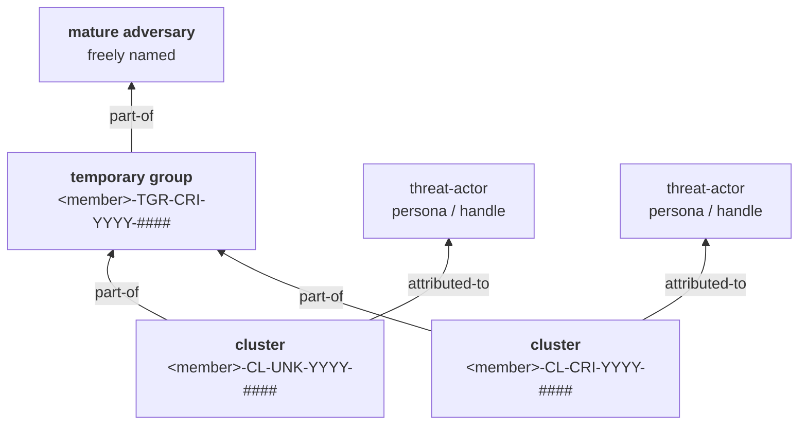
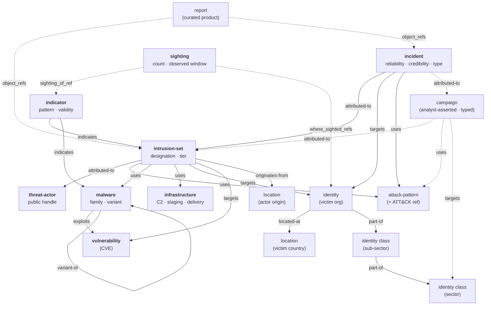

> TL;DR
> - **What this document is:**
> 	The description of what the framework classifies, with what vocabularies, under what confidence and sharing rules, and how each construct traces back to  the standard it was borrowed from.
> - **How it was created.**
> 	We composed several publicly available standards into one framework. That patching-together is why the framework is named **Patchwork**.

---

## Table-of-contents

- [1. Purpose and scope](#1-purpose-and-scope)
- [2. Source standards and how they compose](#2-source-standards-and-how-they-compose)
  - [2.1 Borrowing methodology, not integration](#21-borrowing-methodology-not-integration)
  - [2.2 Where the standards disagree, and who wins](#22-where-the-standards-disagree-and-who-wins)
  - [2.3 Why STIX 2.1 sits differently from the other four](#23-why-stix-21-sits-differently-from-the-other-four)
  - [2.4 Deliberate divergences](#24-deliberate-divergences)
  - [2.5 Not adopted](#25-not-adopted)
  - [2.6 ENISA production method and annual report profile](#26-enisa-production-method-and-annual-report-profile)
- [3. What we track and how we scope it](#3-what-we-track-and-how-we-scope-it)
  - [3.1 Malicious activity of interest](#31-malicious-activity-of-interest)
  - [3.2 Ecosystem](#32-ecosystem)
  - [3.3 Threat domains](#33-threat-domains)
  - [3.4 Threat levels](#34-threat-levels)
  - [3.5 Significant incident](#35-significant-incident)
    - [Boundary cases](#boundary-cases)
    - [Period of interest](#period-of-interest)
- [4. Adversary model and the attribution ladder](#4-adversary-model-and-the-attribution-ladder)
  - [4.1 Three tiers of object, linked](#41-three-tiers-of-object-linked)
  - [4.2 Member namespaces](#42-member-namespaces)
  - [4.3 Attribution codes are assigned once and never reused](#43-attribution-codes-are-assigned-once-and-never-reused)
  - [4.4 Personas are objects, not aliases](#44-personas-are-objects-not-aliases)
  - [4.5 Attribution doctrine](#45-attribution-doctrine)
  - [4.6 Minimum evidence for promotion](#46-minimum-evidence-for-promotion)
    - [Cluster → temporary group](#cluster--temporary-group)
    - [Temporary group → mature adversary](#temporary-group--mature-adversary)
  - [4.7 Mature name collisions and the member registry](#47-mature-name-collisions-and-the-member-registry)
    - [Checking a name before minting it](#checking-a-name-before-minting-it)
    - [When a collision happens anyway](#when-a-collision-happens-anyway)
    - [The member registry](#the-member-registry)
  - [4.8 When several actors claim one activity](#48-when-several-actors-claim-one-activity)
    - [First, decide whether each claimant is an MAI at all](#first-decide-whether-each-claimant-is-an-mai-at-all)
    - [Each claimant that clears the gate is its own cluster](#each-claimant-that-clears-the-gate-is-its-own-cluster)
    - [The edge is `related-to`, and nothing stronger](#the-edge-is-related-to-and-nothing-stronger)
    - [Primacy is recorded as evidence, not as rank](#primacy-is-recorded-as-evidence-not-as-rank)
    - [This is still not a temporary group](#this-is-still-not-a-temporary-group)
- [5. Motivation and activity categorisation](#5-motivation-and-activity-categorisation)
  - [5.1 The analyst-facing motivation classes](#51-the-analyst-facing-motivation-classes)
  - [5.2 Activity categories](#52-activity-categories)
  - [5.3 Intent](#53-intent)
- [6. Taxonomy](#6-taxonomy)
  - [6.1 Sectors](#61-sectors)
  - [6.2 Techniques](#62-techniques)
  - [6.3 Open vocabularies](#63-open-vocabularies)
- [7. Confidence, sourcing and uncertainty](#7-confidence-sourcing-and-uncertainty)
  - [7.1 Admiralty grading attaches to the observation](#71-admiralty-grading-attaches-to-the-observation)
  - [7.2 Comparison with the other standards' confidence scales](#72-comparison-with-the-other-standards-confidence-scales)
- [8. Sharing, handling and provenance](#8-sharing-handling-and-provenance)
  - [8.1 TLP](#81-tlp)
  - [8.2 Provenance](#82-provenance)
  - [8.3 Handling obligations — acknowledged, not specified](#83-handling-obligations--acknowledged-not-specified)
  - [8.4 Retraction of shared facts](#84-retraction-of-shared-facts)
    - [The retraction record](#the-retraction-record)
    - [What a recipient must do](#what-a-recipient-must-do)
    - [The wrong TLP case](#the-wrong-tlp-case)
- [9. Serialisation and storage](#9-serialisation-and-storage)
  - [9.1 The object graph](#91-the-object-graph)
    - [Framework-defined relationship types](#framework-defined-relationship-types)
    - [Objects registered but not modelled](#objects-registered-but-not-modelled)
  - [9.2 Identity and merge rules](#92-identity-and-merge-rules)
  - [9.3 Classification properties](#93-classification-properties)
    - [The extension definition](#the-extension-definition)
    - [The properties](#the-properties)
    - [On the wire](#on-the-wire)
  - [9.4 Curation layer](#94-curation-layer)
  - [9.5 Automating the grouping step](#95-automating-the-grouping-step)
  - [9.6 Indicators and sightings](#96-indicators-and-sightings)
    - [Patterning is required](#patterning-is-required)
    - [Lifecycle](#lifecycle)
    - [Sightings](#sightings)
    - [What an indicator does not do](#what-an-indicator-does-not-do)
- [10. Samples](#10-samples)
- [Glossary](#glossary)
- [Sources](#sources)
- [Revision history](#revision-history)

---
## 1.-Purpose-and-scope

This framework turns analyst observations of adversary activity into actionable threat intelligence designed for STIX 2.1 exchange, **in a record where each judgement stays revisable without destroying the ones around it**.

**The problem it solves.**
	Threat intelligence is a record of provisional judgements, and correction is routine rather than exceptional. Most data models make correction destructive: renaming an actor, merging two clusters, or re-grading a source overwrites the reasoning that produced the earlier view, so the record can no longer show what was believed, on what evidence, or why it changed. Every construct below exists to keep each judgement separable, from the evidence that supports it, and from the other judgements around it.
- **Attribution accumulates rather than overwrites.**
	An analyst who tracks an unattributed intrusion today, links it to a second body of activity next month, and assesses both as one adversary next year ends up with a structure that still holds all three, the two original clusters, the grouping assessment, and the evidence for each ([4.1](#41-three-tiers-of-object-linked)).
- **Source grading attaches to the observation, not the adversary**
	A new report never overwrites the provenance of the last one ([7.1](#71-admiralty-grading-attaches-to-the-observation)).
- **Urgency and sourcing stay on separate axes**
	How close a threat is and how good the reporting is, are answers to different questions ([3.4](#34-threat-levels)).
- **One member's judgement cannot overwrite another's**
	Provisional designations carry the authoring member's namespace, so overlapping assessments coexist instead of one silently winning ([4.2](#42-member-namespaces)).

**In scope:**
	adversary tracking and naming, attribution tiering, motivation and technique classification, sector taxonomy, confidence and source grading, TLP handling, STIX 2.1 serialisation, and curated intelligence products.

**Out of scope, deliberately:**
	this is not a maturity model, not a collection-management plan, not an intelligence-cycle doctrine, and not a detection-engineering standard. It says nothing about how requirements are set or how stakeholders are served, where CERT-EU's framework is a *programme* standard, this one is a *data and attribution* standard.

**Designed for shared use.**
	The framework is meant to be adopted by multiple independent members who may exchange data. Where that creates collision risk, chiefly in adversary naming, the framework specifies a per-member namespace rather than assuming a single authority ([4.2](#42-member-namespaces)).

**Compatible platform in development.** We are working on a threat-intelligence platform intended to implement this framework. It is not yet a released or verified-conformant implementation. Patchwork remains platform-independent: adopting the framework does not require that platform, and its internal development plans are outside this specification.

---


## 2.-Source-standards-and-how-they-compose

Five foundational external standards were composed. The complementary ENISA production-method and annual-report profile is localised separately in [2.6](#26-enisa-production-method-and-annual-report-profile); it does not replace these foundations or add a wire format. None was adopted wholesale; each contributed the part it does best. Where Patchwork parts company with them is registered below: [2.4](#24-deliberate-divergences) is settled policy, [2.5](#25-not-adopted) is absence, both summarise, and link forward to the chapters that argue each case

| Standard                                                                  | What was taken                                                                                                                                                                                                                                                                                                                                                                                                                                                                                                                                                                                                                                                                                                                                                                                                | Why that one                                                                                                                                                                                                                                                                                                                                                                                                                  |
| ------------------------------------------------------------------------- | ------------------------------------------------------------------------------------------------------------------------------------------------------------------------------------------------------------------------------------------------------------------------------------------------------------------------------------------------------------------------------------------------------------------------------------------------------------------------------------------------------------------------------------------------------------------------------------------------------------------------------------------------------------------------------------------------------------------------------------------------------------------------------------------------------------- | ----------------------------------------------------------------------------------------------------------------------------------------------------------------------------------------------------------------------------------------------------------------------------------------------------------------------------------------------------------------------------------------------------------------------------- |
| **CERT-EU CTI Framework**                                                 | - [Malicious activities of interest](Easy-access/CERT-EU/cert-eu-cti-framework.md#malicious-activities-of-interest)<br>- [ecosystem](Easy-access/CERT-EU/cert-eu-cti-framework.md#ecosystem)<br>- [threat categories](Easy-access/CERT-EU/cert-eu-cti-framework.md#threat-and-counter-threat-categories)<br>- [threat domains](Easy-access/CERT-EU/cert-eu-cti-framework.md#threat-domains)<br>- [threat levels](Easy-access/CERT-EU/cert-eu-cti-framework.md#threat-levels) (localised in [3](#3-what-we-track-and-how-we-scope-it) and [5.2](#52-activity-categories))<br>- [technical-attribution-only doctrine](Easy-access/CERT-EU/cert-eu-cti-framework.md#technical-attribution-principles)<br>- [Admiralty grading scheme](Easy-access/CERT-EU/cert-eu-cti-framework.md#confidence-in-information). | The only one of the four non-STIX standards that is an explicit, published *classification* standard with normative analytic rules. It supplies the doctrine layer.                                                                                                                                                                                                                                                           |
| **Mandiant / Google Threat Intelligence**                                 | - [graduation ladder](Easy-access/GTI/debuncing-attribution-how-mandiant-tracks-uncategorized-threat-actors-mandiant.md#why-uncs-matter)<br>- [Open-vocabulary](Vocabularies.md) <br>- [Report-type](Report-Types.md) <br>- [campaign-type](Easy-access/GTI/Mandiant/How-does-Mandiant-track-threat-actors.md)                                                                                                                                                                                                                                                                                                                                                                                                                                                                                                | The most mature published model of adversary identity as *provisional and revisable* rather than assigned once. Its vocabularies are already the de-facto STIX values in wide tooling.                                                                                                                                                                                                                                        |
| **Palo Alto Unit 42**                                                     | - `intrusion-set` [code grammar](Easy-access/PaloAltoNetworks/introducing-unit-42s-attribution-framework.md#levels-of-attribution)<br>- [motivation classes](Easy-access/PaloAltoNetworks/introducing-unit-42s-attribution-framework.md#level-1-activity-clusters)<br>- `intrusion-set` as the adversary object ([ATOM / Adversary Playbook](https://github.com/pan-unit42/playbook_viewer))                                                                                                                                                                                                                                                                                                                                                                                                                  | Mandiant's ladder has the right *shape* but opaque identifiers. Unit 42's grammar encodes tier and motivation in the name itself, which makes an unattributed cluster self-describing.                                                                                                                                                                                                                                        |
| **CISA Automated Indicator Sharing**, Submission Guide v.16 (25 Jan 2021) | - [TLP marking](<Easy-access/CISA/ais-submission-guide-v.16.md#47-traffic-light-protocol-tlp-marking>) <br>- [sharing matrix](Easy-access/CISA/ais-submission-guide-v.16.md#71-tlp)<br>- [HIGH/MEDIUM/LOW confidence criteria](Easy-access/CISA/ais-submission-guide-v.16.md#appendix-b---confidence-level-criteria) <br>- [PII minimisation](Easy-access/CISA/ais-submission-guide-v.16.md#45-prior-to-submission)<br>- [consent](Easy-access/CISA/ais-submission-guide-v.16.md#72-consent)<br>- [versioning](Easy-access/CISA/ais-submission-guide-v.16.md#100-versioning)                                                                                                                                                                                                                           | The only one of the four non-STIX standards that treats *dissemination* as a first-class constraint rather than an afterthought.                                                                                                                                                                                                                                                                                              |
| **OASIS STIX 2.1**                                                        | - the object and serialisation substrate<br>- the common properties<br>- [versioning model](Easy-access/oasis-open/stix-2.1.md#36-versioning)<br>- `marking-definition`<br>- [TLP marking type](Easy-access/oasis-open/stix-2.1.md#72-data-markings)<br>- [open vocabularies](Easy-access/oasis-open/stix-2.1.md#10-stix-vocabularies) (enumerated in [Vocabularies](Vocabularies.md))<br>- [`extension-definition`](Easy-access/oasis-open/stix-2.1.md#73-extension-definition), which carries the framework's own classification properties ([9.3](#93-classification-properties))                                                                                                                                                                                                                      | The only one of the five that is a *serialisation* standard. The other four supply doctrine, adversary-identity method and dissemination rules; none of them says how a judgement is written down, versioned or exchanged. STIX 2.1's versioning model — `id` constant, `modified` advances, `revoked` retires — is what makes "revisable without destroying the judgements around it" a mechanism rather than an aspiration. |

> ⚠️ **AIS version caveat.** Guide v.16 predates STIX 2.1 adoption in AIS: it is written against STIX **1.x** (`STIX_Package`, `stix:Observables` embedded in `stix:Indicators`, the `AIS_Bundle_Marking_1.1.1` schema). Its field-level [Appendix A](Easy-access/CISA/ais-submission-guide-v.16.md#appendix-a---ais-stix-profile-fields) profile therefore does **not** apply to this framework's STIX 2.1 output. What carries over is *intent* — what must be marked, what must be minimised, what must be consented to — not field names.

### 2.1-Borrowing-methodology,-not-integration

The framework borrows Mandiant's and Unit 42's **published methodology**. It does not depend on, and does not assume access to, any vendor API, feed or commercial subscription. Where a choice below is justified by "it matches what vendor X does", the benefit is *conceptual interoperability* — an analyst who reads a Mandiant or Unit 42 report can map it onto this framework without translation, and a member who later gains access to such a feed will not have to restructure. It is not a claim that data will automatically merge.

### 2.2-Where-the-standards-disagree,-and-who-wins

- **Adversary object type.**
	**Unit 42** explicitly maps **Intrusion Set → Adversary** in its STIX 2.0 [ATOM/Playbook Viewer object mapping](https://github.com/pan-unit42/playbook_viewer/blob/4cdeeb3378c7f2da1b7f2d93d8bc1d6582ef1100/README.md#L19-L23). This framework follows that object choice in STIX 2.1 ([Intrusion Set, §4.9](Easy-access/oasis-open/stix-2.1.md#49-intrusion-set)), using a distinct `intrusion-set` at each attribution tier ([4.1](#41-three-tiers-of-object-linked)). **Mandiant/GTI does not**, and this is a divergence rather than an inheritance: GTI's own STIX documentation lists its threat-object types as `threat-actor`, `malware`, `campaign`, `grouping`, `report` and `vulnerability` ([STIX responses](Easy-access/GTI/gtidocs/reference/01-api-introduction/stix-responses.md)) — `intrusion-set` is not among them. CERT-EU speaks of "threat actors" generically and takes no STIX position.
- **How a designation matures.**
	Both vendors mature *one* designation in place. This framework **diverges**: each tier is a separate object and higher tiers are built by linking, never by renaming ([4.1](#41-three-tiers-of-object-linked)).
- **Where the persona lives.**
	Unit 42's published playbooks emit no `threat-actor` object and populate no `aliases` — the industry handle is simply absent from the serialisation, leaving the intrusion-set's own name to carry everything. This framework **diverges**: the persona is its own `threat-actor` SDO ([4.4](#44-personas-are-objects-not-aliases)).
- **Motivation vocabulary.**
	Unit 42's four MOT classes are richer than STIX's `attack-motivation-ov` can express, and coarser than CERT-EU's nine activity categories. The framework keeps the Unit 42 classes as the *analyst-facing* value and degrades them to STIX on serialisation
- **Sector taxonomy.**
	Neither vendor taxonomy is adopted. The framework defines its own hierarchy and supplies a mapping *into* it ([6.1](#61-sectors)).
- **How to carry non-standard properties.**
	Earlier drafts of this framework used `x_`-prefixed custom properties. STIX 2.1 **deprecates** that mechanism — its [11](<Easy-access/oasis-open/stix-2.1.md#11-customizing-stix-deprecated>) is titled "Customizing STIX (Deprecated)" — in favour of `extension-definition` objects ([7.3](Easy-access/oasis-open/stix-2.1.md#73-extension-definition)). Here STIX **wins**: the seven classification properties now ride on a single nested `property-extension` ([9.3](#93-classification-properties)). This is the one entry in this list resolved *against* the framework's earlier choice rather than against a source standard.

### 2.3-Why-STIX-2.1-sits-differently-from-the-other-four

The other four are read as **doctrine and method**, and localised into this document's own prose — CERT-EU's threat domains became [3.3](#33-threat-domains), Unit 42's code grammar became [4.1](#41-three-tiers-of-object-linked). Nothing downstream can check whether that localisation was faithful; it is an editorial claim.

STIX 2.1 is not localised. It is the **wire format**, and conformance to it is *testable* — a bundle either validates or it does not, and [12](Easy-access/oasis-open/stix-2.1.md#12-conformance) says which features are mandatory (versioning is one). That makes it the only source standard this framework can actually fail against.

It also runs in the opposite direction from the other four. They *supply* material the framework adopts; STIX **constrains what can be said**. Richer analyst-facing values are degraded into it on serialisation — Unit 42's MOT classes into `attack-motivation-ov` ([5.1](#51-the-analyst-facing-motivation-classes)), Admiralty credibility into a `confidence` integer ([7.1](#71-admiralty-grading-attaches-to-the-observation)). Where a judgement will not fit, the framework carries it in an extension rather than bending the standard ([9.3](#93-classification-properties)).

### 2.4-Deliberate-divergences

| Divergence                                                                     | From                          | Reason                                                                                                                                                                                                                              |
| ------------------------------------------------------------------------------ | ----------------------------- | ----------------------------------------------------------------------------------------------------------------------------------------------------------------------------------------------------------------------------------- |
| `intrusion-set` as the adversary object                                        | **Mandiant / GTI**            | GTI types adversaries as `threat-actor`; Patchwork reserves that type for the persona ([4.4](#44-personas-are-objects-not-aliases)), and follows Unit 42 in centring the `intrusion-set` ([4.1](#41-three-tiers-of-object-linked))                                     |
| **Tiers are separate linked objects, not one designation maturing in place**   | **Mandiant and Unit 42 both** | Preserves history, makes a wrong grouping correctable by deleting an edge, and keeps cross-cluster evidence (shared code base ⇒ shared developer or operator) expressible after grouping ([4.1](#41-three-tiers-of-object-linked)) |
| Persona is a `threat-actor` SDO, not folded into the adversary record          | Unit 42                       | Personas are adversary-controlled and deceptive; carried as a name or an alias, a shared brand silently fuses unrelated activity ([4.4](#44-personas-are-objects-not-aliases))                                                     |
| Own 182-entry sector hierarchy                                                 | all three                     | Every source taxonomy is **flat**; the sub-sector level is where the analytic value sits ([6.1](#61-sectors))                                                                                                                      |
| Per-member namespace prefix                                                    | all three                     | The sources each assume a single naming authority; a community framework cannot ([4.2](#42-member-namespaces))                                                                                                                     |
| Threat domains defined by *relation* to a constituency, not by named geography | CERT-EU                       | CERT-EU's ladder is EU-specific; Patchwork is multi-member ([3.3](#33-threat-domains))                                                                                                                                             |
| No `financial-gain` motivation                                                 | —                             | Not a member of `attack-motivation-ov`; mirrors Mandiant's own `organizational-gain` mapping.                                                                                                                                       |
| Hacktivism maps to MOT class `UNK`                                             | Unit 42                       | Unit 42's code set has no hacktivism class ([5.1](#51-the-analyst-facing-motivation-classes))                                                                                                                                      |

### 2.5-Not-adopted

**From CERT-EU** — chapters 1–6 are now localised in [3](#3-what-we-track-and-how-we-scope-it) and [5.2](#52-activity-categories). What remains outside the framework:

Threat *actor* levels and the scoring models are **not** adopted.

| Construct | What adoption would require |
|---|---|
| **[Threat actor levels](Easy-access/CERT-EU/cert-eu-cti-framework.md#threat-actor-levels)** (Critical / High / Medium / Low) | **Unblocked in 0.5; still not adopted.** The definitions rest on "significant incident" and on a declared period of interest, and the framework had neither. [3.5](#35-significant-incident) now supplies a reference definition for the first and a rolling-12-month default for the second. What remains is a scoring pass over the adversary graph and a place to put the result — additive work, no longer blocked on a missing definition. |
| **[Threat scoring](Easy-access/CERT-EU/cert-eu-cti-framework.md#threat-scoring)** — occurrences, targeting, severity, time period, decay | A scoring engine over the MAI graph, plus a severity scale (absent, below) and a weighting of the ecosystem components in [3.2](#32-ecosystem). |
| **[Mitigation scoring](Easy-access/CERT-EU/cert-eu-cti-framework.md#mitigation-scoring)** — `K₁ × MMW + K₂ × MIA + K₃ × ME8` | Mitigation objects, initial-access technique tagging and Essential Eight mappings — none of which the framework holds. |
| **[FIRST LCA and WEP](Easy-access/CERT-EU/cert-eu-cti-framework.md#communicating-on-uncertainties)** | Calibrated prose vocabulary for analytic confidence and estimative probability in written products. A templates-only change; nothing structural blocks it. |

**From CISA AIS** — [PII minimisation](Easy-access/CISA/ais-submission-guide-v.16.md#45-prior-to-submission), [source-identity](Easy-access/CISA/ais-submission-guide-v.16.md#73-source-information) and [consent](Easy-access/CISA/ais-submission-guide-v.16.md#72-consent) fields, and [retraction](Easy-access/CISA/ais-submission-guide-v.16.md#100-versioning) of a fact already shared. Detailed in [8.3](#83-handling-obligations--acknowledged-not-specified).

**From STIX 2.1** — features of the standard the framework does not exercise:

| Construct | Why not |
|---|---|
| **Patterning** ([9](Easy-access/oasis-open/stix-2.1.md#9-stix-patterning)) | **Adopted in 0.5 — this entry is closed.** The previous position was that indicators carry analyst-authored context rather than machine-evaluable `pattern` expressions. That was never conformant for a framework that emits `indicator` objects at all: `pattern` and `pattern_type` are *required* properties ([4.7.1](Easy-access/oasis-open/stix-2.1.md#471-properties)), and the samples were already shipping indicators. [9.6](#96-indicators-and-sightings) sets the pattern policy — `stix` for atomic observables, the member's own language where one is already in use. |
| **Language Content** ([7.1](Easy-access/oasis-open/stix-2.1.md#71-language-content)) | Object text is single-language. Localisation would need a `language-content` object per translated object. |
| **Granular markings** ([7.2.3](Easy-access/oasis-open/stix-2.1.md#723-granular-markings)) | **Still not adopted; the case for them is now recorded.** Marking is object-level only ([8.1](#81-tlp)). Mixed-TLP reporting is common — a narrative that must stay AMBER around an indicator set that could travel GREEN — and granular markings are how STIX expresses exactly that. Not adopted because marking individual properties touches every emitted object and every consumer's enforcement path, where the object-level split (two objects, two markings, one `report` tying them together) costs nothing and already works. Revisit when a member has traffic that split cannot carry. |

**Structural gaps in Patchwork itself:**

- **No severity dimension.**
	Nothing distinguishes a defaced website from a destroyed plant. Note that adopting threat levels does **not** close this: a threat level is urgency and proximity, not realised impact, and CERT-EU's own threat scoring treats severity as a separate input.
- **The Diamond promotion gate is unquantified** ([4.1](#41-three-tiers-of-object-linked)) — "enough vertices" is not a specification.
- **No object type for non-adversarial context.**
	`Policy & law enforcement` activity — takedowns, arrests, sanctions — has real explanatory value for why an adversary changed behaviour, and nowhere to live ([5.2](#52-activity-categories)).
- **`intent` has no value for influence operations.**
	The four values of [5.3](#53-intent) reach neither `Digital foreign interference` nor the ambiguous middle of `Data exposure and leaks`. Both currently contribute nothing to the derivation rather than being forced into the nearest value. A fifth value is additive to the extension and nothing structural blocks it; it is not coined until a member has activity that needs it.
- **Retraction of facts — closed in 0.5.**
	Withdrawing an *assessment* was always solved by the additive ladder; withdrawing a *fact already shared* was not. [8.4](#84-retraction-of-shared-facts) now specifies the retraction record, the correction/withdrawal split forced by `revoked` being permanent, the recipient's obligations, and the wrong-TLP case. **One residue remains:** SCOs are not versioned in STIX at all, so a wrong hash or domain has no `revoked` to set and can only be retracted by retracting the objects that reference it.

---

### 2.6-ENISA-production-method-and-annual-report-profile

ENISA contributes a **complementary production-method layer**: how to turn intelligence requirements and a curated evidence base into a reviewed threat-landscape product. The [September 2026 CTL methodology](Easy-access/ENISA/enisa-ctl-methodology-2026.md) supplies direction, collection, processing, analysis and production, dissemination, and feedback. The [2026 annual report's extracted structure](Easy-access/ENISA/enisa-threat-landscape-2026-schema.md) supplies one output profile, not an incident taxonomy, an adversary naming authority or a formal conformance standard. See the [ENISA alignment and adoption decisions](ENISA-Alignment.md) for the full lifecycle crosswalk and source limitations.

The [annual threat-landscape template](Report-Templates/annual-threat-landscape.md) is an **optional authoring profile of `net-assessment`**, not a fourteenth authored report type. It adds an explicit reporting window, collection cutoff, corpus and metric definitions, coverage/unknowns, source-aware sector and threat analyses, assessment-to-action traceability, and publication/update/feedback records. Generalise the EU scope to the member's constituency and choose chapters to answer declared intelligence requirements; do not freeze the source's year, top-five sectors, actor lists or statistics into future editions.

**Precedence and boundaries.** Existing Patchwork object identities, attribution gates, classifications and sharing rules still apply. ENISA EU-relevance scoring is not Patchwork `threat_level`, an event's estimated probability is not Admiralty credibility or STIX `confidence`, and the annual report's incident counts, separate EEAS FIMI corpus, NIS2 events and vulnerability series are not interchangeable denominators. Preserve original taxonomies and document mappings rather than replacing the sector hierarchy ([6.1](#61-sectors)) or nine activity categories ([5.2](#52-activity-categories)). Where FIMI or law-enforcement context has no adopted core representation, keep it as explicitly sourced narrative; do not force it into an intrusion or invent an `intent` value.

**Human analytical accountability.** Applying this profile follows the [methodology's AI boundary](Easy-access/ENISA/enisa-ctl-methodology-2026.md#247-use-of-ai-supported-tools): tools may support defined monitoring, collection and limited editorial tasks with human validation, not identify analytical trends, draw conclusions or formulate CTL assessments. Record the tools actually used; the source annual report's “no AI-generated content” statement is its own disclosure, not a statement members may copy unverified.

**No schema migration.** All added template/dictionary fields are production documentation unless explicitly mapped to an existing STIX property or the existing Patchwork extension. The 27 report-type values, seven classification properties, extension id/version **2.0.0**, namespace rules and identity keys remain unchanged. For authored annual products the established `published` period-start anchor remains stable; record actual release and later revisions separately. This is methodological alignment, not ENISA endorsement, certification or a replacement for testable STIX conformance.

## 3.-What-we-track-and-how-we-scope-it

Before the framework can say *who* did something, it has to say *what* is worth recording and *how close to home* it is. This chapter is localised from CERT-EU's framework (chapters 1–6), with its EU-specific constituency generalised: where CERT-EU writes "Union entities", Patchwork reads **"the member's constituency"** — the set of organisations that member exists to protect.

### 3.1-Malicious-activity-of-interest

> A **malicious activity of interest (MAI)** is any adversarial cyber activity with a potential impact on a member's constituency or its ecosystem. This includes confirmed compromise, suspicious attempts, adversarial resource development, and reconnaissance.

MAIs are tracked to support alerting and awareness, and to support response and mitigation where relevant.

**The MAI is this framework's unit of observation.** Everything upward depends on it: an activity cluster ([4.1](#41-three-tiers-of-object-linked)) is a set of MAIs assessed as one coherent body of activity, and the ladder above that groups clusters. Without a defined unit, the ladder would start from nowhere.

Two consequences of CERT-EU's definition that are easy to miss, and that Patchwork adopts deliberately:

- **An MAI need not be a successful compromise.**
	Suspicious attempts, adversary *infrastructure being built*, and reconnaissance all qualify. A framework that only records successful intrusions cannot see an adversary preparing.
- **Impact is *potential*, not realised.** Relevance is judged by exposure — which is what the ecosystem model below exists to make concrete.

### 3.2-Ecosystem

Watching only the constituency's own networks misses threats arriving through dependencies; watching all of cyberspace is not affordable. The **ecosystem** is the middle ground: the set of components through which a constituency is exposed, directly or indirectly.

| Component     | What it covers                                                                                                                                                                                                                                                  |     |
| ------------- | --------------------------------------------------------------------------------------------------------------------------------------------------------------------------------------------------------------------------------------------------------------- | --- |
| **Countries** | Countries the constituency operates in, including any non-domestic physical presence. Targeting these can reach the constituency through local infrastructure or service breaches, and through any geographically-focused campaign.                             |     |
| **Sectors**   | Sectors the constituency operates in — see the sector taxonomy in [6.1 Sectors](#61-sectors). Targeting a sector exposes it through shared dependencies and a shared attack surface.                                                                                      |     |
| **Events**    | Geopolitical events the constituency is involved in and which may trigger or attract malicious activity: conferences, summits, disputes, negotiations, conflicts, elections. Involvement varies — organising, participating, supporting or sanctioning a party. |     |
| **Partners**  | Organisations the constituency cooperates or exchanges information with, permanently or on ad-hoc projects. Targeting a partner reaches the constituency through trusted channels and shared projects.                                                          |     |
| **Providers** | IT companies providing services — cloud, managed service, internet service providers and others. A provider breach reaches the constituency through service disruption, loss of data confidentiality, or access to systems.                                     |     |
| **Software**  | Software products in use: operating systems, browsers, edge devices, security and business software, AI tooling. Reaches the constituency via vulnerability exploitation, trojanised updates, or abuse of legitimate software.                                  |     |
| **Systems**   | Information systems assembled for shared or collaborative purposes — public websites, shared identity and survey services. Targeting these directly affects service continuity, data integrity and user trust.                                                  |     |

Classifying an activity as an MAI weighs these together: one component may suffice where the impact is direct and significant; elsewhere several weaker signals may collectively justify attention.

> **Note on the source.**
> CERT-EU's prose introduces the ecosystem as "six components" while its own table lists the seven above. We enumerate the table rather than resolve the discrepancy on CERT-EU's behalf.

### 3.3-Threat-domains

A hierarchy for the scope an activity affects, ranked from the constituency outward. **When several domains apply, the highest-ranking one takes precedence.**

| Domain | Definition |
|---|---|
| **Constituency** | The activity targeted one or more organisations the member protects. |
| **National** | The activity targeted entities in the member's own country — government, infrastructure, or private organisations — outside the constituency itself. |
| **Regional** | The activity targeted entities in the surrounding region or political bloc. |
| **Partner** | The activity targeted a country or area of declared partner interest outside the region. |
| **World** | The activity targeted anything not covered above. |

**Each member instantiates this ladder for itself** — the rungs are defined by *relation* to the constituency, not by fixed geography, which is what lets members with different constituencies use one framework. CERT-EU's own instantiation is the worked example:

| Generic rung | CERT-EU's instantiation |
|---|---|
| Constituency | Union entities (per Regulation 2023/2841) |
| National | EU — entities in one or more Member States |
| Regional | Europe — European countries outside the EU, including NATO, EFTA and candidate countries |
| Partner | EU Civilian Mission Area — countries outside Europe hosting an EU civilian mission |
| World | Any country not falling under the above |

### 3.4-Threat-levels

A three-point scale for the criticality and proximity of an activity, reflecting adversary intent, technical impact, and known targeting of the constituency. It drives urgency and prioritisation, and is the natural field for a threat-alert product.

| Level | Definition | Typical examples |
|---|---|---|
| **High** | An immediate threat to the constituency. Verification and action required without delay. | A significant incident affecting the constituency; exploitation in the wild of a zero-day in an internet-facing system the constituency deploys; a state-sponsored spearphishing campaign detected in the constituency or a close partner. |
| **Medium** | A close threat. Close monitoring and checking strongly recommended. | A focused espionage campaign against a sector of interest; opportunistic exploitation of a known vulnerability in software the constituency uses; adversary activity against critical infrastructure in the region. |
| **Low** | A distant or indirect threat with no identified link to the constituency. Monitoring advised; action as resources and priorities allow. | Opportunistic scanning or enumeration; a global campaign with no apparent focus on the constituency's region; indicators from an unrelated incident reused in commodity malware. |

> **Threat level is not a confidence grade — keep the two axes apart.**
> Threat level answers *how urgent and how close is this?*; Admiralty grading ([7.1](#71-admiralty-grading-attaches-to-the-observation)) answers *how good is the sourcing?* They are independent. A perfectly-sourced report of a distant campaign is **A1 and Low**; a poorly-sourced rumour of an active intrusion in the constituency is **D4 and High**, and is worth acting on precisely because the level is high despite the grade. Collapsing them into a single "priority" number destroys both.

> ⚠️ **Instantiation dependency.** The *High* level leans on the notion of a **significant incident**, which CERT-EU inherits from EU regulation and never restates. Since 0.5 the framework carries a reference definition in [3.5](#35-significant-incident) — a default to adopt or adapt, not a mandate. A member still has to make the call for its own constituency; what changed is that it no longer has to start from nothing.

### 3.5-Significant-incident

`Significant incident` is load-bearing in two places — the **High** threat level above, and CERT-EU's threat *actor* levels ([2.5](#25-not-adopted)) — and CERT-EU uses it as a defined term without restating it, because for Union entities it is fixed by EU regulation. That definition does not travel: a member outside that regime has nothing to inherit, and until 0.5 each member defined it privately, which meant one member's **High** was another's **Medium** while both cited the same scale.

What follows is a **reference definition**. It is the default a member gets by adopting Patchwork without deciding anything, and it is written to be adapted.

> **A malicious activity of interest is a *significant incident* for a member when, judged against that member's own constituency, it meets any one of these tests:**
>
> 1. **Severe operational disruption.**
> 	It has caused, or was capable of causing, severe disruption to a service the constituency depends on.
> 2. **Sensitive data at scale.**
> 	It resulted in confirmed unauthorised access to, or exfiltration of, sensitive data belonging to the constituency — where "at scale" is judged by the sensitivity of the data, not only the record count.
> 3. **Safety or physical consequence.**
> 	It caused, or was capable of causing, loss of control of a system whose failure has safety, physical or life consequences.
> 4. **Onward access.**
> 	It compromised a system or credential that confers further access into the constituency — a trust relationship, a supply-chain path, an identity provider — regardless of what was done with that access.
> 5. **Member-defined material cost.**
> 	It exceeded the member's own declared threshold for financial or reputational cost.

**The framework fixes no numbers, and this is deliberate.** There is no euro figure, no hour count, no record threshold — for the same reason [4.1](#41-three-tiers-of-object-linked) refuses to fix a numeric promotion threshold. A number that is right for a national CERT is wrong for a single company, and a framework that shipped one would be quietly ignored by half its members. Test 5 is where a member puts its own number, and tests 1–4 are qualitative on purpose.

**Adapting this is expected, and must be done in writing.** A member that changes the definition records what it changed and publishes it alongside its threat levels — otherwise a shared **High** still means two different things and the problem 3.5 exists to solve comes back in a new form. The one thing a member should not do is leave it undefined and infer it case by case.

#### Boundary-cases

The tests earn their keep at the edges. Four worked cases, each of which analysts routinely disagree about:

| Case | Significant? | Why |
|---|---|---|
| Ransomware encrypts a file server the constituency uses; restored from backup in four hours, nothing published | **Yes**, test 1 | The test is disruption *caused or capable of being caused*. Fast recovery is a good outcome, not evidence the incident was minor — grading on recovery speed rewards luck and preparation identically |
| A phishing email is blocked before any credential is submitted; no system or data is compromised | **No**, absent another member-defined impact | The attempt alone does not meet tests 1–4. If a usable credential is actually compromised and confers onward access, test 4 applies even if the SOC prevents its use |
| A vendor is breached, exposing constituency data the vendor held | **Yes**, test 2 | Significance follows the **data**, not the box. The compromised system is not the member's; the exposure is |
| A public website is defaced, no data touched, restored in twenty minutes | **Member's call** | Fails tests 1–4 on any ordinary reading. Whether it clears test 5 on reputational cost is exactly the judgement a member is expected to make and write down |

The fourth case is the useful one: a definition that answered it for everybody would be wrong for somebody.

#### Period-of-interest

CERT-EU's threat actor levels are scoped by a **period of interest** as well as by significance — "last three months, last 12 months, or a defined timeframe such as 2025-Q1" — and by a **scope**, the slice of the constituency being assessed. Both are member choices; the framework's default is a **rolling 12 months** against the member's whole constituency, chosen because it is long enough to survive a quiet quarter and short enough that a level still describes the present.

An adversary level computed over a different period is not comparable with one computed over 12 months, so the period travels with the assessment or the number is not interpretable.

---

## 4.-Adversary-model-and-the-attribution-ladder

### 4.1-Three-tiers-of-object,-linked

**The ladder adds objects; it never rewrites them.** Each tier is a *distinct* `intrusion-set`, and a higher tier is built by creating a **new** object and linking the lower-tier ones to it. Nothing is renamed, merged away, or overwritten.

| Tier                 | What it is                                                     | `name`                      | Created when                                           |
| -------------------- | -------------------------------------------------------------- | --------------------------- | ------------------------------------------------------ |
| **Activity cluster** | One coherent body of activity — the unit of observation        | `<member>-CL-<MOT>-YYYY-####`    | Malicious activity of interest is seen                 |
| **Temporary group**  | An analyst's assessment that several clusters are one operator | `<member>-TGR-<MOT>-YYYY-####`   | A relationship is found between ≥2 clusters            |
| **Mature adversary** | A confirmed adversary, freely named                            | analyst's choice, no prefix | The relationship is assessed as meaningful and durable |




**Every object stays.** The clusters continue to exist, keep their own designations, keep their own incidents, malware, infrastructure and victims, and keep their own confidence. The temporary group and the mature adversary are *additional* objects that sit above them. A reader can always descend from a named adversary to the specific clusters that justify the name, and from each cluster to the evidence that justifies it.

This is the framework's most consequential design decision, and it buys four things:

1. **History is preserved by construction.**
	The record of what was believed, and when, is not destroyed by the next assessment. A renaming model overwrites its own audit trail.
2. **Mistakes are corrected by deleting a relationship, not by editing an entity.**
	If an analyst wrongly groups two clusters, the fix is to remove the `part-of` edge — the clusters are untouched and their evidence is intact. Under a rename-in-place model the only object available *is* the merged one, so an error can only be repaired by manipulating the entity that absorbed everything, and the pre-merge state is unrecoverable.
3. **Cross-cluster analysis stays possible.**
	Because clusters remain separate objects with separate capability sets, questions like *do these two ransomware operations share a code base?* remain askable — `malware --variant-of--> malware` or `derived-from` between the clusters' malware is evidence for a shared developer or a shared operator, and is exactly the kind of observation that justifies creating a temporary group in the first place. Merge the clusters first and the evidence for merging them disappears into the merged object.
4. **Competing assessments can coexist.**
	Two members may group the same clusters differently. Both groupings exist as separate objects over a shared set of clusters; neither destroys the other's work.

**Relationships used** between `intrusion-set` objects. Two are native STIX common relationships; `part-of` is defined by this framework, and is registered as such in [9.1](#91-the-object-graph):

| Edge | Origin | Meaning |
|---|---|---|
| `part-of` | **Framework-defined** | This cluster is assessed to belong to that group / adversary |
| `related-to` | Native ([STIX 3.7](Easy-access/oasis-open/stix-2.1.md#37-common-relationships)) | A link is observed between two clusters, with no grouping claim yet |
| `derived-from` | Native ([STIX 3.7](Easy-access/oasis-open/stix-2.1.md#37-common-relationships)) | This activity is assessed to descend from that one (successor, rebrand, splinter) |

*Lineage:* Mandiant and Unit 42 both describe the same three tiers (`UNC` → `TEMP` → `APT`/`FIN`), and we adapt Unit 42's code grammar for them[^1], adding the member namespace ([4.2](#42-member-namespaces)) and allocation year ([4.3](#43-attribution-codes-are-assigned-once-and-never-reused)). **Both vendors, however, mature a single designation in place — and this framework does not.** That divergence is the point of this section.

**Confidence describes the assessment, not a merge gate.** Each object carries the confidence of the claim it represents: a cluster's confidence is confidence in the clustering; a temporary group's is confidence in the grouping; a mature adversary's is confidence in the attribution. Because nothing is renamed, confidence is never doing double duty as a merge tie-break.

**The promotion gate is the Diamond Model.** Create a higher-tier object only when enough of the four vertices (adversary / infrastructure / capability / victim) are evidenced across the member clusters, and the grading on the underlying observations supports the claim. The framework deliberately does not fix a numeric threshold; which vertices are required at each step, and what the underlying observations must be graded, is [4.6](#46-minimum-evidence-for-promotion).

 *Attribution workflow visualization*
 
### 4.2-Member-namespaces

Cluster and temporary-group designations are **provisional judgements**, and two members will inevitably assign different codes to overlapping activity. To keep those judgements from colliding, every member prefixes the objects it authors with its **own short namespace token**:

```
<member>-CL-CRI-2026-0023      e.g.  cc-CL-CRI-2026-0023,  acme-CL-CRI-2026-0023
```

- The token is chosen by the member, must be lowercase, short, and stable forever. Changing it forks every object that carries it.
- **Namespaced:**
	activity-cluster and temporary-group intrusion-sets.

> A **mature adversary** carries no namespace prefix, because at that point the designation is meant to be shared and cited by everyone. Its namespaced member clusters keep their prefixed codes forever — they are still that member's assertions, and they remain reachable underneath the shared name.

Tokens are reserved and resolved in the **member registry**, which also carries the mature names each member has minted and is what makes an unprefixed name safe to assert — [4.7](#47-mature-name-collisions-and-the-member-registry).

### 4.3-Attribution-codes-are-assigned-once-and-never-reused

From v0.7, new provisional `intrusion-set` designations use `<member>-<tier>-<MOT>-YYYY-####`, where `<tier>` is `CL` for an activity cluster or `TGR` for a temporary group. For example, `CL-UNK-2026-0001` is the local code; the shared STIX `name` includes the member namespace, such as `cc-CL-UNK-2026-0001`.

Each member keeps an append-only registry: `code → {tier, MOT class at allocation, allocated_at, first seen, persona (if any)}`. A cluster code is allocated when the member first records that cluster; a temporary-group code is allocated when the grouping object is created. The following rules apply to both provisional tiers:

- **`YYYY` is the four-digit UTC calendar year of code allocation**, not the incident date, earliest activity date or report-publication year. Activity discovered in 2026 may have begun in 2025 and still receive a 2026 code.
- **The sequence is scoped to `(member, tier, MOT class at allocation, allocation year)`**, starts at `0001`, and advances in allocation order. A new year's scope starts at `0001` without changing any earlier code. Pad to at least four digits; after `9999`, continue with `10000` rather than wrapping or reusing a number.
- **The complete code is assigned once and never reused or renumbered.** Later sightings, year boundaries, changed motivation assessments and retirement do not change it. Its MOT component records the assessment at allocation; current motivation is recorded on the object. A temporary group has its own allocation year and sequence, independent of the clusters linked beneath it.

**Previously issued yearless codes remain valid.** Do not rename existing objects, change their STIX `id`, or automatically insert a year into a stored designation: [9.2](#92-identity-and-merge-rules) makes that an identity change for name-keyed stores. If a member needs a year-qualified lookup for a legacy object, reserve it against that same registry entry and, only after checking for name/alias collisions and confirming the consumer preserves identity, add it as an alias while retaining the original `name` and `id`. These revised documentation examples illustrate the new format; they are not a bulk migration instruction.

> The registry is keyed by the **cluster**, not by the persona. A cluster may have no observed persona at all ([4.4](#44-personas-are-objects-not-aliases)), several personas, or a persona that is later found to belong to someone else — none of which may disturb the code it was issued.

### 4.4-Personas-are-objects,-not-aliases

A `threat-actor` in this framework is **the persona an adversary operates behind** — the leak-site brand, the forum handle, the sockpuppet account, the "team" name in a ransom note. It is a *presented identity*, deliberately chosen and controlled by the adversary, and it should be modelled as the separate, unreliable thing it is:

- the **designation** (`<member>-CL-CRI-2026-0023`) is our analytic label for observed activity — it lives on the `intrusion-set`;
- the **persona** (`IRLeaks`) is the adversary's own claim about who they are — it lives on its own `threat-actor` SDO, pinned to Threat-Actor-**Group**;
- they are joined by `intrusion-set --attributed-to--> threat-actor`.

A cluster with no observed persona yields **no** threat-actor — an analytic code is not a persona. Where the same operator fronts several brands, each is its own object, or additional names go into `threat-actor.aliases`.

**Why this must not be an alias.** Personas are adversary-controlled and routinely deceptive. They are abandoned after takedowns, resurrected by unrelated groups, shared across affiliates, and sometimes deliberately impersonated to misdirect attribution. If the persona is stored as an alias of the intrusion-set, then every one of those events forces an edit to the *activity* record — and worse, two clusters that adopt the same brand name will **merge into one object** under name-based deduplication, silently fusing two unrelated bodies of activity. Keeping the persona separate means a brand can move, split, or be exposed as a front without disturbing a single observation.

> **This diverges from Unit 42**, whose playbooks emit no `threat-actor` object at all — and do not carry the handle as an `aliases` entry either, so it is absent from the serialisation rather than merely folded in. The cost of modelling it separately is an extra object per persona.


### 4.5-Attribution-doctrine

Adopted from CERT-EU as framework policy:

- **Technical attribution only.**
	Activity is linked to threat actors on the basis of behavioural patterns, infrastructure reuse, malware artefacts and targeting. The framework does **not** assign responsibility to a state or organisation; that is political attribution and is out of scope.
- **Geographic linkage is situational awareness, not accusation.**
	An actor's assessed origin is recorded as an `originates-from` relationship to a location. In prose products this is expressed as "threat actors linked to *country*".
- **Attribution is time- and scope-bound** and may be revised as information emerges — which is precisely what the additive tier model ([4.1](#41-three-tiers-of-object-linked)) operationalises: a revision adds or removes a link, it does not rewrite what was previously recorded.

### 4.6-Minimum-evidence-for-promotion

[4.1](#41-three-tiers-of-object-linked) gates promotion on "enough of the four vertices" being evidenced, and deliberately fixes no numeric threshold. "Enough" was doing a great deal of unstated work. This section says which vertices, and what the observations under them must be graded, without turning the gate into a number.

**The gate is about the evidence *linking* the objects, not the quality of each object.** Two immaculately documented clusters are still two clusters. What promotes them is what they share.

#### Cluster-→-temporary-group

The claim is *these clusters are one operator*.

| Requirement | Detail |
|---|---|
| **Vertices in common** | At least **two** of the four Diamond vertices evidenced *across* the clusters, not merely present in each |
| **At least one must be Capability or Infrastructure** | Shared malware family or code lineage, a shared C2, a reused certificate, registrant or hosting pattern, or distinctively-configured tooling |
| **Grading floor** | The linking observation carries at least **C/3** — fairly reliable, possibly true. A promotion may not rest solely on material graded `F` or `6` |

The asymmetry between vertices is the point:

- **Victim overlap alone is not evidence.**
	Two adversaries hitting the same sector in the same quarter is the base rate, not a link. Victim is a corroborating vertex, never a sufficient one.
- **Adversary overlap alone is not evidence either.**
	Personas are cheap, shared, sold and impersonated ([4.4](#44-personas-are-objects-not-aliases)). A common handle raises the question; it does not answer it.
- **Capability and Infrastructure carry the weight** because they are costly to share accidentally. This is also why [4.1](#41-three-tiers-of-object-linked) insists the clusters stay separate objects: `malware --variant-of--> malware` between two clusters *is* the promotion evidence, and merging the clusters first destroys it.

#### Temporary-group-→-mature-adversary

The claim is *this is a durable adversary worth a shared name*, and a mature name is the one thing in the model that carries no namespace prefix ([4.2](#42-member-namespaces)) — so it is asserted to everyone, and the bar is correspondingly higher.

| Requirement | Detail |
|---|---|
| **Vertices** | All four evidenced across the member clusters — or three, with the gap named explicitly in the object's description. Silent gaps are what this row exists to prevent |
| **Persistence** | The grouping holds across observations **separated in time**. A tight burst of activity is a campaign ([9.4](#94-curation-layer)), not an adversary |
| **Grading floor** | At least one linking observation at **B/2**, or two independently sourced observations at **C/3**. "Independently sourced" means genuinely separate collection, not two vendors repeating one report |
| **Collision check** | The intended name is checked against the member registry before it is minted ([4.7](#47-mature-name-collisions-and-the-member-registry)) |

> **This is a default, and a member may tighten it.**
> What a member may not do is loosen it silently: a mature name is the framework's only shared identifier, and a member that promotes on thinner evidence exports that thinness to everyone who cites the name. Tightened criteria are published the way an adapted significant-incident definition is ([3.5](#35-significant-incident)).

> **No confidence numbers appear here, deliberately.**
> The obvious way to write this section would have been "promote at confidence ≥ 60", and earlier drafts of the repo did carry numbers of that shape. They were removed because [4.1](#41-three-tiers-of-object-linked)'s refusal to fix a numeric threshold is load-bearing, and a threshold reintroduced under a new heading is the same mistake wearing a hat. Vertices and Admiralty grades describe *what evidence exists*; confidence describes *how strongly the analyst holds the resulting claim*. The gate is made of the former.

### 4.7-Mature-name-collisions-and-the-member-registry

Namespaces ([4.2](#42-member-namespaces)) protect the provisional tiers, and stop there by design: a mature adversary carries **no** prefix, because the name is meant to be shared and cited. That leaves a hole. [9.2](#92-identity-and-merge-rules) keys `intrusion-set` on `name` or any alias, so two members that independently mature different activity under the same string **fuse irreversibly** — the one operation in the model that cannot be undone by deleting an edge.

#### Checking-a-name-before-minting-it

The cheapest fix is not to collide. Before a name is minted, the promoting member checks it against:

1. **The member registry** (below) — every mature name published by any member, and their aliases.
2. **Its own lower tiers** —
	the string must not already exist as a cluster or temporary-group alias anywhere in the member's own data, prefix notwithstanding.
3. **Published vendor names**, to the extent the member tracks them. Colliding with a well-known external name is not prohibited — vendors collide with each other constantly — but doing it *unknowingly* is what this check exists to prevent.

A name that survives all three is minted and announced to the registry in the same action. A name is checked at the moment of minting, not at the moment of first use in a draft.

#### When-a-collision-happens-anyway

| Situation | Resolution |
|---|---|
| Two members name **the same activity** the same thing | Not a collision. The convergence is the system working; the objects merge and both members' clusters hang beneath the shared name |
| Two members name **different activity** the same thing, caught **before** either publishes | The member that registered the name first keeps it. The other picks again — cheap, because nothing has been cited yet |
| Two members name **different activity** the same thing, caught **after** publication | The name stays with the **earlier registration**. The later object is renamed, and the retired string is recorded on it as a former name — not as an `alias`, which would re-key it into the collision under [9.2](#92-identity-and-merge-rules) |
| The same adversary was matured **twice** under different names | The later object is linked to the earlier with `duplicate-of` and the earlier name is preferred in products. Both objects remain, per the additive rule ([4.1](#41-three-tiers-of-object-linked)) |

> **`duplicate-of` is a native STIX relationship**, listed among the common relationships in [STIX 2.1 3.7](Easy-access/oasis-open/stix-2.1.md#37-common-relationships) — unlike `part-of`, it is not something this framework defines ([9.1](#91-the-object-graph)). It is used here exactly as the standard intends.

> ⚠️ **Never resolve a collision with an alias.** Adding the losing name to the winning object's `aliases` looks tidy and is the one move that guarantees the fuse: aliases are contributing properties for `intrusion-set` in [9.2](#92-identity-and-merge-rules), so the alias re-creates the exact merge the rename was meant to avoid.

**Who arbitrates.** Registration order decides it, and registration order is a fact rather than a judgement — which is the point. No member adjudicates another member's analysis, and no committee is required for what is fundamentally a naming clash. Where registration order is genuinely ambiguous (same day, no ordering), the members involved agree between themselves and record the outcome in the registry; the framework does not appoint a tiebreaker it has no way to convene.

#### The-member-registry

[4.2](#42-member-namespaces) requires every member to hold a namespace token, and until 0.5 the framework never said where that token is recorded or how anyone resolves one. A token that only its owner can interpret defeats the purpose: a reader who receives `acme-CL-CRI-2026-0023` needs to know who `acme` is.

The registry is [Member-Registry.md](Member-Registry.md), maintained by pull request, holding one row per member and a separate table of registered mature names. Example tokens in this document do not reserve a namespace; registration requires an accepted entry.

| Field | Content |
|---|---|
| `token` | The member's namespace token — lowercase, short, stable forever ([4.2](#42-member-namespaces)) |
| `identity` | The member's STIX `identity` name, exactly as it appears in `created_by_ref` ([8.2](#82-provenance)) |
| `contact` | A monitored address for collision and retraction traffic ([8.4](#84-retraction-of-shared-facts)) |
| `mature names` | Mature adversary names this member has minted, with the date each was registered |

Two consequences worth stating: the registry is the **only** place a token is reserved, so a member that never registers has no claim to its token; and because it holds registration dates, it is what makes the collision rule above decidable at all.

> The registry is deliberately a flat file under version control rather than a service. It is small, it changes rarely, it needs an audit trail more than it needs an API, and a framework that required members to run infrastructure in order to name something would not be adopted.


### 4.8-When-several-actors-claim-one-activity

One compromise routinely attracts more than one actor: the original broker advertises access, a second account re-lists it using the first one's proof, a third buys it and sells it on — or says it has. [Access-sale-scenario-2](Real-Examples/Access-sale-scenario-2.md) already names this as the normal lifecycle in its immediate actions, and until 0.6 the framework said nothing about how to record it. The two tempting shortcuts — folding the newcomers into the cluster that got there first, or hanging their handles off it as aliases — are the two the rest of this chapter exists to forbid.

#### First,-decide-whether-each-claimant-is-an-MAI-at-all

Not every account that talks about a compromise is conducting one. [3.1](#31-malicious-activity-of-interest) admits four kinds of thing — confirmed compromise, suspicious attempts, adversarial resource development, reconnaissance — and commentary is none of them.

| What the claimant does | An MAI? | What to create |
|---|---|---|
| Holds, sells or brokers the access — **including merely claiming to** | Yes — adversarial resource development | Its own cluster, and its own persona if a handle is observed |
| Redistributes the stolen material to an audience | Yes — hack-and-leak, categorised `Data exposure and leaks` or `Hacktivism` ([5.2](#52-activity-categories)) | Its own cluster and persona |
| Comments on, analyses or reports the compromise | **No** | Nothing. It is a *source*, and belongs in the report's Sources table |

- **A claim you believe to be false is still an observation.**
	A seller advertising access it does not hold cannot be told apart from a genuine broker at the moment of observation, and the listing has effect either way — it keeps the victim named in a market and it draws buyers. Record it and grade it; do not decline to record it because you doubt it. Where the doubt goes is *Primacy is recorded as evidence, not as rank*, below.
- **An observer is not an adversary.**
	This is the same call [5.2](#52-activity-categories) already makes for `Policy & law enforcement` — real analytic value, no adversary object. A researcher, a journalist, or a channel reposting a screenshot with its own commentary are observers of the activity, not participants in it. Give one a cluster and the graph asserts an adversary that does not exist, permanently, because codes are never withdrawn ([4.3](#43-attribution-codes-are-assigned-once-and-never-reused)).

#### Each-claimant-that-clears-the-gate-is-its-own-cluster

Separate operators conducting separate MAIs are separate clusters, coded on first sight ([4.3](#43-attribution-codes-are-assigned-once-and-never-reused)). Folding a claimant into the originating cluster asserts that they are one operator, which is the one claim the evidence does not support; carrying its handle in the originating cluster's `aliases` asserts the same thing and additionally fuses the two irreversibly under [9.2](#92-identity-and-merge-rules)'s name key ([4.4](#44-personas-are-objects-not-aliases)).

**The MOT class is derived per claimant, never inherited.** A resale account is `CRI` with intent `financial` — [5.3](#53-intent) places access brokering *and* fraud there, so the scam reading does not change the class. A channel republishing the material to make a political point is `UNK`, which is where [5.1](#51-the-analyst-facing-motivation-classes) maps hacktivism, with intent `disruption`. Two claimants on one compromise can therefore sit in different MOT classes and carry different code prefixes, which is the clearest statement the model can make that shared subject matter is not shared identity.

> ⚠️ **Check the contact identifier before minting a code.**
> If a claimant's contact identifier, wallet or infrastructure matches the originating cluster's, this is one operator running a second front, and the right record is one cluster with more incidents — exactly what [Access-sale-scenario-2](Real-Examples/Access-sale-scenario-2.md) is. Codes are never renumbered ([4.3](#43-attribution-codes-are-assigned-once-and-never-reused)), so this is the one mistake in this section that cannot be repaired by deleting an edge.

#### The-edge-is-related-to,-and-nothing-stronger

| Candidate | Verdict |
|---|---|
| **`related-to`** | **Correct.** [4.1](#41-three-tiers-of-object-linked) defines it as *a link is observed between two clusters, with no grouping claim yet*, which is exactly the claim being made |
| `part-of` | No. It is the ladder edge, and it asserts that the clusters are one operator ([4.1](#41-three-tiers-of-object-linked)) |
| `derived-from` | No, and this is the trap. [4.1](#41-three-tiers-of-object-linked) glosses it *successor, rebrand, splinter* — a claim about operator continuity. A reseller does not descend from the broker it bought from |
| `duplicate-of` | No. That is the same adversary matured twice ([4.7](#47-mature-name-collisions-and-the-member-registry)) |

**What kind of link it is goes in the relationship's `description`, not into a new relationship type.** `related-to` is deliberately empty of meaning, and the pull to coin `resells-access-of` or `impersonates` is to be resisted: [9.1](#91-the-object-graph) registers exactly one framework-defined type, and a registry that grew an exception per situation would reproduce, in a new place, the error it was written to fix. The prose belongs on the edge — *"re-listing of the access first advertised by `cc-CL-CRI-2026-0028` on 2026-06-08; the proof image is byte-identical to that listing's"* — where it travels with the assertion instead of living in an analyst's head.

**The queryable link is the victim, not the edge.** Every claimant's incident `targets` the same victim `identity` objects, and each carries its own `observed_date`. That shared spine is a fact rather than an assessment, it survives the deletion of any `related-to` edge, and it is what makes *show me everyone trading this access* answerable at all.

#### Primacy-is-recorded-as-evidence,-not-as-rank

The instinct on finding a copycat is to mark it as one — a low confidence on its cluster, a "fake" flag, an alias hung off the real actor. Each of those writes a judgement about **one claim** onto a **durable record of activity**, which is the failure mode [4.4](#44-personas-are-objects-not-aliases) and [7.1](#71-admiralty-grading-attaches-to-the-observation) were both written to prevent. There is no rank property, and none is needed:

| To record | Put it on | Never on |
|---|---|---|
| *This claim is probably false* | information credibility on the **incident** — `4` doubtful ⇒ `confidence` 40, `5` improbable ⇒ 20 ([7.1](#71-admiralty-grading-attaches-to-the-observation)) | the cluster's `confidence`, which means confidence in the *clustering* ([4.1](#41-three-tiers-of-object-linked)) |
| *This source is a throwaway account* | `x_opencti_reliability` `D`–`F` on the incident ([7.1](#71-admiralty-grading-attaches-to-the-observation)) | the persona, or the cluster |
| *This actor was not first* | `observed_date` — required on every incident, and part of [9.2](#92-identity-and-merge-rules)'s key | a rank, sequence or "primary" property |
| *This actor evidences no capability* | the **absence** of `attack-pattern` and `indicator` edges | a technique inherited from the originating cluster |

- **Do not inherit the originator's technique.**
	A re-lister holding someone else's screenshot has evidenced nothing and gets no `attack-pattern` at all; a buyer genuinely evidences **T1650 Acquire Access**. Carrying the originating cluster's technique across is the quiet contamination that separate incident objects exist to prevent.
- **A low grade does not lower the threat level.**
	[3.4](#34-threat-levels)'s own worked case is that a poorly-sourced rumour of an active intrusion in the constituency is *D4 and High*, and is worth acting on precisely because the level is high despite the grade. A re-listing widens the pool of people trying to buy access to a constituency asset, which is what the level tracks; the grade tracks how well-sourced the claim is. The two axes stay apart here as everywhere.
- **The originating cluster is not edited.**
	No new alias, no confidence change, no new incident. A second actor selling a tracked actor's goods says something about the market, not about the operator — and a third party paying for access is a market signal, not corroboration. Only new evidence about the compromise itself moves the original grading.

#### This-is-still-not-a-temporary-group

Two or more clusters now exist with edges between them, which is the shape [Access-sale-scenario-2](Real-Examples/Access-sale-scenario-2.md) said was missing — so the reach for `<member>-TGR-<MOT>-YYYY-####` is predictable, and wrong. [4.6](#46-minimum-evidence-for-promotion) gates promotion on two Diamond vertices in common with at least one being Capability or Infrastructure, and states that victim overlap alone is not evidence. Here the *only* shared vertex is Victim. A resale chain is a market, not an operator.

> **The convergence itself can be tracked, where a member wants it as an object.**
> [9.4](#94-curation-layer)'s `Global` campaign is the container for *multiple unrelated actors acting in parallel on a shared theme, target or resource*, and one access brokered by several parties is one resource. It is a deliberate authoring act and never inferred — a shared subject is cheap to detect and a campaign is not a trend — and it is optional: the clusters, the `related-to` edges and the per-incident grading are complete without it. Where one is authored, the write-up of the activity that made it relevant is a `threat-activity` report and the campaign object carries the operation ([Report-Types](Report-Types.md)).

---

## 5.-Motivation-and-activity-categorisation

### 5.1-The-analyst-facing-motivation-classes

Observations carry a normalised motivation. An adversary's **MOT class** is then derived from the union of its observations:

| Observed motivation example | MOT contribution |
| --------------------------- | ---------------- |
| Ransomware, cyber-crime     | `CRI`            |
| Espionage, sabotage         | `STA`            |
| Both present                | `MIX`            |
| Hacktivism, or none         | `UNK`            |

### 5.2-Activity-categories

Localised from CERT-EU. Where the MOT class above describes **an adversary**, these categories describe **an activity** — one MAI at a time, by the intent behind it or the nature of the action.

| Category | Definition |
|---|---|
| **Cyberespionage & prepositioning** | Stealing sensitive information for intelligence purposes, or covertly compromising a system for future exploitation. |
| **Cybercrime** | Compromising systems for financial benefit — ransomware, selling access, deploying malware to steal and resell credentials. |
| **Hacktivism** | Targeting systems to promote an ideological or political agenda: DDoS, defacement, or hack-and-leak carried out to draw attention to a cause. |
| **Opportunistic** | Non-targeted activity that finds and exploits vulnerable systems in the wild — worms through unpatched routers, mass scanning and automated exploitation of exposed assets. |
| **Digital foreign interference** | Influencing public opinion or sowing discord by unauthorised cyber means: fake accounts spreading disinformation, selectively altered leaks, bots amplifying polarising content. |
| **Disruption & destruction** | Disrupting a victim's operations, destroying the system, or destroying data — wiper attacks, DDoS on critical infrastructure. |
| **Data exposure and leaks** | Activity leading to exposure or leaks that damage reputation or enable further attacks: hack-and-leak, insider exposure, and accidental exposure. |
| **Policy & law enforcement** | **(Non-adversarial context.)** Undertakings that address malicious activity — policy, regulation, cooperation, arrests, seizures, takedowns, bans. |
| **Unknown** | The purpose of the activity is unknown. |

**The three vocabularies are complementary, not competing.** They answer different questions and are recorded on different objects:

| | Answers | Recorded on | Changes when |
|---|---|---|---|
| **Activity category** | What is *this activity* doing? | the MAI / incident | never — it describes one event |
| **MOT class** ([5.1](#51-the-analyst-facing-motivation-classes)) | What does *this adversary* pursue? | the activity cluster | the adversary's assessed pattern changes |
| **Intent** ([5.3](#53-intent)) | What is *this adversary* trying to achieve? | the `intrusion-set` / `threat-actor` | recomputed with the MOT class, from the union of the adversary's observations |

A `CRI` cluster routinely conducts activity categorised `Cybercrime` *and* `Data exposure and leaks` — a ransomware operator running a leak site does both, and neither label is wrong. Do not try to derive the activity category and the MOT class from each other; they describe different things at different cadences. **`intent` is the one place they are read together** ([5.3](#53-intent)), and it is written to a third object rather than back onto either input.

Two categories deserve a note:

- **Categories overlap by design**, and adversaries sometimes cultivate that overlap to hinder attribution — a state operation presenting as hacktivism, for instance. An activity may legitimately carry more than one category.
- **`Policy & law enforcement` is not adversary activity at all.**
	It is the counter-threat context that explains why an adversary went quiet, rebranded, or lost infrastructure — real analytic value, but this framework has no object type for it ([2.5](#25-not-adopted)).


### 5.3-Intent

Where the MOT class ([5.1](#51-the-analyst-facing-motivation-classes)) records *whose* problem an adversary is — crime, state, or both — and an activity category ([5.2](#52-activity-categories)) records what one event was doing, `intent` records **what the adversary is trying to achieve**. It is normative on `intrusion-set` and `threat-actor` ([9.3](#93-classification-properties)).

| Value | The adversary is trying to | Characteristic activity | Not this |
|---|---|---|---|
| **`financial`** | Extract value — money, resaleable data, or access sold on | Ransomware, access brokering, fraud, extortion, credential theft for resale | An operation that costs the victim money as a side effect of some other aim |
| **`espionage`** | Obtain information, or hold access in order to obtain it later | Collection against a target's data, long-dwell prepositioning, supply-chain access for downstream collection | Theft of data in order to *sell* it — that is `financial` |
| **`sabotage`** | Degrade or destroy capability, with the damage as the objective and the effect meant to persist | Wipers, destruction of data or backups, manipulation of a physical process | Destruction used as leverage for payment — that is `financial` |
| **`disruption`** | Interrupt operations or availability, usually visibly, with the interruption itself as the point | DDoS, defacement, hack-and-leak staged for effect | An outage incidental to an intrusion whose aim was collection |

The `sabotage` / `disruption` split is the one that repays care, because [5.2](#52-activity-categories) deliberately bundles both into a single **`Disruption & destruction`** category — one event often cannot be told apart in the moment. `intent` is where the framework resolves it, at the adversary level, once a pattern is visible. The test is **whether the damage is the objective and whether it is meant to last**: a wiper that ends a plant's production run is `sabotage`; a DDoS that takes the same plant's website down for an afternoon is `disruption`.

**Intent is derived from two inputs, not one.** The MOT class alone cannot reach `sabotage` or `disruption` — MOT has no such class — which is why the one-way MOT table in [Vocabularies 2](Vocabularies.md#2-the-motivation-model) could never produce them. The derivation takes the adversary's MOT class **and** the activity categories of the events attributed to it:

| Input | Contributes |
|---|---|
| MOT `CRI` | `financial` |
| MOT `STA` | `espionage` |
| MOT `MIX` | `financial` **and** `espionage` |
| MOT `UNK` | nothing |
| Activity `Cybercrime` | `financial` |
| Activity `Cyberespionage & prepositioning` | `espionage` |
| Activity `Disruption & destruction` | `sabotage` **or** `disruption`, by the persistence test above — an analyst judgement, not a lookup |
| Activity `Hacktivism` | `disruption` |
| Every other 5.2 category | nothing on its own |

**`intent` is a list.** `MIX` maps to both `financial` and `espionage`, and a single-valued property would have to silently drop one of them — which is exactly what the pre-0.5 mapping did. The alternative considered was to keep `intent` single-valued and let the `CL-MIX-` cluster code carry the other half, as [Vocabularies 2](Vocabularies.md#2-the-motivation-model) structurally already does. It was rejected because **`intent` also rides on `threat-actor`, and a persona has no cluster code to fall back on**: there, single-valued loses the information with no way to recover it. Retyping is a breaking change to the extension, taken deliberately and recorded in [9.3](#93-classification-properties) and the revision history.

> An empty list is meaningful and is the correct value for an adversary whose MOT is `UNK` with no intent-bearing activity yet. It says *not yet assessed*, and is not the same as an adversary assessed to have no discernible objective.

**`intent` follows the adversary cadence, not the event cadence.** Because the derivation reads `incident`-level data to set an `intrusion-set` property, the two-cadence rule in [5.2](#52-activity-categories) would otherwise be ambiguous. It is resolved this way: `intent` is recomputed **with the MOT class**, from the union of every observation attributed to the adversary. A new incident can therefore *add* an intent; it never rewrites the incident it was derived from, and it never removes an intent already evidenced. Intent accumulates for the same reason the attribution ladder is additive ([4.1](#41-three-tiers-of-object-linked)) — a past objective that is no longer pursued is still something the adversary did.

> **What `intent` does not cover.**
> The four values reach neither influence operations (`Digital foreign interference`) nor the ambiguous middle of `Data exposure and leaks`, where a leak may serve payment, coercion or publicity and the event alone does not say which. Both are recorded as contributing nothing rather than being forced into the nearest value; a fifth value for influence is a live option and is registered in [2.5](#25-not-adopted) rather than coined here.

---

## 6.-Taxonomy

### 6.1-Sectors

Sectors are **first-class entities** (STIX `identity` with `identity_class: class`), arranged in a two-level hierarchy by `part-of` relationships. A victim organisation is linked `part-of` its most specific sector, and each sub-sector is linked `part-of` its parent, so queries filter at either level.

The canonical list is [Sectors](Sectors.md): **182 entries — 58 parent sectors and 124 sub-sectors**, written `parent:subsector` (e.g. `energy:oil, gas & consumable fuels`).

**This is the framework's own taxonomy, and it is normative.** Neither vendor taxonomy was adopted, for a reason that is easy to verify: **neither vendor publishes a hierarchy at all.**

| Source                             | Shape                                                                                                     | Values                       |
| ---------------------------------- | --------------------------------------------------------------------------------------------------------- | ---------------------------- |
| **This framework**                 | Two-level hierarchy, `part-of`                                                                            | 58 parents + 124 sub-sectors |
| **Google TI** (`IndustrySectorOV`) | **Flat**, no hierarchy                                                                                    | 27 fixed values              |
| **Mandiant**                       | **Flat**, and *no fixed vocabulary at all* — industry strings are passed through verbatim from the source | unbounded                    |
| **CERT-EU** ([9](Easy-access/CERT-EU/cert-eu-cti-framework.md#sectors-of-interest), NIS2-derived)     | Flat                                                                                                      | 28 values                    |

Adopting any of them would mean discarding the sub-sector level, which is where most analytic value sits — "energy" and "energy:oil, gas" support very different questions.


### 6.2-Techniques

Techniques are MITRE ATT&CK. An emitted `attack-pattern` carries `x_mitre_id`, a `mitre-attack` external reference, and the technique's kill-chain phase — so it merges into the ATT&CK catalogue rather than duplicating it.

### 6.3-Open-vocabularies

Value sets are taken verbatim from the published Google Threat Intelligence and Mandiant vocabularies — the **11 vocabularies** of [Vocabularies 1](Vocabularies.md#1-vocabularies), listed there in full. The motivation model, attribution tiers and campaign types in that file's 2–4 are Patchwork's own and are not part of that count. The rationale is conformance, not integration ([2.1](#21-borrowing-methodology-not-integration)): these are the values the wider STIX tooling ecosystem already expects, so adopting them costs nothing and avoids inventing a private dialect. Most are standard STIX open vocabularies that any conformant platform already ships. The genuinely additive ones are the domain **report types** (`malware-profile`, `ttp-deep-dive`, `threat-alert`, …), which have no standard equivalent. Most were inherited with the Mandiant domain set; `net-assessment` was re-derived from the live upstream catalogue, which the connector's frozen value set had dropped; and three inherited values are kept only so records that already carry them stay valid ([Report-Types](Report-Types.md)).

---

## 7.-Confidence,-sourcing-and-uncertainty

### 7.1-Admiralty-grading-attaches-to-the-observation

Source reliability and information credibility describe **one observation**, not a durable adversary — and they describe its *sourcing*, not its urgency; see the two-axes note in [3.4](#34-threat-levels). Attaching them to the intrusion-set would mean each new observation clobbered the last one's grading, destroying exactly the provenance they exist to record. They therefore attach to the event:

| Admiralty axis | Field |
|---|---|
| Source reliability A–F | `x_opencti_reliability` (native Admiralty vocab: `A - Completely reliable` … `F - Reliability cannot be judged`) |
| Information credibility 1–6 | `confidence`, by fixed lookup |

| Credibility | 1 | 2 | 3 | 4 | 5 | 6 |
|---|---:|---:|---:|---:|---:|---:|
| `confidence` | 90 | 75 | 60 | 40 | 20 | 10 |

> **`confidence` carries two different meanings depending on the object it sits on:**
> on an event it is information credibility (the table above); on a cluster, temporary group or mature adversary it is confidence in the *assessment* that object represents ([4.1](#41-three-tiers-of-object-linked)). They are never mixed on the same object. Because nothing is ever renamed, neither use is load-bearing for merging — so a custom property for the assessment side remains a cheap option if the overload proves confusing in practice.

### 7.2-Comparison-with-the-other-standards'-confidence-scales

| | Scale | Granularity | Status here |
|---|---|---|---|
| **Admiralty** ([CERT-EU 10.1](Easy-access/CERT-EU/cert-eu-cti-framework.md#confidence-in-information)) | A–F × 1–6, two independent axes | 36 combinations | **Adopted** |
| **CISA AIS** ([Appendix B](Easy-access/CISA/ais-submission-guide-v.16.md#appendix-b---confidence-level-criteria), after DIA 2010) | HIGH / MEDIUM / LOW-UNKNOWN, single axis | 3 values | Not used. Comparable to a collapsed Admiralty: HIGH ≈ A1–B2, MEDIUM ≈ B3–C3, LOW ≈ D–F or 4–6 |
| **STIX 2.1 `confidence`** | 0–100 integer | continuous | **Used** as the serialisation target |
| **FIRST LCA / WEP** ([CERT-EU 10.2](Easy-access/CERT-EU/cert-eu-cti-framework.md#communicating-on-uncertainties)) | *low/moderate/high confidence*; *unlikely/likely/very likely/almost certainly* | prose | **Not adopted** |

---
## 8.-Sharing,-handling-and-provenance

### 8.1-TLP

Every object carries a TLP marking, defaulting to TLP:CLEAR when unspecified. The framework tracks **TLP 2.0** ([FIRST](https://www.first.org/tlp/)), which renamed WHITE to CLEAR and added a fifth level, AMBER+STRICT. TLP 2.0 itself is not mirrored in `Easy-access/` — it is a short, stable public document and the levels below are the operative statement of it for this framework.

| Level | Recipient may share | Handling in practice |
|---|---|---|
| **TLP:CLEAR** | Without restriction | Publishable. Still subject to PII minimisation ([8.3](#83-handling-obligations--acknowledged-not-specified)) |
| **TLP:GREEN** | Within their community; **not** via publicly accessible channels | Community lists and member channels; never a public blog or feed |
| **TLP:AMBER** | Within their organisation **and its clients**, on a need-to-know basis | Automated redistribution to a client tenant is permitted only where the client relationship is real |
| **TLP:AMBER+STRICT** | Within their organisation **only**, on a need-to-know basis | The client carve-out is withdrawn. Use when onward sharing to customers would itself cause the harm |
| **TLP:RED** | Not at all — named recipients only | **Never travels an automated channel** (below) |

**Four of the five resolve themselves; the fifth cannot.** STIX 2.1 defines exactly four predefined TLP marking objects — white, green, amber, red ([7.2.1.4](Easy-access/oasis-open/stix-2.1.md#7214-tlp-marking-object-type)) — and the framework references those ids directly rather than emitting `marking-definition` objects for them, because platforms already resolve them and a partial stub fails validation. TLP:WHITE keeps its id under the CLEAR name, so both spellings resolve identically.

AMBER+STRICT postdates STIX 2.1 and has no predefined id. It also cannot simply be minted as a fifth TLP marking, because the same section forecloses it:

> "The following standard marking definitions **MUST** be used to reference or represent TLP markings. Other instances of `tlp-marking` **MUST NOT** be used or created (the only instances of TLP marking definitions permitted are those defined here)."
>
> — STIX 2.1 [7.2.1.4](Easy-access/oasis-open/stix-2.1.md#7214-tlp-marking-object-type)

So a `marking-definition` with `definition_type: tlp` for AMBER+STRICT would be **non-conformant**, not merely unusual. The conformant route is the one the standard itself points to: `definition` and `definition_type` are optional-deprecated, and [7.2.1.1](Easy-access/oasis-open/stix-2.1.md#7211-properties) directs that "any new marking definitions **SHOULD** be specified using the extension facility described in section 7.3". The framework therefore carries AMBER+STRICT as a **complete marking-definition using the extension facility**, with a permanent id minted once and never changed, exactly as the classification extension id is ([9.3](#93-classification-properties)).

**Both ids below are normative.** A member that mints its own instead of using these produces a marking that no other member can resolve, and the dual-marking rule then degrades every AMBER+STRICT object to plain AMBER for everyone — the failure is silent, which is why the ids are fixed here rather than left to implementations. This is a **second** `extension-definition` alongside the classification one; that is a real cost, and it is the price of a level the standard predates.

The marking extension, published once:

```json
{
  "type": "extension-definition",
  "spec_version": "2.1",
  "id": "extension-definition--3f5b8d21-9a47-4c6e-b0d3-7e1a5c942f88",
  "created_by_ref": "identity--<the-publishing-member>",
  "created": "2026-09-05T00:00:00.000Z",
  "modified": "2026-10-05T00:00:00.000Z",
  "name": "Patchwork TLP 2.0 marking",
  "description": "Carries TLP 2.0 levels for which STIX 2.1 defines no predefined marking. Currently AMBER+STRICT only.",
  "schema": "Nested property-extension on marking-definition: extension_type is property-extension; tlp_2_level is the string amber+strict. It restricts sharing to the recipient organisation on a need-to-know basis. Use with the predefined AMBER marking, as specified in section 8.1 of the Patchwork CTI Framework.",
  "version": "1.0.0",
  "extension_types": ["property-extension"]
}
```

And the marking itself. `marking-definition` lists `modified` among its *not applicable* common properties ([7.2.1.1](Easy-access/oasis-open/stix-2.1.md#7211-properties)), so the object carries `created` and never changes:

```json
{
  "type": "marking-definition",
  "spec_version": "2.1",
  "id": "marking-definition--a9c47e60-2f18-4b53-8d7a-16e0f3b95c24",
  "created_by_ref": "identity--<the-publishing-member>",
  "created": "2026-09-05T00:00:00.000Z",
  "name": "TLP:AMBER+STRICT",
  "extensions": {
    "extension-definition--3f5b8d21-9a47-4c6e-b0d3-7e1a5c942f88": {
      "extension_type": "property-extension",
      "tlp_2_level": "amber+strict"
    }
  }
}
```

Note there is no `definition_type: tlp` and no `definition` property: that is what keeps this conformant rather than an illegal fifth `tlp-marking`.

> **This satisfies the no-stubs rule rather than excepting itself from it.**
> [8.1](#81-tlp)'s reason for not emitting marking-definitions is that predefined ids resolve themselves *and a partial stub fails validation*. A complete, conformant, permanently-identified object is not a stub. The rule was never "emit nothing"; it was "do not emit something half-built".

**Dual-marking is mandatory for AMBER+STRICT.** An object marked AMBER+STRICT carries **both** that marking and the predefined TLP:AMBER id in its `object_marking_refs`. A consumer that knows the extension honours the stricter level; one that does not sees plain AMBER and applies it. Without the second reference, an unaware consumer sees a marking it cannot resolve — and the failure mode of an unresolvable marking is to treat the object as unmarked, which is precisely backwards for the strictest level in the scheme.

> ⚠️ AMBER+STRICT is the level most likely to be misapplied as "AMBER, but I mean it". It is not an emphasis; it is the specific withdrawal of the client carve-out. If the concern is that the recipient's *customers* must not receive the content, use it. If the concern is anything else, the level is not doing what you think.

**Handling rule adopted from [AIS 4.7](<Easy-access/CISA/ais-submission-guide-v.16.md#47-traffic-light-protocol-tlp-marking>):** TLP:RED must never travel over an automated sharing channel. Any export path a member builds is required to filter on TLP **before** transmission — recording a marking faithfully is not the same as honouring it. The same filter is where the AMBER+STRICT rule is enforced: an export that fans out to a member's clients must exclude AMBER+STRICT objects, and a pipeline that cannot make that distinction must treat every AMBER object as AMBER+STRICT rather than guess.

### 8.2-Provenance

Every object a member authors carries:

- `created_by_ref` →
	that member's own `identity` object;
- a label identifying the member, for filtering their assertions from everyone else's.

Neither affects name-based deduplication, so shared taxonomy still converges ([4.2](#42-member-namespaces)).

**Standardising someone else's reporting.** Much of what a member publishes is a third party's report rendered into this model, so "the member who authored it" splits in two. `created_by_ref` follows authorship of the **claim**, not authorship of the STIX:

- The `report` object carries `created_by_ref` → the **original publisher's** `identity`, which the member mints as an `organization` identity and includes in the report's `object_refs`. A member does not become the author of someone else's analysis by transcribing it.
- Every object the member **derives** — the `intrusion-set`, `campaign`, `incident`, the attribution and targeting relationships, and the classification properties of [9.3](#93-classification-properties) — carries `created_by_ref` → the **standardising member's** identity. These are the member's judgements, reached by reading the source, and the member alone revises them.
- The source is graded *as a source*: its reliability rides on the report as `x_opencti_reliability` ([7.1](#71-admiralty-grading-attaches-to-the-observation)), and the member's own confidence in each derived object is recorded separately, on that object.

Worked in [CRESCENTHARVEST](Real-Examples/CRESCENTHARVEST.md), where an Acronis TRU report is standardised by a member: the `report` is Acronis TRU's, the cluster and the campaign are the member's.

### 8.3-Handling-obligations-—-acknowledged,-not-specified

The framework records the following AIS obligations without yet specifying how to meet them. They are listed so that a member building a sharing capability starts from a known baseline rather than discovering them late.

- **PII minimisation.**
	[AIS (4.5)](Easy-access/CISA/ais-submission-guide-v.16.md#45-prior-to-submission) requires removing all personal information not directly related to a cybersecurity threat *before* sharing. Free-text description fields are the obvious risk surface.
- **Source identity and consent.**
	AIS ([7.2](Easy-access/CISA/ais-submission-guide-v.16.md#72-consent)–[7.3](Easy-access/CISA/ais-submission-guide-v.16.md#73-source-information)) require an organisation name, ISO 3166-1 alpha-2 country, ISO 3166-2 administrative area, sector, and an explicit consent choice (None / USG / Everyone) on every submission.
- **Versioning and retraction.**
	[AIS (10)](Easy-access/CISA/ais-submission-guide-v.16.md#100-versioning) requires issuing a versioning update when information is shared in error or under a wrong marking. Retracting an **assessment** is solved by the additive ladder: delete the `part-of` or `related-to` edge and the grouping is withdrawn with the underlying clusters and their evidence intact ([4.1](#41-three-tiers-of-object-linked)). Retracting a **fact already shared** was the one genuinely unsolved item of the three; **[8.4](#84-retraction-of-shared-facts) now specifies it**, including the wrong-TLP case AIS singles out.

### 8.4-Retraction-of-shared-facts

Withdrawing an **assessment** is free: delete the edge, and the grouping is gone with every underlying object intact ([4.1](#41-three-tiers-of-object-linked)). Withdrawing a **fact** is not, and the asymmetry is structural rather than an oversight:

| What is wrong | Mechanism available |
|---|---|
| An assessment — a grouping, an attribution | Delete the relationship. Additive model, nothing else moves |
| A fact on a versioned SDO — a wrong indicator, a misidentified victim | STIX versioning: a new version, or `revoked` |
| A fact on an **SCO** — a wrong hash, a wrong domain | **Nothing.** "SCOs are not versioned and thus do not have the four versioning properties" ([STIX 3.6](Easy-access/oasis-open/stix-2.1.md#36-versioning)); there is no `revoked` to set |

**`revoked` withdraws; it does not correct.** STIX is explicit that "revoking an object is permanent; future versions of the object with this `id` **MUST NOT** be created" ([3.6](Easy-access/oasis-open/stix-2.1.md#36-versioning)). The two cases must therefore be kept apart — using `revoked` for something a member may later want to reinstate forecloses it permanently:

- **Correction** —
	the object should exist, but said something wrong. Issue a **new version**: same `id`, advanced `modified`. Never `revoked`.
- **Withdrawal** —
	the object should not have been published at all. Set `revoked: true`, and accept that the `id` is spent forever.

#### The-retraction-record

STIX supplies the mechanism and stops there: it "does not address how implementations should handle revoked data" ([3.6](Easy-access/oasis-open/stix-2.1.md#36-versioning)). A flag a recipient is free to ignore is not a retraction, so the framework specifies both the record and the obligation.

A retraction is issued as a `report` whose `name` begins with the literal token **`RETRACTION:`** and whose `object_refs` list exactly the objects affected. This needs no new extension property and no new vocabulary value: the token is machine-detectable, and [9.2](#92-identity-and-merge-rules) already keys `report` on `name` + `published`, so a retraction neither collides with nor merges into the reporting it withdraws.

It carries four things, and is incomplete without any of them:

| Field | Content |
|---|---|
| **Scope** | Which objects, by `id`, via `object_refs`. Not "the report of the 14th" — retraction is object-level, because that is the granularity recipients store at |
| **Class** | `correction` or `withdrawal`, matching the two cases above |
| **Reason** | Why, in enough detail for a recipient to judge its own exposure. "Issued in error" tells a recipient nothing about whether they acted on it |
| **Supersedes** | For a correction, the `id` and version that replaces it. For a withdrawal, an explicit statement that nothing does |

#### What-a-recipient-must-do

On ingesting a retraction for an object it holds, a member:

1. **Stops redistributing** the affected objects immediately — before any local reconciliation.
2. **Applies the class**:
	ingests the superseding version for a correction; marks its local copy revoked for a withdrawal. **It does not delete.** Deleting destroys the record that the member once held, and possibly acted on, the fact — which is the audit trail retraction exists to create.
3. **Re-examines what it built on top.**
	A withdrawn indicator may be load-bearing for a cluster; a misidentified victim may be the only evidence for a targeting relationship. The retraction propagates into the member's own assessments, or it has not been applied.
4. **Passes it on** to anyone it redistributed the original to. A retraction that stops at the first recipient never reaches the population holding the fact.

#### The-wrong-TLP-case

AIS singles this out, and it is the case a versioning update alone cannot fix: an object published as GREEN that should have been AMBER+STRICT has already been redistributed under the looser marking, and re-marking it **does not un-share it**. Nothing in STIX travels backwards.

A marking retraction is therefore **out-of-band first, in-band second**. The issuing member contacts affected recipients through the address in the member registry ([4.7](#47-mature-name-collisions-and-the-member-registry)) — the same escalation shape AIS prescribes, which routes wrong-marking disclosures to a monitored human channel rather than to a feed — and issues the corrected marking as a new object version afterwards. The out-of-band step reaches the recipients who have already passed it on; the in-band step stops the next automated fan-out.

> A marking correction is a **correction**, never a withdrawal. The object is still true; only its handling was wrong. Revoking it would destroy an object the member wants to keep sharing at the correct level — and revocation, being permanent, could not be undone.

---

## 9.-Serialisation-and-storage

### 9.1-The-object-graph



Solid edges are emitted per observation; dashed edges come from the curation layer ([9.4](#94-curation-layer)) and appear only when campaigns or reports are produced.

> **`CAM -.->|attributed-to| IS` is one edge or a few for an `Individual` campaign and many for a `Global` one** ([9.4](#94-curation-layer)). That plurality is a consequence of the type, not a coordination assertion: a `Global` campaign attributed to six intrusion-sets is claiming six unrelated actors converged, not that they worked together.

> **`sighting` is used for indicators, not attack patterns.**
> Sighting an attack pattern is atypical STIX. Indicator sightings — including negative ones — are specified in [9.6](#96-indicators-and-sightings).

#### Framework-defined-relationship-types

STIX permits this explicitly: "Relationships are not restricted to those listed below. Relationships can be created between any objects using the `related-to` relationship type or, as with open vocabularies, **user-defined names**" ([STIX 3.7](Easy-access/oasis-open/stix-2.1.md#37-common-relationships)). The framework uses that allowance exactly once, and the registry exists so that the one exception cannot be mistaken for the rule:

| Edge | Origin | Used for |
|---|---|---|
| **`part-of`** | **Framework-defined** | The attribution ladder — cluster → temporary group → mature adversary ([4.1](#41-three-tiers-of-object-linked)) — and the identity hierarchy, victim organisation → sub-sector → sector ([6.1](#61-sectors)) |
| `related-to` · `derived-from` · `duplicate-of` | Native — common to all SDOs and SCOs ([3.7](Easy-access/oasis-open/stix-2.1.md#37-common-relationships)) | Observed link without a grouping claim; succession and rebrands; collision resolution ([4.7](#47-mature-name-collisions-and-the-member-registry)) |
| `attributed-to` · `targets` · `uses` · `originates-from` · `located-at` · `variant-of` · `exploits` · `indicates` · `based-on` | Native — defined in each SDO's own relationship table | The graph above, as drawn |

> **`part-of` is the only one.**
> It appears **zero times** in the STIX 2.1 specification, which is why it is declared here rather than cited. Every other edge in this document is native and is cited as native — including `variant-of` and `duplicate-of`, which are easy to assume are ours because the framework leans on them so heavily, and are not. A registry that over-claimed would reproduce, in a new place, the exact error it was written to fix.

#### Objects-registered-but-not-modelled

`note`, `opinion` and `grouping` are STIX SDOs the framework deliberately does not use. Analyst commentary, review state and loose collections are platform concerns, and every member's platform already has its own opinions about them; modelling them here would specify workflow rather than classification, which is not what this framework is for. They are recorded here so their absence reads as a decision rather than an oversight, and adopting any of them later is additive.

### 9.2-Identity-and-merge-rules

The framework assumes a store that ignores an incoming STIX `id` and recomputes a deterministic identity from the object's *contributing properties*, with names lowercased and trimmed. This is what lets independently-generated objects converge. What each type is keyed on:

| Type                                        | Contributing properties                            |
| ------------------------------------------- | -------------------------------------------------- |
| `intrusion-set`, `threat-actor`, `campaign` | `name` (or any alias)                              |
| `identity`                                  | `name` + `identity_class` (class `class` ⇒ Sector) |
| `location`                                  | `name` + location type                             |
| `incident`                                  | `name` + `observed_date`                           |
| `attack-pattern`                            | `x_mitre_id` when present, else `name`             |
| `report`                                    | `name` + `published`                               |

Three derived rules the framework depends on:

- **Name-based merging is a hazard the model routes around, not a mechanism it relies on.**
	Because entities merge on name, any two objects that come to share a name fuse irreversibly. This is precisely why the ladder creates new objects instead of renaming ([4.1](#41-three-tiers-of-object-linked)), and why adversary personas are separate objects rather than aliases ([4.4](#44-personas-are-objects-not-aliases)): both patterns would otherwise put a *changing* name on a *durable* record.
- **Event identity is structural since 0.5, and naming discipline backs it up.**
	When an event's identity was its `name` alone, two observations of the same attack on the same target collapsed into one — silently discarding the second's Admiralty grading, which [7.1](#71-admiralty-grading-attaches-to-the-observation) exists to preserve — and the only defence was a naming convention, which is to say hope. `observed_date` ([9.3](#93-classification-properties)) now contributes to the key, so two observations on different dates cannot fuse whatever they are called. Event names **still** carry a distinguishing element, as the samples show: the structural key stops the silent merge, and the readable name is what lets an analyst notice the near-duplicate in the first place.

  > ⚠️ **This is a breaking change for stores that already ingested v0.4 incidents.** Deterministic ids are recomputed from the new property set, so a v0.4 incident and the same incident re-emitted under 0.5 **fork into two objects** rather than updating in place. There is no migration that preserves the old ids — that is what a change to the contributing properties means. Members holding v0.4 incident data re-key it or accept the fork, and the revision history records this alongside 0.2's "bundles do not round-trip".
- **A report's `published` date must be anchored to something stable** —
	the earliest activity it covers, never the latest. Anchoring to the latest forks a new report every time the underlying set grows, instead of updating the living product in place.

### 9.3-Classification-properties

STIX 2.1 has no native representation for the classification concepts in [3](#3-what-we-track-and-how-we-scope-it) and [5.2](#52-activity-categories), so the framework defines its own. They are carried in a **STIX extension**, not as `x_`-prefixed custom properties: STIX 2.1 [11](<Easy-access/oasis-open/stix-2.1.md#11-customizing-stix-deprecated>) deprecates that mechanism in favour of `extension-definition` ([7.3](Easy-access/oasis-open/stix-2.1.md#73-extension-definition)), and [10.5](Easy-access/oasis-open/stix-2.1.md#105-extension-types-enumeration) encourages the nested `property-extension` type over top-level properties, which collide across producers.

**These names are normative** — members exchanging reports must use the same strings and the same extension id, or every member invents their own and the classification stops being comparable.

#### The-extension-definition

To be published once by the issuing member, and referenced by every object that carries a classification. This is a documentation skeleton: replace the placeholder publishing identity before issuing it.

```json
{
  "type": "extension-definition",
  "spec_version": "2.1",
  "id": "extension-definition--68d9295e-c5bb-4fae-895b-23271595cc5b",
  "created_by_ref": "identity--<the-publishing-member>",
  "created": "2026-08-31T00:00:00.000Z",
  "modified": "2026-10-05T00:00:00.000Z",
  "name": "Patchwork CTI classification",
  "description": "Threat level, threat domain, activity category, observed date, attribution tier, intent and campaign type, as defined by the Patchwork CTI Framework.",
  "schema": "Nested property-extension: threat_level is High, Medium or Low; threat_domain is Constituency, National, Regional, Partner or World; activity_category is a non-empty list of section 5.2 category strings; observed_date is a STIX timestamp required on incident; attribution_tier is Cluster, Temporary or Mature; intent is a possibly empty list of financial, espionage, sabotage or disruption; campaign_type is Individual or Global. Property applicability and interpretation follow section 9.3 of the Patchwork CTI Framework.",
  "version": "2.0.0",
  "extension_types": ["property-extension"]
}
```

> ⚠️ **The extension id is permanent.** Changing it forks every object that carries it, exactly as changing a member namespace token does ([4.2](#42-member-namespaces)). Mint once.

The `schema` fields here and in [8.1](#81-tlp) use normative prose rather than an unpublished repository URL. STIX 2.1 [7.3.1](Easy-access/oasis-open/stix-2.1.md#731-extension-definition-properties) explicitly permits a URL **or plain text explaining the definition**. These JSON blocks illustrate the model; placeholder identifiers and omitted common properties must be completed before producing exchangeable STIX objects. The documentation checks do not certify those objects or a platform implementation.

**The `version` moves; the `id` does not.** Adding a property to the set below is a change to this definition, so `version` advances and `modified` with it — `1.1.0` added `campaign_type`. Adding a property is backward-compatible: objects written against `1.0.0` stay valid, and a consumer that does not know the new property ignores it exactly as it would ignore the whole extension. Removing or retyping a property is not, and is not something to do quietly.

**`2.0.0` is the first time that has happened.** Framework 0.5 retyped `intent` from a single string to a list ([5.3](#53-intent)), so the major version moves and the change is called out here, in the revision history, and in 5.3 itself. A consumer written against `1.1.0` that reads `intent` as a string breaks on an array — there is no silent-degradation path, which is why it is a major bump rather than a minor one. The `id` is unchanged, per the permanence rule above: the extension is the same extension, at a new version.

`2.0.0` also **adds** `observed_date` on `incident` ([9.2](#92-identity-and-merge-rules)). An addition would ordinarily be a minor bump; it rides along here because the major version is already moving. STIX itself points this way — the `incident` SDO is explicitly "a stub … suggested that it is used as an extension point for an Incident object defined using the extension facility" ([4.6](Easy-access/oasis-open/stix-2.1.md#46-incident)) — so incident metadata has nowhere else to live.

#### The-properties

| Concept                                                     | Property              | Carried on                      | Values                                                         |
| ----------------------------------------------------------- | --------------------- | ------------------------------- | -------------------------------------------------------------- |
| Threat level ([3.4](#34-threat-levels))                    | `threat_level`        | `report`, `incident`            | `High` · `Medium` · `Low`                                      |
| Threat domain ([3.3](#33-threat-domains))                  | `threat_domain`       | `report`, `incident`            | `Constituency` · `National` · `Regional` · `Partner` · `World` |
| Activity category ([5.2](#52-activity-categories))         | `activity_category`   | `incident`                      | **list** — one or more of the nine 5.2 categories             |
| Observed date ([9.2](#92-identity-and-merge-rules))        | `observed_date`       | `incident`                      | `timestamp`, **required on `incident`** — when the activity was observed, not when the record was written |
| Attribution tier ([4.1](#41-three-tiers-of-object-linked)) | `attribution_tier`    | `intrusion-set`                 | `Cluster` · `Temporary` · `Mature`                             |
| Intent ([5.3](#53-intent))                                 | `intent`              | `intrusion-set`, `threat-actor` | **list** — zero or more of `financial` · `espionage` · `sabotage` · `disruption` |
| Campaign type ([9.4](#94-curation-layer))                  | `campaign_type`       | `campaign`                      | `Individual` · `Global`                                        |

The `x_` prefix is gone: the extension id already namespaces these, so prefixing them again would only re-introduce the collision risk the extension exists to remove.

Two properties are **lists**. `activity_category`, because 5.2 states categories overlap by design — a ransomware operation running a leak site is legitimately both `Cybercrime` and `Data exposure and leaks`. And `intent`, because a `MIX` adversary pursues more than one objective and single-valuing it would silently drop one ([5.3](#53-intent)); an empty list is a valid value there, meaning *not yet assessed*.

The rest are single-valued: an activity has one highest-ranking domain ([3.3](#33-threat-domains)) and one urgency, and a campaign is one kind or the other — if it reads as both, it is two campaigns.

`observed_date` is the one property that is **required** rather than merely normative, because [9.2](#92-identity-and-merge-rules) keys `incident` on it. An incident emitted without it cannot be keyed at all: a store that recomputes deterministic ids has nothing to recompute from, and the object either fails ingest or falls back to name-only keying — which is exactly the silent merge 0.5 removed. Producers that genuinely cannot date an observation use the date it was *reported* and say so in the description; that is worse than the observation date and far better than absent.

`campaign_type` is here rather than on the object itself because STIX 2.1's `campaign` SDO ([4.2](Easy-access/oasis-open/stix-2.1.md#42-campaign)) has **no type property** — its specific properties are `name`, `description`, `aliases`, `first_seen`, `last_seen` and `objective`, and there is no `campaign-type-ov` to draw values from. The distinction is Mandiant's ([2](#2-source-standards-and-how-they-compose)); the carrier is ours because the standard offers no slot for it.

#### On-the-wire

```json
{
  "type": "report",
  "spec_version": "2.1",
  "id": "report--3f8a1c92-5e47-4b10-9d3e-7c2a6b4f0e15",
  "created_by_ref": "identity--<the-authoring-member>",
  "name": "<CTI-CENTER> Access broker advertising utility-sector foothold",
  "report_types": ["threat-alert"],
  "published": "2026-08-14T00:00:00.000Z",
  "object_refs": ["intrusion-set--...", "incident--..."],
  "confidence": 60,
  "object_marking_refs": ["marking-definition--<tlp-amber>"],
  "extensions": {
    "extension-definition--68d9295e-c5bb-4fae-895b-23271595cc5b": {
      "extension_type": "property-extension",
      "threat_level": "High",
      "threat_domain": "National"
    }
  }
}
```

An `intrusion-set`, showing `intent` in its list form — a `MIX` adversary carrying both objectives:

```json
{
  "type": "intrusion-set",
  "spec_version": "2.1",
  "id": "intrusion-set--9c1e4d77-2b83-4a56-8f10-5d9e3a7c1b40",
  "created_by_ref": "identity--<the-authoring-member>",
  "name": "cc-CL-MIX-2026-0042",
  "primary_motivation": "organizational-gain",
  "confidence": 30,
  "extensions": {
    "extension-definition--68d9295e-c5bb-4fae-895b-23271595cc5b": {
      "extension_type": "property-extension",
      "attribution_tier": "Cluster",
      "intent": ["financial", "espionage"]
    }
  }
}
```

A consumer that does not know the extension still reads the report, its `confidence` and its TLP marking — it loses only the classification. That graceful degradation is the reason for using the standard mechanism rather than inventing one.

A `campaign` carries its type the same way — same extension id, same nesting:

```json
{
  "type": "campaign",
  "spec_version": "2.1",
  "id": "campaign--b7c4e2a8-1d93-4f56-8e0b-3a9c5d7f2481",
  "created_by_ref": "identity--<the-authoring-member>",
  "name": "<CTI-CENTER> CVE-2026-XXXXX mass exploitation",
  "description": "Unrelated actors converging on a freshly disclosed edge-device vulnerability.",
  "first_seen": "2026-08-19T00:00:00.000Z",
  "object_marking_refs": ["marking-definition--<tlp-green>"],
  "extensions": {
    "extension-definition--68d9295e-c5bb-4fae-895b-23271595cc5b": {
      "extension_type": "property-extension",
      "campaign_type": "Global"
    }
  }
}
```

> **Other producers' properties are not ours to redefine.**
> The samples emit five properties the framework neither owns nor absorbs into the Patchwork extension. They stay exactly as their originators emit them; the framework consumes them, it does not define them:
>
> | Property | Origin | What it carries |
> |---|---|---|
> | `x_opencti_reliability` | OpenCTI (native Admiralty vocabulary) | source reliability on an observation ([7.1](#71-admiralty-grading-attaches-to-the-observation)) |
> | `x_mitre_id` | MITRE ATT&CK | technique identity on `attack-pattern` ([6.2](#62-techniques)) |
> | `incident_type` | OpenCTI | what kind of event an `incident` records. Patchwork defines no `incident_type_ov` of its own |
> | `x_opencti_severity` | OpenCTI | incident severity. `severity` is reserved in STIX 2.1 and the validator hard-fails on it, so the `x_`-prefixed form is what travels; rename at push time if platform-native severity is wanted |
> | `x_opencti_type` | OpenCTI | `threat-actor` sub-type, e.g. `Threat-Actor-Group` ([4.4](#44-personas-are-objects-not-aliases)) |
>
> Registering them is not the same as adopting them. Absorbing any into the Patchwork `extension-definition` would be a data-model change, and none is proposed here; a member whose platform does not emit them loses nothing normative.

### 9.4-Curation-layer

Above the per-observation objects sit two analyst-asserted containers:

- **Campaigns** are a *shared-context claim* — that several events belong together and are worth tracking as one thing. `campaign_type` ([9.3](#93-classification-properties)) records which kind of togetherness is being claimed:
    - **`Individual`** —
    	one or more actors cooperating toward a single objective. This is the stronger, *coordination* assertion: one operation, however many hands are on it.
    - **`Global`** —
    	multiple unrelated actors acting in parallel on a shared theme, target or resource; the standing example is a scramble of unconnected actors onto a freshly disclosed vulnerability. This is explicitly **not** a coordination claim. What is being asserted is that the convergence itself is worth tracking, not that anyone coordinated it.

  Both are authored deliberately, **never inferred automatically** — the `Global` type
  especially, because a shared theme is cheap to detect and a campaign is not a trend. Heuristics
  may **suggest** groupings for an analyst to confirm; a suggestion is not a campaign.

  An actor-less "regional wave" is a legitimate *unattributed* **`Individual`** campaign — one
  operation whose operator is not yet known. That is a different claim from `Global`, where the
  operators are known to be several and known to be unrelated. Unattributed is a statement about
  what we have not established; `Global` is a statement about what we have.
- **Reports** are the products members exchange, typed from `report_types_ov` ([Vocabularies 1.10](Vocabularies.md#110-report_types_ov)). [Report-Types](Report-Types.md) is the picker — which value to use, when, and a skeleton template for each of the 13 authored kinds. Three further domain values are **retired**: still accepted so historical imports stay valid, never chosen for new work.

  A report is not a campaign. `threat-activity` is the write-up of activity whose relevance
  has become elevated; the claim that several incidents form *one operation* lives in the
  `campaign` object, above. A report references a campaign, it does not stand in for one;

### 9.5-Automating-the-grouping-step

[4.1](#41-three-tiers-of-object-linked) defines grouping as an analyst act. Where tooling assists it, two rules apply.

**Analyst-confirmed links only.** A tool may *suggest* candidate cluster pairs — shared infrastructure, overlapping TTPs, malware `variant-of` / `derived-from` links, temporal and victimology proximity — but a suggestion is not a `related-to` edge and certainly not a `part-of` edge. Confirmation is a human act, and suggestion confidences should be capped below the grouping threshold so that a careless bulk import cannot promote itself.

**Derived objects must be visibly derived.** From confirmed links a tool may generate the skeleton: connected components of ≥2 clusters ⇒ one temporary group; each member `part-of` it; and up-attribution — if a member cluster is attributed to a persona, the group is too. Every such generated object and edge must carry an `inferred` / `pending-review` label and a confidence no higher than the premises it rests on, forming an explicit human-verification queue. A framework that lets machine inference become indistinguishable from analyst judgement has lost the thing attribution tiering was built to protect.

Because the grouping is expressed purely as *added objects and edges* ([4.1](#41-three-tiers-of-object-linked)), withdrawing a machine-generated assessment is a deletion, not a repair — the underlying clusters were never touched.

### 9.6-Indicators-and-sightings

The framework emits `indicator` objects — [CRESCENTHARVEST](Real-Examples/CRESCENTHARVEST.md) alone ships seven file indicators plus a C2 domain and IP. That made [2.5](#25-not-adopted)'s "Patterning — not adopted" untenable rather than merely conservative, because patterning is not optional for anyone who emits indicators at all.

#### Patterning-is-required

STIX 2.1 makes **`pattern`, `pattern_type` and `valid_from` required properties** on `indicator` ([4.7.1](Easy-access/oasis-open/stix-2.1.md#471-properties)). An "indicator" without a pattern is not a conformant indicator; it is an analyst note wearing the wrong `type`. The framework's position is therefore not *whether* to pattern but *in which language*:

| Case | `pattern_type` | Why |
|---|---|---|
| Atomic observables — file hashes, domains, IPs, URLs | **`stix`** | The grammar is trivial for atomic values and universally consumed. This is the default and covers the bulk of what members share |
| Host or log behaviour a member already authors as Sigma | `sigma` | Re-expressing it as a STIX pattern would lose fidelity and duplicate maintenance |
| File or memory signatures a member already authors as YARA | `yara` | As above |
| Network signatures already authored for Snort/Suricata | `snort` · `suricata` | As above |

All five values are drawn from `pattern-type-ov` ([STIX 10](Easy-access/oasis-open/stix-2.1.md#10-stix-vocabularies)), whose full set is `stix` · `pcre` · `sigma` · `snort` · `suricata` · `yara`. The rule is **do not translate**: a member that already maintains a detection in one of these languages ships it in that language, sets `pattern_type` to match, and records `pattern_version` where the language has no formal specification. Translating a rule to satisfy a default is how detections silently change meaning.

The atomic STIX patterns members will actually write:

| Observable | Pattern |
|---|---|
| File hash | `[file:hashes.'SHA-256' = '<sha256>']` |
| Domain | `[domain-name:value = '<domain>']` |
| IPv4 | `[ipv4-addr:value = '<address>']` |
| URL | `[url:value = '<url>']` |

#### Lifecycle

`valid_from` is **when the indicator became valid** — the observation date — not when the analyst typed it. Backdating to the observation is what makes an indicator comparable with the incident it came from.

`valid_until` is optional in STIX and **required by this framework for network observables**: domains expire and are re-registered, and addresses are reassigned, so an unbounded IP indicator eventually accuses whoever holds the lease next. File hashes may omit it — a hash does not stop identifying its file. STIX requires `valid_until` to be strictly greater than `valid_from`.

**Decay is recorded, never silent — and it does not touch the Admiralty grading.** [7.1](#71-admiralty-grading-attaches-to-the-observation) fixes `confidence` from information credibility by lookup. That lookup gives the indicator's **initial** confidence and continues to describe the sourcing of the original observation, which is the thing 7.1 exists to preserve. Decay and re-scoring on sighting feedback are a **separate, later adjustment**, recorded as such:

- A decayed indicator is expressed by moving `valid_until` in, or by revoking it ([8.4](#84-retraction-of-shared-facts) — a withdrawal, since a decayed indicator is not a correction of a wrong one).
- If a member also adjusts `confidence`, it records that it did so and why. Overwriting a graded observation's confidence with a decay score destroys the provenance [7.1](#71-admiralty-grading-attaches-to-the-observation) was built to keep, and leaves two different meanings competing for one property.
- Sighting feedback is **evidence about the indicator**, not a new grading of the source report.

#### Sightings

| Property | Rule |
|---|---|
| `sighting_of_ref` | **Required**, and **MUST reference only an SDO** — the `indicator`, not an SCO. Sighting a raw observable is not expressible |
| `where_sighted_refs` | **MUST reference only `identity` or `location` SDOs.** Omitting it does *not* imply the creator saw it; a member that saw it lists its own identity |
| `count` | Number of times sighted |
| `first_seen` / `last_seen` | The observation window |
| `summary` | `true` when the sighting aggregates earlier sightings rather than reporting primary observation |

**Negative sightings need no invention.** STIX states that "a sighting with a count of 0 can be used to express that an indicator was not seen at all" ([5.2.1](Easy-access/oasis-open/stix-2.1.md#521-properties)). A member that hunted for an indicator across its estate and found nothing records `count: 0` with the window it searched. This is worth sharing: it is the only thing that distinguishes *not present* from *not looked for*, and a community where only positive sightings travel systematically overestimates prevalence.

#### What-an-indicator-does-not-do

An indicator is evidence hanging off an incident or a cluster. It is **not** an input to promotion.

[4.6](#46-minimum-evidence-for-promotion) gates promotion on Diamond vertices evidenced *across* clusters. An indicator contributes only insofar as it evidences a shared **Infrastructure** or **Capability** vertex — two clusters resolving to the same C2, or the same malware family. Volume is not evidence: a thousand sightings of one indicator is one vertex, sighted often, and an indicator set shared between two clusters because both were derived from the same public report is not shared infrastructure at all. The `indicates` edge in [9.1](#91-the-object-graph) points from the indicator to what it detects; it never promotes what it points at.


---


## 10.-Samples

Worked examples under [Real-Examples](Real-Examples/), each written so a reader can check its object and relationship types against [9.1](#91-the-object-graph):

> ⚠️ **No STIX bundle ships yet.** The intent is that each sample is accompanied by the bundle it produces, generated by a committed deterministic builder, so narrative and serialisation can be diffed against each other rather than taken on trust — which is what [2.3](#23-why-stix-21-sits-differently-from-the-other-four) means by conformance being the one thing this framework can actually *fail* against. The builders and bundles are **forthcoming**; until they land, every mapping below is a hand-derived appendix, and the conformance claim is an editorial one.

- [Access-sale-scenario-1](Real-Examples/Access-sale-scenario-1.md) — an underground-forum listing offering access to a traffic-control system. Written as a **filled-in `threat-alert`** following the submission standard in [Report-Types](Report-Types.md), so it doubles as the worked example of what a good submission looks like: metadata block with all three classification fields, key judgments, actions, then the full object mapping and relationship graph as appendices.
- [Access-sale-scenario-2](Real-Examples/Access-sale-scenario-2.md) — the same activity cluster as the sample above, observed 74 days later selling a different, already-completed breach. Its companion is deliberate: read together, the two samples show what changes on a *second* observation of a tracked cluster (confidence moves, the persona's counters refresh) and — the point of its Appendix B — what does **not**: two incidents on one cluster is not grounds to promote to a temporary group ([4.1](#41-three-tiers-of-object-linked)).
- [Access-sale-scenario-3](Real-Examples/Access-sale-scenario-3.md) — the same compromise as the two samples above, now being re-listed for sale by a second actor and republished with its proof-of-access material by a third. Written as a **filled-in `threat-activity`**, it is the worked example for [4.8](#48-when-several-actors-claim-one-activity): two further clusters in two different MOT classes, joined to the originating cluster by `related-to` and nothing stronger, with the doubt about each claim carried as Admiralty credibility on its own incident rather than as a rank on any actor.
- [CRESCENTHARVEST](Real-Examples/CRESCENTHARVEST.md) — an unattributed espionage cluster (`cc-CL-STA-2026-0001`), sourced from a real third-party report (Acronis TRU), showing the framework applied to a technical malware/campaign write-up rather than a dark-web listing: a `campaign` and `malware` object, ten ATT&CK techniques, and file/domain/IP indicators, all under a Cluster tier whose low-confidence attribution notes — but does not adopt — an overlap with activity reported elsewhere under different names.
- [Graduation fixture](Real-Examples/graduation-fixture.md) — not a narrative sample but the specification of a synthetic **test bundle**: four independent, unattributed clusters with no relationships between them yet, built to exercise the automated-grouping workflow in [9.5](#95-automating-the-grouping-step) rather than to represent a real incident.

> The two access-sale samples deliberately show two things that are easy to get wrong: the persona as its **own** `threat-actor` rather than an alias ([4.4](#44-personas-are-objects-not-aliases)), and a **High** threat level carried on **C/3** sourcing — urgency and source quality are independent axes ([3.4](#34-threat-levels)).


---

## Glossary

One-line definitions for terms used throughout this document without re-explanation. Each links to the section that defines it in full.

- **MAI — malicious activity of interest.**
	The framework's unit of observation: any adversarial activity with potential impact on a member's constituency. See [3.1](#31-malicious-activity-of-interest).
- **Ecosystem.**
	The set of countries, sectors, events, partners, providers, software and systems through which a constituency is exposed. See [3.2](#32-ecosystem).
- **Threat domain.**
	How far an activity's targeting sits from the constituency — Constituency/National/Regional/Partner/World. See [3.3](#33-threat-domains).
- **Threat level.**
	High/Medium/Low urgency and proximity of an activity — independent of source grading. See [3.4](#34-threat-levels).
- **Significant incident.**
	A MAI that clears any of the five reference tests in [3.5](#35-significant-incident) — severe disruption, sensitive data at scale, safety consequence, onward access, or member-declared cost. A default a member adopts or adapts, never a fixed number. See [3.5](#35-significant-incident).
- **Activity cluster.**
	The lowest attribution tier: one coherent body of activity, coded `<member>-CL-<MOT>-YYYY-####`. See [4.1](#41-three-tiers-of-object-linked).
- **Temporary group.**
	The middle attribution tier: an analyst's assessment that ≥2 clusters are one operator, coded `<member>-TGR-<MOT>-YYYY-####`. See [4.1](#41-three-tiers-of-object-linked).
- **Mature adversary.**
	The top attribution tier: a confirmed, freely-named adversary built by linking lower tiers. See [4.1](#41-three-tiers-of-object-linked).
- **Diamond Model.**
	The four-vertex model (adversary / infrastructure / capability / victim) used as the (unquantified) gate for promoting between attribution tiers. See [4.1](#41-three-tiers-of-object-linked).
- **Member namespace.**
	The short, per-member token prefixing cluster and temporary-group codes so independent members' provisional judgements never collide. See [4.2](#42-member-namespaces).
- **Member registry.**
	The version-controlled file mapping each member's namespace token to its identity and contact, and recording the mature adversary names it has minted, with dates. See [4.7](#47-mature-name-collisions-and-the-member-registry).
- **Persona.**
	The adversary's own presented identity (a leak-site brand, a forum handle) — modelled as its own `threat-actor` object, never as an alias of the activity record. See [4.4](#44-personas-are-objects-not-aliases).
- **MOT class.**
	An adversary's normalised motivation — `STA` (state), `CRI` (crime), `MIX` (both), or `UNK` (unknown/hacktivism) — derived from its observations. See [5.1](#51-the-analyst-facing-motivation-classes).
- **Activity category.**
	What one malicious activity of interest is doing (e.g. Cybercrime, Cyberespionage & prepositioning) — recorded per-event, may overlap, and answers a different question than MOT class. See [5.2](#52-activity-categories).
- **Intent.**
	What an adversary is trying to achieve — `financial`, `espionage`, `sabotage`, `disruption` — held as a **list** on the `intrusion-set` or `threat-actor`, derived from MOT class together with observed activity categories. See [5.3](#53-intent).
- **Sector taxonomy.**
	The framework's own two-level, 182-entry `parent:subsector` hierarchy used to classify victim organisations. See [6.1](#61-sectors).
- **Admiralty grading.**
	The A–F source-reliability / 1–6 information-credibility scale attached to individual observations, not to a durable adversary object. See [7.1](#71-admiralty-grading-attaches-to-the-observation).
- **TLP (Traffic Light Protocol).**
	The mandatory per-object sharing marking, TLP 2.0 — RED / AMBER+STRICT / AMBER / GREEN / CLEAR. TLP:RED must never travel over an automated channel, and AMBER+STRICT is dual-marked with AMBER so unaware consumers degrade safely. See [8.1](#81-tlp).
- **Retraction record.**
	A `report` named `RETRACTION: …` that withdraws or corrects a fact already shared, carrying scope, class, reason and what supersedes it. See [8.4](#84-retraction-of-shared-facts).
- **Negative sighting.**
	A `sighting` with `count: 0` — the STIX idiom for "this indicator was searched for and not seen", which is what separates *not present* from *not looked for*. See [9.6](#96-indicators-and-sightings).
- **SDO / SCO.**
	STIX Domain Object / STIX Cyber-observable Object — the two base STIX 2.1 object families this framework serialises into (e.g. `intrusion-set` and `threat-actor` are SDOs; a `user-account` used as an indicator's basis is an SCO). See [9.1](#91-the-object-graph).
- **Attribution tier.**
	The `attribution_tier` extension property recording where an `intrusion-set` sits on the ladder — `Cluster`, `Temporary`, or `Mature`. See [9.3](#93-classification-properties).
- **Campaign.**
	An analyst-asserted, deliberately-authored claim that several events belong together — either as one coordinated operation (`campaign_type: Individual`) or as unrelated actors converging on a shared theme, target or resource (`campaign_type: Global`). Never inferred automatically. See [9.4](#94-curation-layer).

---

## Sources

- **CERT-EU Cyber Threat Intelligence Framework**, v2 (April 2026) — local copy: [cert-eu-cti-framework.md](Easy-access/CERT-EU/cert-eu-cti-framework.md)
	- <https://cert.europa.eu/publications/threat-intelligence/cyber-threat-intelligence-framework/markdown>
- **CISA Automated Indicator Sharing (AIS) Submission Guide**, v.16, 25 January 2021 — local copy: [ais-submission-guide-v.16.md](Easy-access/CISA/ais-submission-guide-v.16.md)
	- <https://www.cisa.gov/automated-indicator-sharing-ais>
- **Mandiant / Google Threat Intelligence** —
	"DebUNCing Attribution: How Mandiant Tracks Uncategorized Threat Actors" — local copy: [debuncing-attribution-…-mandiant.md](Easy-access/GTI/debuncing-attribution-how-mandiant-tracks-uncategorized-threat-actors-mandiant.md)
	- <https://cloud.google.com/blog/topics/threat-intelligence/how-mandiant-tracks-uncategorized-threat-actors> ·
	- GTI suspected attribution <https://gtidocs.virustotal.com/docs/suspected-attribution> ·
	- GTI STIX responses <https://gtidocs.virustotal.com/reference/stix-responses>
- **Palo Alto Unit 42** —
	attribution framework — local copy: [introducing-unit-42s-attribution-framework.md](Easy-access/PaloAltoNetworks/introducing-unit-42s-attribution-framework.md)
	- <https://unit42.paloaltonetworks.com/unit-42-attribution-framework/> · naming
	- <https://unit42.paloaltonetworks.com/from-activity-to-formal-naming/> · playbooks
	- <https://github.com/pan-unit42/playbook_viewer>
- **OASIS STIX 2.1** —
	Committee Specification 01 / OASIS Standard. The object model, common properties, versioning semantics, data markings, extension mechanism and open vocabularies ([2](#2-source-standards-and-how-they-compose), [2.3](#23-why-stix-21-sits-differently-from-the-other-four)) — local copy: [stix-2.1.md](Easy-access/oasis-open/stix-2.1.md)
	- <https://docs.oasis-open.org/cti/stix/v2.1/os/stix-v2.1-os.html>
- **ENISA** — complementary production methodology and output profile ([2.6](#26-enisa-production-method-and-annual-report-profile)):
	- *ENISA Cybersecurity Threat Landscape Methodology*, September 2026 — [local reference](Easy-access/ENISA/enisa-ctl-methodology-2026.md), DOI [10.2824/1888892](https://doi.org/10.2824/1888892).
	- *ENISA Threat Landscape 2026*, September 2026 — [source structure and adaptation notes](Easy-access/ENISA/enisa-threat-landscape-2026-schema.md), DOI [10.2824/0806036](https://doi.org/10.2824/0806036). The supplied edition covers recorded incidents in calendar 2025; its original PDF and third-party artwork are not redistributed here.
- **MITRE ATT&CK** Enterprise : <https://attack.mitre.org/>
- **FIRST** :
	Levels of Confidence in Assessment and Words of Estimative Probability guidance (referenced by CERT-EU 10.2; not adopted here).
- **OpenCTI** :
	https://github.com/OpenCTI-Platform/opencti


---

## Revision-history

- **0.7.2** · 2026-11-09 — **ENISA production-method alignment and annual reporting.** Added the attributed September 2026 CTL methodology reference, a source-page schema extraction from the supplied ENISA Threat Landscape 2026, an optional annual `net-assessment` profile and the lifecycle/adoption crosswalk in [2.6](#26-enisa-production-method-and-annual-report-profile). The annual profile separates publication year from the observed period, corpus/denominator/unknown coverage, source claims from analyst assessments, review, updates and feedback. EU-specific scoring, source taxonomies and the annual probability matrix are not silently substituted for Patchwork classifications or confidence. No report-type values, classification properties, identifiers, extension versions or historical records change; the extension remains **2.0.0**.

- **0.7.1** · 2026-10-05 — **Publication preparation and editorial corrections.** Added the member registry, publication checklist and third-party source notices. Replaced obsolete repository URLs in extension examples with the normative prose definitions permitted by STIX 2.1, corrected the classification-property count, clarified the credential-phishing boundary case and distinguished open-vocabulary interoperability from conformance. Synthetic confidence values are explicitly examples rather than tier baselines. Template title placeholders are rendered as code so GitHub does not treat them as HTML tags. Offline tool tests and history-free public export include the publication documents. No classification properties, extension ids, extension versions or naming rules change; third-party redistribution and actual publication still require owner approval.

- **0.7** · 2026-10-04 — **Year-qualified designations and public review.** New cluster and temporary-group names include the code-allocation year ([4.3](#43-attribution-codes-are-assigned-once-and-never-reused)), with member/tier/MOT/year sequence scopes, immutable issued codes and explicit legacy-identity safeguards. Naming examples, vocabulary diagrams and the actor-profile template follow the new grammar. The framework and README state that a compatible platform is in development, without claiming a released implementation. The distribution excludes internal transfer plans and includes GitHub-compatible links and validated, history-free public-export tooling. No extension property changes, so the classification `extension-definition` remains **2.0.0**.

- **0.6** · 2026-09-06 — **One activity, several claimants.** A gap found in operational use rather than in review: §4 covered the ladder, personas, promotion evidence and name collisions, and said nothing about what to do when a second and a third actor start trading a compromise a tracked cluster already advertised.

  - **When several actors claim one activity** ([4.8](#48-when-several-actors-claim-one-activity)) — the MAI gate that decides whether a claimant earns an object at all, one cluster per claimant with the MOT class derived rather than inherited, `related-to` as the only defensible edge between them, and the rule that a doubted claim is graded on the incident and never ranked on the cluster.
  - The relationship registry in [9.1](#91-the-object-graph) gains `based-on`, which every sample emits on `indicator --based-on--> <SCO>` and which the registry had omitted. Native STIX, so `part-of` remains the only framework-defined type.
  - No property is added, retyped or removed, so the `extension-definition` stays at **2.0.0** ([9.3](#93-classification-properties)).

- **0.5** · 2026-09-05 — **The operational layer, and two breaking changes.** Nine sections added or rewritten in response to two external reviews.

  *New sections:*
  - **Significant incident** ([3.5](#35-significant-incident)) — a reference definition members adopt or adapt, which unblocks CERT-EU's threat *actor* levels.
  - **Minimum evidence for promotion** ([4.6](#46-minimum-evidence-for-promotion)) — which Diamond vertices and which Admiralty grades gate each rung of the ladder, still with no numeric threshold.
  - **Mature-name collisions and the member registry**
    ([4.7](#47-mature-name-collisions-and-the-member-registry)) — registration-order arbitration, and the token→identity→contact registry [4.2](#42-member-namespaces) always assumed.
  - **Intent** ([5.3](#53-intent)) — all four values defined, derived from MOT *and* activity categories.
  - **Retraction of shared facts** ([8.4](#84-retraction-of-shared-facts)) — the correction/withdrawal split forced by `revoked` being permanent, plus the wrong-TLP case.
  - **Indicators and sightings** ([9.6](#96-indicators-and-sightings)) — pattern policy, lifecycle and decay, and negative sightings.

  *Rewritten:*
  - **TLP for TLP 2.0** ([8.1](#81-tlp)) with AMBER+STRICT, which STIX cannot express as a fifth `tlp-marking` (§7.2.1.4 forbids new instances) and so is carried via the extension facility and dual-marked with AMBER.
  - **The object graph** ([9.1](#91-the-object-graph)) gains `malware`, `infrastructure`, `vulnerability`, `indicator` and `sighting`, and now carries a **registry of framework-defined relationship types** — `part-of` is the only one, every other edge is native STIX and is cited as such.

  *Breaking changes:*
  - ⚠️ **`intent` is retyped from a string to a list**, so the classification `extension-definition` moves to **2.0.0** — a consumer written against 1.1.0 that reads `intent` as a string breaks on an array. The `id` is unchanged ([9.3](#93-classification-properties)).
  - ⚠️ **`incident` is keyed on `name` + the new `observed_date`** rather than `name` alone ([9.2](#92-identity-and-merge-rules)), so **v0.4 incidents fork rather than update** — as with 0.2's bundles, there is no migration that preserves the old ids.

  *Also:*
  - All **16 templates** updated in step: the TLP row moves to TLP 2.0 values, and an `Observed date` row is added, required wherever the report records an incident.
  - The sector taxonomy is corrected to its stated 182 entries — two parent rows were missing, orphaning eleven sub-sectors.
  - `net-assessment` is described accurately as re-derived from the live catalogue rather than as Patchwork's own.
  - Counts, links and images that had drifted from their sources are fixed.
  - `LICENSE` (CC BY 4.0) and `LICENSE-MIT` are added, and `.gitignore` no longer excludes itself and `.github/`.
  - Four entries in the not-adopted register ([2.5](#25-not-adopted)) are **closed rather than deleted** — patterning, retraction of facts, threat actor levels, and the granular-markings case — each recording the version and reason.

- **0.4** · 2026-09-01 — **Report types re-derived against their source** ([Report-Types](Report-Types.md), [1.10](Vocabularies.md#110-report_types_ov)). The domain set had been adopted from a connector's value set, which is frozen at a catalogue Google has since retired, and read as though it were a live product list.

  - Three values — `patch`, `network-activity`, `ics-security-roundup` — are **retired from authoring**: still accepted so records that already carry them stay valid ([9.2](#92-identity-and-merge-rules)), but no longer offered in the picker and no longer holding a usable template.
  - `network-activity` is retired for a second reason — the slug named a network-flow product and the template had drifted into a general infrastructure write-up, so one value carried two meanings.
  - **`net-assessment` is added** (27 values), a backward-looking period summary that had no home among the others. It is **re-derived, not invented**: a current type in the live upstream catalogue, missing here only because the domain set came from the connector's frozen value set rather than from that catalogue.
  - Four descriptions that changed *which type an author picks* are corrected:
    - `vulnerability-exploitation` is the periodic roundup for out-of-cycle patching decisions rather than a single-CVE write-up — which is what made `patch` look necessary.
    - `threat-activity` is activity whose relevance has become elevated, **not** a campaign, a reading that collided with `campaign_type` ([9.4](#94-curation-layer)).
    - `event-coverage` covers the implications of a cyber event, not activity around a real-world election or summit.
    - `ttp-deep-dive` is actor-anchored.
  - No existing sample changes type.

- **0.3** · 2026-09-01 — **Campaigns are now typed** — new `campaign_type` extension property ([9.3](#93-classification-properties)), values `Individual` · `Global`, localised from Mandiant's campaign taxonomy ([2](#2-source-standards-and-how-they-compose)).

  - This **widened the definition of a campaign** ([9.4](#94-curation-layer), glossary) from a *coordination claim* — several events forming one operation — to a *shared-context claim*, because a Global campaign asserts that unrelated actors converged, not that anyone coordinated.
  - Existing campaigns are all `Individual` and keep their meaning, but the word "campaign" now covers a case it previously excluded.
  - The deliberate-authorship rule is unchanged and restated per type.
  - The classification `extension-definition` moves to **1.1.0** — a backward-compatible addition; `id` unchanged, so 0.2 bundles stay valid.

- **0.2** · 2026-08-31 — **OASIS STIX 2.1 recorded as the fifth source standard** ([2](#2-source-standards-and-how-they-compose), [2.3](#23-why-stix-21-sits-differently-from-the-other-four)) — previously relied on throughout but absent from the source table.

  - The five classification properties **migrated from deprecated `x_` custom properties to a nested `property-extension`** ([9.3](#93-classification-properties)); STIX 2.1 §11 deprecates the `x_` mechanism in favour of `extension-definition` (§7.3).
  - Property names are unchanged apart from dropping the `x_` prefix, but their serialised position has moved, so 0.1 bundles do not round-trip.

- **0.1** · 2026-08-31 — First draft circulated for community review, consolidated into a single document. Composed from CERT-EU, Mandiant/GTI, Unit 42 and CISA AIS v.16.

[^1]: Palo Alto Unit 42, "Introducing Unit 42's Attribution Framework" — <https://unit42.paloaltonetworks.com/unit-42-attribution-framework/>
