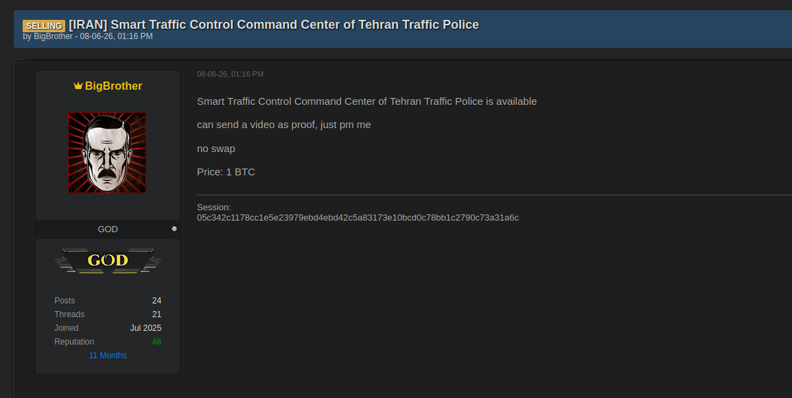
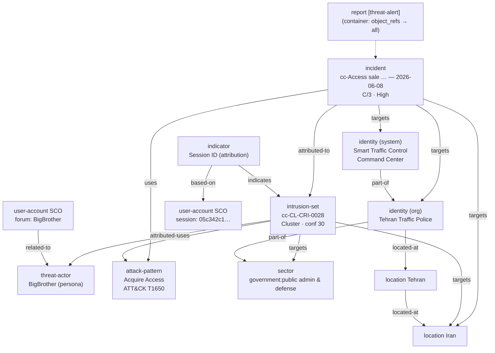

> **Worked example.**
> This is a filled-in [threat-alert](../Report-Templates/threat-alert.md) following the submission standard in [Report-Types](../Report-Types.md). Appendix A is the full object mapping, written so a deterministic builder can be generated from it; no STIX bundle ships yet ([10](../Patchwork-CTI-Framework.md#10.-samples)). `cc-` is **this member's** namespace token — pick your own ([4.2](../Patchwork-CTI-Framework.md#4.2-member-namespaces)).

## Report-metadata

| Field              | Value                                                                                      |
| ------------------ | ------------------------------------------------------------------------------------------ |
| Report Type        | `threat-alert`                                                                             |
| Title              | `cc-Access sale — Tehran Traffic Police Smart Traffic Control Command Center (BigBrother)` |
| Published          | 2026-06-08 — the observation date, and stable                                              |
| TLP                | `Amber` — dark-web sourced                                                                 |
| Author             | CTI Center                                                                                 |
| Source Reliability | `C` — Fairly reliable                                                                      |
| Info Credibility   | `3` — Possibly true                                                                        |
| Threat level       | **High** — access to an operational traffic-control system is being sold now               |
| Threat domain      | `Constituency`                                                                             |
| Activity category  | `Cybercrime`                                                                               |

## Key-judgments

- An established underground-forum persona is **offering access to an operational OT/ICS asset** — the Smart Traffic Control Command Center of the Tehran Traffic Police — for 1 BTC, with video proof offered. Access brokerage of a traffic-control system warrants High.
- The claim is **plausible but uncorroborated** (C/3). It is first-party, unverified, and the seller has an incentive to overstate. Reputation 46 over 11 months makes outright fabrication less likely, not unlikely.
- The sale implies the system is **already compromised**. The sale is evidence of an intrusion, not the intrusion itself — the initial access vector is unknown.
- The Session messenger ID is the **only durable pivot** in the observation. Infrastructure and capability are both unevidenced.
- Attribution is a single activity cluster at **Cluster tier**. There is no basis to group it with any other activity yet.

## What-happened

On 2026-06-08 13:16, a **SELLING** post appeared on an underground forum from the persona **BigBrother** (rank GOD, 24 posts, 21 threads, joined Jul 2025, reputation 46), offering access to the Smart Traffic Control Command Center of the Tehran Traffic Police. Asking price **1 BTC**, "no swap", video proof offered by PM. Contact given as a Session messenger ID.

*The post date reads DD-MM-YY. Read as MM-DD-YY it would fall in the future, and it would also be inconsistent with the persona's "Joined Jul 2025 / 11 Months" tenure.*

## Who's-affected

Tehran Traffic Police (`government:public administration and defense`), Iran — specifically the Smart Traffic Control Command Center, an OT/ICS asset `part-of` that organisation. Any operator of a comparable traffic-management deployment should treat this as a signal about the platform class, not only about the named victim.

## Immediate-actions

- Treat the named system as **presumed compromised**. Do not wait for confirmation of the sale.
- Hunt the Session ID `05c342c1…3a31a6c` across contact and messaging metadata.
- Review remote-access paths into traffic-management infrastructure — access being brokered implies a route that is still open and being monetised.
- Monitor for follow-on posts from the same persona: a completed sale, a price drop, or a re-listing all change the urgency.

## Detection

| Detection method | Detail |
| --- | --- |
| Contact-identifier hunt | Session ID `05c342c1178cc1e5e23979ebd4ebd42c5a83173e10bcd0c78bb1c2790c73a31a6c` |
| Forum monitoring | Persona `BigBrother` — further listings, price changes, proof-of-access posts |
| ATT&CK | T1650 Acquire Access (resource development) |

## Objects-referenced

The report's `object_refs` cover: the incident, the activity cluster, the persona threat-actor, the victim organisation and the system, both locations, the sector hierarchy, the attack-pattern, the indicator and its user-account observables, and the relationships among them.

## Sources

| Source | Reference | Reliability |
| --- | --- | --- |
| Underground forum listing (screenshot) | Captured 2026-06-08 | C — first-party claim, unverified |

---

# Appendix-A-—-Scenario-→-STIX-object-mapping

| Evidence in the post | STIX object | Key fields |
|---|---|---|
| The seller's activity | **`intrusion-set`** | `name: cc-CL-CRI-0028` (cluster code, §4.3), **no aliases**, `attribution_tier: Cluster`, confidence 30, `organizational-gain` + `intent: [financial]` |
| Persona **BigBrother** | **`threat-actor`** | `name: BigBrother`, `x_opencti_type: Threat-Actor-Group`, `threat_actor_types: [criminal]` — the presented identity, joined by `intrusion-set --attributed-to--> threat-actor` (§4.4) |
| The sale event itself | **`incident`** | `cc-Access sale: … — 2026-06-08`, `observed_date: 2026-06-08` (both, §9.2: the date is the structural key, the name keeps it readable), `incident_type: compromise`, `x_opencti_severity: high`¹, Admiralty **C/3** → `x_opencti_reliability: C - Fairly reliable`, confidence 60 |
| "…of Tehran Traffic Police" | `identity` (organization) | sector `government:public administration and defense` |
| "Smart Traffic Control Command Center" | `identity` (**system**) | the compromised OT/ICS asset, `part-of` the org |
| [IRAN] / Tehran | `location` ×2 | Country **Iran**, City **Tehran** (org `located-at` Tehran `located-at` Iran) |
| Access brokerage (1 BTC) | `attack-pattern` | ATT&CK **T1650 Acquire Access** (resource development) |
| Session messenger ID | **`indicator`** + `user-account` SCO | pattern on `user-account:account_login`, `indicator_types: [attribution]`, `based-on` the SCO, `indicates` the intrusion-set |
| Forum persona account | `user-account` SCO | `account_type: forum`, `related-to` the threat-actor |
| The observation as product | **`report`** | `report_types: [threat-alert]`, `published: 2026-06-08`, `threat_level: High`, `threat_domain: Constituency`, `activity_category: ["Cybercrime"]` (§9.3) |

## Relationship-graph

# Appendix-B-—-Analytic-notes

- **Why Cluster tier / confidence 30.**
	A single persona and a single observation, with no infrastructure or capability corroboration — one Diamond vertex (adversary) plus a claimed victim. Creating a temporary group would need a second cluster to link to ([4.1](../Patchwork-CTI-Framework.md#4.1-three-tiers-of-object,-linked)); the Session ID is the pivot that might one day supply one.
- **Why the persona is its own object.**
	`BigBrother` is a brand on a forum. It can be sold, abandoned after a takedown, or impersonated. Modelled as an alias of the cluster, any of those would force an edit to the activity record — and a second cluster adopting the same brand would silently merge into this one ([4.4](../Patchwork-CTI-Framework.md#4.4-personas-are-objects,-not-aliases)).
- **Why Admiralty C/3 sits on the incident, not the actor.**
	Reliability and credibility describe *this observation*. On the durable cluster they would be overwritten by the next one ([7.1](../Patchwork-CTI-Framework.md#7.1-admiralty-grading-attaches-to-the-observation)).
- **Why High threat level with only C/3 sourcing.**
	The two axes are independent ([3.4](../Patchwork-CTI-Framework.md#3.4-threat-levels)). Level reflects urgency and proximity — access to an operational traffic-control system, offered for sale today. Grade reflects how well-sourced the claim is. A thin source does not make an urgent threat less urgent; it makes it less certain.
- **Why `incident_type: compromise`.**
	An access sale implies the system is already compromised. The sale is evidence of the intrusion, not the intrusion itself.
- **Cluster code.**
	`cc-CL-CRI-0028` came from the authoring member's code registry — issued on first sight, never renumbered ([4.3](../Patchwork-CTI-Framework.md#4.3-attribution-codes-are-assigned-once-and-never-reused)). The builder pins it as a literal so the sample reproduces standalone.

¹ `severity` is a reserved property name in STIX 2.1 and the validator hard-fails on it, so the bundle carries `x_opencti_severity`. OpenCTI's incident ingest reads a top-level `severity`; rename at push time if platform-native severity is wanted.

---

