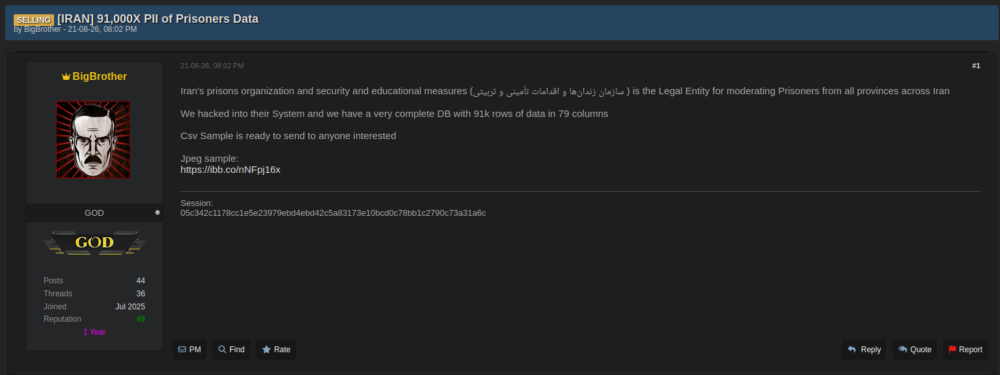
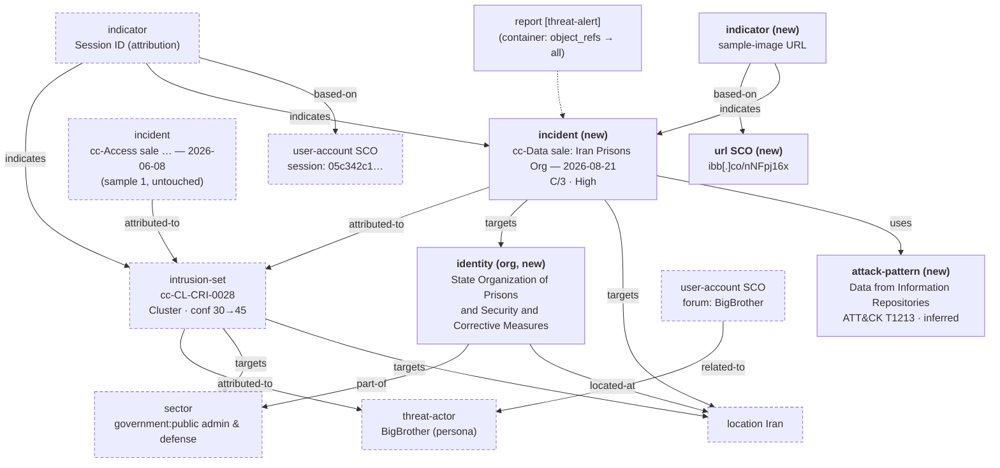

> **Worked example 2.**
> A filled-in [threat-alert](../Report-Templates/threat-alert.md) following the submission standard in [Report-Types](../Report-Types.md). Its companion is [Access-sale-scenario](Access-sale-scenario.md) — the **same activity cluster**, seen 74 days earlier. Read the two together: this one exists to show what the framework does when a tracked cluster is observed *again*, which is the case sample 1 could not exercise. `cc-` is **this member's** namespace token — pick your own ([4.2](../Patchwork-CTI-Framework.md#4.2-member-namespaces)).
>
> No STIX bundle ships with this sample yet — none do ([10](../Patchwork-CTI-Framework.md#10.-samples)). Appendix A is written so a deterministic builder can be generated from it.

## Report-metadata

| Field              | Value                                                                            |
| ------------------ | -------------------------------------------------------------------------------- |
| Report Type        | `threat-alert`                                                                   |
| Title              | `cc-Data sale — Iran Prisons Organization prisoner records (BigBrother)`         |
| Published          | 2026-08-21 — the observation date, and stable                                    |
| TLP                | `Amber` — dark-web sourced, and the subject matter is bulk personal data         |
| Author             | CTI Center                                                                       |
| Source Reliability | `C` — Fairly reliable                                                            |
| Info Credibility   | `3` — Possibly true                                                              |
| Threat level       | **High** — see *Why High* below; the argument is not sample 1's argument          |
| Threat domain      | `Constituency`                                                                   |
| Activity category  | `Cybercrime`, `Data exposure and leaks`                                          |

> **Why `threat-alert` and not `threat-activity`.**
> The compromise is finished, which is normally what pushes a report toward `threat-activity` — activity whose relevance has become elevated by current circumstances. It stays an alert because the action it demands is immediate and belongs to someone other than the analyst: the named authority has to be notified, today, that its records are being brokered. `threat-activity` would document the exposure; the alert moves it.

## Key-judgments

- The listing is **the same operator as [Access-sale-scenario](Access-sale-scenario.md)**. The Session contact ID is byte-identical to the one in the June post, and the persona's forum counters advance monotonically from it (24→44 posts, 21→36 threads, reputation 46→49, "11 Months"→"1 Year", same Jul 2025 join). This is a second observation of `cc-CL-CRI-0028`, not a new cluster.
- The seller claims a **completed breach of a national prisons authority** and offers a database of ~91,000 rows across 79 columns covering prisoners from all provinces of Iran. A CSV sample is offered on request and a JPEG sample is linked publicly.
- The claim is **plausible but uncorroborated** (C/3). It is first-party and unverified. The offered samples were deliberately **not** retrieved (see *Handling*), so nothing has been done that could raise credibility — that is a conscious trade, not an omission.
- **The data is already out.**
	Unlike the June listing, there is no access here to revoke and no window to close. This is breach response and data-subject protection, not prevention.
- Attribution stays at **Cluster** tier. Two incidents on one cluster do not make a temporary group ([4.1](../Patchwork-CTI-Framework.md#4.1-three-tiers-of-object,-linked)) — see Appendix B.

### Why-High

Sample 1 earned High from *access to an operational system being sold now* — live, ongoing, closable. **That argument does not transfer here**, and reusing it would be dishonest: the compromise is finished and the access is not on offer.

High rests instead on [3.4](../Patchwork-CTI-Framework.md#3.4-threat-levels)'s *significant incident affecting the constituency*. §3.4 flags that Patchwork deliberately does not define "significant incident" and leaves it to each member, so the assumption is stated rather than assumed: **CTI Center treats the bulk exposure of ~91,000 records held by a national authority, concerning a population that cannot take any protective action on its own behalf, as significant.** A member whose instantiation differs will grade this differently, and should.

## What-happened

On **2026-08-21 20:02**, a **SELLING** post appeared on an underground forum from the persona **BigBrother** (rank GOD, 44 posts, 36 threads, joined Jul 2025, reputation 49, tenure "1 Year"), headed `[IRAN] 91,000X PII of Prisoners Data`.

The post identifies the victim as *سازمان زندان‌ها و اقدامات تأمینی و تربیتی* — the State Organization of Prisons and Security and Corrective Measures — describing it as the legal entity responsible for prisoners across all provinces of Iran. The seller states: "We hacked into their System and we have a very complete DB with 91k rows of data in 79 columns." A CSV sample is offered to interested parties, and a JPEG sample is linked at `hxxps://ibb[.]co/nNFpj16x`. Contact is the same Session messenger ID given in June.

No price is stated, no intrusion vector is described, and no date of compromise is given.

*The post date reads DD-MM-YY, the same convention as the June listing. Read as MM-DD-YY it would be inconsistent with the persona's "Joined Jul 2025 / 1 Year" tenure and with the monotonic advance of the forum counters.*

### Handling

Recorded here because the reasoning is the point of a worked example, not only its outcome:

- **The linked JPEG sample was not retrieved, and the CSV sample was not requested.**
	Retrieving either would mean taking possession of the personal data of incarcerated people to confirm a claim that action does not depend on. The URL is recorded **defanged** — it is an artifact of the sale, not personal data, and is a legitimate observable — but nothing behind it was fetched.
- **The dataset is described and quantified, never reproduced.**
	~91,000 rows, 79 columns, and not one field name or record beyond that.
- This is [8.3](../Patchwork-CTI-Framework.md#8.3-handling-obligations-—-acknowledged,-not-specified) PII minimisation applied at collection time rather than at sharing time. §8.3 notes free-text description fields as the obvious risk surface; a screenshot and an eager analyst are another.

## Who's-affected

The **State Organization of Prisons and Security and Corrective Measures** (`government:public administration and defense`), Iran — a national authority, with the post claiming coverage of prisoners "from all provinces". Scope is therefore **national, not municipal**: no city applies, which is where this differs from sample 1's Tehran-scoped victim.

The data subjects are the population at risk, and they are the reason this is not an ordinary records breach. Incarcerated and formerly incarcerated people cannot change their identifiers, cannot monitor their own exposure, and in many cases cannot be contacted. Seventy-nine columns is far wider than an identity table, so plan for exposure beyond identifiers — the categories a corrections system typically holds (case, custodial, health, visitor and next-of-kin records) are the ones to prepare for, and several of them would extend the harm to families who were never the subject of the record. **This is inference from the stated column count, not knowledge of the schema — the sample was not opened** (see *Handling*).

Treat downstream harm — coercion, extortion, targeting on release — as the primary impact, ahead of the authority's own operational risk.

## Immediate-actions

- **Notify the named authority**, through whatever channel the member has. This outranks every other item; the victim may not know.
- Treat the authority's systems as **presumed still compromised**. No vector is stated and no eviction is evidenced, so nothing supports assuming the route is closed.
- Hunt the Session ID `05c342c1…3a31a6c` across contact and messaging metadata — the same pivot as June, now with a second observation behind it.
- Monitor for follow-on posts from `BigBrother`: a completed sale, a price appearing, a second tranche, or the dataset being dumped free. A free dump changes the response entirely.
- Watch for the dataset resurfacing on leak sites and paste services under other handles — resale and re-listing are the normal lifecycle here.
- Do **not** acquire the sample to validate the claim. If verification becomes necessary, it goes through the victim, not through the seller.

## Detection

| Detection method | Detail |
| --- | --- |
| Contact-identifier hunt | Session ID `05c342c1178cc1e5e23979ebd4ebd42c5a83173e10bcd0c78bb1c2790c73a31a6c` — shared with [Access-sale-scenario](Access-sale-scenario.md) |
| Forum monitoring | Persona `BigBrother` — further listings, price changes, proof posts, tranche 2 |
| Sample-hosting artifact | `hxxps://ibb[.]co/nNFpj16x` (defanged; not retrieved) |
| ATT&CK | T1213 Data from Information Repositories — **inferred, not evidenced** |

> **On the ATT&CK mapping.**
> The post evidences possession of a bulk database and nothing else. T1213 is the closest fit for the collection step and is recorded as inferred; initial access, exfiltration channel and persistence are all unevidenced and get no technique. Sample 1's T1650 Acquire Access is **not** carried over — no access is being brokered here, and inheriting a technique from the cluster's previous incident would be exactly the kind of quiet contamination that separate incident objects exist to prevent.

## Objects-referenced

The report's `object_refs` cover: the new incident, the existing activity cluster, the existing persona threat-actor, the victim organisation, the Iran location, the sector hierarchy, the inferred attack-pattern, the Session indicator and its user-account observables, the new sample URL observable, and the relationships among them.

## Sources

| Source | Reference | Reliability |
| --- | --- | --- |
| Underground forum listing (screenshot) | Captured 2026-08-21 | C — first-party claim, unverified |
| Prior observation, same cluster | [Access-sale-scenario](Access-sale-scenario.md) — 2026-06-08 | C — corroborates the *operator*, not this claim |

---

# Appendix-A-—-Scenario-→-STIX-object-mapping

**Reused** objects already exist from sample 1 and must not be recreated; recreating them would fork the cluster. **New** objects are additive.

| Evidence in the post | STIX object | New / reused | Key fields |
|---|---|---|---|
| The seller's activity | **`intrusion-set`** | **reused** | `name: cc-CL-CRI-0028` — the *same* code, not a new one ([4.3](../Patchwork-CTI-Framework.md#4.3-attribution-codes-are-assigned-once-and-never-reused)). Still `attribution_tier: Cluster`. Confidence **30 → 45** |
| Persona **BigBrother** | **`threat-actor`** | **reused** | Description refreshed to the 2026-08-21 counters (44 posts / 36 threads / rep 49). Same object, same `attributed-to` edge |
| The sale event itself | **`incident`** | **new** | `cc-Data sale: Iran Prisons Organization — 2026-08-21`, `observed_date: 2026-08-21` (both, [9.2](../Patchwork-CTI-Framework.md#9.2-identity-and-merge-rules): the date is the structural key, the name keeps it readable), `incident_type: compromise`, `x_opencti_severity: high`, Admiralty **C/3** → `x_opencti_reliability: C - Fairly reliable`, confidence 60 |
| "…prisons organization…" | `identity` (organization) | **new** | State Organization of Prisons and Security and Corrective Measures, sector `government:public administration and defense` |
| "[IRAN]" / "all provinces" | `location` | **reused** | Country **Iran** only. **No city object** — the victim is a national authority, unlike sample 1's Tehran-scoped one |
| "91k rows … 79 columns" | *(no object)* | — | Recorded in the incident description as a quantity. No `observed-data`, no artifact, nothing derived from the sample |
| Bulk DB in the seller's hands | `attack-pattern` | **new** | ATT&CK **T1213 Data from Information Repositories**, flagged inferred in the incident description |
| Session messenger ID | **`indicator`** + `user-account` SCO | **reused** | Same pattern on `user-account:account_login`, `indicator_types: [attribution]`. Add `indicates` → the new incident; the `indicates` → intrusion-set edge already exists |
| Forum persona account | `user-account` SCO | **reused** | `account_type: forum`, `related-to` the threat-actor |
| Sample image link | `url` SCO + `indicator` | **new** | `url:value = 'https://ibb.co/nNFpj16x'`, `indicator_types: [attribution]`, `based-on` the SCO. Defanged in prose only — STIX patterns carry the live value |
| The observation as product | **`report`** | **new** | `report_types: [threat-alert]`, `published: 2026-08-21`, `threat_level: High`, `threat_domain: Constituency`, `activity_category: ["Cybercrime", "Data exposure and leaks"]` ([9.3](../Patchwork-CTI-Framework.md#9.3-classification-properties)) |

## Relationship-graph

Dashed nodes already existed before this report; solid nodes are new.

# Appendix-B-—-Analytic-notes

- **Why this is not a temporary group — the point of this sample.**
	Two observations of the same operator look like grounds for promotion, and under Mandiant's or Unit 42's rename-in-place model something would change here. Under Patchwork nothing does. The promotion gate at [4.1](../Patchwork-CTI-Framework.md#4.1-three-tiers-of-object,-linked) requires a relationship between **≥2 clusters**; what exists here is **one cluster with two incidents**. A cluster is "one coherent body of activity", and same persona plus byte-identical contact ID is as coherent as a body of activity gets. Creating `cc-TGR-CRI-####` over a single cluster would assert a grouping with nothing to group.

- **What *would* promote it.** A second, independently-coded cluster that links to this one — the Session ID reappearing under a different handle in unrelated activity, shared infrastructure, or a matching data-handling pattern (same forum, same sample-hosting service, same column-count boasting) traced to a body of activity we did not already attribute to BigBrother. Then two clusters exist, a `related-to` or `part-of` edge is warranted, and a temporary group has something to sit above.

- **Why raising cluster confidence 30 → 45 does not break the additive rule.**
	§4.1 forbids rewriting *history*; it does not freeze an assessment. The section says confidence "describes the assessment", and the assessment has genuinely improved: two observations, two distinct victims, and a durable pivot present in both. Nothing historical is disturbed — the June incident object, its C/3 grading and its own confidence are untouched, and a reader can still reconstruct exactly what was believed on 2026-06-08. Confidence 45 keeps it below any hand-wave promotion threshold, which is appropriate: still one Diamond vertex firmly evidenced (adversary), with victims claimed but capability and infrastructure unevidenced.

- **Why the code is reused, not reissued.**
	`cc-CL-CRI-0028` was issued on first sight and is never renumbered ([4.3](../Patchwork-CTI-Framework.md#4.3-attribution-codes-are-assigned-once-and-never-reused)). Issuing `cc-CL-CRI-00xx` for this listing would fork the cluster and strand June's evidence in a separate object. Note also that the registry is keyed by the **cluster**, not the persona — if BigBrother turned out to be a shared or sold account tomorrow, the code would stay put and the correction would happen on the `attributed-to` edge.

- **Why the persona is refreshed but not forked.**
	The brand is the same brand ([4.4](../Patchwork-CTI-Framework.md#4.4-personas-are-objects,-not-aliases)). Updating the threat-actor description with the new counters is a fact refresh on a presented identity, and it costs nothing analytically — precisely because the persona is a separate object, none of the activity record moves when it changes. Had the handle been carried as an alias of the intrusion-set instead, this second listing under an evolved profile would have had nowhere clean to go.

- **Why Admiralty grading sits on the new incident, not the cluster.**
	The June observation was graded C/3 and this one is graded C/3 independently ([7.1](../Patchwork-CTI-Framework.md#7.1-admiralty-grading-attaches-to-the-observation)). They happen to match; if this listing had arrived with corroboration from the victim it would be C/2 or B/2 and June's C/3 would still stand. A grade on the cluster would be overwritten by whichever observation landed last, which is the failure mode §7.1 exists to prevent.

- **Why two activity categories.**
	`Cybercrime` covers the monetisation; `Data exposure and leaks` covers what actually happens to the data subjects. [5.2](../Patchwork-CTI-Framework.md#5.2-activity-categories) states these overlap by design and that an activity may carry more than one — this is that case, and dropping the second would erase the harm from the record. The cluster's MOT class stays `CRI`; the two vocabularies answer different questions and neither derives from the other.

- **Why `incident_type: compromise` and not something about theft.**
	"We hacked into their System" is a compromise claim, and `compromise` is the value sample 1 already emits — reusing it keeps the two incidents queryable as one series. Patchwork defines no `incident_type_ov` of its own ([Vocabularies](../Vocabularies.md) defines no incident-type vocabulary), so coining `data-theft` here would invent a private value in a framework whose stated rationale for its vocabularies is conformance. The *sale of already-exfiltrated data* is carried in the incident description, where prose belongs, not in a made-up enum.
