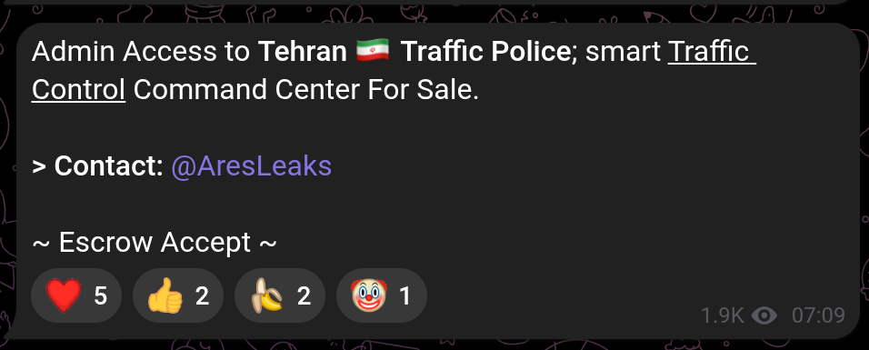
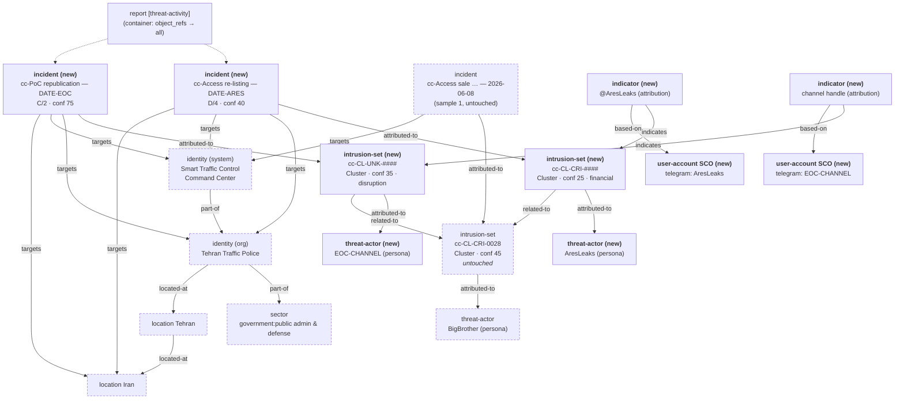

> **Worked example 3.**
> A filled-in [threat-activity](../Report-Templates/threat-activity.md) report following the submission standard in [Report-Types](../Report-Types.md). Its companions are [Access-sale-scenario-1](Access-sale-scenario-1.md) and [Access-sale-scenario-2](Access-sale-scenario-2.md). This one exists to exercise [4.8](../Patchwork-CTI-Framework.md#4.8-when-several-actors-claim-one-activity): what the framework does when *other* actors start trading and republishing a compromise a tracked cluster already advertised. `cc-` is **this member's** namespace token — pick your own ([4.2](../Patchwork-CTI-Framework.md#4.2-member-namespaces)).
>
> No STIX bundle ships with this sample yet — none do ([10](../Patchwork-CTI-Framework.md#10.-samples)). Appendix A is written so a deterministic builder can be generated from it.

> ⚠️ **Values still to fill before this sample ships.**
> Six observed values are held as `<<placeholders>>` rather than invented. Cluster codes especially: they come from the member's own registry, are issued on first sight and are never renumbered ([4.3](../Patchwork-CTI-Framework.md#4.3-attribution-codes-are-assigned-once-and-never-reused)), so guessing one is the single unrecoverable mistake available here.
>
> | Placeholder | What it needs |
> |---|---|
> | `<<CL-CRI-CODE>>` | Next free `cc-CL-CRI-####` from the code registry |
> | `<<CL-UNK-CODE>>` | Next free `cc-CL-UNK-####` from the code registry |
> | `<<DATE-ARES>>` | Date of the `@AresLeaks` listing (the export carries only the time, 07:09) |
> | `<<DATE-EOC>>` | Date of the republication post (the export carries only `edited 12:22`) |
> | `<<EOC-CHANNEL>>` | The republishing channel's name or handle |
> | `<<SCREENSHOT-*>>` | Capture filenames under `../Resources/` |

## Report-metadata

| Field              | Value                                                                                      |
| ------------------ | ------------------------------------------------------------------------------------------ |
| Report Type        | `threat-activity`                                                                          |
| Title              | `cc-Re-listing and republication — Tehran Traffic Police Smart Traffic Control Command Center` |
| Published          | `<<DATE-ARES>>` — the earliest activity the report covers, and stable ([9.2](../Patchwork-CTI-Framework.md#9.2-identity-and-merge-rules)) |
| TLP                | `Amber` — dark-web and closed-channel sourced                                              |
| Author             | CTI Center                                                                                 |
| Source Reliability | Per observation — `D` and `C`; see *Sources*. **Not** one grade for the report              |
| Info Credibility   | Per observation — `4` and `2`; see *Sources*                                                |
| Threat level       | **High** — the access first advertised in June is still being brokered, and the proof of compromise is now public at scale |
| Threat domain      | `Constituency`                                                                             |
| Activity category  | `Cybercrime`, `Hacktivism`, `Data exposure and leaks`                                      |

> **Why `threat-activity` and not a third `threat-alert`.**
> Samples 1 and 2 were alerts because each demanded an action from someone else, immediately: notify the authority, treat the system as compromised. Those actions were issued on 2026-06-08 and stand unchanged — nothing here supersedes them, and re-issuing them as a new alert would spend urgency the recipient has already been asked for. What is new is that the activity's *relevance has become elevated*: two further actors are now trading and amplifying it, which is [Report-Types](../Report-Types.md)' definition of `threat-activity` almost word for word.

> **Why the grading is per-observation and not per-report.**
> The metadata block above carries two grades because the two observations assert different things and are sourced differently ([7.1](../Patchwork-CTI-Framework.md#7.1-admiralty-grading-attaches-to-the-observation)). Collapsing them to one report-level grade would average a doubtful sale claim against a directly-corroborated republication and lose both. Samples 1 and 2 each carried a single grade because each covered a single observation.

## Key-judgments

- **Two further actors are now trading the June access, and neither is `cc-CL-CRI-0028`.** One Telegram account is re-listing the access for sale; one channel has republished `cc-CL-CRI-0028`'s proof-of-access material inside a political analysis of the same system. Each is recorded as its own activity cluster ([4.8](../Patchwork-CTI-Framework.md#4.8-when-several-actors-claim-one-activity)).
- **They sit in different MOT classes, which is the point.** The re-lister is `CRI` with `intent: [financial]`; the republisher is `UNK` — where [5.1](../Patchwork-CTI-Framework.md#5.1-the-analyst-facing-motivation-classes) maps hacktivism — with `intent: [disruption]`. One compromise, two claimants, two code prefixes. Shared subject matter is not shared identity.
- **The re-listing is doubtful and is graded as such (D/4).** `@AresLeaks` offers no proof of its own, escalates the claim from "access" to "**Admin** access", and hides "Escrow Accept" behind a spoiler. Audience reaction includes a clown-face. None of that is proof of a scam; all of it is why credibility is `4` and not higher.
- **The republication, by contrast, is well corroborated (C/2).** What that incident asserts is not "this channel holds access" — it asserts "this channel published this material", and that was verified by comparing the post against sample 1's capture. The two incidents differ by 35 confidence points because they claim different things, not because one actor is more trustworthy.
- **`cc-CL-CRI-0028` is untouched.** No alias, no confidence change, no new incident on it. A third party paying for or amplifying a tracked actor's goods is a market signal, not corroboration of the original claim.
- **This is not a temporary group.** Three clusters now exist with edges between them, but the only vertex they share is Victim, and [4.6](../Patchwork-CTI-Framework.md#4.6-minimum-evidence-for-promotion) rules victim overlap out on its own. See Appendix B.
- **The victim's exposure has materially worsened even though no new compromise occurred.** The proof of compromise is now in front of a five-figure audience, and the republication supplies operational detail about the same system that was not public before.

## What-happened

### The re-listing — `@AresLeaks`

On `<<DATE-ARES>>` at 07:09, a Telegram post offered *"Admin Access to Tehran 🇮🇷 Traffic Police; smart Traffic Control Command Center For Sale."* Contact is given as the Telegram handle `@AresLeaks`. The words "Escrow Accept" are placed inside a Telegram **spoiler** entity. No price is stated, no proof is offered, and no sample is linked.

The post reached 1,940 views and 26 shares, with reactions ❤️ 5 · 👍 2 · 🍌 2 · 🤡 1.

*Telegram post re-listing access to the traffic-control system*

Three features are worth recording because they bear on the grading and on nothing else:

- **The claim is escalated.**
	`cc-CL-CRI-0028` offered *access*; this post offers *Admin* access. An escalation unaccompanied by any new evidence is the ordinary shape of a resale pitch, and equally the ordinary shape of a fabrication.
- **No proof is offered at all.**
	The June listing offered video proof by PM. This one offers nothing, which is why it evidences no capability and receives no `attack-pattern` ([4.8](../Patchwork-CTI-Framework.md#4.8-when-several-actors-claim-one-activity)).
- **The audience is signalling doubt.**
	A clown-face reaction on a sale post is a forum-culture accusation of fraud. It is one reaction against nine, from an unmeasured population, and is recorded as colour rather than as evidence — it does not move the grade on its own.

### The republication — `<<EOC-CHANNEL>>`

On `<<DATE-EOC>>` (post edited 12:22), a channel published a Persian-language analysis titled *«مرکز کنترل بحران شهر تهران، شریان اصلی سرکوب اعتراضات»* — "Tehran's crisis-control centre, the main artery of protest suppression" — together with a PDF attachment, `نقش سیستم EOC در سرکوب.pdf` (978.8 KB), and the hashtag `#انقلاب_شیروخورشید`.

**The post republishes `cc-CL-CRI-0028`'s proof-of-access material**, which is what brings it inside the framework at all.

The analysis describes the same facility sample 1 names as the Smart Traffic Control Command Center, under its emergency-operations designation, and asserts that during street protests it functions as a joint command post for security bodies; that it is used to shut metro and BRT lines serving protest areas and to impose targeted local blackouts; that municipal crisis-management depots are repurposed for staging and short-term detention; and that its camera network is connected to facial-recognition processing at intelligence services. It places the centre in western Tehran.

The post reached 13,502 views and 166 shares.

*Screenshot pending: `<<SCREENSHOT-EOC>>` (not included in this draft).*

### Handling

- **The PDF was not retrieved.**
	Its name and size are recorded as artifacts of the post; nothing behind it was fetched. This is the same collection-time minimisation sample 2 applied to the CSV and JPEG samples ([8.3](../Patchwork-CTI-Framework.md#8.3-handling-obligations-—-acknowledged,-not-specified)).
- **The republished proof material is described, never reproduced.**
	It is identified as matching sample 1's capture and is not carried into this report.
- **The channel's assertions about suppression are reported as its claims, not adopted as findings.**
	They are recorded because they change the victim's risk picture and because they are the reason the republication is `Hacktivism` rather than `Cybercrime`. The framework takes no position on their accuracy, and [4.5](../Patchwork-CTI-Framework.md#4.5-attribution-doctrine) keeps it out of political attribution.

## Who's-affected

**Tehran Traffic Police** (`government:public administration and defense`), Iran, and specifically the **Smart Traffic Control Command Center** — the same organisation and the same OT/ICS asset as [Access-sale-scenario-1](Access-sale-scenario-1.md). No new victim is introduced by either observation, and that is what makes the three clusters comparable at all ([4.8](../Patchwork-CTI-Framework.md#4.8-when-several-actors-claim-one-activity)).

The victim's position is worse than it was on 2026-06-08 without any new intrusion having occurred:

- **The proof of compromise is now public at scale.**
	It was previously offered by private message to prospective buyers. It has now been seen by a five-figure audience, which broadens both the buyer pool and the set of people who know the system is exposed.
- **The system's function is now described publicly in operational detail.**
	Camera-network integration, downstream processing, and the facility's role during civil unrest were not previously in open circulation attached to a compromise claim. Whether or not the channel's characterisation is accurate, the description is now targeting material.
- **Exposure has widened beyond the organisation.**
	If the asserted camera and facial-recognition integration is real, the population reachable through this system is the public in a monitored city, not only the operator. That does not change the sector or the victim identity; it changes what a successful buyer could do, and it belongs in the risk picture.

## Immediate-actions

- **The actions from [Access-sale-scenario-1](Access-sale-scenario-1.md) stand and are not superseded.** Treat the system as presumed compromised; the access was never evidenced as closed.
- **Re-notify the authority, with the new fact.** The original notification concerned one seller. It is now being brokered by at least one other party and its proof material is public. That is a change the recipient has not been told about.
- Hunt the Telegram handle `@AresLeaks` across contact and messaging metadata, and check it against the Session ID from samples 1 and 2 — **if they resolve to one operator this is a second front, not a third party**, and the record collapses to one cluster ([4.8](../Patchwork-CTI-Framework.md#4.8-when-several-actors-claim-one-activity)).
- Monitor `<<EOC-CHANNEL>>` for further tranches, and for the underlying access being dumped rather than sold. A free dump changes the response entirely.
- Watch for **further re-listings**. Two claimants in a few weeks is the shape of an access being shopped around, and each new one is a new cluster, not an update to an existing one.
- Do **not** acquire access or retrieve the PDF to validate either claim. Verification goes through the victim.

## Detection

| Detection method | Detail |
| --- | --- |
| Contact-identifier hunt | Telegram handle `@AresLeaks` |
| Contact-identifier correlation | Session ID `05c342c1…3a31a6c` — check against `@AresLeaks`; shared with [Access-sale-scenario-1](Access-sale-scenario-1.md) and [Access-sale-scenario-2](Access-sale-scenario-2.md) |
| Channel monitoring | `<<EOC-CHANNEL>>` — further tranches, dumps, follow-on analyses |
| Artifact | `نقش سیستم EOC در سرکوب.pdf` (978.8 KB) — recorded by name and size; **not retrieved** |
| ATT&CK | **None.** Neither observation evidences a technique — see Appendix B |

## Objects-referenced

The report's `object_refs` cover: the two new incidents, the two new activity clusters, the two new persona threat-actors, the existing `cc-CL-CRI-0028` cluster, the existing victim organisation and system identities, both locations, the sector hierarchy, the two new contact-identifier indicators with their user-account observables, and the relationships among them.

## Sources

| Source | Reference | Reliability | Credibility |
| --- | --- | --- | --- |
| Telegram re-listing (screenshot) | Captured `<<DATE-ARES>>` | `D` — no track record, no proof offered, claim escalated | `4` — doubtful |
| Telegram republication (screenshot) | Captured `<<DATE-EOC>>` | `C` — fairly reliable channel | `2` — probably true; the republication is directly corroborated against sample 1's capture |
| Prior observations, originating cluster | [Access-sale-scenario-1](Access-sale-scenario-1.md) — 2026-06-08, [Access-sale-scenario-2](Access-sale-scenario-2.md) — 2026-08-21 | `C` — establishes what was originally advertised, and by whom | — |

---

# Appendix-A-—-Scenario-→-STIX-object-mapping

**Reused** objects already exist from samples 1 and 2 and must not be recreated. **New** objects are additive. Nothing already in the store is edited except one description refresh, noted below.

| Evidence | STIX object | New / reused | Key fields |
|---|---|---|---|
| The re-lister's activity | **`intrusion-set`** | **new** | `name: cc-<<CL-CRI-CODE>>`, **no aliases**, `attribution_tier: Cluster`, confidence 25, `primary_motivation: organizational-gain`, `intent: ["financial"]` |
| Persona **AresLeaks** | **`threat-actor`** | **new** | `name: AresLeaks`, `x_opencti_type: Threat-Actor-Group`, `threat_actor_types: [criminal]`, `intent: ["financial"]`; joined by `intrusion-set --attributed-to--> threat-actor` ([4.4](../Patchwork-CTI-Framework.md#4.4-personas-are-objects,-not-aliases)) |
| The re-listing event | **`incident`** | **new** | `cc-Access re-listing: Tehran Traffic Police Smart Traffic Control Command Center — <<DATE-ARES>>`, `observed_date: <<DATE-ARES>>`, `incident_type: compromise`, `x_opencti_severity: high`, Admiralty **D/4** → `x_opencti_reliability: D - Not usually reliable`, **confidence 40**, `activity_category: ["Cybercrime"]` |
| The republisher's activity | **`intrusion-set`** | **new** | `name: cc-<<CL-UNK-CODE>>`, **no aliases**, `attribution_tier: Cluster`, confidence 35, `intent: ["disruption"]`. **`UNK`, not `CRI`** — [5.1](../Patchwork-CTI-Framework.md#5.1-the-analyst-facing-motivation-classes) maps hacktivism there |
| Persona **`<<EOC-CHANNEL>>`** | **`threat-actor`** | **new** | `x_opencti_type: Threat-Actor-Group`, `threat_actor_types: [hacktivist]`, `intent: ["disruption"]` |
| The republication event | **`incident`** | **new** | `cc-Proof-of-access republication: Tehran Traffic Police Smart Traffic Control Command Center — <<DATE-EOC>>`, `observed_date: <<DATE-EOC>>`, `incident_type: compromise` — carried **only** so the three observations stay queryable as one series; this actor neither performed nor claims a compromise, and Patchwork defines no `incident_type_ov` to say so more precisely ([9.3](../Patchwork-CTI-Framework.md#9.3-classification-properties)), `x_opencti_severity: high`, Admiralty **C/2** → `x_opencti_reliability: C - Fairly reliable`, **confidence 75**, `activity_category: ["Hacktivism", "Data exposure and leaks"]` |
| The originating cluster | **`intrusion-set`** | **reused, unedited** | `cc-CL-CRI-0028` — confidence stays **45**, no alias added, no new incident attached ([4.8](../Patchwork-CTI-Framework.md#4.8-when-several-actors-claim-one-activity)) |
| Persona **BigBrother** | `threat-actor` | **reused, unedited** | — |
| Tehran Traffic Police | `identity` (organization) | **reused** | sector `government:public administration and defense` |
| Smart Traffic Control Command Center | `identity` (**system**) | **reused, description refreshed** | The republication supplies function detail — camera-network integration, emergency-operations role. A fact refresh on the victim record, which [4.8](../Patchwork-CTI-Framework.md#4.8-when-several-actors-claim-one-activity) does not forbid; it forbids editing the originating *cluster* |
| [IRAN] / Tehran | `location` ×2 | **reused** | Country **Iran**, City **Tehran** |
| `@AresLeaks` | **`indicator`** + `user-account` SCO | **new** | pattern on `user-account:account_login`, `account_type: telegram`, `pattern_type: stix`, `valid_from: <<DATE-ARES>>`, `indicator_types: [attribution]`, `based-on` the SCO, `indicates` `cc-<<CL-CRI-CODE>>` ([9.6](../Patchwork-CTI-Framework.md#9.6-indicators-and-sightings)) |
| `<<EOC-CHANNEL>>` | **`indicator`** + `user-account` SCO | **new** | same shape, `valid_from: <<DATE-EOC>>`, `indicates` `cc-<<CL-UNK-CODE>>` |
| The PDF attachment | *(no object)* | — | Name and size recorded in the incident description. Not retrieved, so no hash and no `file` SCO — the same trade sample 2 made on the CSV |
| The suppression claims | *(no object)* | — | Recorded in the incident description as the channel's assertions. The framework has no object type for a political claim and takes no position on it ([4.5](../Patchwork-CTI-Framework.md#4.5-attribution-doctrine)) |
| Attack patterns | *(no object)* | — | **Neither incident gets one.** See Appendix B |
| Link to the originating cluster | **`relationship`** ×2 | **new** | `cc-<<CL-CRI-CODE>> --related-to--> cc-CL-CRI-0028` and `cc-<<CL-UNK-CODE>> --related-to--> cc-CL-CRI-0028`, each carrying its meaning in `description` ([4.8](../Patchwork-CTI-Framework.md#4.8-when-several-actors-claim-one-activity)) |
| The observation as product | **`report`** | **new** | `report_types: [threat-activity]`, `published: <<DATE-ARES>>`, `threat_level: High`, `threat_domain: Constituency` ([9.3](../Patchwork-CTI-Framework.md#9.3-classification-properties)) |

**The two `relationship` descriptions, in full** — this is where the meaning lives, because [9.1](../Patchwork-CTI-Framework.md#9.1-the-object-graph) registers no relationship type for either situation and coining one is not on the table:

- `cc-<<CL-CRI-CODE>> --related-to--> cc-CL-CRI-0028`
	*"Re-listing for sale of the access first advertised by cc-CL-CRI-0028 on 2026-06-08. Same victim organisation and same system; no shared contact identifier, infrastructure or capability observed. No claim that these are one operator."*
- `cc-<<CL-UNK-CODE>> --related-to--> cc-CL-CRI-0028`
	*"Republication of cc-CL-CRI-0028's proof-of-access material inside a political analysis of the same system, verified by comparison against the 2026-06-08 capture. No claim that these are one operator."*

## Relationship-graph

Dashed nodes already existed before this report; solid nodes are new.

# Appendix-B-—-Analytic-notes

- **Why two new clusters — the point of this sample.**
	Samples 1 and 2 showed one operator observed twice. This shows two *other* operators trading what that operator advertised, which is the case [4.8](../Patchwork-CTI-Framework.md#4.8-when-several-actors-claim-one-activity) exists for. Both claimants clear [3.1](../Patchwork-CTI-Framework.md#3.1-malicious-activity-of-interest)'s gate — one by brokering access, one by redistributing stolen material — so both earn objects. Folding either into `cc-CL-CRI-0028` would assert they are one operator, which nothing supports; putting `AresLeaks` in that cluster's `aliases` would assert it *and* fuse the two irreversibly under [9.2](../Patchwork-CTI-Framework.md#9.2-identity-and-merge-rules)'s name key.

- **Why they land in different MOT classes.**
	The re-lister sells, so it is `CRI` with `intent: ["financial"]`. The republisher sells nothing; it redistributes the material to make a political argument, which is hacktivism, which [5.1](../Patchwork-CTI-Framework.md#5.1-the-analyst-facing-motivation-classes) maps to `UNK`, and [5.3](../Patchwork-CTI-Framework.md#5.3-intent) turns into `intent: ["disruption"]`. The two therefore carry different code prefixes — `cc-CL-CRI-####` and `cc-CL-UNK-####` — for activity about a single compromise. That divergence is the most legible thing in the record: it says in the identifier itself that shared subject matter is not shared identity.

- **Why `related-to` and not `derived-from`.**
	`derived-from` is the edge that looks right and is not. [4.1](../Patchwork-CTI-Framework.md#4.1-three-tiers-of-object,-linked) glosses it *successor, rebrand, splinter* — every reading is a claim about **operator continuity**. A reseller does not descend from the broker it bought from any more than a shop descends from its wholesaler, and a channel republishing a screenshot descends from nobody. `related-to` is defined as *a link is observed between two clusters, with no grouping claim yet*, which is the entire claim being made here.

- **Why no relationship type was coined for this.**
	`resells-access-of` and `republishes-proof-of` would both have been more expressive than `related-to`, and both were rejected. [9.1](../Patchwork-CTI-Framework.md#9.1-the-object-graph) registers exactly one framework-defined relationship type and says a registry that over-claimed *"would reproduce, in a new place, the exact error it was written to fix"*. The expressiveness goes into the relationship `description` instead, where it travels with the assertion and costs no one a vocabulary extension.

- **Why the two incidents are graded 35 points apart.**
	This is the note worth reading twice. `D/4` on the re-listing and `C/2` on the republication is not a ranking of the two actors' honesty — it is a consequence of **what each incident asserts**. The re-listing asserts *"I hold admin access to this system"*: unproven, escalated over the original claim, from an account with no track record. The republication asserts *"this channel published this material"*: something we observed ourselves and corroborated by comparing the post against sample 1's capture. A claim you can check is better sourced than a claim you cannot, regardless of who makes it. [7.1](../Patchwork-CTI-Framework.md#7.1-admiralty-grading-attaches-to-the-observation) grades observations for exactly this reason.

- **Why the cluster confidences are 25 and 40, and why neither equals its incident's.**
	Cluster confidence is confidence in the *clustering* ([4.1](../Patchwork-CTI-Framework.md#4.1-three-tiers-of-object,-linked)), never in the truth of the claim. `cc-<<CL-CRI-CODE>>` sits at 25 — below sample 1's opening 30 — because a bare handle on one post is less to cluster on than sample 1's persona with a rank, a post count and eleven months of tenure. `cc-<<CL-UNK-CODE>>` sits at 35 — above the re-lister because an established channel with visible reach and a corroborated artifact delimits a firmer body of activity, and below `cc-CL-CRI-0028`'s 45 because that cluster has two observations behind it and this one has a single post. Both numbers differ from their incidents' 40 and 75, which is the separation working: if a cluster's confidence ever tracked its incident's credibility, one of the two meanings would be doing nothing.

- **Why neither incident gets an `attack-pattern`.**
	Sample 1 emitted **T1650 Acquire Access** because a listing with offered video proof evidences brokerage. Neither observation here evidences anything. `@AresLeaks` offers no proof at all, so T1650 would record a *claim* as a *technique*. The republisher performed no technique — publishing someone else's screenshot is not a TTP. Inheriting sample 1's T1650 onto either would be the quiet contamination that separate incident objects exist to prevent, and it is the same call sample 2 made when it refused to carry T1650 forward.

- **Why High survives a D/4 observation.**
	[3.4](../Patchwork-CTI-Framework.md#3.4-threat-levels) states the two axes are independent and offers *D4 and High* as its own worked case. The level answers *how urgent and how close*: access to an operational traffic-control system in the constituency is being brokered by more parties than before, and its proof of compromise is now in front of a five-figure audience. The grade answers *how good is the sourcing of this particular claim*, and for the re-listing it is poor. Averaging them into one priority number would lose both.

- **Why `cc-CL-CRI-0028` is not edited at all.**
	Not renamed, no alias, no confidence change, no incident attached. It is tempting to read a third party re-selling the access as weak corroboration that the access is real — someone with money believed it. That is a market signal, not evidence: the buyer may have been defrauded, and the re-lister may hold nothing. The June and August gradings describe the June and August observations and are not improved by what other people say afterwards. Only new evidence about the compromise itself would move them.

- **Why this is still not a temporary group.**
	Sample 2 said the missing ingredient was a second cluster to link to. Three clusters now exist with `related-to` edges between them, so the reach for `cc-TGR-CRI-####` is predictable — and [4.6](../Patchwork-CTI-Framework.md#4.6-minimum-evidence-for-promotion) still refuses. The gate needs **two** Diamond vertices in common with at least one being Capability or Infrastructure, and here the only shared vertex is **Victim**, which §4.6 rules out on its own. No shared contact identifier, no shared infrastructure, no shared tooling. A resale chain is a market, not an operator. Promoting on shared subject matter would produce a group whose members' only common property is that they all read the same forum.

- **Why no `Global` campaign was authored.**
	[9.4](../Patchwork-CTI-Framework.md#9.4-curation-layer)'s `Global` type would fit the words — unrelated actors converging on a shared resource — and was deliberately declined. Two claimants over a few weeks is a lifecycle, not yet a phenomenon worth its own object with its own `first_seen`, and §9.4 warns that a shared theme is cheap to detect while a campaign is not a trend. The clusters, the edges and the per-incident grading carry the analysis without it. If further claimants appear, authoring one becomes the right call and costs nothing retrospectively — it is an added object, like everything else in this framework.

- **What would collapse this model.**
	If `@AresLeaks` resolves to the Session ID from samples 1 and 2, this is `cc-CL-CRI-0028` running a second storefront, and the correct record is one cluster with a third incident — exactly the shape sample 2 documented. That check belongs **before** the codes are minted, because codes are issued on first sight and never renumbered ([4.3](../Patchwork-CTI-Framework.md#4.3-attribution-codes-are-assigned-once-and-never-reused)); a code issued to a sockpuppet stays issued.

- **What would promote this.**
	The same thing sample 2 named: evidence that binds two of these clusters at the Capability or Infrastructure vertex. Shared hosting for the proof material, a wallet reused across listings, a common tool for scraping and re-listing, or the same contact identifier surfacing in activity we did not already attribute. Until then, three clusters and two edges is the honest record.
