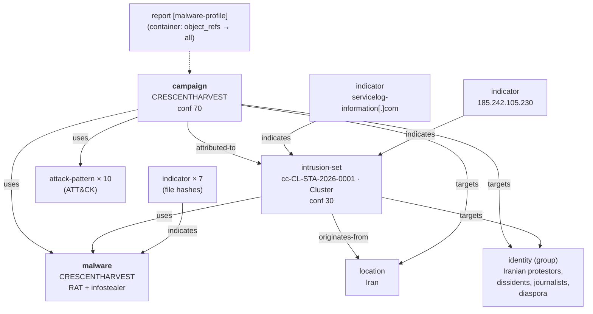

> **Worked example 3.**
> A filled-in [malware-profile](../Report-Templates/malware-profile.md) for a real, third-party-reported campaign — standardised into Patchwork's model rather than authored from an original observation. No STIX bundle ships with this sample yet — none do ([10](../Patchwork-CTI-Framework.md#10-samples)). Appendix A is the full object mapping, written so a deterministic builder can be generated from it. `cc-` is **this member's** namespace token — pick your own ([4.2](../Patchwork-CTI-Framework.md#42-member-namespaces)).
>
> Unlike the Access-sale scenarios, this is not a CTI Center original observation: it standardises a public Acronis Threat Research Unit (TRU) report into Patchwork's object model. That distinction is itself worth showing — most of what a member ingests will be someone else's reporting, not their own telemetry.

## Report-metadata

| Field              | Value                                                                                                       |
| ------------------ | ----------------------------------------------------------------------------------------------------------- |
| Report Type        | `malware-profile` — see *Why this report type*                                |
| Title              | CRESCENTHARVEST: Iranian protestors and dissidents targeted in cyberespionage campaign                      |
| Published          | 2026-07-09 — Acronis TRU's analysis/report date                                                             |
| TLP                | `Clear` — public vendor blog post                                                                           |
| Author             | Acronis Threat Research Unit (TRU) — *standardised by CTI Center*                                           |
| Source Reliability | `B` — Usually reliable (named vendor research unit, technical detail, verifiable IOCs)                      |
| Info Credibility   | `2` — Probably true (specific, verifiable technical claims; TTP and code overlaps independently reported by Check Point) → `confidence: 75` by §7.1's fixed lookup |
| Threat level       | **Medium** — see *Why Medium* below                                                                         |
| Threat domain      | `World` — see *Why World*                                                                                   |
| Activity category  | `Cyberespionage & prepositioning`                                                                           |

> **Why this report type.**
> [Report-Types](../Report-Types.md) defines `malware-profile` as technical analysis of a representative sample of a code family — file characteristics, host- and network-based indicators, configuration information, and details of code execution. That is what this report carries: the side-loading chain, the implant's capability set, and seven file hashes. CRESCENTHARVEST is both the campaign and the malware family's name, and the source report is built around the implant's mechanics as much as the campaign's targeting.
>
> **One report, one type**, as every template requires. Two other values were considered and rejected, and the reasoning is worth more here than a union would be:
>
> - `actor-profile` —
> 	the report refuses attribution and holds the adversary at Cluster tier, confidence 30. There is no standing actor picture to profile.
> - `threat-report` —
> 	the [feed-assigned](<../Report-Types.md#feed-assigned-types-11--no-template>) values classify an imported report that has **no finer classification** available. This one has a finer classification. Note the reason is *not* that the report was standardised by hand — it is ingested third-party reporting, as the header above says.
>
> **Why Medium.**
> [3.4 Threat levels](../Patchwork-CTI-Framework.md#34-threat-levels) lists "a focused espionage campaign against a sector of interest" as its own Medium example — this is that case. It is not High: nothing here evidences current, direct targeting of a specific member's constituency the way the Access-sale scenarios' named national authority does.
>
> **Why World.**
> [3.3 Threat domains](../Patchwork-CTI-Framework.md#33-threat-domains) ranks domains by relation to *a member's* constituency. CRESCENTHARVEST targets a civilian population (Iranian protest supporters, journalists, diaspora), not an organisation any generic member instantiation is likely to count as its constituency, its own country, or a declared partner interest — so it falls to World under a typical instantiation. A member whose constituency is itself Iranian civil-society-facing would instantiate this differently, which is exactly the point of domains being constituency-relative rather than fixed.

## Key-judgments

- **The activity is unattributed and stays at Cluster tier**, `cc-CL-STA-2026-0001`, confidence 30. The source report notes TTP, code and lure overlaps with Iranian-nexus activity Check Point has reported under other names (Educated Manticore / Nimbus Manticore) — this is recorded as a **noted overlap, not an attribution**: infrastructure is fresh and non-overlapping, so nothing here supports a `derived-from` or `related-to` edge to those other trackings yet ([4.1](../Patchwork-CTI-Framework.md#41-three-tiers-of-object-linked)).
- **The targeting is the population, not an organisation.**
	Victims are modelled as a `group` identity — "Iranian protestors, dissidents, journalists and diaspora" — rather than a named organisation, because the source report describes a targeted demographic, not a breached entity. This is a different victim shape than either Access-sale scenario, both of which target a specific organisation.
- **Motivation is `STA` (state), intent `espionage`.**
	`resource_level: government` and long-term information theft against a politically-defined population, not a monetisable target, are the basis — nothing here reads as financially motivated.
- **The malware and the campaign share a name** (`CRESCENTHARVEST`) in the source report; the framework keeps them as separate STIX objects (`campaign` and `malware`) linked by `uses`, consistent with [9.1](../Patchwork-CTI-Framework.md#91-the-object-graph) — a shared public name is not a reason to collapse two different kinds of object into one.

## What-happened

Acronis TRU reports a cyberespionage campaign, first observed **2026-01-09**, targeting Farsi-speaking Iranian protest supporters, activists, journalists and diaspora. The lure is a RAR archive containing a Farsi-language protest-related report alongside protest media (video/image files), packaged as `.LNK` shortcuts disguised as media files (`VID_20260114_000556_609.mp4.lnk`, `IMG_20260140_000315_689.jpg.lnk`). Executing the lure side-loads the CRESCENTHARVEST implant through a signed Google binary (`software_reporter_tool.exe` loading a malicious `version.dll` / `urtcbased140d_d.dll`).

CRESCENTHARVEST is a dual RAT/infostealer written in C++ (x86-64). Observed capability includes:

- Low-level keylogging via `WH_KEYBOARD_LL`
- Chrome app-bound encryption key decryption through the `IElevator` COM broker, enabling cookie and saved-credential theft from the browser
- Telegram credential and session theft
- WMI-based antivirus/security-product enumeration
- HTTPS/JSON command-and-control

The campaign objective is long-term information theft rather than a single extraction — consistent with the credential- and session-persistence-oriented capability set above, and with `first_seen` predating the analysis date by six months.

### Attribution-note

The source report notes overlaps in TTPs, code and lures with Iranian-nexus activity Check Point has publicly tracked under other names (Educated Manticore / Nimbus Manticore), but describes the observed infrastructure in this campaign as fresh and non-overlapping with that prior reporting. Patchwork records this as free text on the Cluster-tier `intrusion-set`'s description, **not** as a `related-to` or `derived-from` edge to any object representing those other trackings — an edge would assert a link the evidence doesn't yet carry ([4.1](../Patchwork-CTI-Framework.md#41-three-tiers-of-object-linked), [4.5](../Patchwork-CTI-Framework.md#45-attribution-doctrine)).

## Who's-affected

Farsi-speaking Iranian protestors, dissidents, journalists and diaspora — a population, not an organisation. There is no breached entity to notify; the relevant response is defensive (detection and takedown support), not victim notification.

## Indicators

| Type | Value | Note |
| --- | --- | --- |
| File (SHA-256) | `0fbc1f9cbacf076d2ced458e2d1afff0c615640a4647996bca2b651b80f90a6e` | `version.dll` — side-loaded payload |
| File (SHA-256) | `fc1319166cfb607402e9dcaf68ef13ce10f326dbb6ac406ef576e1c02e7404a9` | `urtcbased140d_d.dll` — side-loaded payload |
| File (SHA-256) | `bd8a48d4dc71552c790a44065cce77c7592f1d00e6cbe904af01f1d164d4dd78` | `VID_20260114_000556_609.mp4.lnk` — lure |
| File (SHA-256) | `03315debd0c7a253b59a6b447d0673aa3de84103ca3cd4d5b6148c018d90b39b` | `IMG_20260140_000315_689.jpg.lnk` — lure |
| File (SHA-256) | `62c4814c88521619ec6bc42e93b88c23f6727e1413f312e53063cdf089c6bc58` | `files.rar` — delivery archive |
| File (SHA-256) | `e3cf12272d9103e4693333543b0f25840b18ac6bbea11d17202d752e6a49d707` | `tmp1732799711.zip` |
| File (SHA-256) | `dde9fec23a8db87842babb40c306ee6685a13de7a6a2d9f6dc65ed5ea5df87a3` | `tmp205099634.zip` |
| Domain | `servicelog-information[.]com` | C2 |
| IPv4 | `185.242.105.230` | C2 — AS42532 VEESP-LV, Riga, Latvia |

### ATT&CK-techniques

| Technique | Phase |
| --- | --- |
| T1566.001 Spearphishing Attachment | initial-access |
| T1204.002 User Execution: Malicious File | execution |
| T1574.002 Hijack Execution Flow: DLL Side-Loading | defense-evasion |
| T1053.005 Scheduled Task/Job: Scheduled Task | persistence |
| T1056.001 Input Capture: Keylogging | collection |
| T1555.003 Credentials from Password Stores: Web Browsers | credential-access |
| T1539 Steal Web Session Cookie | credential-access |
| T1071.001 Application Layer Protocol: Web Protocols | command-and-control |
| T1518.001 Software Discovery: Security Software Discovery | discovery |
| T1027 Obfuscated Files or Information | defense-evasion |

## Objects-referenced

The report's `object_refs` cover: the authoring identity (Acronis TRU), the victim-population identity, the Iran location, the Cluster-tier intrusion-set, the campaign, the malware, all ten attack-patterns, the seven file indicators, and the C2 domain and IP indicators. Including the relationships between them, the mapping comes to 53 objects in total.

## Sources

| Source | Reference | Reliability |
| --- | --- | --- |
| Acronis Threat Research Unit | [CRESCENTHARVEST: Iranian protestors and dissidents targeted in cyberespionage campaign](https://www.acronis.com/en/tru/posts/crescentharvest-iranian-protestors-and-dissidents-targeted-in-cyberespionage-campaign/) | B — Usually reliable |

---

# Appendix-A-—-Scenario-→-STIX-object-mapping

Hand-derived, and written to be mechanically buildable: a deterministic builder should be able to emit exactly this set of objects from the source report.

| Evidence in the source report | STIX object | Key fields |
|---|---|---|
| Acronis TRU (authoring vendor) | `identity` (organization) | `name: Acronis Threat Research Unit (TRU)` |
| Targeted population | `identity` (group) | `name: Iranian protestors, dissidents, journalists and diaspora` |
| Actor origin / primary victim geography | `location` | `name: Iran`, `country: IR`, `region: western-asia` |
| The unattributed adversary | `intrusion-set` | `name: cc-CL-STA-2026-0001`, `attribution_tier: Cluster`, `primary_motivation: organizational-gain`, `intent: [espionage]`, `resource_level: government`, confidence 30 |
| The operation | `campaign` | `name: CRESCENTHARVEST`, `first_seen: 2026-01-09`, confidence 70 |
| The implant | `malware` | `name: CRESCENTHARVEST`, `is_family: true`, `malware_types: [remote-access-trojan, spyware, keylogger]`, 10 `capabilities` values, `implementation_languages: [c++]`, `architecture_execution_envs: [x86-64]` |
| Each ATT&CK technique | `attack-pattern` × 10 | `mitre-attack` external reference + kill-chain phase (see table above) |
| Each file hash | `indicator` × 7 | `pattern: [file:hashes.'SHA-256' = '<sha256>']`, `pattern_type: stix`, `valid_from: 2026-01-09`. No `valid_until` — a hash does not stop identifying its file ([9.6](../Patchwork-CTI-Framework.md#96-indicators-and-sightings)) |
| C2 domain | `indicator` | `pattern: [domain-name:value = 'servicelog-information.com']`, `pattern_type: stix`, `valid_from: 2026-01-09`, `valid_until: 2027-01-09` — bounded because domains get re-registered ([9.6](../Patchwork-CTI-Framework.md#96-indicators-and-sightings)); the 12-month window is this member's choice, not a framework default |
| C2 IP | `indicator` | `pattern: [ipv4-addr:value = '185.242.105.230']`, `pattern_type: stix`, `valid_from: 2026-01-09`, `valid_until: 2027-01-09` — bounded because addresses get reassigned ([9.6](../Patchwork-CTI-Framework.md#96-indicators-and-sightings)) |
| The report itself | `report` | `report_types: [malware-profile]`, `published: 2026-07-09`, `created_by_ref:` Acronis TRU, confidence 75 (credibility 2, §7.1), `x_opencti_reliability: B - Usually reliable` |

## Relationship-graph

