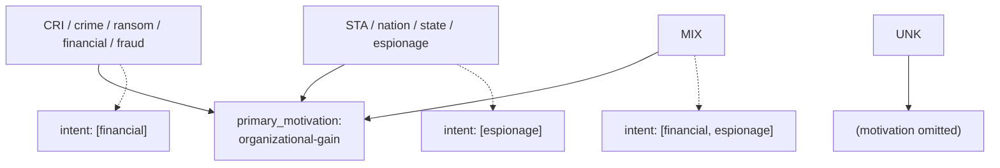
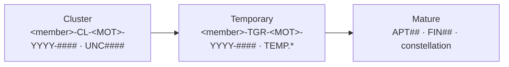

The controlled value sets a Patchwork report draws from. Every value in [1](#1-vocabularies) is reproduced verbatim from its source vocabulary — nothing there is invented, and the counts stated in each section are the authority. Sections [2](#2-the-motivation-model), [3](<#3-attribution-tiers-where-the-crista-code-lives>) and [4](#4-campaign-types) are different in kind: they are Patchwork's own models, built where no source vocabulary exists, and each says so where it starts. Where a table carries a **Use when** column, that column is a short editorial gloss to help you pick between confusable values — it is *not* normative spec text, and neither is the short explanation that opens each section. The values themselves are verbatim; the glosses are ours, and are fair game to correct.

## 1.-Vocabularies

| §                                       | Vocabulary                       | Applies to                                                  | Source              |
| --------------------------------------- | -------------------------------- | ----------------------------------------------------------- | ------------------- |
| [1.1](#11-attack_motivation_ov)        | `attack_motivation_ov`           | `threat-actor.primary_motivation`, `.secondary_motivations` | STIX 2.1            |
| [1.2](#12-attack_resource_level_ov)    | `attack_resource_level_ov`       | `threat-actor.resource_level`                               | STIX 2.1            |
| [1.3](#13-threat-actor-type)           | `threat_actor_type_ov`           | `threat-actor.threat_actor_types`                           | STIX 2.1            |
| [1.4](#14-threat-actor-role)           | `threat_actor_role_ov`           | `threat-actor.roles`                                        | STIX 2.1            |
| [1.5](#15-threat-actor-sophistication) | `threat_actor_sophistication_ov` | `threat-actor.sophistication`                               | STIX 2.1            |
| [1.6](#16-malware_type_ov)             | `malware_type_ov`                | `malware.malware_types`                                     | STIX 2.1            |
| [1.7](#17-malware_capabilities_ov)     | `malware_capabilities_ov`        | `malware.capabilities`                                      | STIX 2.1            |
| [1.8](#18-implementation_language_ov)  | `implementation_language_ov`     | `malware.implementation_languages`                          | STIX 2.1            |
| [1.9](#19-processor_architecture_ov)   | `processor_architecture_ov`      | `malware.architecture_execution_envs`                       | STIX 2.1            |
| [1.10](#110-report_types_ov)           | `report_types_ov`                | `report.report_types`                                       | STIX 2.1 & Mandiant |
| [1.11](#111-indicator_type_ov)         | `indicator_type_ov`              | `indicator.indicator_types`                                 | STIX 2.1            |

**Easily confused.** Four distinctions the vocabulary names do not make on their own:

| These look alike | The difference |
|---|---|
| [1.2](#12-attack_resource_level_ov) vs [1.5](#15-threat-actor-sophistication) | What the actor can **afford** vs the **skill** the attack needs — related in STIX, not independent |
| [1.3](#13-threat-actor-type) vs [1.4](#14-threat-actor-role) | What they **are** vs what they **did on this operation** |
| [1.6](#16-malware_type_ov) vs [1.7](#17-malware_capabilities_ov) | The **label** on the code vs the **behaviour** it shows |
| `x86-32` / `x86-64` in [1.8](#18-implementation_language_ov) and [1.9](#19-processor_architecture_ov) | Written **in** assembly vs built to **run on** that CPU |

> Two of these are **ordinal** — the order is part of the meaning, so they are never alphabetised: [1.2](#12-attack_resource_level_ov) (`individual` → `government`) and [1.5](#15-threat-actor-sophistication) (`none` → `strategic`).

### 1.1-attack_motivation_ov

Why the actor acts. `primary_motivation` carries a single best-fit value and `secondary_motivations` a list of any others. It records intent — not what the actor did, and not how capable they are (that is [1.5](#15-threat-actor-sophistication)).

10 values.

| Value | Use when |
|---|---|
| `accidental` | Harm caused unintentionally, with no hostile intent |
| `coercion` | Acting under threat or pressure from another party |
| `dominance` | Asserting superiority or control over the target |
| `ideology` | Driven by political, religious, environmental or social belief |
| `notoriety` | Seeking prestige, attention or public recognition |
| `organizational-gain` | Advantage over a competing organisation, military included — **and financial**, see §2 |
| `personal-gain` | Improving the individual's own financial position |
| `personal-satisfaction` | Curiosity, thrill-seeking, amusement — a strictly personal goal |
| `revenge` | Retaliation for a perceived wrong |
| `unpredictable` | Acting without identifiable reason or purpose |

> `financial-gain` is **not** a member of `attack-motivation-ov` and is emitted by neither connector. See [2](#2-the-motivation-model) for the full motivation model.

### 1.2-attack_resource_level_ov

The **organisational level** the actor works at, which in turn determines the resources available to them. STIX ties this to sophistication ([1.5](#15-threat-actor-sophistication)): a given resource level implies access to **at least** a corresponding sophistication level, so the two are related rather than independent.

6 values, ordinal ascending — `individual` is the least resourced, `government` is the most:

| Value | Use when |
|---|---|
| `individual` | Acting alone, with the resources of an average person |
| `club` | Loose volunteer group, social ties, little stake in the target |
| `contest` | Short-lived push toward a single goal, then disbands |
| `team` | Formally organised and led, built around one goal |
| `organization` | Company or syndicate scale, multiple geographies, persistent |
| `government` | State resources and jurisdiction; very well resourced |

### 1.3-threat-actor-type

What **kind** of adversary this is — their nature, rather than the part they play on any one operation (that is [1.4](#14-threat-actor-role)).

12 values. `threat-actor` groups and individuals share one set — there is no separate individual vocabulary.

| Value | Use when |
|---|---|
| `activist` | Supporter of a social or political cause; disrupts or damages targets |
| `competitor` | A rival organisation seeking commercial advantage |
| `crime-syndicate` | Large, well-resourced enterprise; large-scale crime for profit |
| `criminal` | Individual committing computer crime, usually for personal gain |
| `hacker` | Motivated by challenge, curiosity or skill — not gain |
| `insider-accidental` | Trusted insider who causes harm unintentionally |
| `insider-disgruntled` | Current or former insider retaliating for perceived wrongs |
| `nation-state` | A state, or an actor operating on a state's behalf |
| `sensationalist` | Exposes sensitive information to embarrass and cause a PR crisis |
| `spy` | Secretly collects sensitive information for use, sale or release |
| `terrorist` | Uses violence or fear for political or ideological ends |
| `unknown` | Not enough information to determine a type |

### 1.4-threat-actor-role

What **part** the actor plays in an operation, as distinct from what kind of actor they are ([1.3](#13-threat-actor-type)). Roles are how a single campaign separates the group that wrote the malware from the group that ran the infrastructure from the sponsor who paid for it. `roles` is a list — one actor can hold several.

7 values.

| Value | Use when |
|---|---|
| `agent` | Executes attacks, for themselves or at another's direction |
| `director` | Commands or directs others; sets the objectives |
| `independent` | Self-directed and unaffiliated — no sponsor |
| `infrastructure-architect` | Designs the attack infrastructure |
| `infrastructure-operator` | Runs and maintains that infrastructure |
| `malware-author` | Authors malware or other malicious tools |
| `sponsor` | Funds or resources the activity |

### 1.5-threat-actor-sophistication

The **skill, knowledge, training or expertise** the actor needs in order to carry out the attack. Distinct from how well resourced they are ([1.2](#12-attack_resource_level_ov)) — but not independent of it: STIX says a given resource level implies at least a corresponding sophistication.

7 values.

Ordinal, ascending — keep this order, do not alphabetise:

| # | Value | Use when |
|---:|---|---|
| 1 | `none` | Runs tools they do not understand at all |
| 2 | `minimal` | Uses well-known, easy-to-find scripts — the script-kiddie |
| 3 | `intermediate` | Proficient with existing frameworks; identifies known vulnerabilities |
| 4 | `advanced` | Develops own tools from publicly known vulnerabilities |
| 5 | `expert` | Unknown malicious code; user and kernel-mode rootkits |
| 6 | `innovator` | Well-funded teams discovering new vulnerabilities, developing exploits |
| 7 | `strategic` | State-scale; influences products during design or manufacture |

### 1.6-malware_type_ov

What the malicious code **is**, classified by primary purpose. `malware_types` is a list — one sample is often several, such as a `dropper` that installs a `backdoor`. This is the label; what the code can actually do is [1.7](#17-malware_capabilities_ov).

22 values:

| Value | Use when |
|---|---|
| `adware` | Software funded by advertising; may also harvest user data |
| `backdoor` | Lets an attacker act on a remote system — files, passwords, commands |
| `bot` | Node in a botnet, taking operator commands |
| `bootkit` | Targets the Master Boot Record of the machine |
| `ddos` | Generates denial-of-service traffic |
| `downloader` | Fetches and runs a further payload from elsewhere |
| `dropper` | Carries an embedded payload and installs it |
| `exploit-kit` | Software toolkit targeting common vulnerabilities |
| `keylogger` | Captures keystrokes |
| `ransomware` | Encrypts a victim's files, demanding ransom for the access codes |
| `remote-access-trojan` | Full interactive remote control of the host |
| `resource-exploitation` | Uses host resources for the operator — cryptomining and similar |
| `rogue-security-software` | Poses as a security product to defraud or infect |
| `rootkit` | Hides its own presence at OS or kernel level |
| `screen-capture` | Captures screen contents |
| `spyware` | Covertly gathers information about the user |
| `trojan` | Presents as legitimate software to get itself run |
| `unknown` | Not enough information to classify the sample |
| `virus` | Self-replicates by infecting existing host files |
| `webshell` | Maintains persistent access to an already compromised web app |
| `wiper` | Destroys data or renders systems unbootable |
| `worm` | Self-propagates across a network without a host file |

### 1.7-malware_capabilities_ov

Any of the **capabilities identified** for the malware instance or family — what it can do, complementing the type label in [1.6](#16-malware_type_ov). These are *not* ATT&CK techniques: those ride on separate `attack-pattern` objects carrying `x_mitre_id` (framework §6.2).

Grouped for scanning. The 37 values are unchanged — the groups are a reading aid, not part of the vocabulary, and are never emitted:

| Group | Values |
|---|---|
| **Anti-analysis** (6) | `anti-debugging` · `anti-disassembly` · `anti-emulation` · `anti-memory-forensics` · `anti-sandbox` · `anti-vm` |
| **Evasion & concealment** (5) | `cleans-traces-of-infection` · `evades-av` · `hides-artifacts` · `hides-executing-code` · `self-modifies` |
| **Command & control** (2) | `communicates-with-c2` · `determines-c2-server` |
| **Capture & theft** (5) | `captures-input-peripherals` · `captures-output-peripherals` · `captures-system-state-data` · `exfiltrates-data` · `steals-authentication-credentials` |
| **Reconnaissance** (2) | `fingerprints-host` · `probes-network-environment` |
| **Impact on data & system** (6) | `compromises-data-availability` · `compromises-data-integrity` · `compromises-system-availability` · `prevents-artifact-access` · `prevents-artifact-deletion` · `violates-system-operational-integrity` |
| **Control & privilege** (4) | `accesses-remote-machines` · `controls-local-machine` · `escalates-privileges` · `installs-other-components` |
| **Persistence & defence degradation** (3) | `persists-after-system-reboot` · `degrades-security-software` · `degrades-system-updates` |
| **Propagation** (2) | `infects-files` · `infects-remote-machines` |
| **Fraud & abuse** (2) | `commits-fraud` · `emails-spam` |

### 1.8-implementation_language_ov

The **programming language(s) used to implement** the malware instance or family. `implementation_languages` is a list — a family with a scripted loader and a compiled payload carries several. `x86-32` and `x86-64` appear here meaning hand-written assembly; the same two strings in [1.9](#19-processor_architecture_ov) mean something different.

21 values:

| Value | Use when |
|---|---|
| `applescript` | macOS automation scripting |
| `bash` | Unix shell scripting |
| `c` | Compiled systems language |
| `c++` | Compiled systems language, object-oriented |
| `c#` | .NET managed language |
| `go` | Compiled; large statically linked cross-platform binaries |
| `java` | JVM bytecode, cross-platform |
| `javascript` | Browser and Node.js scripting |
| `lua` | Lightweight embedded scripting |
| `objective-c` | Legacy native macOS and iOS |
| `perl` | Unix text-processing scripting |
| `php` | Server-side web scripting — common for webshells |
| `powershell` | Windows administration scripting — common for fileless stages |
| `python` | Cross-platform scripting, often packed into an executable |
| `ruby` | General-purpose scripting |
| `scala` | JVM language |
| `swift` | Modern native macOS and iOS |
| `typescript` | Typed JavaScript, compiled to JavaScript |
| `visual-basic` | VB, VBA and VBScript — macro and script malware |
| `x86-32` | 32-bit assembly, hand-written or inline |
| `x86-64` | 64-bit assembly, hand-written or inline |

### 1.9-processor_architecture_ov

The **CPU architecture(s)** the sample is built to execute on, emitted on `architecture_execution_envs`. Cross-compiled families carry several. Note `x86-32` / `x86-64` also appear in [1.8](#18-implementation_language_ov), where they mean the code was *written in* assembly rather than that it *runs on* that CPU.

8 values:

| Value | Use when |
|---|---|
| `alpha` | DEC Alpha — legacy 64-bit RISC |
| `arm` | Mobile, embedded, IoT, and Apple silicon |
| `ia-64` | Intel Itanium — legacy, **not** the same as `x86-64` |
| `mips` | Routers and embedded devices |
| `powerpc` | Legacy Mac, embedded, some network gear |
| `sparc` | Sun and Oracle systems |
| `x86` | 32-bit Intel and AMD |
| `x86-64` | 64-bit Intel and AMD — the common desktop and server target |

### 1.10-report_types_ov

What kind of report this is. It decides which template you start from, and how a receiving member triages what you send them.

27 values, in three tiers:

**STIX 2.1 `report-type-ov` (11):** `attack-pattern` · `campaign` · `identity` · `indicator` · `intrusion-set` · `malware` · `observed-data` · `threat-actor` · `threat-report` · `tool` · `vulnerability`

These classify a report by the kind of object it concerns. Import connectors apply them; nobody hand-writes one.

**Patchwork domain types, authored (13):** `actor-profile` · `country-profile` · `event-coverage` · `executive-perspective` · `industry` · `malware-profile` · `net-assessment` · `news-analysis` · `threat-activity` · `threat-alert` · `trends-forecasting` · `ttp-deep-dive` · `vulnerability-exploitation`

Twelve were inherited with the Mandiant domain set. `net-assessment` was **re-derived**: it is a current type in the live upstream catalogue but was absent from the connector's frozen value set the domain types were originally adopted from, so it had to be recovered rather than inherited. It is not Patchwork's invention.

**Retired, still valid (3):** `ics-security-roundup` · `network-activity` · `patch`

Accepted on imported historical reports, never chosen for new work. Retiring a value from *authoring* is not the same as removing it from the vocabulary — a set that invalidates records it once accepted breaks [9.2](Patchwork-CTI-Framework.md#92-identity-and-merge-rules). [Report-Types](<Report-Types.md#retired--valid-not-authored-3>) gives the reason for each and what to write instead.

> **Choosing between the 13.**
> [Report-Types](Report-Types.md) carries the full picker table — each type's description, benefits, template and worked sample. It is the picker — this section is only the value list, so the two do not drift.

### 1.11-indicator_type_ov

What the indicator **asserts** about the pattern it carries — whether that pattern marks something malicious, benign, anonymising or compromised. This classifies the *claim*; how much you trust it is the separate `confidence` field (framework §7).

7 values.

| Value | Use when |
|---|---|
| `anomalous-activity` | Unexpected or unusual activity that may still be benign |
| `anonymization` | Proxy, VPN, Tor — infrastructure that obscures origin |
| `benign` | Not malicious alone; may be, combined with other activity |
| `compromised` | Assets suspected to be compromised |
| `malicious-activity` | Patterns of suspected malicious objects or activity |
| `attribution` | Ties activity to a particular actor or campaign |
| `unknown` | Not enough information to classify |

## 2.-The-motivation-model

Financially-motivated crime cannot be a distinct `attack-motivation-ov` value — there is no `financial-gain`. The two connectors resolve this **differently**, and we follow Mandiant's:

| Producer | How financial motivation is emitted |
|---|---|
| **GTI connector** | Passes GTI's **raw** string through (`AttackMotivationOV(motivation)` on an open vocab) → `primary_motivation = "Financial"` (non-conformant; a GTI limitation) |
| **Mandiant connector** | Explicit map: `"Financial Theft" → organizational-gain` (also `"Military Advantage"`, `"Political Advantage"`, `"Disruption"` → `organizational-gain`) |
| **Ours** | `organizational-gain` + `intent`, matching Mandiant |

Our mapping — crime vs state is carried in `intent` + the cluster-name code (`CL-CRI-` / `CL-STA-`), **not** in `primary_motivation`:

Result: local `organizational-gain` crime actors sit in the same motivation space as Mandiant-imported FIN groups. (Other spreadsheet inputs still map to valid values: hacktivism → `ideology`, sabotage/disruption → `dominance`, plus `notoriety` / `revenge` / `coercion`.)

> **This table is only half of the `intent` derivation.**
> MOT reaches `financial` and `espionage` and nothing else — it has no class that could produce `sabotage` or `disruption`, which come from the activity side. `MIX` contributes **both** values, which is why `intent` is a list rather than a single string. The full derivation, taking MOT *and* observed activity categories as inputs, is [Patchwork 5.3](Patchwork-CTI-Framework.md#53-intent); the four values are defined there.

## 3.-Attribution-tiers-(where-the-CRI/STA-code-lives)

Patchwork's cluster-name code (which carries the CRI/STA/MIX/UNK distinction) follows a three-tier ladder adapted from the Mandiant and Unit 42 lineages. The member namespace and allocation year are Patchwork additions, not vendor naming rules:

`<MOT>` = `STA` (state) · `CRI` (crime) · `MIX` (state+crime) · `UNK` (unknown). Tier lives in `attribution_tier` (a Patchwork extension property, not `x_`-prefixed — see [Patchwork 9.3](Patchwork-CTI-Framework.md#93-classification-properties)); see [Patchwork 4.1](Patchwork-CTI-Framework.md#41-three-tiers-of-object-linked).

`YYYY` is the code-allocation year, and `####` is a sequence of at least four digits scoped to member, tier, MOT class and allocation year. Full rules and treatment of existing yearless codes are in [Patchwork 4.3](Patchwork-CTI-Framework.md#43-attribution-codes-are-assigned-once-and-never-reused).

## 4.-Campaign-types

Which kind of *belonging together* a campaign asserts. Lives in `campaign_type` (a Patchwork extension property, not `x_`-prefixed — see [Patchwork 9.3](Patchwork-CTI-Framework.md#93-classification-properties)); the concept is localised from Mandiant's campaign taxonomy.

STIX 2.1's `campaign` object has no type property and there is no `campaign-type-ov`, so unlike §1 these values are **ours** — there is no source vocabulary to reproduce.

2 values:

| Value | What it asserts | Use when |
|---|---|---|
| `Individual` | One or more actors cooperating toward a single objective against multiple targets in a relevant time period. A **coordination** claim: one operation, however many hands are on it. | The events are one operation — even if you cannot yet say whose. |
| `Global` | Multiple **unrelated** actors running parallel activity on a shared theme, target or resource. Explicitly **not** a coordination claim; what is asserted is that the convergence is worth tracking. | Unconnected actors have independently converged — the standing example is a scramble onto a freshly disclosed vulnerability. |

**Mandiant mapping.** `Individual` ← "Individual Threat Campaign"; `Global` ← "Global Threat Campaign". The property name already supplies "campaign", so the values drop the suffix.

> **Easily confused: an unattributed `Individual` vs a `Global`.**
> An actor-less "regional wave" is an *unattributed* `Individual` campaign — one operation whose operator is not yet known. `Global` is not a weaker version of that: it says the operators are known to be several *and* known to be unrelated. Unattributed describes what you have not established; `Global` describes what you have. If you are reaching for `Global` because attribution is thin, you want an unattributed `Individual`.

Single-valued — a campaign is one kind or the other; if it reads as both, it is two campaigns. Both types are analyst-authored and never inferred automatically, the `Global` type especially: a shared theme is cheap to detect, and a campaign is not a trend. See [Patchwork 9.4](Patchwork-CTI-Framework.md#94-curation-layer).
