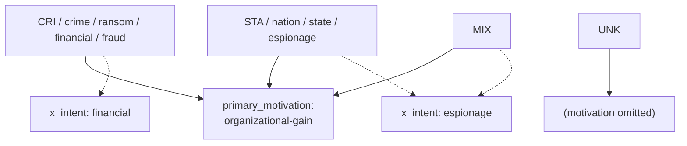
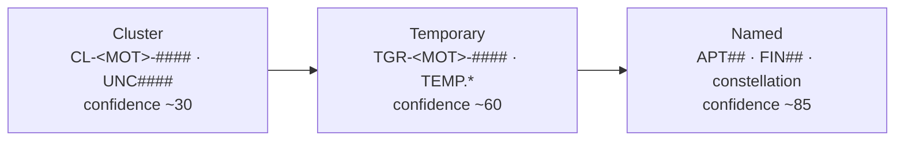

# CTI-Vocabularies-—-GTI-+-Mandiant-Reference

### 1.1-`attack_motivation_ov`-—-10-values-(NO-`financial-gain`)
`accidental` · `coercion` · `dominance` · `ideology` · `notoriety` ·
`organizational-gain` · `personal-gain` · `personal-satisfaction` · `revenge` ·
`unpredictable`

> `financial-gain` is **not** a member of `attack-motivation-ov` and is emitted by
> neither connector. See §4 for the full motivation model.

### 1.2-`attack_resource_level_ov`-—-6
`individual` · `club` · `contest` · `team` · `organization` · `government`

### 1.3-threat-actor-`type`-—-12-(group-&-individual-share-the-set)
`activist` · `competitor` · `crime-syndicate` · `criminal` · `hacker` ·
`insider-accidental` · `insider-disgruntled` · `nation-state` · `sensationalist` ·
`spy` · `terrorist` · `unknown`

### 1.4-threat-actor-`role`-—-7
`agent` · `director` · `independent` · `infrastructure-architect` ·
`infrastructure-operator` · `malware-author` · `sponsor`

### 1.5-threat-actor-`sophistication`-—-7
`none` · `minimal` · `intermediate` · `advanced` · `expert` · `innovator` ·
`strategic`

### 1.6-`malware_type_ov`-—-22
`adware` · `backdoor` · `bot` · `bootkit` · `ddos` · `downloader` · `dropper` ·
`exploit-kit` · `keylogger` · `ransomware` · `remote-access-trojan` ·
`resource-exploitation` · `rogue-security-software` · `rootkit` ·
`screen-capture` · `spyware` · `trojan` · `unknown` · `virus` · `webshell` ·
`wiper` · `worm`

### 1.7-`malware_capabilities_ov`-—-37
`accesses-remote-machines` · `anti-debugging` · `anti-disassembly` ·
`anti-emulation` · `anti-memory-forensics` · `anti-sandbox` · `anti-vm` ·
`captures-input-peripherals` · `captures-output-peripherals` ·
`captures-system-state-data` · `cleans-traces-of-infection` · `commits-fraud` ·
`communicates-with-c2` · `compromises-data-availability` ·
`compromises-data-integrity` · `compromises-system-availability` ·
`controls-local-machine` · `degrades-security-software` · `degrades-system-updates` ·
`determines-c2-server` · `emails-spam` · `escalates-privileges` · `evades-av` ·
`exfiltrates-data` · `fingerprints-host` · `hides-artifacts` ·
`hides-executing-code` · `infects-files` · `infects-remote-machines` ·
`installs-other-components` · `persists-after-system-reboot` ·
`prevents-artifact-access` · `prevents-artifact-deletion` ·
`probes-network-environment` · `self-modifies` ·
`steals-authentication-credentials` · `violates-system-operational-integrity`

### 1.8-`implementation_language_ov`-—-21
`applescript` · `bash` · `c` · `c++` · `c#` · `go` · `java` · `javascript` ·
`lua` · `objective-c` · `perl` · `php` · `powershell` · `python` · `ruby` ·
`scala` · `swift` · `typescript` · `visual-basic` · `x86-32` · `x86-64`

### 1.9-`processor_architecture_ov`-—-8
`alpha` · `arm` · `ia-64` · `mips` · `powerpc` · `sparc` · `x86` · `x86-64`

### 1.10-`report_types_ov`-—-26-(union-of-both-connectors)
**GTI (11 base STIX slugs):** `attack-pattern` · `campaign` · `identity` ·
`indicator` · `intrusion-set` · `malware` · `observed-data` · `threat-actor` ·
`threat-report` · `tool` · `vulnerability`
**Mandiant (15 additional domain slugs):** `actor-profile` · `country-profile` ·
`event-coverage` · `executive-perspective` · `ics-security-roundup` · `industry` ·
`malware-profile` · `network-activity` · `patch` · `ttp-deep-dive` · `threat-alert` ·
`threat-activity` · `trends-forecasting` · `vulnerability-exploitation` ·
`news-analysis`

### 1.11-`indicator_type_ov`-—-7
`anomalous-activity` · `anonymization` · `benign` · `compromised` ·
`malicious-activity` · `attribution` · `unknown`

## 2.-The-motivation-model-(the-load-bearing-decision)

Financially-motivated crime cannot be a distinct `attack-motivation-ov` value —
there is no `financial-gain`. Both connectors resolve this the same way, and we
mirror them:

| Producer | How financial motivation is emitted |
|---|---|
| **GTI connector** | Passes GTI's **raw** string through (`AttackMotivationOV(motivation)` on an open vocab) → `primary_motivation = "Financial"` (non-conformant; a GTI limitation) |
| **Mandiant connector** | Explicit map: `"Financial Theft" → organizational-gain` (also `"Military Advantage"`, `"Political Advantage"`, `"Disruption"` → `organizational-gain`) |
| **Ours** | `organizational-gain` + `x_intent`, matching Mandiant |

Our mapping — crime vs state is carried in `x_intent` + the cluster-name code
(`CL-CRI-` / `CL-STA-`), **not** in `primary_motivation`:

Result: local `organizational-gain` crime actors sit in the same motivation space
as Mandiant-imported FIN groups. (Other spreadsheet inputs still map to valid
values: hacktivism → `ideology`, sabotage/disruption → `dominance`, plus
`notoriety` / `revenge` / `coercion`.)

## 3.-Attribution-tiers-(where-the-CRI/STA-code-lives)

The cluster-name code (which carries the CRI/STA/MIX/UNK distinction) travels the
same three-tier ladder for both Mandiant and Unit 42 lineages:

`<MOT>` = `STA` (state) · `CRI` (crime) · `MIX` (state+crime) · `UNK` (unknown).
Tier lives in `x_attribution_tier`; see
[Patchwork 4.1](Patchwork-CTI-Framework.md#4.1-three-tiers-of-object,-linked).

